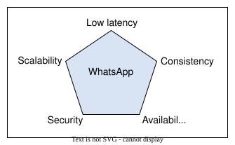

# Requirements_of_WhatsApp’s_Design

Source: https://www.educative.io/courses/grokking-the-system-design-interview/requirements-of-whatsapps-design

---

[Home](https://www.educative.io/)

[Courses](https://www.educative.io/search?tab=courses)

[Grokking Modern System Design Interview](https://www.educative.io/courses/grokking-the-system-design-interview)

# Requirements of WhatsApp’s Design

Define the functional and non-functional requirements for a highly scalable chat service like WhatsApp. Learn how to balance consistency, security, and low-latency needs. Practice resource estimation to calculate the necessary storage, bandwidth, and server capacity for billions of daily messages.

We'll cover the following...

- [Requirements](https://www.educative.io/courses/grokking-the-system-design-interview/requirements-of-whatsapps-design#Requirements)
  - [Functional requirements](https://www.educative.io/courses/grokking-the-system-design-interview/requirements-of-whatsapps-design#Functional-requirements)
  - [Non-functional requirements](https://www.educative.io/courses/grokking-the-system-design-interview/requirements-of-whatsapps-design#Non-functional-requirements)
- [Resource estimation](https://www.educative.io/courses/grokking-the-system-design-interview/requirements-of-whatsapps-design#Resource-estimation)
  - [Storage estimation](https://www.educative.io/courses/grokking-the-system-design-interview/requirements-of-whatsapps-design#Storage-estimation)
  - [Bandwidth estimation](https://www.educative.io/courses/grokking-the-system-design-interview/requirements-of-whatsapps-design#Bandwidth-estimation)
  - [Number of servers estimation](https://www.educative.io/courses/grokking-the-system-design-interview/requirements-of-whatsapps-design#Number-of-servers-estimation)
  - [Try it out](https://www.educative.io/courses/grokking-the-system-design-interview/requirements-of-whatsapps-design#Try-it-out)
- [Building blocks we will use](https://www.educative.io/courses/grokking-the-system-design-interview/requirements-of-whatsapps-design#Building-blocks-we-will-use)

## Requirements[#](https://www.educative.io/courses/grokking-the-system-design-interview/requirements-of-whatsapps-design#Requirements)

Let’s scope the WhatsApp design by identifying the following requirements.

### Functional requirements[#](https://www.educative.io/courses/grokking-the-system-design-interview/requirements-of-whatsapps-design#Functional-requirements)

- **Conversation:** Support one-on-one and group conversations.
- **Acknowledgment:** Provide message delivery status (sent, delivered, and read).
- **Sharing:** Enable sharing of media files, including images, videos, and audio.
- **Chat storage:** Persist messages for offline users until they are successfully delivered.
- **Push notifications:** Notify offline users of new messages when they reconnect.
- **AI-powered message summaries:** Generate a private summary of a chat’s unread messages on request. The feature is optional and respects chat-level privacy settings that limit AI processing.

> **Note:** “Offline” refers to users disconnected from the internet. The system sends push notifications when they reconnect. “Online” users are actively connected and receive real-time messages.

### Non-functional requirements[#](https://www.educative.io/courses/grokking-the-system-design-interview/requirements-of-whatsapps-design#Non-functional-requirements)

- **Low latency:** Deliver messages with minimal delay.
- **Consistency:** Deliver messages in order and ensure chat history is consistent across all user devices.
- **Availability:** Prioritize high availability, though trade-offs may be made to ensure consistency.
- **Security:** Implement end-to-end encryption so only communicating parties can access message content. AI features must not weaken this guarantee, so message content processed for a summary must stay confidential and must not be retained or logged.
- **Scalability:** Support an increasing number of users and daily messages.

The non-functional requirements of the WhatsApp system

## Resource estimation[#](https://www.educative.io/courses/grokking-the-system-design-interview/requirements-of-whatsapps-design#Resource-estimation)

For capacity planning, assume more than 2 billion daily active users (DAUs) who send more than 100 billion messages per day. Estimate the storage, bandwidth, and server capacity required to support this load.

### Storage estimation[#](https://www.educative.io/courses/grokking-the-system-design-interview/requirements-of-whatsapps-design#Storage-estimation)

We assume 100 billion messages per day with an average size of 100 bytes. Servers retain messages for 30 days; if a user does not reconnect within this window, messages are permanently deleted.

100 billion/ day×100 Bytes=10 TB/day100\ \text{billion/ day} \times 100\ \text{Bytes} = 10\ \text{TB/day}100 billion/ day×100 Bytes=10 TB/day

The 30-day storage requirement is:

30×10 TB/day = 300 TB/ month30 \times10\ \text{TB/day = } 300\ \text{TB/ month}30×10 TB/day = 300 TB/ month

Real-world requirements exceed this figure due to media files (larger than 100 Bytes), user information, message metadata (timestamps, IDs), and encryption keys. For simplicity, we will use 300 TB per month as our baseline.

The total storage required by WhatsApp in a month

### Bandwidth estimation[#](https://www.educative.io/courses/grokking-the-system-design-interview/requirements-of-whatsapps-design#Bandwidth-estimation)

Based on a daily storage intake of 10 TB, the required incoming bandwidth is approximately 926 Mb/s.

10 TB/86400 sec≈926 Mb/s10\ \text{TB}/86400 \text{ sec} \approx 926 \text{ Mb/s}10 TB/86400 sec≈926 Mb/s

> **Note:** This estimate ignores media content (images, videos, documents), so the actual bandwidth requirement will be higher.

Outgoing bandwidth must match incoming bandwidth, as every message received by the system is delivered to a recipient.

The total bandwidth required by WhatsApp

## High-Level Estimates

|  |  |
| --- | --- |
| **Type** | **Estimates** |
| Total messages per day | 100 billion |
| Storage required per day | 10 TB |
| Storage for 30 days | 300 TB |
| Incoming data per second | 926 Mb/s |
| Outgoing data per second | 926 Mb/s |

### Number of servers estimation[#](https://www.educative.io/courses/grokking-the-system-design-interview/requirements-of-whatsapps-design#Number-of-servers-estimation)

WhatsApp handles approximately 10 million connections per server. This high density is achieved through extensive performance engineering, which involves optimizing the server kernel, networking libraries, and infrastructure configuration.

> **Note:** General-purpose servers can be optimized for specific tasks by carefully tuning the full software stack.

We estimate the number of servers as follows:

No. of servers=Total connections per dayNo. of connections per server=2 billion10 million=200 servers\text{No. of servers} = \frac{\text{Total connections per day}}{\text{No. of connections per server}} = \frac{2 \text{ billion}}{10 \text{ million}} = 200 \text{ servers}No. of servers=No. of connections per serverTotal connections per day​=10 million2 billion​=200 servers

Based on these estimates, we require 200 chat servers.

Number of chat servers required for WhatsApp

### Try it out[#](https://www.educative.io/courses/grokking-the-system-design-interview/requirements-of-whatsapps-design#Try-it-out)

Analyze how the number of daily messages affects storage and bandwidth requirements by adjusting the values in the table below:

#### 

|  |  |
| --- | --- |
| Number of users per day (in billions) | 2 |
| Number of messages per day (in billions) | 100 |
| Size of each message (in bytes) | 100 |
| Number of connections a server can handle (in millions) | 10 |
| Storage estimation per day (in TB) | f10 |
| Incoming and Outgoing bandwidth (Mb/s) | f926.4 |
| Number of chat servers required | f200 |

## Building blocks we will use[#](https://www.educative.io/courses/grokking-the-system-design-interview/requirements-of-whatsapps-design#Building-blocks-we-will-use)

We will use the following building blocks in our design:

The building blocks required to design WhatsApp

- [**Databases**](https://www.educative.io/courses/grokking-the-system-design-interview/introduction-to-databases)**:** Store user and group metadata.
- [**Blob storage**](https://www.educative.io/courses/grokking-the-system-design-interview/system-design-a-blob-store)**:** Store multimedia content shared in messages.
- [**CDN**](https://www.educative.io/courses/grokking-the-system-design-interview/system-design-the-content-delivery-network-cdn)**:** Deliver frequently accessed multimedia content.
- [**Load balancer**](https://www.educative.io/courses/grokking-the-system-design-interview/introduction-to-load-balancers)**:** Distribute incoming requests across available servers.
- [**Caches**](https://www.educative.io/courses/grokking-the-system-design-interview/system-design-the-distributed-cache)**:** Store frequently accessed data to reduce latency.
- [**Messaging queue**](https://www.educative.io/courses/grokking-the-system-design-interview/system-design-the-distributed-messaging-queue)**:** Temporarily hold messages for offline users.

AI Powered

Saved

1 attempt left

Reset

Design WhatsApp system using the building blocks and components discussed above.

Beyond the mentioned building blocks, additional components contribute to creating a comprehensive design. These include:

- Message service
- Group message service
- Websocket manager
- Mnesia database
- Redis cluster

Provide your solution considering the following details:

- Which entity will process the messages of the two users intending to communicate with each other?
- How are the group messages handled?
- Where are the messages stored when a user is offline?
- Where will the media files be kept for frequent access?
- What protocol(s) is (are) required to transmit messages with low latency?
- How will different services be decoupled?

This is your last attempt.

System Design: WhatsApp

High-Level Design of WhatsApp

Ask

[Requirements](https://www.educative.io/courses/grokking-the-system-design-interview/requirements-of-whatsapps-design#Requirements)

[Functional requirements](https://www.educative.io/courses/grokking-the-system-design-interview/requirements-of-whatsapps-design#Functional-requirements)

[Non-functional requirements](https://www.educative.io/courses/grokking-the-system-design-interview/requirements-of-whatsapps-design#Non-functional-requirements)

[Resource estimation](https://www.educative.io/courses/grokking-the-system-design-interview/requirements-of-whatsapps-design#Resource-estimation)

[Storage estimation](https://www.educative.io/courses/grokking-the-system-design-interview/requirements-of-whatsapps-design#Storage-estimation)

[Bandwidth estimation](https://www.educative.io/courses/grokking-the-system-design-interview/requirements-of-whatsapps-design#Bandwidth-estimation)

[Number of servers estimation](https://www.educative.io/courses/grokking-the-system-design-interview/requirements-of-whatsapps-design#Number-of-servers-estimation)

[Try it out](https://www.educative.io/courses/grokking-the-system-design-interview/requirements-of-whatsapps-design#Try-it-out)

[Building blocks we will use](https://www.educative.io/courses/grokking-the-system-design-interview/requirements-of-whatsapps-design#Building-blocks-we-will-use)