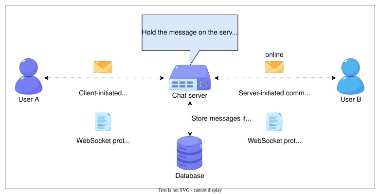
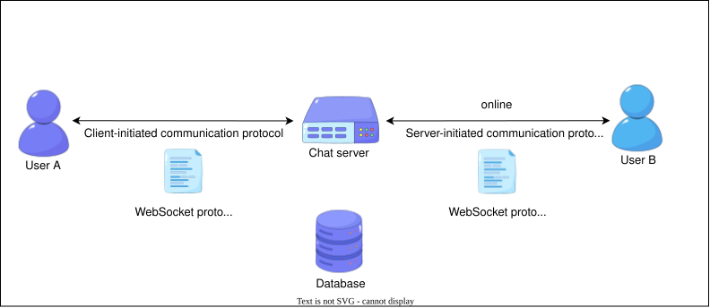
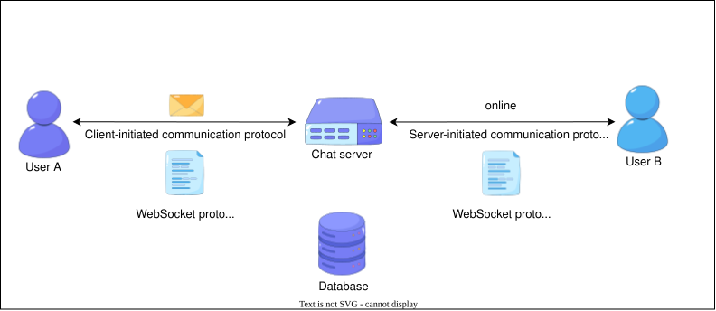
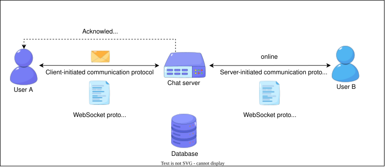
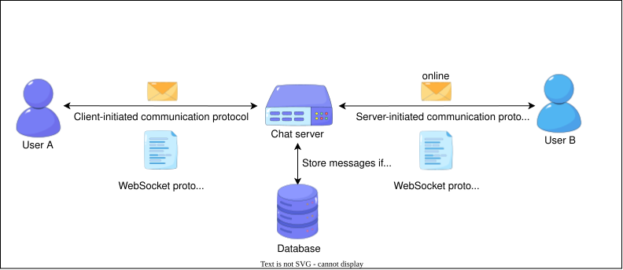
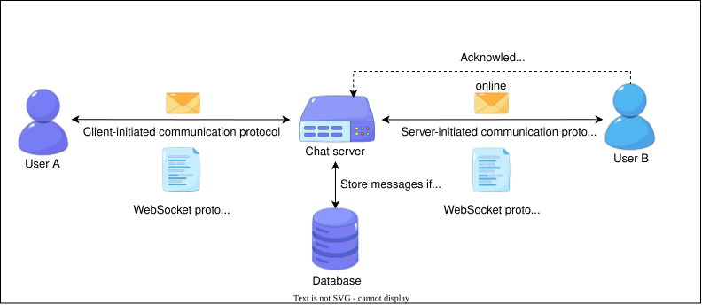

# High-Level_Design_of_WhatsApp

Source: https://www.educative.io/courses/grokking-the-system-design-interview/high-level-design-of-whatsapp

---

[Home](https://www.educative.io/)

[Courses](https://www.educative.io/search?tab=courses)

[Grokking Modern System Design Interview](https://www.educative.io/courses/grokking-the-system-design-interview)

# High-Level Design of WhatsApp

Discover the high-level design of the WhatsApp system. Analyze the core architecture and communication flow between clients and the chat server for reliable message delivery. Review the essential API structure for efficiently managing real-time text and media transfers.

We'll cover the following...

- [High-level design](https://www.educative.io/courses/grokking-the-system-design-interview/high-level-design-of-whatsapp#High-level-design)
- [API design](https://www.educative.io/courses/grokking-the-system-design-interview/high-level-design-of-whatsapp#API-design)
  - [Send message](https://www.educative.io/courses/grokking-the-system-design-interview/high-level-design-of-whatsapp#Send-message)
  - [Get message](https://www.educative.io/courses/grokking-the-system-design-interview/high-level-design-of-whatsapp#Get-message)
  - [Upload media or a document file](https://www.educative.io/courses/grokking-the-system-design-interview/high-level-design-of-whatsapp#Upload-media-or-a-document-file)
  - [Download a document or media file](https://www.educative.io/courses/grokking-the-system-design-interview/high-level-design-of-whatsapp#Download-a-document-or-media-file)

## High-level design[#](https://www.educative.io/courses/grokking-the-system-design-interview/high-level-design-of-whatsapp#High-level-design)

At a high level, the system uses a chat server to handle message exchange. Users connect to the server to send and receive messages. The server routes messages to the intended recipient and stores the messages in a database for durability and offline retrieval.

The high-level design of WhatsApp messenger

The communication flow between clients proceeds as follows:

1. User A and User B establish connections with the chat server.
2. User A sends a message to the chat server.
3. The chat server acknowledges receipt to User A.
4. The chat server attempts to deliver the message to User B and stores it in the database to ensure delivery if the receiver is offline.
5. User B sends an acknowledgment to the chat server.
6. The chat server notifies User A that the message was successfully delivered.
7. When User B reads the message, the application notifies the chat server.
8. The chat server notifies User A that the message has been read.

This process is illustrated below:

1 / 8

User A and user B create connections with the chat server

1 / 8

User A sends a message to the chat server

1 / 8

Upon receiving the message, the chat server acknowledges back to user A

1 / 8

The chat server sends the message to user B and stores the message in the database

1 / 8

User B sends an acknowledgment to the chat server

## API design[#](https://www.educative.io/courses/grokking-the-system-design-interview/high-level-design-of-whatsapp#API-design)

WhatsApp exposes APIs for various features, including:

- Sending messages
- Retrieving messages
- Uploading media or documents
- Downloading media or documents
- Sending a location
- Sending a contact
- Creating a status

We will focus on the APIs for the core messaging features.

### Send message[#](https://www.educative.io/courses/grokking-the-system-design-interview/high-level-design-of-whatsapp#Send-message)

The `sendMessage` API definition is as follows:

Ace Editor

1

sendMessage(message\_ID, sender\_ID, receiver\_ID, type, text=none, media\_object=none, document=none)

הההההההההההההההההההההההההההההההההההההההההההההההההההההההההההההההההההההההההההההההההההההההההההההההההההההההההההההההההההההההההההההההההההההההההההההההההההההההההההההההההההההההההההההההההההההההההההההההההההההההההההההההההההההההההההההההההההההההההההההההההההההההההההההההההההההההההההההההההההההההההההההההההההההההההההההההההההההההההההההההההההההההההההההההההההההההההההההההההההההההההההההההההההההההההההההההההההההההההההההההההההההההההההההההההההההההההההההההההההההההההההההההההההההההההההההההההההההההההההההההההההההההההההההההההההההההההההההההה

XXXXXXXXXXXXXXXXXXXXXXXXXXXXXXXXXXXXXXXXXXXXXXXXXXXXXXXXXXXXXXXXXXXXXXXXXXXXXXXXXXXXXXXXXXXXXXXXXXXXXXXXXXXXXXXXXXXXXXXXXXXXXXXXXXXXXXXXXXXXXXXXXXXXXXXXXXXXXXXXXXXXXXXXXXXXXXXXXXXXXXXXXXXXXXXXXXXXXXXXXXXXXXXXXXXXXXXXXXXXXXXXXXXXXXXXXXXXXXXXXXXXXXXXXXXXXXXXXXXXXXXXXXXXXXXXXXXXXXXXXXXXXXXXXXXXXXXXXXXXXXXXXXXXXXXXXXXXXXXXXXXXXXXXXXXXXXXXXXXXXXXXXXXXXXXXXXXXXXXXXXXXXXXXXXXXXXXXXXXXXXXXXXXXXXXXXXXXXXXXXXXXXXXXXXXXXXXXXXXXXXXXXXXXXXXXXXXXXXXXXXXXXXXXXXXXXXXXXXXXXXXXXXXXXXXXXXXXXXXXXXXXXXXXXXXXXXXXXXXXXXXXXXXXXXXX

This API sends a `text` message via a POST request to the `/messages` endpoint. User IDs are typically phone numbers. The request parameters are detailed below:

|  |  |
| --- | --- |
| **Parameter** | **Description** |
| `message_ID` | This is a unique identifier of the message sent. |
| `sender_ID` | This is a unique identifier of the user who sends the message. |
| `receiver_ID` | This is a unique identifier of the user who receives the message. |
| `type` | The default message `type` is text. This represents whether the sender sends a media file or a document. |
| `text` | This field contains the text that has to be sent as a message. |
| `media_object` | This parameter is defined based on the type parameter. It represents the media file to be sent. |
| `document` | This represents the document file to be sent. |

### Get message[#](https://www.educative.io/courses/grokking-the-system-design-interview/high-level-design-of-whatsapp#Get-message)

The `getMessage` API definition is as follows:

Ace Editor

1

getMessage(user\_Id)

הההההההההההההההההההההההההההההההההההההההההההההההההההההההההההההההההההההההההההההההההההההההההההההההההההההההההההההההההההההההההההההההההההההההההההההההההההההההההההההההההההההההההההההההההההההההההההההההההההההההההההההההההההההההההההההההההההההההההההההההההההההההההההההההההההההההההההההההההההההההההההההההההההההההההההההההההההההההההההההההההההההההההההההההההההההההההההההההההההההההההההההההההההההההההההההההההההההההההההההההההההההההההההההההההההההההההההההההההההההההההההההההההההההההההההההההההההההההההההההההההההההההההההההההההההההההההההההההה

XXXXXXXXXXXXXXXXXXXXXXXXXXXXXXXXXXXXXXXXXXXXXXXXXXXXXXXXXXXXXXXXXXXXXXXXXXXXXXXXXXXXXXXXXXXXXXXXXXXXXXXXXXXXXXXXXXXXXXXXXXXXXXXXXXXXXXXXXXXXXXXXXXXXXXXXXXXXXXXXXXXXXXXXXXXXXXXXXXXXXXXXXXXXXXXXXXXXXXXXXXXXXXXXXXXXXXXXXXXXXXXXXXXXXXXXXXXXXXXXXXXXXXXXXXXXXXXXXXXXXXXXXXXXXXXXXXXXXXXXXXXXXXXXXXXXXXXXXXXXXXXXXXXXXXXXXXXXXXXXXXXXXXXXXXXXXXXXXXXXXXXXXXXXXXXXXXXXXXXXXXXXXXXXXXXXXXXXXXXXXXXXXXXXXXXXXXXXXXXXXXXXXXXXXXXXXXXXXXXXXXXXXXXXXXXXXXXXXXXXXXXXXXXXXXXXXXXXXXXXXXXXXXXXXXXXXXXXXXXXXXXXXXXXXXXXXXXXXXXXXXXXXXXXXXXX

This API retrieves all unread messages when a user comes online after a period of inactivity.

|  |  |
| --- | --- |
| **Parameter** | **Description** |
| `user_Id` | This is a unique identifier representing the user who has to fetch all unread messages. |

### Upload media or a document file[#](https://www.educative.io/courses/grokking-the-system-design-interview/high-level-design-of-whatsapp#Upload-media-or-a-document-file)

The `uploadFile` API definition is as follows:

Ace Editor

1

uploadFile(file\_type, file)

הההההההההההההההההההההההההההההההההההההההההההההההההההההההההההההההההההההההההההההההההההההההההההההההההההההההההההההההההההההההההההההההההההההההההההההההההההההההההההההההההההההההההההההההההההההההההההההההההההההההההההההההההההההההההההההההההההההההההההההההההההההההההההההההההההההההההההההההההההההההההההההההההההההההההההההההההההההההההההההההההההההההההההההההההההההההההההההההההההההההההההההההההההההההההההההההההההההההההההההההההההההההההההההההההההההההההההההההההההההההההההההההההההההההההההההההההההההההההההההההההההההההההההההההההההההההההההההההה

XXXXXXXXXXXXXXXXXXXXXXXXXXXXXXXXXXXXXXXXXXXXXXXXXXXXXXXXXXXXXXXXXXXXXXXXXXXXXXXXXXXXXXXXXXXXXXXXXXXXXXXXXXXXXXXXXXXXXXXXXXXXXXXXXXXXXXXXXXXXXXXXXXXXXXXXXXXXXXXXXXXXXXXXXXXXXXXXXXXXXXXXXXXXXXXXXXXXXXXXXXXXXXXXXXXXXXXXXXXXXXXXXXXXXXXXXXXXXXXXXXXXXXXXXXXXXXXXXXXXXXXXXXXXXXXXXXXXXXXXXXXXXXXXXXXXXXXXXXXXXXXXXXXXXXXXXXXXXXXXXXXXXXXXXXXXXXXXXXXXXXXXXXXXXXXXXXXXXXXXXXXXXXXXXXXXXXXXXXXXXXXXXXXXXXXXXXXXXXXXXXXXXXXXXXXXXXXXXXXXXXXXXXXXXXXXXXXXXXXXXXXXXXXXXXXXXXXXXXXXXXXXXXXXXXXXXXXXXXXXXXXXXXXXXXXXXXXXXXXXXXXXXXXXXXXX

This API uploads media via a POST request to the `/v1/media` endpoint. A successful upload returns a media ID, which is then forwarded to the receiver. The size limit is 16 MB for media and 100 MB for documents.

|  |  |
| --- | --- |
| **Parameter** | **Description** |
| `file_type` | This represents the type of file uploaded via the API call. |
| `file` | This contains the file being uploaded via the API call. |

### Download a document or media file[#](https://www.educative.io/courses/grokking-the-system-design-interview/high-level-design-of-whatsapp#Download-a-document-or-media-file)

The `downloadFile` API definition is as follows:

Ace Editor

1

downloadFile(user\_id, file\_id)

הההההההההההההההההההההההההההההההההההההההההההההההההההההההההההההההההההההההההההההההההההההההההההההההההההההההההההההההההההההההההההההההההההההההההההההההההההההההההההההההההההההההההההההההההההההההההההההההההההההההההההההההההההההההההההההההההההההההההההההההההההההההההההההההההההההההההההההההההההההההההההההההההההההההההההההההההההההההההההההההההההההההההההההההההההההההההההההההההההההההההההההההההההההההההההההההההההההההההההההההההההההההההההההההההההההההההההההההההההההההההההההההההההההההההההההההההההההההההההההההההההההההההההההההההההההההההההההההה

XXXXXXXXXXXXXXXXXXXXXXXXXXXXXXXXXXXXXXXXXXXXXXXXXXXXXXXXXXXXXXXXXXXXXXXXXXXXXXXXXXXXXXXXXXXXXXXXXXXXXXXXXXXXXXXXXXXXXXXXXXXXXXXXXXXXXXXXXXXXXXXXXXXXXXXXXXXXXXXXXXXXXXXXXXXXXXXXXXXXXXXXXXXXXXXXXXXXXXXXXXXXXXXXXXXXXXXXXXXXXXXXXXXXXXXXXXXXXXXXXXXXXXXXXXXXXXXXXXXXXXXXXXXXXXXXXXXXXXXXXXXXXXXXXXXXXXXXXXXXXXXXXXXXXXXXXXXXXXXXXXXXXXXXXXXXXXXXXXXXXXXXXXXXXXXXXXXXXXXXXXXXXXXXXXXXXXXXXXXXXXXXXXXXXXXXXXXXXXXXXXXXXXXXXXXXXXXXXXXXXXXXXXXXXXXXXXXXXXXXXXXXXXXXXXXXXXXXXXXXXXXXXXXXXXXXXXXXXXXXXXXXXXXXXXXXXXXXXXXXXXXXXXXXXXXX

This API retrieves documents or media using the file ID. The parameters are listed below:

|  |  |
| --- | --- |
| **Parameter** | **Description** |
| `user_id` | This is a unique identifier of the user who will download a file. |
| `file_id` | This is a unique identifier of a file. It’s generated while uploading a file via `uploadFile()` API call. The `downloadFile()` API call downloads the media file through this identifier. The client can find the `file_id` by providing the file name to the server. That API call is not shown here. |

AI Powered

Saved

7 attempts left

Reset

Scaling Messaging Systems

Hi, I’m Ed. In this session, we will focus on some questions related to the messaging system. Do you want to be mentored or evaluated?

You have 7 attempts to answer.

In the next lesson, we’ll focus on the detailed design of the WhatsApp system.

Requirements of WhatsApp’s Design

Detailed Design of WhatsApp

Ask

[High-level design](https://www.educative.io/courses/grokking-the-system-design-interview/high-level-design-of-whatsapp#High-level-design)

[API design](https://www.educative.io/courses/grokking-the-system-design-interview/high-level-design-of-whatsapp#API-design)

[Send message](https://www.educative.io/courses/grokking-the-system-design-interview/high-level-design-of-whatsapp#Send-message)

[Get message](https://www.educative.io/courses/grokking-the-system-design-interview/high-level-design-of-whatsapp#Get-message)

[Upload media or a document file](https://www.educative.io/courses/grokking-the-system-design-interview/high-level-design-of-whatsapp#Upload-media-or-a-document-file)

[Download a document or media file](https://www.educative.io/courses/grokking-the-system-design-interview/high-level-design-of-whatsapp#Download-a-document-or-media-file)