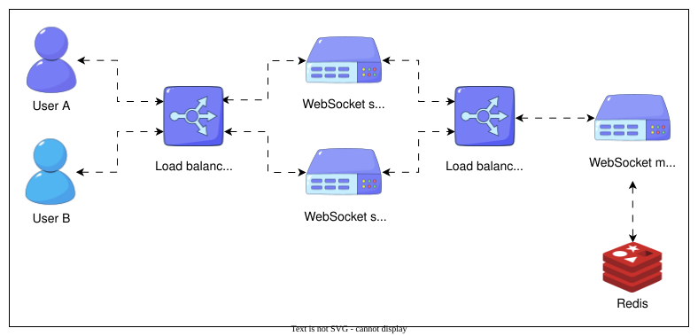

# Detailed_Design_of_WhatsApp

Source: https://www.educative.io/courses/grokking-the-system-design-interview/detailed-design-of-whatsapp

---

[Home](https://www.educative.io/)

[Courses](https://www.educative.io/search?tab=courses)

[Grokking Modern System Design Interview](https://www.educative.io/courses/grokking-the-system-design-interview)

# Detailed Design of WhatsApp

Explore the detailed System Design of WhatsApp by tracing the flow of messages and media files. Learn how WebSocket servers scale connections and how services like Message Service and Asset Service use Mnesia, Redis, and Kafka to ensure reliable, low-latency delivery for individual and group chats.

We'll cover the following...

- [Detailed design](https://www.educative.io/courses/grokking-the-system-design-interview/detailed-design-of-whatsapp#Detailed-design)
  - [Connection with a WebSocket server](https://www.educative.io/courses/grokking-the-system-design-interview/detailed-design-of-whatsapp#Connection-with-a-WebSocket-server)
  - [Send or receive messages](https://www.educative.io/courses/grokking-the-system-design-interview/detailed-design-of-whatsapp#Send-or-receive-messages)
  - [Send or receive media files](https://www.educative.io/courses/grokking-the-system-design-interview/detailed-design-of-whatsapp#Send-or-receive-media-files)
  - [Support for group messages](https://www.educative.io/courses/grokking-the-system-design-interview/detailed-design-of-whatsapp#Support-for-group-messages)
  - [AI-powered private message summaries](https://www.educative.io/courses/grokking-the-system-design-interview/detailed-design-of-whatsapp#AI-powered-private-message-summaries)
- [Put everything together](https://www.educative.io/courses/grokking-the-system-design-interview/detailed-design-of-whatsapp#Put-everything-together)

## Detailed design[#](https://www.educative.io/courses/grokking-the-system-design-interview/detailed-design-of-whatsapp#Detailed-design)

The high-level design leaves several key questions unanswered:

- How is a communication channel created between clients and servers?
- How can the design scale to support billions of users?
- How is user data stored?
- How is the receiver identified for message delivery?

Let’s explore each component in detail, starting with how users connect to chat servers.

### Connection with a WebSocket server[#](https://www.educative.io/courses/grokking-the-system-design-interview/detailed-design-of-whatsapp#Connection-with-a-WebSocket-server)

Each active device establishes a WebSocket connection to the messaging infrastructure. The **WebSocket servers** maintain persistent connections with online users. To support billions of users, connections are distributed across a cluster of WebSocket servers. Each server maintains a session for every active connection. A WebSocket manager maintains the mapping between users, active connections, and servers. This mapping is stored in a Redis cluster.

Two users are connected via WebSocket handlers

1.

Why is WebSocket preferred over HTTP(S) protocol for client-server communication?

Show Answer

Did you find this helpful?

### Send or receive messages[#](https://www.educative.io/courses/grokking-the-system-design-interview/detailed-design-of-whatsapp#Send-or-receive-messages)

The WebSocket manager maintains a mapping between each active user and the server connection handling that user. When a user reconnects to a different WebSocket server, the mapping is updated in the data store.

The WebSocket server communicates with the **Message service**, which manages message storage using a Mnesia database cluster. The Message service acts as an interface for other services to store and retrieve messages. It deletes messages after a configurable period and provides APIs to filter messages by user ID or message ID.

WebSocket communicates with message service on top of Mnesia database cluster

Now, let’s assume that user A wants to send a message to user B. As shown in the above figure, both users are connected to different WebSocket servers. The system performs the following steps to send messages from user A to user B:

1. User A sends the message to their connected WebSocket server.
2. User A’s server queries the WebSocket manager to locate User B’s server. If user B is online, the manager returns the connection details.
3. Simultaneously, the message is sent to the message service and stored in the Mnesia database for FIFO processing. Once delivered, the message is deleted from the database.
4. User A’s server forwards the message to user B’s server, establishing communication.
5. If user B is offline, the message remains in the Mnesia database. When user B comes online, the system delivers pending messages via push notifications. Undelivered messages are permanently deleted after 30 days.

Both the sender and receiver rely on the WebSocket manager to locate each other’s WebSocket server. During an ongoing conversation between two users, this can result in frequent lookups to the WebSocket manager. To reduce latency and avoid repeated lookups, each WebSocket server caches the following metadata:

- If both users are connected to the same server, the call to the WebSocket manager is avoided.
- It caches information of recent conversations about which user is connected to which WebSocket server.

1.

The data in the cache will become outdated if a user gets disconnected and connects to another server. Keeping this in mind, how long should a WebSocket server cache information?

Show Answer

Did you find this helpful?

### Send or receive media files[#](https://www.educative.io/courses/grokking-the-system-design-interview/detailed-design-of-whatsapp#Send-or-receive-media-files)

While WebSocket servers handle text, they are too lightweight for heavy media payloads. The **asset service** handles sending and receiving media files.

The media transfer process consists of the following steps:

1. The device compresses and encrypts the media file.
2. The file is sent to the asset service and stored in blob storage. The service assigns a unique ID and returns it to the sender. It also hashes files to prevent duplication; if the content already exists, the service returns the existing ID.
3. The asset service sends the media ID to the receiver via the message service. The receiver uses this ID to download the content.
4. If specific content receives high traffic, the asset service loads it onto a CDN.

The following figure demonstrates the components involved in sharing media files:

Sending media files via the asset service

### Support for group messages[#](https://www.educative.io/courses/grokking-the-system-design-interview/detailed-design-of-whatsapp#Support-for-group-messages)

WebSocket servers track active users, not groups. Since group members may have mixed online statuses, the system uses three components to deliver group messages:

- Group message handler
- Group service
- Kafka

Suppose user A sends a message to `Group/A`. The flow is as follows:

1. User A sends the message to the message service via their WebSocket server.
2. The message service publishes the message and group details to Kafka. Here, the group acts as a topic, with senders as producers and receivers as consumers.
3. The **group service** manages group metadata (members, ID, status, icon) using a MySQL cluster with geographically distributed replicas. A Redis cache reduces latency for frequent lookups.
4. The group message handler retrieves `Group/A` member data from the group service.
5. The handler delivers the message to each member following the standard WebSocket delivery process.

Components responsible for sending group messages

### AI-powered private message summaries[#](https://www.educative.io/courses/grokking-the-system-design-interview/detailed-design-of-whatsapp#AI-powered-private-message-summaries)

In a busy group chat, users can return to hundreds of unread messages. WhatsApp offers [Private Message Summaries](https://blog.whatsapp.com/catch-up-on-conversations-with-private-message-summaries), which condense unread messages into a short summary on request. This creates a design tension: with end-to-end encryption, WhatsApp’s servers cannot read messages, yet summarizing them requires a language model that is usually too large to run on a phone.

**Execution options:** WhatsApp documents two execution models. [Message translation](https://blog.whatsapp.com/introducing-message-translations) runs **on the device**, so content never leaves the phone, but the model must be small enough for the phone’s memory and battery. Summaries use [private processing](https://engineering.fb.com/2025/04/29/security/whatsapp-private-processing-ai-tools/), which runs a larger model on servers inside a protected environment designed so that neither WhatsApp nor Meta can access the messages being processed. Local inference keeps the trust boundary simple; confidential remote inference supports heavier models but requires mechanisms to verify that the server environment is trustworthy.

**Request flow:** The process starts on the device, which already holds the decrypted messages:

1. The user requests a summary of a chat.
2. The client checks that the feature is turned on and that the chat’s Advanced Chat Privacy setting allows AI features.
3. The client selects only the unread messages needed as context.
4. It sends them over an encrypted channel to the protected inference environment, which generates the summary.
5. The summary returns only to the requesting user. Other chat members cannot see the summary or that one was requested.

**Data retention:** Inside the protected environment, requests are processed without keeping message content afterward. Ordinary server logs, caches, and analytics pipelines must never receive message text, because any copy outside the protected boundary would break the confidentiality that end-to-end encryption provides.

**Failure isolation:** Summaries run on a separate path from message delivery. If the inference service is slow or unavailable, messages still send and arrive normally, and the user simply does not get a summary.

The following diagram shows how the summary path stays separate from message delivery.

Summaries run in a protected environment, separate from message delivery

**Note:** End-to-end encryption does not mean every AI feature must run on the device. It means message content must never be readable by the service operator, wherever processing happens.

## Put everything together[#](https://www.educative.io/courses/grokking-the-system-design-interview/detailed-design-of-whatsapp#Put-everything-together)

We have designed the core features of WhatsApp, including connection management, text and media messaging, group chat, encryption, and private message summaries. The final architecture is shown below. The dashed purple box shows Private Processing, which handles summary requests outside the normal message path.

The detailed WhatsApp design

In the next lesson, we’ll evaluate our design and look into the non-functional requirements.

High-Level Design of WhatsApp

Evaluation of WhatsApp’s Design

Ask

[Detailed design](https://www.educative.io/courses/grokking-the-system-design-interview/detailed-design-of-whatsapp#Detailed-design)

[Connection with a WebSocket server](https://www.educative.io/courses/grokking-the-system-design-interview/detailed-design-of-whatsapp#Connection-with-a-WebSocket-server)

[Send or receive messages](https://www.educative.io/courses/grokking-the-system-design-interview/detailed-design-of-whatsapp#Send-or-receive-messages)

[Send or receive media files](https://www.educative.io/courses/grokking-the-system-design-interview/detailed-design-of-whatsapp#Send-or-receive-media-files)

[Support for group messages](https://www.educative.io/courses/grokking-the-system-design-interview/detailed-design-of-whatsapp#Support-for-group-messages)

[AI-powered private message summaries](https://www.educative.io/courses/grokking-the-system-design-interview/detailed-design-of-whatsapp#AI-powered-private-message-summaries)

[Put everything together](https://www.educative.io/courses/grokking-the-system-design-interview/detailed-design-of-whatsapp#Put-everything-together)