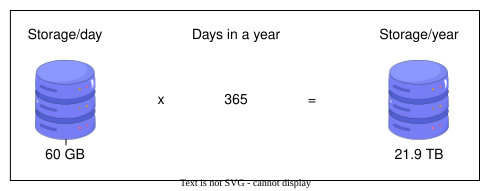

# Requirements_of_the_Typeahead_Suggestion_System’s_Design

Source: https://www.educative.io/courses/grokking-the-system-design-interview/requirements-of-the-typeahead-suggestion-systems-design

---

[Home](https://www.educative.io/)

[Courses](https://www.educative.io/search?tab=courses)

[Grokking Modern System Design Interview](https://www.educative.io/courses/grokking-the-system-design-interview)

# Requirements of the Typeahead Suggestion System’s Design

Explore the initial phase of System Design by defining the functional and non-functional requirements for a Typeahead Suggestion System. Calculate precise resource estimations for storage, bandwidth, and servers, ensuring the design meets strict low-latency and scalability constraints.

We'll cover the following...

- [Requirements](https://www.educative.io/courses/grokking-the-system-design-interview/requirements-of-the-typeahead-suggestion-systems-design#Requirements)
  - [Functional requirements](https://www.educative.io/courses/grokking-the-system-design-interview/requirements-of-the-typeahead-suggestion-systems-design#Functional-requirements)
  - [Non-functional requirements](https://www.educative.io/courses/grokking-the-system-design-interview/requirements-of-the-typeahead-suggestion-systems-design#Non-functional-requirements)
- [Resource estimation](https://www.educative.io/courses/grokking-the-system-design-interview/requirements-of-the-typeahead-suggestion-systems-design#Resource-estimation)
  - [Storage estimation](https://www.educative.io/courses/grokking-the-system-design-interview/requirements-of-the-typeahead-suggestion-systems-design#Storage-estimation)
  - [Bandwidth estimation](https://www.educative.io/courses/grokking-the-system-design-interview/requirements-of-the-typeahead-suggestion-systems-design#Bandwidth-estimation)
  - [Number of servers estimation](https://www.educative.io/courses/grokking-the-system-design-interview/requirements-of-the-typeahead-suggestion-systems-design#Number-of-servers-estimation)
- [Building blocks](https://www.educative.io/courses/grokking-the-system-design-interview/requirements-of-the-typeahead-suggestion-systems-design#Building-blocks)

## Requirements[#](https://www.educative.io/courses/grokking-the-system-design-interview/requirements-of-the-typeahead-suggestion-systems-design#Requirements)

We will design a typeahead suggestion system that meets the following functional and non-functional requirements.

### Functional requirements[#](https://www.educative.io/courses/grokking-the-system-design-interview/requirements-of-the-typeahead-suggestion-systems-design#Functional-requirements)

The system suggests the top NNN frequent and relevant terms based on the user’s input. Suggestions can be ranked using context, such as the user's recent searches, and low-confidence suggestions are hidden rather than shown.

### Non-functional requirements[#](https://www.educative.io/courses/grokking-the-system-design-interview/requirements-of-the-typeahead-suggestion-systems-design#Non-functional-requirements)

- **Low latency:** The system must provide suggestions in real time, with latency under 200 ms. Since the average time between keystrokes is 160 ms, the system must respond quickly to remain useful and prevent stale suggestions.
- **Fault tolerance:** The system must provide suggestions even if individual components fail. If the ranking model is unavailable, the system falls back to the most frequent prefix completions.
- **Scalability:** The system must support an increasing number of users and queries over time.

## Resource estimation[#](https://www.educative.io/courses/grokking-the-system-design-interview/requirements-of-the-typeahead-suggestion-systems-design#Resource-estimation)

Typeahead improves the search experience by suggesting query completions while the user types. Design for a workload comparable to Google Search scale. [Google handles more than 5 trillion searches per year](https://searchengineland.com/google-5-trillion-searches-per-year-452928), roughly 14 billion per day. This scale requires careful capacity planning and distributed infrastructure. To keep the arithmetic simple, the estimates below use a working assumption of 3.5 billion queries per day; the same method scales linearly to the full figure. Estimate storage and bandwidth requirements for the proposed system.

### Storage estimation[#](https://www.educative.io/courses/grokking-the-system-design-interview/requirements-of-the-typeahead-suggestion-systems-design#Storage-estimation)

Assuming that out of the 3.5 billion queries per day, two billion queries are unique and need to be stored. Let’s also assume that each query consists of 15 characters on average, and each character takes 2 Bytes of storage. According to this formulation, we would require the following: 2 billion×15×2=60 GB2 \text{ billion} \times 15 \times 2 = 60 \text{ GB}2 billion×15×2=60 GB to store all the queries made in a day.

Storage required per year: 60 GB/day×365=21.9 TB/year60\ \text{GB/day} \times 365 = 21.9\ \text{TB/year}60 GB/day×365=21.9 TB/year

Storage requirements for the typeahead suggestion system

### Bandwidth estimation[#](https://www.educative.io/courses/grokking-the-system-design-interview/requirements-of-the-typeahead-suggestion-systems-design#Bandwidth-estimation)

With 3.5 billion daily queries averaging 15 characters, we calculate the read requests:

15×3.5 billion = 52.5 billion15 \times 3.5 \text{ billion = 52.5 billion} 15×3.5 billion = 52.5 billion characters per day.

Total read requests per second (86,400 seconds/day): 52.5 B/86400≈0.607 M52.5\text{ B}/86400 \approx 0.607 \text{ M}52.5 B/86400≈0.607 M characters/sec.

Since each character requires 2 Bytes, the incoming bandwidth is:

0.607 million×2×8=9.7 Mb/sec0.607\ \text{million} \times 2 \times 8 = 9.7\ \text{Mb/sec}0.607 million×2×8=9.7 Mb/sec

9.7 Mb/sec9.7\text{ Mb/sec}9.7 Mb/sec is the incoming bandwidth. The system suggests the top ten queries (roughly the same length as the input) for each character typed. Therefore, the outgoing bandwidth requirement is:

10×9.7 Mb/sec=97 Mb/sec10 \times 9.7\ \text{Mb/sec} = 97\ \text{Mb/sec}
10×9.7 Mb/sec=97 Mb/sec

The total bandwidth required by the typeahead suggestion system

### Number of servers estimation[#](https://www.educative.io/courses/grokking-the-system-design-interview/requirements-of-the-typeahead-suggestion-systems-design#Number-of-servers-estimation)

The system processes 52.5 billion requests per day. Using [our assumption](https://www.educative.io/courses/grokking-the-system-design-interview/put-back-of-the-envelope-numbers-in-perspective) of daily active users as a proxy for peak load, we estimate 52.5 billion requests per second (treating each character as a request).

A typical server handles 64,000 requests per second (RPS). The required server count is estimated as follows:

Number of servers=Number of requests/secondRPS of server\text{Number of servers} = \frac{\text{Number of requests/second}}{\text{RPS of server}}
Number of servers=RPS of serverNumber of requests/second​

Number of servers=52.5 billion64,000=820312.5≈821 K servers\text{Number of servers} = \frac{52.5\ \text{billion}}{64,000} = 820312.5 \approx 821 \text{ K servers}
Number of servers=64,00052.5 billion​=820312.5≈821 K servers

> **Note:** The initial estimate of 52.5 billion requests per second is unrealistic. However, on average, a person types three to four characters per second.

Assuming 3.5 billion users and a peak load where each user types roughly three characters per second, we calculate a revised estimate of (3.5×33.5\times 33.5×3) billion requests per second:

Number of Servers=3.5 billion×364,000=164062.5≈164 K servers\text{Number of Servers} = \frac{3.5\ \text{billion} \times 3}{64,000} = 164062.5 \approx 164\ \text{K servers}
Number of Servers=64,0003.5 billion×3​=164062.5≈164 K servers

The number of servers required for the typeahead suggestion system

In the table below, adjust the values to see how the resource estimations change.

#### Resource Estimation for the Typeahead Suggestion System

|  |  |  |
| --- | --- | --- |
| Total Queries per Day | 3.5 | billion |
| Unique Queries per Day | 2 | billion |
| Minimum Characters in a Query | 15 | Characters |
| Server's QPS | 64000 | Queries per second |
| Storage | f60 | GB/day |
| Incoming Bandwidth | f9.7 | Mb/sec |
| Outgoing Bandwidth | f97 | Mb/sec |
| Number of Servers (uniform requests) | f9 | Severs |
| Number of Servers (peak load) | f164063 | Servers |

## Building blocks[#](https://www.educative.io/courses/grokking-the-system-design-interview/requirements-of-the-typeahead-suggestion-systems-design#Building-blocks)

We will use the following standard components in our design:

Building blocks required in the design of the typeahead suggestion system

- [**Databases:**](https://www.educative.io/courses/grokking-the-system-design-interview/introduction-to-databases) Store query prefixes.
- [**Load balancers**](https://www.educative.io/courses/grokking-the-system-design-interview/introduction-to-load-balancers)**:** Distribute incoming queries across active servers.
- [**Caches:**](https://www.educative.io/courses/grokking-the-system-design-interview/system-design-the-distributed-cache) Store the topNNNsuggestions for fast retrieval.

In the next lesson, we will discuss the high-level design and APIs.

System Design: The Typeahead Suggestion System

High-Level Design of the Typeahead Suggestion System

Ask

[Requirements](https://www.educative.io/courses/grokking-the-system-design-interview/requirements-of-the-typeahead-suggestion-systems-design#Requirements)

[Functional requirements](https://www.educative.io/courses/grokking-the-system-design-interview/requirements-of-the-typeahead-suggestion-systems-design#Functional-requirements)

[Non-functional requirements](https://www.educative.io/courses/grokking-the-system-design-interview/requirements-of-the-typeahead-suggestion-systems-design#Non-functional-requirements)

[Resource estimation](https://www.educative.io/courses/grokking-the-system-design-interview/requirements-of-the-typeahead-suggestion-systems-design#Resource-estimation)

[Storage estimation](https://www.educative.io/courses/grokking-the-system-design-interview/requirements-of-the-typeahead-suggestion-systems-design#Storage-estimation)

[Bandwidth estimation](https://www.educative.io/courses/grokking-the-system-design-interview/requirements-of-the-typeahead-suggestion-systems-design#Bandwidth-estimation)

[Number of servers estimation](https://www.educative.io/courses/grokking-the-system-design-interview/requirements-of-the-typeahead-suggestion-systems-design#Number-of-servers-estimation)

[Building blocks](https://www.educative.io/courses/grokking-the-system-design-interview/requirements-of-the-typeahead-suggestion-systems-design#Building-blocks)