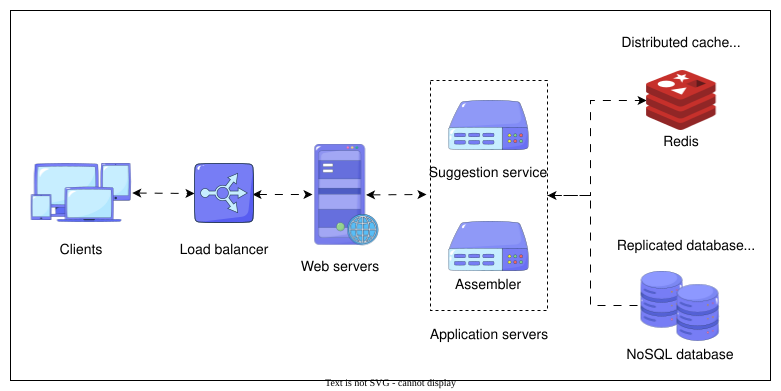

# High-Level_Design_of_the_Typeahead_Suggestion_System

Source: https://www.educative.io/courses/grokking-the-system-design-interview/high-level-design-of-the-typeahead-suggestion-system

---

[Home](https://www.educative.io/)

[Courses](https://www.educative.io/search?tab=courses)

[Grokking Modern System Design Interview](https://www.educative.io/courses/grokking-the-system-design-interview)

# High-Level Design of the Typeahead Suggestion System

Design the High-Level System Design for a real-time typeahead suggestion feature. Define the core components, including the suggestions service and the assembler, which manage low-latency retrieval from cache and persistent storage of trending queries. Learn to structure the architecture using load balancers and essential APIs for scalability.

We'll cover the following...

- [High-level design](https://www.educative.io/courses/grokking-the-system-design-interview/high-level-design-of-the-typeahead-suggestion-system#High-level-design)
- [API design](https://www.educative.io/courses/grokking-the-system-design-interview/high-level-design-of-the-typeahead-suggestion-system#API-design)
  - [Get suggestion](https://www.educative.io/courses/grokking-the-system-design-interview/high-level-design-of-the-typeahead-suggestion-system#Get-suggestion)
  - [Add trending queries to the database](https://www.educative.io/courses/grokking-the-system-design-interview/high-level-design-of-the-typeahead-suggestion-system#Add-trending-queries-to-the-database)

## High-level design[#](https://www.educative.io/courses/grokking-the-system-design-interview/high-level-design-of-the-typeahead-suggestion-system#High-level-design)

The system must suggest queries in real-time with minimal latency while storing new search queries in the database. This ensures users receive suggestions based on popular and recent searches.

The proposed system should perform two main functions:

- Provides suggestions based on user search history.
- Stores new and trending queries in the database to update the suggestion list.

When a user begins typing a query, each keystroke triggers a request to an application server. Assume a suggestions service retrieves the top 10 suggestions from a Redis cache and returns them to the client. The system also includes an assembler service. The assembler collects search queries, processes them to compute rankings, and stores the results in a distributed NoSQL database.

The high-level design of the typeahead suggestion system

Load balancers distribute incoming requests across application servers. Web servers act as entry points for client requests and route requests to the appropriate microservices. These web servers abstract the internal system architecture and provide supporting functions such as authentication, monitoring, and traffic shaping.

## API design[#](https://www.educative.io/courses/grokking-the-system-design-interview/high-level-design-of-the-typeahead-suggestion-system#API-design)

Because the system provides suggestions and tracks trending queries, we require the following APIs.

### Get suggestion[#](https://www.educative.io/courses/grokking-the-system-design-interview/high-level-design-of-the-typeahead-suggestion-system#Get-suggestion)

Ace Editor

1

getSuggestions(prefix)

הההההההההההההההההההההההההההההההההההההההההההההההההההההההההההההההההההההההההההההההההההההההההההההההההההההההההההההההההההההההההההההההההההההההההההההההההההההההההההההההההההההההההההההההההההההההההההההההההההההההההההההההההההההההההההההההההההההההההההההההההההההההההההההההההההההההההההההההההההההההההההההההההההההההההההההההההההההההההההההההההההההההההההההההההההההההההההההההההההההההההההההההההההההההההההההההההההההההההההההההההההההההההההההההההההההההההההההההההההההההההההההההההההההההההההההההההההההההההההההההההההההההההההההההההההההההההההההההה

XXXXXXXXXXXXXXXXXXXXXXXXXXXXXXXXXXXXXXXXXXXXXXXXXXXXXXXXXXXXXXXXXXXXXXXXXXXXXXXXXXXXXXXXXXXXXXXXXXXXXXXXXXXXXXXXXXXXXXXXXXXXXXXXXXXXXXXXXXXXXXXXXXXXXXXXXXXXXXXXXXXXXXXXXXXXXXXXXXXXXXXXXXXXXXXXXXXXXXXXXXXXXXXXXXXXXXXXXXXXXXXXXXXXXXXXXXXXXXXXXXXXXXXXXXXXXXXXXXXXXXXXXXXXXXXXXXXXXXXXXXXXXXXXXXXXXXXXXXXXXXXXXXXXXXXXXXXXXXXXXXXXXXXXXXXXXXXXXXXXXXXXXXXXXXXXXXXXXXXXXXXXXXXXXXXXXXXXXXXXXXXXXXXXXXXXXXXXXXXXXXXXXXXXXXXXXXXXXXXXXXXXXXXXXXXXXXXXXXXXXXXXXXXXXXXXXXXXXXXXXXXXXXXXXXXXXXXXXXXXXXXXXXXXXXXXXXXXXXXXXXXXXXXXXXXX

The suggestion service uses this API to retrieve suggestions and return them to the client.

The table below details the parameters passed to the API call:

|  |  |
| --- | --- |
| **Parameter** | **Description** |
| `prefix` | This refers to whatever the user has typed in the search bar. |

### Add trending queries to the database[#](https://www.educative.io/courses/grokking-the-system-design-interview/high-level-design-of-the-typeahead-suggestion-system#Add-trending-queries-to-the-database)

Ace Editor

1

addToDatabase(query)

הההההההההההההההההההההההההההההההההההההההההההההההההההההההההההההההההההההההההההההההההההההההההההההההההההההההההההההההההההההההההההההההההההההההההההההההההההההההההההההההההההההההההההההההההההההההההההההההההההההההההההההההההההההההההההההההההההההההההההההההההההההההההההההההההההההההההההההההההההההההההההההההההההההההההההההההההההההההההההההההההההההההההההההההההההההההההההההההההההההההההההההההההההההההההההההההההההההההההההההההההההההההההההההההההההההההההההההההההההההההההההההההההההההההההההההההההההההההההההההההההההההההההההההההההההההההההההההההה

XXXXXXXXXXXXXXXXXXXXXXXXXXXXXXXXXXXXXXXXXXXXXXXXXXXXXXXXXXXXXXXXXXXXXXXXXXXXXXXXXXXXXXXXXXXXXXXXXXXXXXXXXXXXXXXXXXXXXXXXXXXXXXXXXXXXXXXXXXXXXXXXXXXXXXXXXXXXXXXXXXXXXXXXXXXXXXXXXXXXXXXXXXXXXXXXXXXXXXXXXXXXXXXXXXXXXXXXXXXXXXXXXXXXXXXXXXXXXXXXXXXXXXXXXXXXXXXXXXXXXXXXXXXXXXXXXXXXXXXXXXXXXXXXXXXXXXXXXXXXXXXXXXXXXXXXXXXXXXXXXXXXXXXXXXXXXXXXXXXXXXXXXXXXXXXXXXXXXXXXXXXXXXXXXXXXXXXXXXXXXXXXXXXXXXXXXXXXXXXXXXXXXXXXXXXXXXXXXXXXXXXXXXXXXXXXXXXXXXXXXXXXXXXXXXXXXXXXXXXXXXXXXXXXXXXXXXXXXXXXXXXXXXXXXXXXXXXXXXXXXXXXXXXXXXXX

This API adds a trending `query` to the database via the assembler. This occurs only if the query has been searched previously and exceeds a specific threshold.

|  |  |
| --- | --- |
| **Parameter** | **Description** |
| `query` | This represents a frequently searched query that crosses the predefined limit. |

##

1.

Instead of updating the whole page, we just need to update the suggested query in the search box in real time. What technique can we use for this purpose?

Show Answer

Did you find this helpful?

AI Powered

Saved

15 attempts left

Reset

Multilingual Typeahead

Hi, I’m Ed. In this session, we will focus on some questions related to the multilingual typeahead. Do you want to be mentored or evaluated?

You have 15 attempts to answer.

In the next lesson, we’ll learn about an efficient data structure that’s used to store the suggestions or prefixes.

Requirements of the Typeahead Suggestion System’s Design

Data Structure for Storing Prefixes

Ask

[High-level design](https://www.educative.io/courses/grokking-the-system-design-interview/high-level-design-of-the-typeahead-suggestion-system#High-level-design)

[API design](https://www.educative.io/courses/grokking-the-system-design-interview/high-level-design-of-the-typeahead-suggestion-system#API-design)

[Get suggestion](https://www.educative.io/courses/grokking-the-system-design-interview/high-level-design-of-the-typeahead-suggestion-system#Get-suggestion)

[Add trending queries to the database](https://www.educative.io/courses/grokking-the-system-design-interview/high-level-design-of-the-typeahead-suggestion-system#Add-trending-queries-to-the-database)