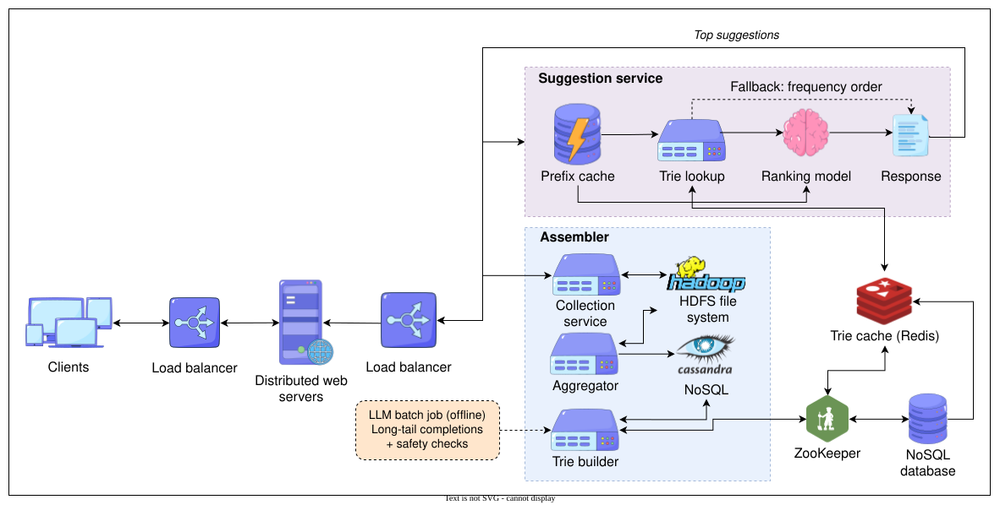

# Detailed_Design_of_the_Typeahead_Suggestion_System

Source: https://www.educative.io/courses/grokking-the-system-design-interview/detailed-design-of-the-typeahead-suggestion-system

---

[Home](https://www.educative.io/)

[Courses](https://www.educative.io/search?tab=courses)

[Grokking Modern System Design Interview](https://www.educative.io/courses/grokking-the-system-design-interview)

# Detailed Design of the Typeahead Suggestion System

Design the detailed architecture of a scalable typeahead suggestion system. Separate the real-time suggestion service from the asynchronous assembler, which handles data collection and processing. Understand how components like the aggregator and trie builder use HDFS and Cassandra to efficiently update suggestion data structures.

We'll cover the following...

- [Detailed design](https://www.educative.io/courses/grokking-the-system-design-interview/detailed-design-of-the-typeahead-suggestion-system#Detailed-design)
  - [Suggestion service](https://www.educative.io/courses/grokking-the-system-design-interview/detailed-design-of-the-typeahead-suggestion-system#Suggestion-service)
    - [AI-powered suggestion ranking](https://www.educative.io/courses/grokking-the-system-design-interview/detailed-design-of-the-typeahead-suggestion-system#AI-powered-suggestion-ranking)
    - [Where generative AI fits in typeahead](https://www.educative.io/courses/grokking-the-system-design-interview/detailed-design-of-the-typeahead-suggestion-system#Where-generative-AI-fits-in-typeahead)
  - [Assembler](https://www.educative.io/courses/grokking-the-system-design-interview/detailed-design-of-the-typeahead-suggestion-system#Assembler)

## Detailed design[#](https://www.educative.io/courses/grokking-the-system-design-interview/detailed-design-of-the-typeahead-suggestion-system#Detailed-design)

The illustration below outlines the flow and interaction of the system components. The design consists of two main parts:

- Suggestion service
- Assembler

The detailed design of the typeahead suggestion system

### Suggestion service[#](https://www.educative.io/courses/grokking-the-system-design-interview/detailed-design-of-the-typeahead-suggestion-system#Suggestion-service)

As a user types a query, `getSuggestions(prefix)` API calls reach the suggestion service. The service retrieves the top ten popular queries from the distributed cache (Redis).

#### AI-powered suggestion ranking[#](https://www.educative.io/courses/grokking-the-system-design-interview/detailed-design-of-the-typeahead-suggestion-system#AI-powered-suggestion-ranking)

The trie returns completions ordered by search frequency. Frequency is a useful starting point, but the best suggestion can also depend on context. For example, a user who recently searched for “python tutorial” might prefer “pandas dataframe” over “panama” when typing “pan”. Machine learning (ML) can improve autocomplete ranking by considering context, personalization, and suggestion relevance. Amazon has also described using [ML-powered autocomplete for book discovery](https://www.amazon.science/blog/simplifying-book-discovery-with-ml-powered-visual-autocomplete-suggestions).

The main challenge is latency. With roughly 160ms between keystrokes and a 200ms response-time target, ranking must remain lightweight. We can achieve this in three ways:

- **Find candidates, then rank them:** The trie retrieves matching completions for the prefix. A lightweight model reorders only the top few dozen candidates instead of processing the entire vocabulary.
- **Precompute reusable features:** Popularity trends and other features that change infrequently are computed offline and stored with the relevant trie nodes or candidates. User-specific context, such as recent searches, is added at request time.
- **Cache common prefixes:** Frequently typed prefixes, such as “a” or “wh”, can have their top suggestions cached. The system can then adjust these results using lightweight personalization when needed.

The ranking model can also assign a confidence score to each suggestion. A calibrated threshold filters out weak suggestions, while frequency-ranked results can serve as a fallback when the model produces no suitable matches.

Each keystroke triggers a new request, so responses may arrive out of order. The client assigns a sequence number to each request and cancels outdated requests when possible. It also discards responses that do not belong to the latest request, preventing a slow response for “pa” from replacing results for “pan”.

Personalization uses an individual user's search history to improve that user's suggestions. The system keeps individual search histories isolated between users and does not expose one user's history to another.

#### Where generative AI fits in typeahead[#](https://www.educative.io/courses/grokking-the-system-design-interview/detailed-design-of-the-typeahead-suggestion-system#Where-generative-AI-fits-in-typeahead)

Large language models are starting to change search suggestions. Search engines are experimenting with LLM-based query rewriting, which turns a vague or partial query into a clearer one, and with suggestions phrased as natural-language questions for AI-generated answers. This raises a strong interview point: typeahead’s latency budget rules out calling an LLM on every keystroke.

A hosted LLM typically needs hundreds of milliseconds or more just to return its first tokens, while the full suggestion round trip, including the network, must fit in about 200 ms, and a new keystroke arrives roughly every 160 ms. Generative models therefore work around the keystroke path, not on it:

- **Offline candidate generation:** A batch job uses an LLM to generate or rewrite completions for rare, long-tail prefixes, and the assembler adds them to the trie with the other candidates. At request time, they are served and ranked like any other completion.
- **After the user submits:** Query rewriting runs once per search, where a few hundred milliseconds is acceptable, instead of once per keystroke.
- **Offline safety checks:** Generated suggestions pass the same filters as other completions, removing offensive or misleading phrases, before they reach the trie.

The pattern of moving expensive generation off the latency-critical path and precomputing its results applies to any feature with a tight response budget.

### Assembler[#](https://www.educative.io/courses/grokking-the-system-design-interview/detailed-design-of-the-typeahead-suggestion-system#Assembler)

We previously discussed how tries are built, partitioned, and stored. However, trie creation and updates should not occur in the critical path of a user’s query. Real-time updates are avoided because:

- **Scale:** Millions of users enter queries every second. Updating the trie in real time for every query would significantly slow down the suggestion service.
- **Relevance:** Top suggestions do not change frequently enough to require immediate updates.

Therefore, a separate assembler service creates and updates tries at configurable intervals. The assembler consists of the following components:

- **Collection service:** When a user types, this service logs the phrase, timestamp, and metadata to a database for later processing. Due to the massive volume of raw data, the Hadoop Distributed File System (HDFS) is used for storage. Timestamps are recorded to track when to update a phrase’s frequency.

The following table shows raw data collected by the collection service:

|  |  |
| --- | --- |
| **Phrases** | **Date and Time (DD-MM-YYYY HH:MM:SS)** |
| UNIVERSAL | 23-03-2022 10:16:18 |
| UNIVERSITY | 23-03-2022 10:20:11 |
| UNIQUE | 23-03-2022 10:21:10 |
| UNIQUE | 23-03-2022 10:22:24 |
| UNIVERSITY | 23-03-2022 10:25:09 |

- **Aggregator:** Raw data from the collection service is often unconsolidated. The aggregator retrieves this data from HDFS and distributes it to workers. A `MapReduce` job aggregates prefix frequencies over a given time interval and periodically updates a Cassandra database. Cassandra is suitable here because it efficiently stores large amounts of tabular data. The system maintains a table of processed and consolidated data, which is regularly updated by the aggregator. For simplicity, we assume this data is case-insensitive.

The following table contains useful information extracted from the raw data:

|  |  |  |
| --- | --- | --- |
| **Phrases** | **Frequency** | **Time Interval** |
| UNIVERSAL | 1400 | 1st 15 minutes |
| UNIVERSITY | 1340 | 1st 15 minutes |
| UNIQUE | 1200 | 1st 15 minutes |

- **Trie builder:** This service creates or updates tries using aggregated data from Cassandra. It either updates an existing trie snapshot with new terms and frequencies or creates a new one. Tries are stored in a NoSQL document database (like MongoDB) for persistence and recovery. Once ready, the system uses ZooKeeper to make the trie available to the suggestion service.

AI Powered

Saved

3 attempts left

Reset

Misspelled or incomplete words

How would you handle misspelled or incomplete words in the Typeahead Suggestion System?

You have 3 attempts to answer.

1.

Should we collect data and build a trie per user, or should it be shared among all users?

Show Answer

Did you find this helpful?

Data Structure for Storing Prefixes

Evaluation of the Typeahead Suggestion System’s Design

Ask

[Detailed design](https://www.educative.io/courses/grokking-the-system-design-interview/detailed-design-of-the-typeahead-suggestion-system#Detailed-design)

[Suggestion service](https://www.educative.io/courses/grokking-the-system-design-interview/detailed-design-of-the-typeahead-suggestion-system#Suggestion-service)

[AI-powered suggestion ranking](https://www.educative.io/courses/grokking-the-system-design-interview/detailed-design-of-the-typeahead-suggestion-system#AI-powered-suggestion-ranking)

[Where generative AI fits in typeahead](https://www.educative.io/courses/grokking-the-system-design-interview/detailed-design-of-the-typeahead-suggestion-system#Where-generative-AI-fits-in-typeahead)

[Assembler](https://www.educative.io/courses/grokking-the-system-design-interview/detailed-design-of-the-typeahead-suggestion-system#Assembler)