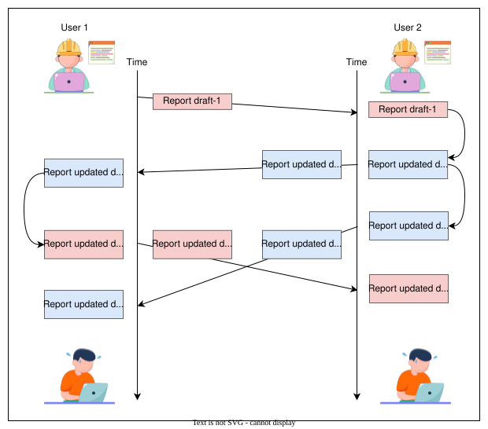

# Google_Docs_System_Design

Source: https://www.educative.io/courses/grokking-the-system-design-interview/system-design-google-docs

---

[Home](https://www.educative.io/)

[Courses](https://www.educative.io/search?tab=courses)

[Grokking Modern System Design Interview](https://www.educative.io/courses/grokking-the-system-design-interview)

# System Design: Google Docs

Define the challenges of real-time document collaboration and the benefits of services like Google Docs. Learn the systematic, four-stage approach for designing this complex service using a centralized client-server architecture. Prepare to analyze requirements, concurrency, and scalability.

We'll cover the following...

- [Problem statement](https://www.educative.io/courses/grokking-the-system-design-interview/system-design-google-docs#Problem-statement)
- [Google Docs](https://www.educative.io/courses/grokking-the-system-design-interview/system-design-google-docs#Google-Docs)
  - [Designing Google Docs](https://www.educative.io/courses/grokking-the-system-design-interview/system-design-google-docs#Designing-Google-Docs)
- [How will we design Google Docs?](https://www.educative.io/courses/grokking-the-system-design-interview/system-design-google-docs#How-will-we-design-Google-Docs)

## Problem statement[#](https://www.educative.io/courses/grokking-the-system-design-interview/system-design-google-docs#Problem-statement)

Collaborating on documents by exchanging files is inefficient. For example, if two users edit local copies of the same document simultaneously, merging their changes becomes a manual and error-prone process. The lack of synchronization often results in version conflicts and duplicated effort.

Problems arise when there’s no collaborative document editing service

Manual file exchange creates friction and data inconsistency.

## Google Docs[#](https://www.educative.io/courses/grokking-the-system-design-interview/system-design-google-docs#Google-Docs)

Online collaborative editing services like Google Docs solve the above problems by enabling real-time cooperation. Key advantages include:

- **Real-time collaboration:** Users can edit, review, and comment simultaneously.
- **Accessibility:** No special hardware is required; a standard browser suffices.
- **Mobility:** Users can work from any location.
- **Version control:** The system maintains a history of changes, allowing users to revert to older versions.
- **Cost:** Many services offer free access to end-users.

Popular alternatives include Etherpad, Microsoft Office 365, and Slite.

### Designing Google Docs[#](https://www.educative.io/courses/grokking-the-system-design-interview/system-design-google-docs#Designing-Google-Docs)

There are two primary architectural approaches for this system:

- **Client-server:** A centralized service manages document state and provides editing capabilities to clients.
- **Peer-to-peer (P2P):** Clients collaborate directly on a document without a central authority.

Client-server vs. peer-to-peer collaboration, and why the design uses client-server

Commercial solutions typically favor client-server architecture to ensure granular control and consistency. We will follow this approach.

> **Note:** According to a survey, 64% of people use Google Docs for document editing at least once a week.

## How will we design Google Docs?[#](https://www.educative.io/courses/grokking-the-system-design-interview/system-design-google-docs#How-will-we-design-Google-Docs)

We will approach the design in four stages:

1. [**Requirements for Google Docs’ design**](https://www.educative.io/courses/grokking-the-system-design-interview/requirements-of-google-docs-design)**:** Establish functional requirements and estimate infrastructure scale.
2. [**Google Docs’ design**](https://www.educative.io/courses/grokking-the-system-design-interview/design-of-google-docs)**:** Develop a design that satisfies these requirements, detailing component roles and interactions.
3. [**Concurrency in collaborative editing**](https://www.educative.io/courses/grokking-the-system-design-interview/concurrency-in-collaborative-editing)**:** Explore techniques to resolve conflicts arising from simultaneous edits.
4. [**Evaluating Google Docs’ design**](https://www.educative.io/courses/grokking-the-system-design-interview/evaluation-of-google-docs-design)**:** Analyze the design's performance, consistency, availability, and scalability.

If you want to get hands-on experience with how to build a simple collaborative document editing system in AWS, consider exploring the following AWS Cloud Lab.

Let’s begin by defining the requirements.

Quiz on the Typeahead Suggestion System’s Design

Requirements of Google Docs’ Design

Ask

[Problem statement](https://www.educative.io/courses/grokking-the-system-design-interview/system-design-google-docs#Problem-statement)

[Google Docs](https://www.educative.io/courses/grokking-the-system-design-interview/system-design-google-docs#Google-Docs)

[Designing Google Docs](https://www.educative.io/courses/grokking-the-system-design-interview/system-design-google-docs#Designing-Google-Docs)

[How will we design Google Docs?](https://www.educative.io/courses/grokking-the-system-design-interview/system-design-google-docs#How-will-we-design-Google-Docs)