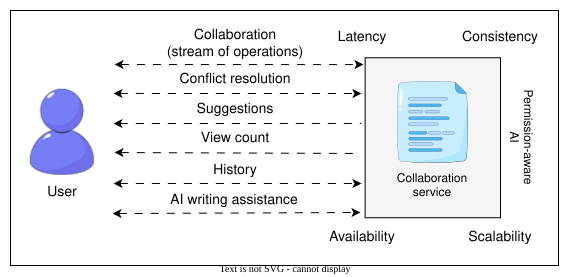

# Requirements_of_Google_Docs’_Design

Source: https://www.educative.io/courses/grokking-the-system-design-interview/requirements-of-google-docs-design

---

[Home](https://www.educative.io/)

[Courses](https://www.educative.io/search?tab=courses)

[Grokking Modern System Design Interview](https://www.educative.io/courses/grokking-the-system-design-interview)

# Requirements of Google Docs’ Design

Establish the foundational requirements for designing a highly scalable collaborative document editor. Calculate resource estimations for storage and bandwidth, then identify the essential distributed building blocks needed to meet latency and consistency goals in System Design.

We'll cover the following...

- [Requirements](https://www.educative.io/courses/grokking-the-system-design-interview/requirements-of-google-docs-design#Requirements)
  - [Functional requirements](https://www.educative.io/courses/grokking-the-system-design-interview/requirements-of-google-docs-design#Functional-requirements)
  - [Non-functional requirements](https://www.educative.io/courses/grokking-the-system-design-interview/requirements-of-google-docs-design#Non-functional-requirements)
- [Resource estimation](https://www.educative.io/courses/grokking-the-system-design-interview/requirements-of-google-docs-design#Resource-estimation)
  - [Storage estimation](https://www.educative.io/courses/grokking-the-system-design-interview/requirements-of-google-docs-design#Storage-estimation)
  - [Bandwidth estimation](https://www.educative.io/courses/grokking-the-system-design-interview/requirements-of-google-docs-design#Bandwidth-estimation)
  - [Number of servers estimation](https://www.educative.io/courses/grokking-the-system-design-interview/requirements-of-google-docs-design#Number-of-servers-estimation)
- [Building blocks we will use](https://www.educative.io/courses/grokking-the-system-design-interview/requirements-of-google-docs-design#Building-blocks-we-will-use)

## Requirements[#](https://www.educative.io/courses/grokking-the-system-design-interview/requirements-of-google-docs-design#Requirements)

We will define the functional and non-functional requirements for a collaborative editing service.

### Functional requirements[#](https://www.educative.io/courses/grokking-the-system-design-interview/requirements-of-google-docs-design#Functional-requirements)

Users can perform the following activities:

- **Document collaboration:** Multiple users can edit a document simultaneously, and a large number of users can view it.
- **Conflict resolution:** The system pushes edits to all collaborators and resolves concurrent editing conflicts.
- **Suggestions:** The system provides autocomplete suggestions for words and phrases, and fixes grammatical mistakes.
- **AI-powered writing assistance:** Users can ask an AI assistant to draft or rewrite text using the current document and other files they can access, then accept or reject each suggestion.
- **View count:** Editors can see the document view count.
- **History:** Users can view the collaboration history.

Real-world editors also handle document creation, deletion, and access management. We will focus on the core collaboration features listed above.

Functional and non-functional requirements of the collaborative editing service

### Non-functional requirements[#](https://www.educative.io/courses/grokking-the-system-design-interview/requirements-of-google-docs-design#Non-functional-requirements)

- **Latency:** Low latency is critical for users collaborating from different regions.
- **Consistency:** The system must resolve concurrent conflicts to ensure a consistent view. Users in different regions must see the updated state.
- **Availability:** The service must be robust and available at all times.
- **Scalability:** The system must support a large number of concurrent users viewing or creating documents.
- **Permission-aware AI:** AI suggestions must use only content the requesting user is allowed to read, and accepting a suggestion must never overwrite a collaborator’s newer edits.

## Resource estimation[#](https://www.educative.io/courses/grokking-the-system-design-interview/requirements-of-google-docs-design#Resource-estimation)

We base our resource estimates on the following assumptions:

- 80 million daily active users (DAU)
- Maximum 20 concurrent editors per document
- Average text document size is 100 KB
- 30% of documents contain images; 2% contain videos
- Images require 800 KB per document; videos require 3 MB
- Each user creates one document per day

### Storage estimation[#](https://www.educative.io/courses/grokking-the-system-design-interview/requirements-of-google-docs-design#Storage-estimation)

With 80 million documents created daily, the storage requirements for one day are:

> **Note:** Adjust the values in the table below to observe changes in storage requirements.

#### Estimation for Storage Requirements

|  |  |  |
| --- | --- | --- |
| Number of documents created by each user | 1 | per day |
| Number of active users | 80 | Million |
| Number of documents in a day | f80 | Million |
| Storage required for textual content per day | f8 | TB |
| Storage required for images per day | f19.2 | TB |
| Storage required for video content per day | f4.8 | TB |
| Total storage required per day | f32 | TB |

Storage required by online collaborative document editing service per day

Total daily storage required: 8+19.2+4.8=32 TBs8 + 19.2 + 4.8 = 32\ \text{TBs}8+19.2+4.8=32 TBs per day

> **Note:** We omit historical data storage requirements for brevity.

### Bandwidth estimation[#](https://www.educative.io/courses/grokking-the-system-design-interview/requirements-of-google-docs-design#Bandwidth-estimation)

**Incoming traffic:** With 32 TB of daily uploads, the incoming traffic requirement is:

32 TB86400×8=3Gbps\frac{32\ \text{TB}}{86400} \times 8 = 3 \text{Gbps}8640032 TB​×8=3Gbps approximately

**Outgoing traffic:** Assuming a typical user views five documents per day, the outgoing traffic is:

> **Note:** Adjust the values in the table below to observe changes in calculations.

#### 

|  |  |  |
| --- | --- | --- |
| Number of documents viewed by users | 5 | per day |
| Number of active users | 80 | Million |
| Number of documents viewed in a day | f400 | Million |
| Number of documents viewed in a second | f4630 | per second |
| Bandwidth required for textual content per second | f3.704 | Gigabits per second(Gbps) |
| Bandwidth for image-based content per second | f8.89 | Gbps |
| Bandwidth for video content per second | f2.22 | Gbps |
| Total outgoing bandwidth required | f14.81 | Gbps |

The total bandwidth required by Google Docs

> **Note:** Total bandwidth is the sum of incoming and outgoing traffic: =3+14.7≈18Gbps= 3+14.7≈18\text{Gbps}=3+14.7≈18Gbps approximately.

### Number of servers estimation[#](https://www.educative.io/courses/grokking-the-system-design-interview/requirements-of-google-docs-design#Number-of-servers-estimation)

As we have 80 million daily active users working on collaborative documents. Considering [our assumption](https://www.educative.io/courses/grokking-the-system-design-interview/put-back-of-the-envelope-numbers-in-perspective) that daily active users serve as a proxy for requests per second to determine the number of servers for peak load, we get 80 million requests per second. Then, we use the following formula to calculate the number of servers:

Servers needed at peak load=Number of requests/secondRPS of server\text{Servers needed at peak load} = \frac{\text{Number of requests/second}}{\text{RPS of server}}
Servers needed at peak load=RPS of serverNumber of requests/second​

Assuming a server handles [64,000 RPS](https://www.educative.io/courses/grokking-the-system-design-interview/put-back-of-the-envelope-numbers-in-perspective), the required server count is:

Servers needed at peak load=80 million64,000=1250≈1.3 K servers\text{Servers needed at peak load} = \frac{80\ \text{million}}{64,000} = 1250 \approx 1.3\ \text{K servers}
Servers needed at peak load=64,00080 million​=1250≈1.3 K servers

The estimated number of servers required for Google Docs

## Building blocks we will use[#](https://www.educative.io/courses/grokking-the-system-design-interview/requirements-of-google-docs-design#Building-blocks-we-will-use)

We will use the following building blocks to design the collaborative document editing service:

Building blocks required to be integrated in the design

- [**Databases**](https://www.educative.io/courses/grokking-the-system-design-interview/introduction-to-databases)**:** Store textual content, document history, and user data. We may require multiple database types.
- [**Blob storage**](https://www.educative.io/courses/grokking-the-system-design-interview/system-design-a-blob-store)**:** Store large files, such as images and videos.
- [**CDN**](https://www.educative.io/courses/grokking-the-system-design-interview/system-design-the-content-delivery-network-cdn)**:** Caches frequently accessed media and read-only documents.
- [**Load balancers**](https://www.educative.io/courses/grokking-the-system-design-interview/introduction-to-load-balancers)**:** Distribute incoming user traffic.
- [**Caching**](https://www.educative.io/courses/grokking-the-system-design-interview/system-design-the-distributed-cache)**:** Improve system performance.
- [**Queueing system**](https://www.educative.io/courses/grokking-the-system-design-interview/system-design-the-distributed-messaging-queue)**:** Manage editing operations. Since concurrent edits cannot be processed instantly, a queue temporarily holds requests.
- [**Pub-sub**](https://www.educative.io/courses/grokking-the-system-design-interview/system-design-the-pub-sub-abstraction)**:** Handle asynchronous tasks that do not require immediate execution.

System Design: Google Docs

Design of Google Docs

Ask

[Requirements](https://www.educative.io/courses/grokking-the-system-design-interview/requirements-of-google-docs-design#Requirements)

[Functional requirements](https://www.educative.io/courses/grokking-the-system-design-interview/requirements-of-google-docs-design#Functional-requirements)

[Non-functional requirements](https://www.educative.io/courses/grokking-the-system-design-interview/requirements-of-google-docs-design#Non-functional-requirements)

[Resource estimation](https://www.educative.io/courses/grokking-the-system-design-interview/requirements-of-google-docs-design#Resource-estimation)

[Storage estimation](https://www.educative.io/courses/grokking-the-system-design-interview/requirements-of-google-docs-design#Storage-estimation)

[Bandwidth estimation](https://www.educative.io/courses/grokking-the-system-design-interview/requirements-of-google-docs-design#Bandwidth-estimation)

[Number of servers estimation](https://www.educative.io/courses/grokking-the-system-design-interview/requirements-of-google-docs-design#Number-of-servers-estimation)

[Building blocks we will use](https://www.educative.io/courses/grokking-the-system-design-interview/requirements-of-google-docs-design#Building-blocks-we-will-use)