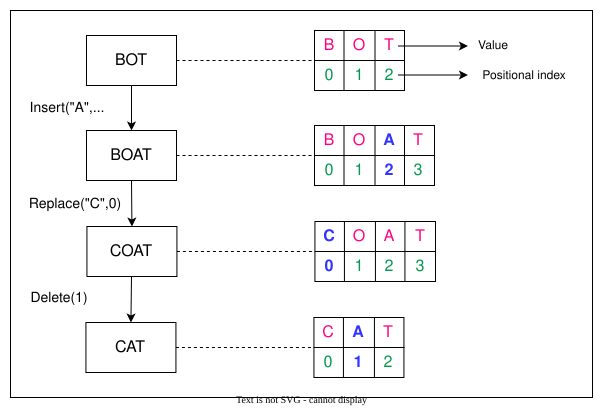
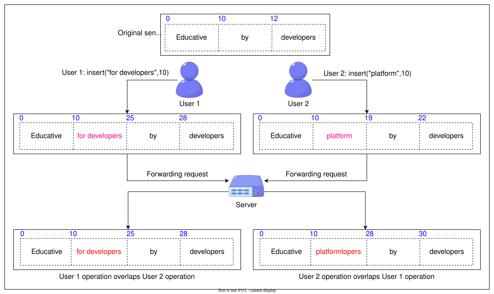
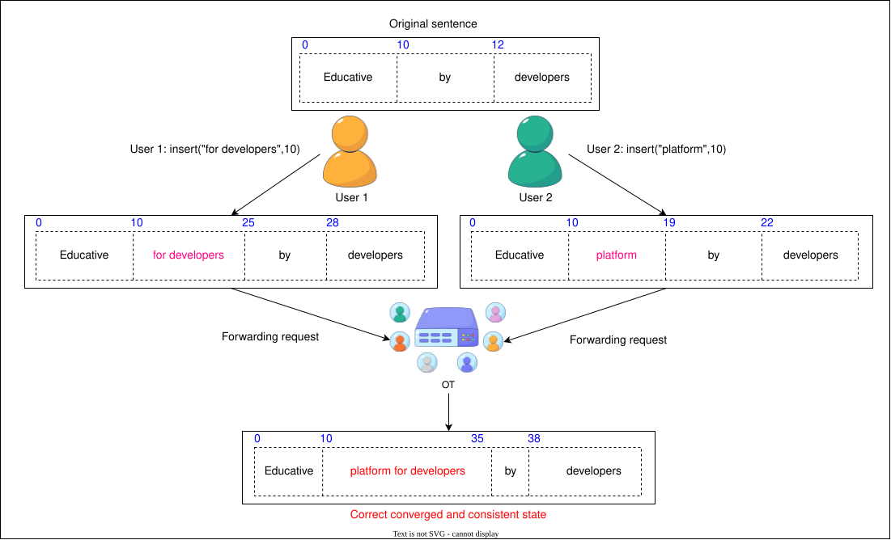
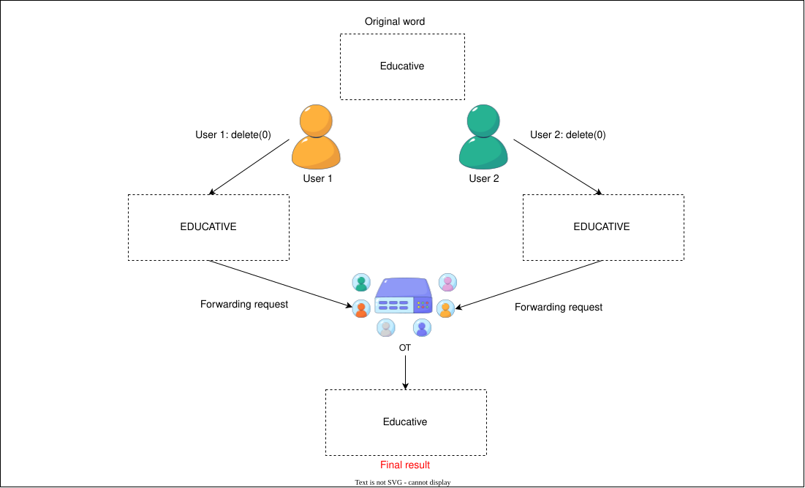

# Concurrency_in_Collaborative_Editing

Source: https://www.educative.io/courses/grokking-the-system-design-interview/concurrency-in-collaborative-editing

---

[Home](https://www.educative.io/)

[Courses](https://www.educative.io/search?tab=courses)

[Grokking Modern System Design Interview](https://www.educative.io/courses/grokking-the-system-design-interview)

# Concurrency in Collaborative Editing

Explore concurrency issues in collaborative editing services like Google Docs, where simultaneous changes can lead to conflicts. Assess conflict resolution techniques, comparing operational transformation (OT) and conflict-free replicated data type (CRDT). Learn how these methods ensure strong consistency and document convergence by maintaining commutativity and idempotency.

We'll cover the following...

- [Introduction](https://www.educative.io/courses/grokking-the-system-design-interview/concurrency-in-collaborative-editing#Introduction)
- [What is a document editor?](https://www.educative.io/courses/grokking-the-system-design-interview/concurrency-in-collaborative-editing#What-is-a-document-editor)
- [Concurrency issues](https://www.educative.io/courses/grokking-the-system-design-interview/concurrency-in-collaborative-editing#Concurrency-issues)
  - [Example 1](https://www.educative.io/courses/grokking-the-system-design-interview/concurrency-in-collaborative-editing#Example-1)
  - [Example 2](https://www.educative.io/courses/grokking-the-system-design-interview/concurrency-in-collaborative-editing#Example-2)
- [Techniques for conflict resolution](https://www.educative.io/courses/grokking-the-system-design-interview/concurrency-in-collaborative-editing#Techniques-for-conflict-resolution)
  - [Operational transformation](https://www.educative.io/courses/grokking-the-system-design-interview/concurrency-in-collaborative-editing#Operational-transformation)
  - [Conflict-free replicated data type (CRDT)](https://www.educative.io/courses/grokking-the-system-design-interview/concurrency-in-collaborative-editing#Conflict-free-replicated-data-type-CRDT)

## Introduction[#](https://www.educative.io/courses/grokking-the-system-design-interview/concurrency-in-collaborative-editing#Introduction)

We have designed the core collaborative editing service, but we still need to address how to handle concurrent document changes. Before solving for concurrency, we must define the data model of a collaborative text editor.

## What is a document editor?[#](https://www.educative.io/courses/grokking-the-system-design-interview/concurrency-in-collaborative-editing#What-is-a-document-editor)

A **document** is a composition of characters in a specific order. Each character has a value and a positional index. The **character** can be a letter, a number, an enter (↵), or a space. An **index** represents the character’s position within the ordered list of characters.

The editor performs operations like `insert()`, `delete()`, and `edit()` on characters based on these indexes. The diagram below depicts how an editor executes these operations.

How a document editor performs different operations

## Concurrency issues[#](https://www.educative.io/courses/grokking-the-system-design-interview/concurrency-in-collaborative-editing#Concurrency-issues)

Concurrent collaboration can create conflicts when multiple users edit the same section of a document. Because users modify a local copy, their view may diverge from the server state until updates are pushed from the server. This delay can lead to conflicting updates or unintended overwrites.

### Example 1[#](https://www.educative.io/courses/grokking-the-system-design-interview/concurrency-in-collaborative-editing#Example-1)

Consider a scenario in which two users attempt to add characters at the same position. The following example illustrates how modifying the same sentence concurrently leads to conflicting results:

How two users modifying the same text can lead to concurrency issues

Two users modify the sentence “Educative by developers” by performing `insert()` at the index `10`. Without conflict resolution, two outcomes are possible:

- The phrase “for developers” overwrites “platform.” This leads to an outcome of “for developers.”
- The phrase “platform” overlaps with “for developers.” This leads to an outcome of “platformlopers.”

This demonstrates that operations are not naturally commutative; the order in which they are applied changes the final result.

### Example 2[#](https://www.educative.io/courses/grokking-the-system-design-interview/concurrency-in-collaborative-editing#Example-2)

Similarly, consider two users deleting the same character from the word “EEDUCATIVE.” Both users intend to remove the extra “E.” If both operations execute blindly, the system might delete both instances, resulting in an incorrect outcome.

How deleting the same character can lead to unexpected changes

This second example shows that operations are not naturally idempotent. To resolve conflicts, the system must enforce two rules:

- **Commutativity:** The order of applied operations must not affect the final result.
- **Idempotency:** Repeated application of the same operation must not change the result beyond the initial application.

Two primary techniques address these challenges.

## Techniques for conflict resolution[#](https://www.educative.io/courses/grokking-the-system-design-interview/concurrency-in-collaborative-editing#Techniques-for-conflict-resolution)

We will discuss the two leading technologies for collaborative consistency.

### Operational transformation[#](https://www.educative.io/courses/grokking-the-system-design-interview/concurrency-in-collaborative-editing#Operational-transformation)

**Operational transformation (OT)** is a widely used technique for conflict resolution in collaborative editing. OT emerged in 1989 and has improved throughout the years. It’s a lock-free, non-blocking approach to conflict resolution. If operations between collaborators conflict, OT resolves conflicts and pushes the correct converged state to end users. As a result, OT provides users with consistency.

OT performs operations using the positional index method to resolve conflicts, as we discussed above. OT resolves the problems above by holding commutativity and idempotency.

1 / 2

Ensuring commutativity

1 / 2

Ensuring idempotency

Collaborative editors based on OT are consistent if they have the following two properties:

- **Causality preservation:** If operation `a` happened before operation `b`, then operation `a` is executed before operation `b`.
- **Convergence:** All document replicas across clients will eventually become identical.

The properties above are part of the **CC consistency model**, a model for consistency maintenance in collaborative editing.

OT has two significant disadvantages:

- Operations rely on positional indexes, making them order-dependent. An insertion at the beginning of a document shifts the indexes of all subsequent characters.
- Implementing correct OT algorithms is notoriously difficult. For instance, the Google Wave team spent two years perfecting its OT implementation.

Due to this complexity, alternatives were developed.

### Conflict-free replicated data type (CRDT)[#](https://www.educative.io/courses/grokking-the-system-design-interview/concurrency-in-collaborative-editing#Conflict-free-replicated-data-type-CRDT)

**Conflict-free replicated data types (CRDTs)** simplify conflict resolution by using more complex data structures.

CRDTs satisfy commutativity and idempotency by assigning two properties to every character:

- A globally unique identity
- A global ordering

This changes the data structure of an operation:

Simplified data structure of a CRDT

The `SiteID` uniquely identifies a user’s site requesting an operation with a `Value` and a `PositionalIndex`. The value of `PositionalIndex` can be in fractions for two main reasons.

- The `PositionalIndex` of other characters won’t change because of certain operations.
- The order dependency of operations between different users will be avoided.

The example below depicts that a user from site ID `123e4567-e89b-12d3` is inserting a character with a value of `A` at a `PositionalIndex` of `1.5`. Although a new character is added, the positional indexes of existing characters are preserved using fractional indices. Therefore, the order dependency between operations is avoided. As shown below, an `insert()` between `O` and `T` didn’t affect the position of `T`.

Preventing order dependency between operations

CRDTs guarantee eventual consistency. Even if users go offline, their local replicas converge with other replicas once they reconnect and synchronize updates. Major platforms such as Google Docs and Etherpad rely on Operational Transformation (OT). CRDTs are gaining popularity because they support serverless and peer-to-peer collaboration models.

> **Note:** While OT and CRDTs handle algorithmic conflicts, UI features like real-time cursor highlighting help users naturally avoid editing the same text simultaneously.

1.

Why can’t we use locks to synchronize between users?

Show Answer

1 / 2

Design of Google Docs

Evaluation of Google Docs’ Design

Ask

[Introduction](https://www.educative.io/courses/grokking-the-system-design-interview/concurrency-in-collaborative-editing#Introduction)

[What is a document editor?](https://www.educative.io/courses/grokking-the-system-design-interview/concurrency-in-collaborative-editing#What-is-a-document-editor)

[Concurrency issues](https://www.educative.io/courses/grokking-the-system-design-interview/concurrency-in-collaborative-editing#Concurrency-issues)

[Example 1](https://www.educative.io/courses/grokking-the-system-design-interview/concurrency-in-collaborative-editing#Example-1)

[Example 2](https://www.educative.io/courses/grokking-the-system-design-interview/concurrency-in-collaborative-editing#Example-2)

[Techniques for conflict resolution](https://www.educative.io/courses/grokking-the-system-design-interview/concurrency-in-collaborative-editing#Techniques-for-conflict-resolution)

[Operational transformation](https://www.educative.io/courses/grokking-the-system-design-interview/concurrency-in-collaborative-editing#Operational-transformation)

[Conflict-free replicated data type (CRDT)](https://www.educative.io/courses/grokking-the-system-design-interview/concurrency-in-collaborative-editing#Conflict-free-replicated-data-type-CRDT)