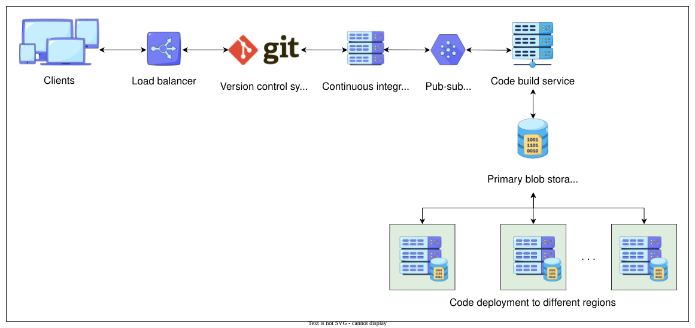
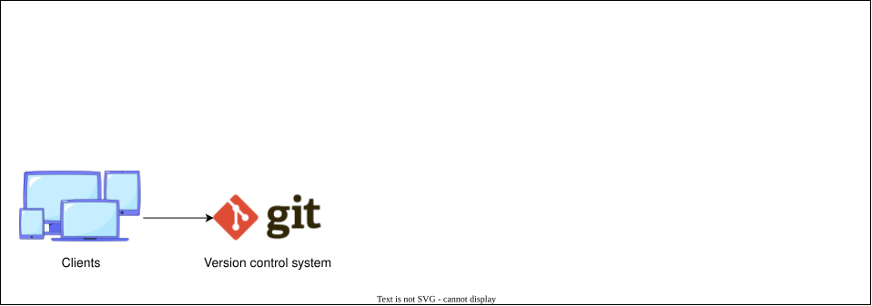
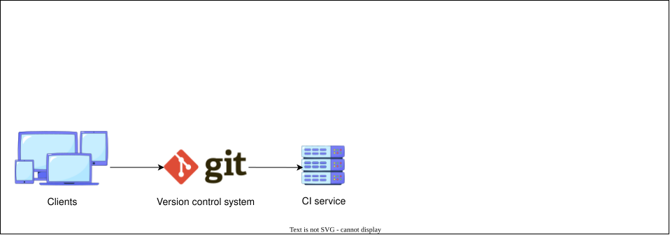
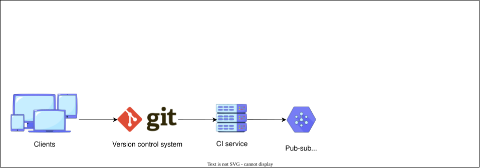
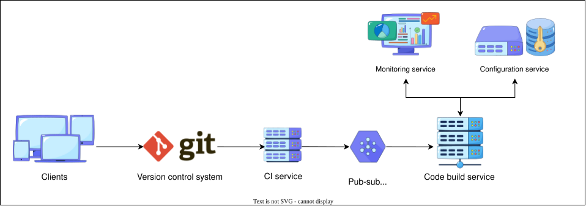
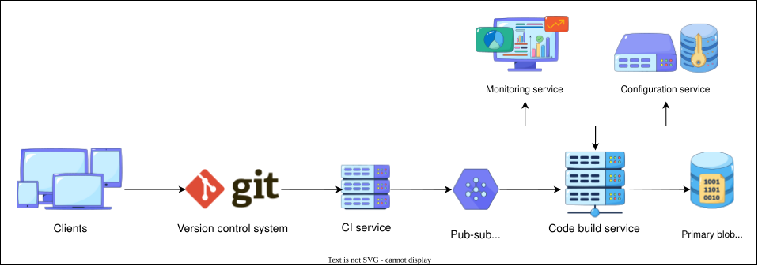
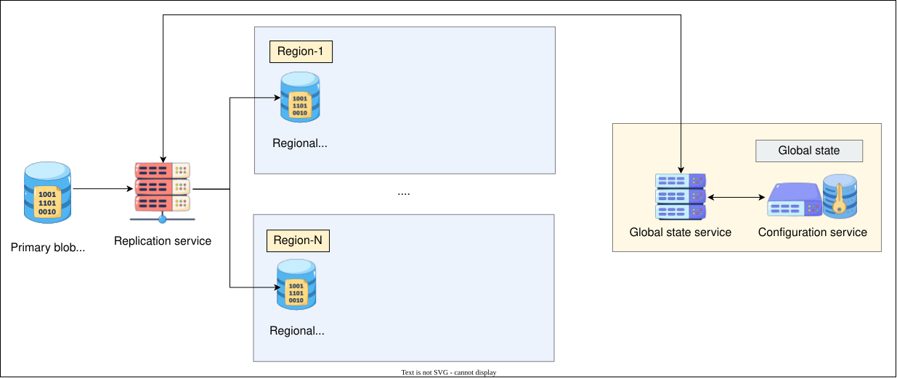
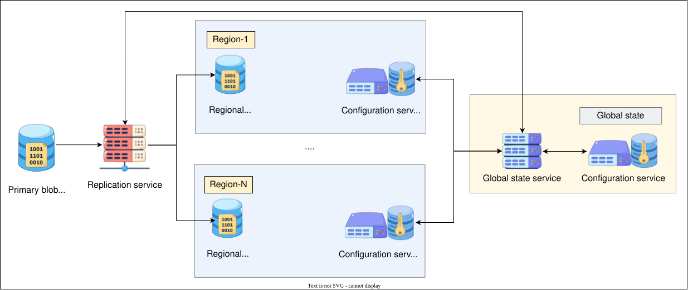
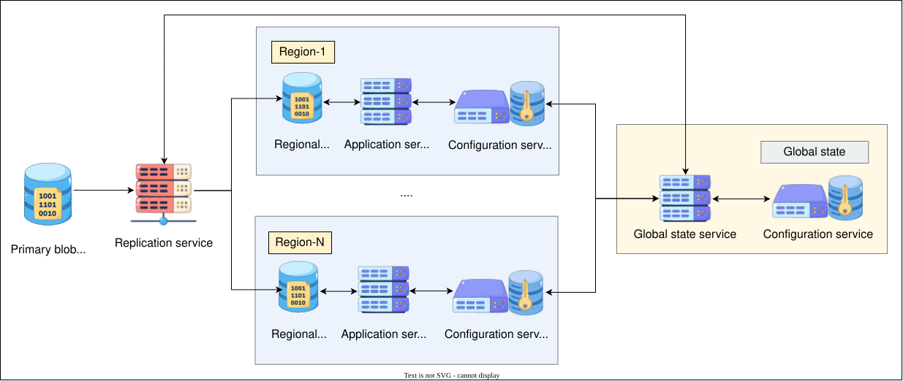

# Design_of_a_Code_Deployment_System

Source: https://www.educative.io/courses/grokking-the-system-design-interview/design-of-a-code-deployment-system

---

[Home](https://www.educative.io/)

[Courses](https://www.educative.io/search?tab=courses)

[Grokking Modern System Design Interview](https://www.educative.io/courses/grokking-the-system-design-interview)

# Design of a Code Deployment System

The design of a code deployment system encompasses a high-level workflow where users submit code to a Version Control System (VCS), triggering a Continuous Integration (CI) platform that builds and tests the code. Key APIs facilitate code submission, build triggering, artifact access, and deployment management. The system operates in two phases: code-building, which integrates and tests changes, and code-deployment, which updates application servers with new binaries. The design prioritizes reliability, scalability, and observability while accommodating various deployment strategies, impacting overall system architecture and performance.

We'll cover the following...

- [High-level design](https://www.educative.io/courses/grokking-the-system-design-interview/design-of-a-code-deployment-system#High-level-design)
- [API design](https://www.educative.io/courses/grokking-the-system-design-interview/design-of-a-code-deployment-system#API-design)
  - [Code-build APIs](https://www.educative.io/courses/grokking-the-system-design-interview/design-of-a-code-deployment-system#Code-build-APIs)
  - [Code deployment APIs](https://www.educative.io/courses/grokking-the-system-design-interview/design-of-a-code-deployment-system#Code-deployment-APIs)
- [Storage schema](https://www.educative.io/courses/grokking-the-system-design-interview/design-of-a-code-deployment-system#Storage-schema)
- [Detailed design](https://www.educative.io/courses/grokking-the-system-design-interview/design-of-a-code-deployment-system#Detailed-design)
  - [The code-building phase](https://www.educative.io/courses/grokking-the-system-design-interview/design-of-a-code-deployment-system#The-code-building-phase)
  - [Code deployment phase](https://www.educative.io/courses/grokking-the-system-design-interview/design-of-a-code-deployment-system#Code-deployment-phase)
- [Putting everything together](https://www.educative.io/courses/grokking-the-system-design-interview/design-of-a-code-deployment-system#Putting-everything-together)
- [Requirements compliance](https://www.educative.io/courses/grokking-the-system-design-interview/design-of-a-code-deployment-system#Requirements-compliance)
  - [Achieving functional requirements](https://www.educative.io/courses/grokking-the-system-design-interview/design-of-a-code-deployment-system#Achieving-functional-requirements)
  - [Fulfilling non-functional requirements](https://www.educative.io/courses/grokking-the-system-design-interview/design-of-a-code-deployment-system#Fulfilling-non-functional-requirements)
- [Impact of deployment strategies on the CDS](https://www.educative.io/courses/grokking-the-system-design-interview/design-of-a-code-deployment-system#Impact-of-deployment-strategies-on-the-CDS)
- [Conclusion](https://www.educative.io/courses/grokking-the-system-design-interview/design-of-a-code-deployment-system#Conclusion)

The previous lesson covered the fundamentals of the code deployment system, including requirements, resources, and key components. Now, we examine the high-level design.

## High-level design[#](https://www.educative.io/courses/grokking-the-system-design-interview/design-of-a-code-deployment-system#High-level-design)

The high-level design integrates the components identified previously to meet functional and non-functional requirements.

High-level design of the code deployment system

The workflow operates as follows:

- Users submit code to the version control system (VCS).
- The VCS triggers the continuous integration (CI) service. The CI system integrates code changes from multiple developers into a shared repository.
- The code is placed in the pub-sub system. The code build service retrieves it from the queue and converts it to a binary.
- Generated artifacts (binaries) are stored in primary blob storage.
- Deployment triggers the download and installation of artifacts on machines in each region.

The following API design details the system’s functional operations.

## API design[#](https://www.educative.io/courses/grokking-the-system-design-interview/design-of-a-code-deployment-system#API-design)

Essential APIs for the code-building and deployment process include:

### Code-build APIs[#](https://www.educative.io/courses/grokking-the-system-design-interview/design-of-a-code-deployment-system#Code-build-APIs)

Key APIs for the code-build process:

- **Submit code:** Submits code to a specified repository in the VCS.

Ace Editor

1

submitCode(code, repository, branch, message)

הההההההההההההההההההההההההההההההההההההההההההההההההההההההההההההההההההההההההההההההההההההההההההההההההההההההההההההההההההההההההההההההההההההההההההההההההההההההההההההההההההההההההההההההההההההההההההההההההההההההההההההההההההההההההההההההההההההההההההההההההההההההההההההההההההההההההההההההההההההההההההההההההההההההההההההההההההההההההההההההההההההההההההההההההההההההההההההההההההההההההההההההההההההההההההההההההההההההההההההההההההההההההההההההההההההההההההההההההההההההההההההההההההההההההההההההההההההההההההההההההההההההההההההההההההההההההההההההה

XXXXXXXXXXXXXXXXXXXXXXXXXXXXXXXXXXXXXXXXXXXXXXXXXXXXXXXXXXXXXXXXXXXXXXXXXXXXXXXXXXXXXXXXXXXXXXXXXXXXXXXXXXXXXXXXXXXXXXXXXXXXXXXXXXXXXXXXXXXXXXXXXXXXXXXXXXXXXXXXXXXXXXXXXXXXXXXXXXXXXXXXXXXXXXXXXXXXXXXXXXXXXXXXXXXXXXXXXXXXXXXXXXXXXXXXXXXXXXXXXXXXXXXXXXXXXXXXXXXXXXXXXXXXXXXXXXXXXXXXXXXXXXXXXXXXXXXXXXXXXXXXXXXXXXXXXXXXXXXXXXXXXXXXXXXXXXXXXXXXXXXXXXXXXXXXXXXXXXXXXXXXXXXXXXXXXXXXXXXXXXXXXXXXXXXXXXXXXXXXXXXXXXXXXXXXXXXXXXXXXXXXXXXXXXXXXXXXXXXXXXXXXXXXXXXXXXXXXXXXXXXXXXXXXXXXXXXXXXXXXXXXXXXXXXXXXXXXXXXXXXXXXXXXXXXX

`submitCode()` returns a commit hash that uniquely identifies the new commit within the repository. This hash references and later retrieves the commit. The API uses the following parameters:

|  |  |
| --- | --- |
| **Parameter** | **Description** |
| `code` | The code submitted to the VCS. |
| `repository` | This shows a path to a repository where the code is being submitted. |
| `branch` | Within a VCS, a branch represents an independent instance of the primary code or repository, typically identified by a unique name. In our case, it shows the branch name where the code is submitted or edited. |
| `message` | An optional message during a commit. |

- **Trigger build:** Triggers the build and preparation of the codebase for deployment.

Ace Editor

1

triggerBuild(project\_id, branch, commit\_hash, configuration)

הההההההההההההההההההההההההההההההההההההההההההההההההההההההההההההההההההההההההההההההההההההההההההההההההההההההההההההההההההההההההההההההההההההההההההההההההההההההההההההההההההההההההההההההההההההההההההההההההההההההההההההההההההההההההההההההההההההההההההההההההההההההההההההההההההההההההההההההההההההההההההההההההההההההההההההההההההההההההההההההההההההההההההההההההההההההההההההההההההההההההההההההההההההההההההההההההההההההההההההההההההההההההההההההההההההההההההההההההההההההההההההההההההההההההההההההההההההההההההההההההההההההההההההההההההההההההההההההה

XXXXXXXXXXXXXXXXXXXXXXXXXXXXXXXXXXXXXXXXXXXXXXXXXXXXXXXXXXXXXXXXXXXXXXXXXXXXXXXXXXXXXXXXXXXXXXXXXXXXXXXXXXXXXXXXXXXXXXXXXXXXXXXXXXXXXXXXXXXXXXXXXXXXXXXXXXXXXXXXXXXXXXXXXXXXXXXXXXXXXXXXXXXXXXXXXXXXXXXXXXXXXXXXXXXXXXXXXXXXXXXXXXXXXXXXXXXXXXXXXXXXXXXXXXXXXXXXXXXXXXXXXXXXXXXXXXXXXXXXXXXXXXXXXXXXXXXXXXXXXXXXXXXXXXXXXXXXXXXXXXXXXXXXXXXXXXXXXXXXXXXXXXXXXXXXXXXXXXXXXXXXXXXXXXXXXXXXXXXXXXXXXXXXXXXXXXXXXXXXXXXXXXXXXXXXXXXXXXXXXXXXXXXXXXXXXXXXXXXXXXXXXXXXXXXXXXXXXXXXXXXXXXXXXXXXXXXXXXXXXXXXXXXXXXXXXXXXXXXXXXXXXXXXXXXX

The `triggerBuild()` initiates the build process asynchronously and returns immediately. It provides a JSON object containing the queue URL and the assigned `build_id`.

|  |  |
| --- | --- |
| **Parameter** | **Description** |
| `project_id` | The ID of the project for which the build is being triggered. |
| `branch` | The branch name where the code is submitted. |
| `commit_hash` | A fixed-length hash value generated using SHA. |
| `configuration` | The specific settings, options, parameters, and environment variables that steer the course of the build process. |

- **Access build artifacts:** Retrieves artifacts generated by the build process.

Ace Editor

1

accessBuildArtifacts(build\_id)

הההההההההההההההההההההההההההההההההההההההההההההההההההההההההההההההההההההההההההההההההההההההההההההההההההההההההההההההההההההההההההההההההההההההההההההההההההההההההההההההההההההההההההההההההההההההההההההההההההההההההההההההההההההההההההההההההההההההההההההההההההההההההההההההההההההההההההההההההההההההההההההההההההההההההההההההההההההההההההההההההההההההההההההההההההההההההההההההההההההההההההההההההההההההההההההההההההההההההההההההההההההההההההההההההההההההההההההההההההההההההההההההההההההההההההההההההההההההההההההההההההההההההההההההההההההההההההההההה

XXXXXXXXXXXXXXXXXXXXXXXXXXXXXXXXXXXXXXXXXXXXXXXXXXXXXXXXXXXXXXXXXXXXXXXXXXXXXXXXXXXXXXXXXXXXXXXXXXXXXXXXXXXXXXXXXXXXXXXXXXXXXXXXXXXXXXXXXXXXXXXXXXXXXXXXXXXXXXXXXXXXXXXXXXXXXXXXXXXXXXXXXXXXXXXXXXXXXXXXXXXXXXXXXXXXXXXXXXXXXXXXXXXXXXXXXXXXXXXXXXXXXXXXXXXXXXXXXXXXXXXXXXXXXXXXXXXXXXXXXXXXXXXXXXXXXXXXXXXXXXXXXXXXXXXXXXXXXXXXXXXXXXXXXXXXXXXXXXXXXXXXXXXXXXXXXXXXXXXXXXXXXXXXXXXXXXXXXXXXXXXXXXXXXXXXXXXXXXXXXXXXXXXXXXXXXXXXXXXXXXXXXXXXXXXXXXXXXXXXXXXXXXXXXXXXXXXXXXXXXXXXXXXXXXXXXXXXXXXXXXXXXXXXXXXXXXXXXXXXXXXXXXXXXXXX

|  |  |
| --- | --- |
| **Parameter** | **Description** |
| `build_id` | A unique ID assigned to each build. |

- **Debug build failures:** This API assists with diagnosing failures during the build process. It triggers a series of diagnostic processes within the deployment system, including retrieval of build logs, error messages, and related diagnostic data. The API returns additional details to help identify the root cause of the failure. These details may include stack traces, error messages, code snippets, and related context.

Ace Editor

1

debugBuildFailures(build\_id)

הההההההההההההההההההההההההההההההההההההההההההההההההההההההההההההההההההההההההההההההההההההההההההההההההההההההההההההההההההההההההההההההההההההההההההההההההההההההההההההההההההההההההההההההההההההההההההההההההההההההההההההההההההההההההההההההההההההההההההההההההההההההההההההההההההההההההההההההההההההההההההההההההההההההההההההההההההההההההההההההההההההההההההההההההההההההההההההההההההההההההההההההההההההההההההההההההההההההההההההההההההההההההההההההההההההההההההההההההההההההההההההההההההההההההההההההההההההההההההההההההההההההההההההההההההההההההההההההה

XXXXXXXXXXXXXXXXXXXXXXXXXXXXXXXXXXXXXXXXXXXXXXXXXXXXXXXXXXXXXXXXXXXXXXXXXXXXXXXXXXXXXXXXXXXXXXXXXXXXXXXXXXXXXXXXXXXXXXXXXXXXXXXXXXXXXXXXXXXXXXXXXXXXXXXXXXXXXXXXXXXXXXXXXXXXXXXXXXXXXXXXXXXXXXXXXXXXXXXXXXXXXXXXXXXXXXXXXXXXXXXXXXXXXXXXXXXXXXXXXXXXXXXXXXXXXXXXXXXXXXXXXXXXXXXXXXXXXXXXXXXXXXXXXXXXXXXXXXXXXXXXXXXXXXXXXXXXXXXXXXXXXXXXXXXXXXXXXXXXXXXXXXXXXXXXXXXXXXXXXXXXXXXXXXXXXXXXXXXXXXXXXXXXXXXXXXXXXXXXXXXXXXXXXXXXXXXXXXXXXXXXXXXXXXXXXXXXXXXXXXXXXXXXXXXXXXXXXXXXXXXXXXXXXXXXXXXXXXXXXXXXXXXXXXXXXXXXXXXXXXXXXXXXXXXX

|  |  |
| --- | --- |
| **Parameter** | **Description** |
| `build_id` | A unique ID assigned to each build. |

### Code deployment APIs[#](https://www.educative.io/courses/grokking-the-system-design-interview/design-of-a-code-deployment-system#Code-deployment-APIs)

Key APIs for the code deployment process:

- **Select environment:** Specifies the target environment (computing infrastructure) for the deployment.

Ace Editor

1

selectTargetEnvironment(environment)

הההההההההההההההההההההההההההההההההההההההההההההההההההההההההההההההההההההההההההההההההההההההההההההההההההההההההההההההההההההההההההההההההההההההההההההההההההההההההההההההההההההההההההההההההההההההההההההההההההההההההההההההההההההההההההההההההההההההההההההההההההההההההההההההההההההההההההההההההההההההההההההההההההההההההההההההההההההההההההההההההההההההההההההההההההההההההההההההההההההההההההההההההההההההההההההההההההההההההההההההההההההההההההההההההההההההההההההההההההההההההההההההההההההההההההההההההההההההההההההההההההההההההההההההההההההההההההההההה

XXXXXXXXXXXXXXXXXXXXXXXXXXXXXXXXXXXXXXXXXXXXXXXXXXXXXXXXXXXXXXXXXXXXXXXXXXXXXXXXXXXXXXXXXXXXXXXXXXXXXXXXXXXXXXXXXXXXXXXXXXXXXXXXXXXXXXXXXXXXXXXXXXXXXXXXXXXXXXXXXXXXXXXXXXXXXXXXXXXXXXXXXXXXXXXXXXXXXXXXXXXXXXXXXXXXXXXXXXXXXXXXXXXXXXXXXXXXXXXXXXXXXXXXXXXXXXXXXXXXXXXXXXXXXXXXXXXXXXXXXXXXXXXXXXXXXXXXXXXXXXXXXXXXXXXXXXXXXXXXXXXXXXXXXXXXXXXXXXXXXXXXXXXXXXXXXXXXXXXXXXXXXXXXXXXXXXXXXXXXXXXXXXXXXXXXXXXXXXXXXXXXXXXXXXXXXXXXXXXXXXXXXXXXXXXXXXXXXXXXXXXXXXXXXXXXXXXXXXXXXXXXXXXXXXXXXXXXXXXXXXXXXXXXXXXXXXXXXXXXXXXXXXXXXXXX

|  |  |
| --- | --- |
| **Parameter** | **Description** |
| `environment` | It is a string variable that shows the specific deployment environment. This variable can hold values such as `production`, `staging`, `development`, or any customer-specific environment corresponding to a particular configuration. |

- **Initiate deployment:** Starts the deployment process in the specified environment.

Ace Editor

1

initiateDeployment(build\_id, build\_version, strategy)

הההההההההההההההההההההההההההההההההההההההההההההההההההההההההההההההההההההההההההההההההההההההההההההההההההההההההההההההההההההההההההההההההההההההההההההההההההההההההההההההההההההההההההההההההההההההההההההההההההההההההההההההההההההההההההההההההההההההההההההההההההההההההההההההההההההההההההההההההההההההההההההההההההההההההההההההההההההההההההההההההההההההההההההההההההההההההההההההההההההההההההההההההההההההההההההההההההההההההההההההההההההההההההההההההההההההההההההההההההההההההההההההההההההההההההההההההההההההההההההההההההההההההההההההההההההההההההההההה

XXXXXXXXXXXXXXXXXXXXXXXXXXXXXXXXXXXXXXXXXXXXXXXXXXXXXXXXXXXXXXXXXXXXXXXXXXXXXXXXXXXXXXXXXXXXXXXXXXXXXXXXXXXXXXXXXXXXXXXXXXXXXXXXXXXXXXXXXXXXXXXXXXXXXXXXXXXXXXXXXXXXXXXXXXXXXXXXXXXXXXXXXXXXXXXXXXXXXXXXXXXXXXXXXXXXXXXXXXXXXXXXXXXXXXXXXXXXXXXXXXXXXXXXXXXXXXXXXXXXXXXXXXXXXXXXXXXXXXXXXXXXXXXXXXXXXXXXXXXXXXXXXXXXXXXXXXXXXXXXXXXXXXXXXXXXXXXXXXXXXXXXXXXXXXXXXXXXXXXXXXXXXXXXXXXXXXXXXXXXXXXXXXXXXXXXXXXXXXXXXXXXXXXXXXXXXXXXXXXXXXXXXXXXXXXXXXXXXXXXXXXXXXXXXXXXXXXXXXXXXXXXXXXXXXXXXXXXXXXXXXXXXXXXXXXXXXXXXXXXXXXXXXXXXXXX

|  |  |
| --- | --- |
| **Parameter** | **Description** |
| `build_id` | A unique ID assigned to each build. |
| `build_version` | A build version that is being deployed. |
| `strategy` | This object shows the deployment strategy and other configuration details to be applied during deployment. |

- **Monitor deployment progress:** Tracks the deployment status.

Ace Editor

1

monitorDeploymentProgress(deployment\_id)

הההההההההההההההההההההההההההההההההההההההההההההההההההההההההההההההההההההההההההההההההההההההההההההההההההההההההההההההההההההההההההההההההההההההההההההההההההההההההההההההההההההההההההההההההההההההההההההההההההההההההההההההההההההההההההההההההההההההההההההההההההההההההההההההההההההההההההההההההההההההההההההההההההההההההההההההההההההההההההההההההההההההההההההההההההההההההההההההההההההההההההההההההההההההההההההההההההההההההההההההההההההההההההההההההההההההההההההההההההההההההההההההההההההההההההההההההההההההההההההההההההההההההההההההההההההההההההההההה

XXXXXXXXXXXXXXXXXXXXXXXXXXXXXXXXXXXXXXXXXXXXXXXXXXXXXXXXXXXXXXXXXXXXXXXXXXXXXXXXXXXXXXXXXXXXXXXXXXXXXXXXXXXXXXXXXXXXXXXXXXXXXXXXXXXXXXXXXXXXXXXXXXXXXXXXXXXXXXXXXXXXXXXXXXXXXXXXXXXXXXXXXXXXXXXXXXXXXXXXXXXXXXXXXXXXXXXXXXXXXXXXXXXXXXXXXXXXXXXXXXXXXXXXXXXXXXXXXXXXXXXXXXXXXXXXXXXXXXXXXXXXXXXXXXXXXXXXXXXXXXXXXXXXXXXXXXXXXXXXXXXXXXXXXXXXXXXXXXXXXXXXXXXXXXXXXXXXXXXXXXXXXXXXXXXXXXXXXXXXXXXXXXXXXXXXXXXXXXXXXXXXXXXXXXXXXXXXXXXXXXXXXXXXXXXXXXXXXXXXXXXXXXXXXXXXXXXXXXXXXXXXXXXXXXXXXXXXXXXXXXXXXXXXXXXXXXXXXXXXXXXXXXXXXXXX

|  |  |
| --- | --- |
| **Parameter** | **Description** |
| `deployment_id` | A unique ID that is associated with each deployment. |

- **View deployment logs:** Retrieves logs generated during deployment.

Ace Editor

1

viewDeploymentLogs(deployment\_id)

הההההההההההההההההההההההההההההההההההההההההההההההההההההההההההההההההההההההההההההההההההההההההההההההההההההההההההההההההההההההההההההההההההההההההההההההההההההההההההההההההההההההההההההההההההההההההההההההההההההההההההההההההההההההההההההההההההההההההההההההההההההההההההההההההההההההההההההההההההההההההההההההההההההההההההההההההההההההההההההההההההההההההההההההההההההההההההההההההההההההההההההההההההההההההההההההההההההההההההההההההההההההההההההההההההההההההההההההההההההההההההההההההההההההההההההההההההההההההההההההההההההההההההההההההההההההההההההההה

XXXXXXXXXXXXXXXXXXXXXXXXXXXXXXXXXXXXXXXXXXXXXXXXXXXXXXXXXXXXXXXXXXXXXXXXXXXXXXXXXXXXXXXXXXXXXXXXXXXXXXXXXXXXXXXXXXXXXXXXXXXXXXXXXXXXXXXXXXXXXXXXXXXXXXXXXXXXXXXXXXXXXXXXXXXXXXXXXXXXXXXXXXXXXXXXXXXXXXXXXXXXXXXXXXXXXXXXXXXXXXXXXXXXXXXXXXXXXXXXXXXXXXXXXXXXXXXXXXXXXXXXXXXXXXXXXXXXXXXXXXXXXXXXXXXXXXXXXXXXXXXXXXXXXXXXXXXXXXXXXXXXXXXXXXXXXXXXXXXXXXXXXXXXXXXXXXXXXXXXXXXXXXXXXXXXXXXXXXXXXXXXXXXXXXXXXXXXXXXXXXXXXXXXXXXXXXXXXXXXXXXXXXXXXXXXXXXXXXXXXXXXXXXXXXXXXXXXXXXXXXXXXXXXXXXXXXXXXXXXXXXXXXXXXXXXXXXXXXXXXXXXXXXXXXXX

- **Manage rollback:** Initiates rollback procedures if deployment issues occur.

Ace Editor

1

manageRollback(deployment\_id)

הההההההההההההההההההההההההההההההההההההההההההההההההההההההההההההההההההההההההההההההההההההההההההההההההההההההההההההההההההההההההההההההההההההההההההההההההההההההההההההההההההההההההההההההההההההההההההההההההההההההההההההההההההההההההההההההההההההההההההההההההההההההההההההההההההההההההההההההההההההההההההההההההההההההההההההההההההההההההההההההההההההההההההההההההההההההההההההההההההההההההההההההההההההההההההההההההההההההההההההההההההההההההההההההההההההההההההההההההההההההההההההההההההההההההההההההההההההההההההההההההההההההההההההההההההההההההההההההה

XXXXXXXXXXXXXXXXXXXXXXXXXXXXXXXXXXXXXXXXXXXXXXXXXXXXXXXXXXXXXXXXXXXXXXXXXXXXXXXXXXXXXXXXXXXXXXXXXXXXXXXXXXXXXXXXXXXXXXXXXXXXXXXXXXXXXXXXXXXXXXXXXXXXXXXXXXXXXXXXXXXXXXXXXXXXXXXXXXXXXXXXXXXXXXXXXXXXXXXXXXXXXXXXXXXXXXXXXXXXXXXXXXXXXXXXXXXXXXXXXXXXXXXXXXXXXXXXXXXXXXXXXXXXXXXXXXXXXXXXXXXXXXXXXXXXXXXXXXXXXXXXXXXXXXXXXXXXXXXXXXXXXXXXXXXXXXXXXXXXXXXXXXXXXXXXXXXXXXXXXXXXXXXXXXXXXXXXXXXXXXXXXXXXXXXXXXXXXXXXXXXXXXXXXXXXXXXXXXXXXXXXXXXXXXXXXXXXXXXXXXXXXXXXXXXXXXXXXXXXXXXXXXXXXXXXXXXXXXXXXXXXXXXXXXXXXXXXXXXXXXXXXXXXXXXX

- **Validate and test:** Triggers validation and testing on the deployed application.

Ace Editor

1

validateAndTest(deployment\_id, environment)

הההההההההההההההההההההההההההההההההההההההההההההההההההההההההההההההההההההההההההההההההההההההההההההההההההההההההההההההההההההההההההההההההההההההההההההההההההההההההההההההההההההההההההההההההההההההההההההההההההההההההההההההההההההההההההההההההההההההההההההההההההההההההההההההההההההההההההההההההההההההההההההההההההההההההההההההההההההההההההההההההההההההההההההההההההההההההההההההההההההההההההההההההההההההההההההההההההההההההההההההההההההההההההההההההההההההההההההההההההההההההההההההההההההההההההההההההההההההההההההההההההההההההההההההההההההההההההההההה

XXXXXXXXXXXXXXXXXXXXXXXXXXXXXXXXXXXXXXXXXXXXXXXXXXXXXXXXXXXXXXXXXXXXXXXXXXXXXXXXXXXXXXXXXXXXXXXXXXXXXXXXXXXXXXXXXXXXXXXXXXXXXXXXXXXXXXXXXXXXXXXXXXXXXXXXXXXXXXXXXXXXXXXXXXXXXXXXXXXXXXXXXXXXXXXXXXXXXXXXXXXXXXXXXXXXXXXXXXXXXXXXXXXXXXXXXXXXXXXXXXXXXXXXXXXXXXXXXXXXXXXXXXXXXXXXXXXXXXXXXXXXXXXXXXXXXXXXXXXXXXXXXXXXXXXXXXXXXXXXXXXXXXXXXXXXXXXXXXXXXXXXXXXXXXXXXXXXXXXXXXXXXXXXXXXXXXXXXXXXXXXXXXXXXXXXXXXXXXXXXXXXXXXXXXXXXXXXXXXXXXXXXXXXXXXXXXXXXXXXXXXXXXXXXXXXXXXXXXXXXXXXXXXXXXXXXXXXXXXXXXXXXXXXXXXXXXXXXXXXXXXXXXXXXXXX

Next, we examine the data structure in the storage schema.

## Storage schema[#](https://www.educative.io/courses/grokking-the-system-design-interview/design-of-a-code-deployment-system#Storage-schema)

The database schema must support the API attributes and persist jobs in the pub-sub queue to ensure a reliable build process. Essential storage schemas include:

Storage schema for build, deployment, and the jobs in the queue

1.

How can we handle a scenario of the unexpected shutdown of a worker during the build process?

Show Answer

Did you find this helpful?

With the schema defined, we move to the detailed design, focusing on internal components and interactions.

## Detailed design[#](https://www.educative.io/courses/grokking-the-system-design-interview/design-of-a-code-deployment-system#Detailed-design)

The code deployment system operates in two phases:

- The code-building phase
- The code-deployment phase

### The code-building phase[#](https://www.educative.io/courses/grokking-the-system-design-interview/design-of-a-code-deployment-system#The-code-building-phase)

Developers submit code to a VCS (e.g., GitHub). The CI system monitors for changes and triggers on pushes or commits. It integrates changes from multiple contributors and runs automated tests for quality assurance.

The following illustration presents the components involved in the code-build system:

The code-building phase of the code deployment system

The CI system triggers build automation by submitting code to the pub-sub system. A cluster of code-build servers retrieves the code, installs dependencies (e.g., from `package.json` or `requirements.txt`), and compiles or transpiles it into executable binaries. These artifacts are stored in primary blob storage.

The build service also executes unit tests to prevent regressions and integration tests to verify component interactions.

A configuration service manages the build workers, handling synchronization, distributed locks, and reliability. Simultaneously, a monitoring service tracks application, system, and network health to provide insights into the build service’s state.

The workflow of the code-building phase is illustrated below:

1 / 5

Developers upload the code to a VCS such as GitHub

1 / 5

The continuous integration system is activated whenever any changes are made to the VCS

1 / 5

The continuous integration system triggers the build process and the code is submitted to the pub-sub system

1 / 5

The available workers take the code from the pub-sub system and start building it. The monitoring service keeps a check on the health of each worker, while the configuration service manages the workers in the build process

1 / 5

When the code is built, it is stored in the primary blob storage for distribution to different regions when the deployment process is triggered

Once the build is complete, the system proceeds to the deployment phase.

### Code deployment phase[#](https://www.educative.io/courses/grokking-the-system-design-interview/design-of-a-code-deployment-system#Code-deployment-phase)

Deploying code involves several phases beyond code-building, each ensuring that new changes are successfully integrated into production systems while minimizing disruptions.

The following illustration shows the detailed design of the code deployment phase:

The deployment phase of the code deployment system

When the new build binaries are uploaded to the primary blob storage, the job status in the queue is updated to “Completed.” A replication service then propagates the build artifacts to regional blob storage. Assume a single build artifact can be several gigabytes in size. Downloading this artifact from regional blob storage to each machine over the network would be slow. Application servers within a region can form a peer-to-peer distribution network. This approach reduces the time required to distribute binaries to each machine.

1.

How does the performance differ when copying large binaries using the client-server paradigm as opposed to peer-to-peer (P2P)?

Show Answer

Did you find this helpful?

Once regional stores are populated, the system updates a global state service to mark the binaries as ready for deployment. A key-value store tracks the target version (e.g., `build:1.1`) to coordinate the rollout.

When a deployment is triggered, the global configuration is updated with the target version as shown below:

Ace Editor

1

2

3

{

build\_version: build:1.1

}

הההההההההההההההההההההההההההההההההההההההההההההההההההההההההההההההההההההההההההההההההההההההההההההההההההההההההההההההההההההההההההההההההההההההההההההההההההההההההההההההההההההההההההההההההההההההההההההההההההההההההההההההההההההההההההההההההההההההההההההההההההההההההההההההההההההההההההההההההההההההההההההההההההההההההההההההההההההההההההההההההההההההההההההההההההההההההההההההההההההההההההההההההההההההההההההההההההההההההההההההההההההההההההההההההההההההההההההההההההההההההההההההההההההההההההההההההההההההההההההההההההההההההההההההההההההההההההההההה

XXXXXXXXXXXXXXXXXXXXXXXXXXXXXXXXXXXXXXXXXXXXXXXXXXXXXXXXXXXXXXXXXXXXXXXXXXXXXXXXXXXXXXXXXXXXXXXXXXXXXXXXXXXXXXXXXXXXXXXXXXXXXXXXXXXXXXXXXXXXXXXXXXXXXXXXXXXXXXXXXXXXXXXXXXXXXXXXXXXXXXXXXXXXXXXXXXXXXXXXXXXXXXXXXXXXXXXXXXXXXXXXXXXXXXXXXXXXXXXXXXXXXXXXXXXXXXXXXXXXXXXXXXXXXXXXXXXXXXXXXXXXXXXXXXXXXXXXXXXXXXXXXXXXXXXXXXXXXXXXXXXXXXXXXXXXXXXXXXXXXXXXXXXXXXXXXXXXXXXXXXXXXXXXXXXXXXXXXXXXXXXXXXXXXXXXXXXXXXXXXXXXXXXXXXXXXXXXXXXXXXXXXXXXXXXXXXXXXXXXXXXXXXXXXXXXXXXXXXXXXXXXXXXXXXXXXXXXXXXXXXXXXXXXXXXXXXXXXXXXXXXXXXXXXXXX

Regional configuration services poll the global state. When a new version is detected, they instruct local application servers to fetch the binaries from the regional blob store. The servers download and install the update, completing the deployment. The regional configuration service ensures seamless integration into the production environment.

1 / 4

When the code build status is changed to "Completed" the replication service updates the regional blob storage with the new build

1 / 4

The global state service is updated when the replication to each regional blob stores is completed. The binaries are now deployable

1 / 4

Upon initiating the deploy command, the global state configuration service updates the regional configuration service

1 / 4

The application servers continuously poll the regional configuration service for any changes. When any change is made to the configuration service, the application servers fetch the binaries from regional blob storage and install them

## Putting everything together[#](https://www.educative.io/courses/grokking-the-system-design-interview/design-of-a-code-deployment-system#Putting-everything-together)

The complete workflow connects the build and deployment phases. After the build phase, the replication service updates regional blob storage. During deployment, the global state configuration updates the build version. Regional services then instruct application servers to download binaries from the updated regional storage. Once installed, the application status is set to “up,” completing the cycle.

Detailed design of the code deployment system

## Requirements compliance[#](https://www.educative.io/courses/grokking-the-system-design-interview/design-of-a-code-deployment-system#Requirements-compliance)

We evaluate how this design satisfies functional and non-functional requirements for reliable, scalable, and observable software delivery.

### Achieving functional requirements[#](https://www.educative.io/courses/grokking-the-system-design-interview/design-of-a-code-deployment-system#Achieving-functional-requirements)

The design addresses the functional requirements as follows:

|  |  |
| --- | --- |
| **Functional Requirements** | **Techniques** |
| Building code | - The CI system detects code changes and triggers the build process. - The code-build service, coordinated via the pub-sub system, compiles and packages the code into binary artifacts (several GBs). - The compiled output is stored in primary blob storage to provide a durable and centralized location accessible by all deployment components |
| Deploying code | - The replication service copies binaries from the primary to the regional blob storage. - Application servers in each region download binaries via peer-to-peer networks. - Regional configuration services coordinate the update to local application servers. |
| Version control integration | - The system integrates with Git-based version control to enable the CI system to pull the latest changes from repositories for build and deployment. |
| Environment configuration | - A central configuration service maintains global and regional configuration states. - Regional configuration services fetch and apply environment-specific settings to application servers. |
| Roll back | - The configuration service can update the deployment version (e.g., build:1.0) to a previous one tracked by the global state service. - Application servers can re-fetch and install older binaries from blob storage. |
| Deploying monitoring | - The monitoring service tracks the health, status, and performance of the build and deployment pipeline, offering visibility into failures or delays. |

Next, we examine the non-functional requirements.

### Fulfilling non-functional requirements[#](https://www.educative.io/courses/grokking-the-system-design-interview/design-of-a-code-deployment-system#Fulfilling-non-functional-requirements)

The system ensures fault tolerance, scalability, and security to support continuous delivery at a global scale. The table below summarizes how the design meets these requirements:

|  |  |
| --- | --- |
| **Non-Functional Requirements** | **Techniques** |
| Availability | - The configuration service enables automated failover by rerouting build requests to backups. - Redundancy is ensured with duplicated servers, databases, and load balancers. |
| Fault tolerance | - The monitoring system checks system health and notifies administrators. - Workers regularly send heartbeats through the pub-sub system, recorded in an SQL database; if one is missed, the task is reassigned to an available worker. |
| Performance | - Builds are executed asynchronously to avoid blocking. - Binaries are distributed across regions. - Peer-to-peer network within each region enables fast replication. |
| Scalability | - Queue service auto-scales with build request volume. - Configuration service deploys more servers as needed. - System resources dynamically adjust based on load. |
| Security | - Multi-factor authentication (MFA) and OAuth are enforced. - Data is encrypted at rest and in transit. - Secure coding practices, firewalls, and intrusion detection are used. - IAM service handles access control and credential management and enforces the least privilege. |

We’ve explored the non-functional requirements and the techniques used to achieve them. Let’s test our understanding with a quiz.

Quiz

1.

What mechanism is established to ensure system availability during the build phase?

A.

OAuth authentication

B.

Redundancy through duplicated elements

C.

Elastic resources management

D.

Blue-green deployment strategy

---

1 / 3

We’ve seen the detailed design of the code deployment system. Now, let’s explore how a deployment strategy impacts the System Design:

## Impact of deployment strategies on the CDS[#](https://www.educative.io/courses/grokking-the-system-design-interview/design-of-a-code-deployment-system#Impact-of-deployment-strategies-on-the-CDS)

The deployment strategy adopted in a code deployment system (CDS) plays a significant role in shaping its architectural decisions. In our proposed design, we rely on a basic deployment strategy, which is flexible and straightforward to implement. While simple, this strategy requires careful management of version consistency and rollback mechanisms to ensure reliability during the rollout.

Different deployment strategies, such as blue-green or canary deployments, have distinct requirements that must be accommodated within the System’s Design. For instance, a blue-green deployment requires creating duplicate environments, while a canary deployment requires mechanisms to gradually roll out changes to a subset of users.

The choice of deployment strategy can significantly affect requirements such as redundancy, load balancing, version management, and monitoring. Therefore, a code deployment system should be designed to be flexible and modular. It should support various strategies tailored to project needs, ensuring performance, reliability, and scalability.

AI Powered

Saved

1 attempt left

Reset

Performance vs. reliability

What trade-offs exist between performance and reliability when implementing a blue-green deployment?

This is your last attempt.

## Conclusion[#](https://www.educative.io/courses/grokking-the-system-design-interview/design-of-a-code-deployment-system#Conclusion)

Designing a scalable code deployment system requires balancing architectural choices and operational constraints. This chapter described a system centered on the build pipeline and a baseline deployment workflow. While the design references supporting components such as version control systems (VCS) and continuous integration (CI), the architecture emphasizes modularity to support different deployment strategies while meeting both functional and non-functional requirements.

Introduction to Code Deployment System

Introduction to the Payment System

Ask

[High-level design](https://www.educative.io/courses/grokking-the-system-design-interview/design-of-a-code-deployment-system#High-level-design)

[API design](https://www.educative.io/courses/grokking-the-system-design-interview/design-of-a-code-deployment-system#API-design)

[Code-build APIs](https://www.educative.io/courses/grokking-the-system-design-interview/design-of-a-code-deployment-system#Code-build-APIs)

[Code deployment APIs](https://www.educative.io/courses/grokking-the-system-design-interview/design-of-a-code-deployment-system#Code-deployment-APIs)

[Storage schema](https://www.educative.io/courses/grokking-the-system-design-interview/design-of-a-code-deployment-system#Storage-schema)

[Detailed design](https://www.educative.io/courses/grokking-the-system-design-interview/design-of-a-code-deployment-system#Detailed-design)

[The code-building phase](https://www.educative.io/courses/grokking-the-system-design-interview/design-of-a-code-deployment-system#The-code-building-phase)

[Code deployment phase](https://www.educative.io/courses/grokking-the-system-design-interview/design-of-a-code-deployment-system#Code-deployment-phase)

[Putting everything together](https://www.educative.io/courses/grokking-the-system-design-interview/design-of-a-code-deployment-system#Putting-everything-together)

[Requirements compliance](https://www.educative.io/courses/grokking-the-system-design-interview/design-of-a-code-deployment-system#Requirements-compliance)

[Achieving functional requirements](https://www.educative.io/courses/grokking-the-system-design-interview/design-of-a-code-deployment-system#Achieving-functional-requirements)

[Fulfilling non-functional requirements](https://www.educative.io/courses/grokking-the-system-design-interview/design-of-a-code-deployment-system#Fulfilling-non-functional-requirements)

[Impact of deployment strategies on the CDS](https://www.educative.io/courses/grokking-the-system-design-interview/design-of-a-code-deployment-system#Impact-of-deployment-strategies-on-the-CDS)

[Conclusion](https://www.educative.io/courses/grokking-the-system-design-interview/design-of-a-code-deployment-system#Conclusion)