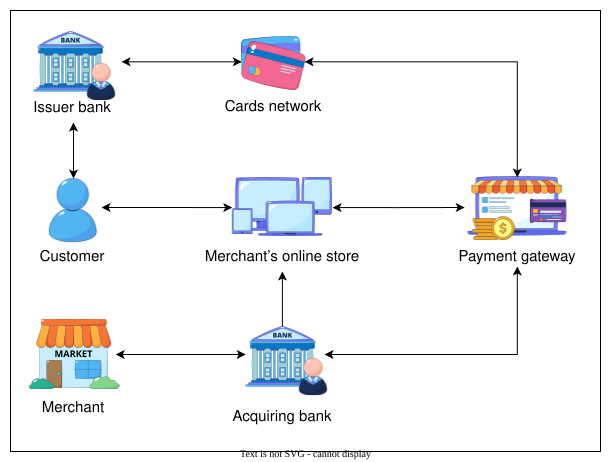

# Introduction_to_the_Payment_System

Source: https://www.educative.io/courses/grokking-the-system-design-interview/introduction-to-the-payment-system

---

[Home](https://www.educative.io/)

[Courses](https://www.educative.io/search?tab=courses)

[Grokking Modern System Design Interview](https://www.educative.io/courses/grokking-the-system-design-interview)

# Introduction to the Payment System

Financial technology (fintech) is revolutionizing e-commerce by facilitating quick, secure transactions through digital payment systems. These systems encompass various methods, including credit/debit cards, mobile payments, and digital wallets, ensuring efficient money transfers. The payment process involves two key phases: authorization, which verifies the payment method's validity and funds, and settlement, which transfers the funds to the merchant. The design of a payment system requires careful consideration of functional and nonfunctional requirements, resource estimation for transactions, and essential components like payment gateways and databases to ensure reliability and scalability.

We'll cover the following...

- [What is a digital payment system?](https://www.educative.io/courses/grokking-the-system-design-interview/introduction-to-the-payment-system#What-is-a-digital-payment-system)
- [The payment process](https://www.educative.io/courses/grokking-the-system-design-interview/introduction-to-the-payment-system#The-payment-process)
  - [The authorization phase](https://www.educative.io/courses/grokking-the-system-design-interview/introduction-to-the-payment-system#The-authorization-phase)
  - [The settlement phase](https://www.educative.io/courses/grokking-the-system-design-interview/introduction-to-the-payment-system#The-settlement-phase)
- [Requirements](https://www.educative.io/courses/grokking-the-system-design-interview/introduction-to-the-payment-system#Requirements)
  - [Functional requirements](https://www.educative.io/courses/grokking-the-system-design-interview/introduction-to-the-payment-system#Functional-requirements)
  - [Non-functional requirements](https://www.educative.io/courses/grokking-the-system-design-interview/introduction-to-the-payment-system#Non-functional-requirements)
- [Resource estimation](https://www.educative.io/courses/grokking-the-system-design-interview/introduction-to-the-payment-system#Resource-estimation)
  - [Storage estimation](https://www.educative.io/courses/grokking-the-system-design-interview/introduction-to-the-payment-system#Storage-estimation)
  - [Bandwidth estimation](https://www.educative.io/courses/grokking-the-system-design-interview/introduction-to-the-payment-system#Bandwidth-estimation)
    - [Incoming bandwidth](https://www.educative.io/courses/grokking-the-system-design-interview/introduction-to-the-payment-system#Incoming-bandwidth)
    - [Outgoing bandwidth](https://www.educative.io/courses/grokking-the-system-design-interview/introduction-to-the-payment-system#Outgoing-bandwidth)
  - [Number of servers estimation](https://www.educative.io/courses/grokking-the-system-design-interview/introduction-to-the-payment-system#Number-of-servers-estimation)
- [Building blocks we will use](https://www.educative.io/courses/grokking-the-system-design-interview/introduction-to-the-payment-system#Building-blocks-we-will-use)

Financial technology (fintech) platforms connect merchants and consumers to process transactions quickly and securely. Integrated payment platforms and digital wallets simplify payment processing and operational workflows. This lesson explains how digital payment systems work and their role in modern commerce.

## What is a digital payment system?[#](https://www.educative.io/courses/grokking-the-system-design-interview/introduction-to-the-payment-system#What-is-a-digital-payment-system)

A **payment system** handles the transfer of funds for purchases. It supports multiple methods, including credit cards, bank transfers, digital wallets, and cryptocurrencies. These systems ensure the secure transfer of funds between parties. This design focuses on payments made through credit and debit cards. Before defining the architecture, it is important to understand the payment flow.

## The payment process[#](https://www.educative.io/courses/grokking-the-system-design-interview/introduction-to-the-payment-system#The-payment-process)

The payment process involves multiple entities. When a customer pays with a card, the system must verify the cardholder, process the payment, and validate the transaction.

The figure below illustrates the payment processing flow:

Payment processing system and the entities involved in it

The table below details the roles of different entities in the system:

|  |  |
| --- | --- |
| **Entities** | **Description** |
| Customer | - A cardholder who wants to purchase goods or services. |
| Merchant | - A company or person who provides goods or services. |
| Issuer bank | - The bank that holds the customer*’s* account and provides credit or debit cards. |
| Acquiring bank | - The bank holding the merchant’s account. |
| Merchant's online store | - The online website where the customer purchases goods or services by providing credit card details. |
| Payment gateway | - A network that facilitates and authorizes transactions of funds to merchants’ accounts. - Requests and receives payment from the customer’s account. |
| Cards network | - Validates the credit or debit card information. - Facilitates payments via credit and debit cards. - Sets the terms for credit or debit card transactions. |

Credit card transactions typically involve two phases: *authorization* and *settlement*. These phases verify the transaction and transfer funds from the customer to the merchant. The following is an overview of each phase:

### The authorization phase[#](https://www.educative.io/courses/grokking-the-system-design-interview/introduction-to-the-payment-system#The-authorization-phase)

The authorization phase’s primary purpose is to verify whether the customer’s payment method (e.g., credit card) is valid, has sufficient funds or credit available, and can be used to make the intended purchase.

1. The customer provides payment details to the merchant via a payment gateway.
2. The gateway requests payment authorization from the customer’s issuer bank.
3. The issuer bank validates the card and checks for fraud and the available credit limit.
4. If approved, the issuer sends an authorization code to the gateway.
5. The gateway relays the code to the merchant, authorizing the transaction.

Successful authorization reserves the amount on the customer’s card but does not immediately transfer funds.

### The settlement phase[#](https://www.educative.io/courses/grokking-the-system-design-interview/introduction-to-the-payment-system#The-settlement-phase)

Settlement finalizes the transaction by moving funds to the merchant’s account.

1. The merchant accumulates authorized transactions over a period (e.g., daily).
2. The merchant sends a batch of transactions to the payment processor or acquiring bank. (Note: Some gateways, like Stripe, also act as processors.)
3. The processor verifies transactions and transfers funds from issuing banks to the merchant’s bank.
4. The processor reconciles the transactions to ensure accuracy.
5. Funds are deposited into the merchant’s account, completing the process.

> **Note:** Authorization is typically immediate, while settlement often occurs in batches.

Once settled, the transaction appears on the customer’s statement, and the payment is complete.

AI Powered

Saved

1 attempt left

Reset

The settlement phase

In what scenarios could authorization succeed but settlement fail, and how should the system handle it?

This is your last attempt.

Now that we understand the process, let’s design a payment system tailored to the specific requirements.

## Requirements[#](https://www.educative.io/courses/grokking-the-system-design-interview/introduction-to-the-payment-system#Requirements)

We will define the functional and non-functional requirements.

### Functional requirements[#](https://www.educative.io/courses/grokking-the-system-design-interview/introduction-to-the-payment-system#Functional-requirements)

The system will accept card payments via a PSP.

- **User registration and authentication:**Users should be able to create accounts, log in securely, and reset passwords.
- **Payment processing:**Users should be able to initiate payment processing upon purchasing a product or service. The system should accept payment via credit and debit cards. Each payment is scored for fraud risk, and the system allows, blocks, requests additional authentication, or holds it for review according to explicit policy rules.
- **Transaction history:**Users should be able to view a history of their transactions, including dates, amounts, and descriptions.
- **Balance management:**Users should be able to check their account balances, including available funds and pending transactions.
- **Mobile accessibility:**Users should be able to access and use the payment system through mobile apps or responsive web interfaces.

### Non-functional requirements[#](https://www.educative.io/courses/grokking-the-system-design-interview/introduction-to-the-payment-system#Non-functional-requirements)

The system must meet the following operational standards:

- **Data integrity and security:**The system should comply with industry security standards. It should also have robust data encryption and secure storage mechanisms, maintain consistency, and prevent data corruption. Fraud scoring must add only a small, bounded delay to checkout, and every risk decision must be recorded for audit.
- **Availability:**The system should be highly available to ensure users can always access it.
- **Reliability:**Redundancy, failover mechanisms, and backup systems should be in place.
- **Scalability:**The system should scale seamlessly as the user base and transaction volume grow. It should also handle peak loads during events like promotions or sales.
- **Performance:**The system should handle high transaction loads without significant slowdowns. The response times for payment processing and account updates should also be within acceptable limits.

Next, we estimate the resources required for the system.

## Resource estimation[#](https://www.educative.io/courses/grokking-the-system-design-interview/introduction-to-the-payment-system#Resource-estimation)

We assume the system handles 50 million transactions per day. This averages ~2 million transactions per hour, rising to 5 million during peak times.

### Storage estimation[#](https://www.educative.io/courses/grokking-the-system-design-interview/introduction-to-the-payment-system#Storage-estimation)

We must store user details and transaction records. Assuming each transaction is 100 bytes and each user record is 200 bytes, we calculate the daily storage requirement:

Storage required per day=50 M×100 bytes+200 bytes≈5 GB\text{Storage required per day} = \text{50 M} \times100 \text{ bytes}+ \text{200 bytes} \approx 5 \text{ GB}Storage required per day=50 M×100 bytes+200 bytes≈5 GB

> **Note:** User records are stored once; transactions reference the user ID.

Use the calculator below to estimate storage needs.

#### Estimating Storage Requirements

|  |  |  |
| --- | --- | --- |
| Size of a single transaction | 100 | Bytes |
| Size of each user’s record | 200 | Bytes |
| No. of transactions per day | 50 | Million |
| Amount of storage required per day | f5 | GB |

### Bandwidth estimation[#](https://www.educative.io/courses/grokking-the-system-design-interview/introduction-to-the-payment-system#Bandwidth-estimation)

Bandwidth requirements depend on the amount of data moving in and out of the system during transactions.

#### Incoming bandwidth[#](https://www.educative.io/courses/grokking-the-system-design-interview/introduction-to-the-payment-system#Incoming-bandwidth)

With a peak load of 5 million transactions per hour, the system handles approximately 1,400 transactions per second (TPS). At 100 bytes per transaction, the incoming bandwidth is:

Totalincoming bandwidth=Totaltransaction/sec×Totaltransaction size=1400×100 Bytes≈1.12 Mbps\begin{align\*}
\text{Total}\_{\text{incoming bandwidth}} &= \text{Total}\_{\text{transaction/sec}} \times \text{Total}\_{\text{transaction size}} \\
&=1400 \times 100 \text{ Bytes} \\
&\approx 1.12 \text{ Mbps}
\end{align\*}Totalincoming bandwidth​​=Totaltransaction/sec​×Totaltransaction size​=1400×100 Bytes≈1.12 Mbps​

#### Outgoing bandwidth[#](https://www.educative.io/courses/grokking-the-system-design-interview/introduction-to-the-payment-system#Outgoing-bandwidth)

Responses contain status codes, tokens, and metadata. We assume an average size of 130 bytes per response.

Totaloutgoing bandwidth=Totalresponse/sec×Totalresponse size=1400×130 Bytes≈1.46 Mbps\begin{align\*}
\text{Total}\_{\text{outgoing bandwidth}} &= \text{Total}\_{\text{response/sec}} \times \text{Total}\_{\text{response size}} \\
&=1400 \times 130 \text{ Bytes} \\
&\approx 1.46 \text{ Mbps}
\end{align\*}Totaloutgoing bandwidth​​=Totalresponse/sec​×Totalresponse size​=1400×130 Bytes≈1.46 Mbps​

The calculator below estimates the total bandwidth:

#### Estimating Incoming and Outgoing Bandwidths

|  |  |  |
| --- | --- | --- |
| No. of transactions per second | 1400 | transaction |
| Size of each transaction (request) | 100 | bytes |
| Size of each response | 130 | bytes |
| Total incoming bandwidth | f1.12 | Mbps |
| Total outgoing bandwidth | f1.46 | Mbps |

Quiz

1.

Assume that the number of transactions is increased to 3000 per second in peak time. Also, suppose that each transaction’s size is increased to 350 bytes. What is the bandwidth requirement estimation in this case?

A.

8400 Kbps8400 \ Kbps8400 Kbps

B.

8400 KBps8400 \ KBps8400 KBps

C.

8.4 Kbps8.4 \ Kbps8.4 Kbps

D.

None of the above

---

1 / 1

> **Note:** Real-world scenarios require additional capacity for redundancy, backups, and metadata.

### Number of servers estimation[#](https://www.educative.io/courses/grokking-the-system-design-interview/introduction-to-the-payment-system#Number-of-servers-estimation)

To estimate the server count, we use the peak traffic load. Given [our assumption](https://www.educative.io/courses/grokking-the-system-design-interview/put-back-of-the-envelope-numbers-in-perspective) that daily active users serve as a proxy for requests per second, we get 50 million requests per second. Then, we use the following formula to calculate the number of servers:

Servers needed at peak load = Number of requests/secondRPS of server\text{Servers needed at peak load = }\frac{\text{Number\ of\ requests/second}}{\text{RPS of server}}Servers needed at peak load = RPS of serverNumber of requests/second​

Assuming a single server can handle 64,000 RPS, the estimation is:

Servers needed at peak load =50 million64,000≈782 servers\text{Servers needed at peak load =} \frac{\text{50 million}}{\text{64,000}} ≈ \text{782 servers}Servers needed at peak load =64,00050 million​≈782 servers

Number of servers required for payment system

Next, we identify the core building blocks for the design.

## Building blocks we will use[#](https://www.educative.io/courses/grokking-the-system-design-interview/introduction-to-the-payment-system#Building-blocks-we-will-use)

The payment system requires specific components, including essential services such as payment gateways, risk checks, and reconciliation systems.

Building blocks in the payment System Design

- [**Databases:**](https://www.educative.io/courses/grokking-the-system-design-interview/introduction-to-databases) Store user payment events and transaction data.
- [**Load balancers**](https://www.educative.io/courses/grokking-the-system-design-interview/introduction-to-load-balancers)**:** Distribute incoming requests across available servers.
- [**Pub-sub systems:**](https://www.educative.io/courses/grokking-the-system-design-interview/system-design-the-pub-sub-abstraction) Decouple services like payment processing, wallets, and ledgers.

In the next lesson, we will detail the system design.

Design of a Code Deployment System

Design of a Payment System

Ask

[What is a digital payment system?](https://www.educative.io/courses/grokking-the-system-design-interview/introduction-to-the-payment-system#What-is-a-digital-payment-system)

[The payment process](https://www.educative.io/courses/grokking-the-system-design-interview/introduction-to-the-payment-system#The-payment-process)

[The authorization phase](https://www.educative.io/courses/grokking-the-system-design-interview/introduction-to-the-payment-system#The-authorization-phase)

[The settlement phase](https://www.educative.io/courses/grokking-the-system-design-interview/introduction-to-the-payment-system#The-settlement-phase)

[Requirements](https://www.educative.io/courses/grokking-the-system-design-interview/introduction-to-the-payment-system#Requirements)

[Functional requirements](https://www.educative.io/courses/grokking-the-system-design-interview/introduction-to-the-payment-system#Functional-requirements)

[Non-functional requirements](https://www.educative.io/courses/grokking-the-system-design-interview/introduction-to-the-payment-system#Non-functional-requirements)

[Resource estimation](https://www.educative.io/courses/grokking-the-system-design-interview/introduction-to-the-payment-system#Resource-estimation)

[Storage estimation](https://www.educative.io/courses/grokking-the-system-design-interview/introduction-to-the-payment-system#Storage-estimation)

[Bandwidth estimation](https://www.educative.io/courses/grokking-the-system-design-interview/introduction-to-the-payment-system#Bandwidth-estimation)

[Incoming bandwidth](https://www.educative.io/courses/grokking-the-system-design-interview/introduction-to-the-payment-system#Incoming-bandwidth)

[Outgoing bandwidth](https://www.educative.io/courses/grokking-the-system-design-interview/introduction-to-the-payment-system#Outgoing-bandwidth)

[Number of servers estimation](https://www.educative.io/courses/grokking-the-system-design-interview/introduction-to-the-payment-system#Number-of-servers-estimation)

[Building blocks we will use](https://www.educative.io/courses/grokking-the-system-design-interview/introduction-to-the-payment-system#Building-blocks-we-will-use)