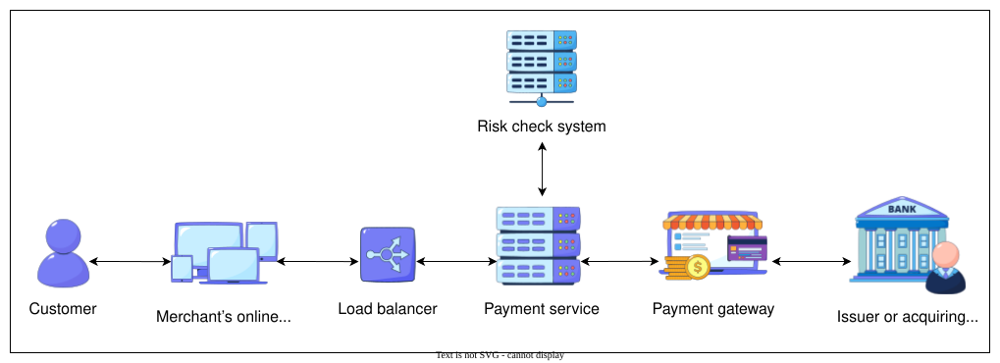

# Design_of_a_Payment_System

Source: https://www.educative.io/courses/grokking-the-system-design-interview/design-of-a-payment-system

---

[Home](https://www.educative.io/)

[Courses](https://www.educative.io/search?tab=courses)

[Grokking Modern System Design Interview](https://www.educative.io/courses/grokking-the-system-design-interview)

# Design of a Payment System

The design of a payment system involves a high-level architecture where customer transactions trigger a series of processes, including risk assessment and payment authorization. Key components include the payment service, fraud detection, risk check systems, and payment gateways, which work together to ensure secure and efficient transactions. Essential APIs facilitate user registration, payment processing, and transaction history management. The system also incorporates mechanisms for handling transient failures, ensuring transaction completion, and maintaining financial integrity through reconciliation and dispute management. Overall, the design emphasizes security, scalability, and resilience in processing payments.

We'll cover the following...

- [High-level design](https://www.educative.io/courses/grokking-the-system-design-interview/design-of-a-payment-system#High-level-design)
- [API design](https://www.educative.io/courses/grokking-the-system-design-interview/design-of-a-payment-system#API-design)
  - [User registration and authentication](https://www.educative.io/courses/grokking-the-system-design-interview/design-of-a-payment-system#User-registration-and-authentication)
  - [Payment processing](https://www.educative.io/courses/grokking-the-system-design-interview/design-of-a-payment-system#Payment-processing)
- [Storage schema](https://www.educative.io/courses/grokking-the-system-design-interview/design-of-a-payment-system#Storage-schema)
- [Detailed design](https://www.educative.io/courses/grokking-the-system-design-interview/design-of-a-payment-system#Detailed-design)
- [Transaction completion](https://www.educative.io/courses/grokking-the-system-design-interview/design-of-a-payment-system#Transaction-completion)
- [AI-powered fraud scoring](https://www.educative.io/courses/grokking-the-system-design-interview/design-of-a-payment-system#AI-powered-fraud-scoring)
  - [LLM assistance for fraud analysts](https://www.educative.io/courses/grokking-the-system-design-interview/design-of-a-payment-system#LLM-assistance-for-fraud-analysts)
- [Transient failures](https://www.educative.io/courses/grokking-the-system-design-interview/design-of-a-payment-system#Transient-failures)
  - [Retry strategy](https://www.educative.io/courses/grokking-the-system-design-interview/design-of-a-payment-system#Retry-strategy)
  - [Time-out](https://www.educative.io/courses/grokking-the-system-design-interview/design-of-a-payment-system#Time-out)
  - [Fallback](https://www.educative.io/courses/grokking-the-system-design-interview/design-of-a-payment-system#Fallback)
- [Achieving requirements](https://www.educative.io/courses/grokking-the-system-design-interview/design-of-a-payment-system#Achieving-requirements)
  - [Achieving functional requirements](https://www.educative.io/courses/grokking-the-system-design-interview/design-of-a-payment-system#Achieving-functional-requirements)
  - [Achieving non-functional requirements](https://www.educative.io/courses/grokking-the-system-design-interview/design-of-a-payment-system#Achieving-non-functional-requirements)
- [Conclusion](https://www.educative.io/courses/grokking-the-system-design-interview/design-of-a-payment-system#Conclusion)

In the previous lesson, we defined the requirements and resource estimates for our payment system. Now, we will cover its high-level design.

## High-level design[#](https://www.educative.io/courses/grokking-the-system-design-interview/design-of-a-payment-system#High-level-design)

High-level design of the payment system

1. A customer clicks the pay button on a merchant’s website, which triggers the payment service.
2. The payment service processes the customer’s information and sends the transaction details to the risk check system for fraud detection.
3. If the transaction passes the risk check, the payment service forwards the request to the payment gateway.
4. The payment gateway validates the payment details and forwards the request to the card issuer’s bank.
5. The issuer’s bank processes the request and sends the payment to the merchant’s account via the payment service.
6. The merchant’s account balance is updated to reflect the successful transaction.

AI Powered

Saved

1 attempt left

Reset

Decoupling fraud checks

How does decoupling fraud checks from the payment gateway improve scalability and security?

This is your last attempt.

Now that we have a high-level design, let’s define the APIs that will serve as the system’s entry points.

## API design[#](https://www.educative.io/courses/grokking-the-system-design-interview/design-of-a-payment-system#API-design)

The following APIs are essential to meet our functional requirements.

### User registration and authentication[#](https://www.educative.io/courses/grokking-the-system-design-interview/design-of-a-payment-system#User-registration-and-authentication)

- **User registration:** This API handles new user registration.

Ace Editor

1

registerUser(username, email, password)

הההההההההההההההההההההההההההההההההההההההההההההההההההההההההההההההההההההההההההההההההההההההההההההההההההההההההההההההההההההההההההההההההההההההההההההההההההההההההההההההההההההההההההההההההההההההההההההההההההההההההההההההההההההההההההההההההההההההההההההההההההההההההההההההההההההההההההההההההההההההההההההההההההההההההההההההההההההההההההההההההההההההההההההההההההההההההההההההההההההההההההההההההההההההההההההההההההההההההההההההההההההההההההההההההההההההההההההההההההההההההההההההההההההההההההההההההההההההההההההההההההההההההההההההההההההההההההההההה

XXXXXXXXXXXXXXXXXXXXXXXXXXXXXXXXXXXXXXXXXXXXXXXXXXXXXXXXXXXXXXXXXXXXXXXXXXXXXXXXXXXXXXXXXXXXXXXXXXXXXXXXXXXXXXXXXXXXXXXXXXXXXXXXXXXXXXXXXXXXXXXXXXXXXXXXXXXXXXXXXXXXXXXXXXXXXXXXXXXXXXXXXXXXXXXXXXXXXXXXXXXXXXXXXXXXXXXXXXXXXXXXXXXXXXXXXXXXXXXXXXXXXXXXXXXXXXXXXXXXXXXXXXXXXXXXXXXXXXXXXXXXXXXXXXXXXXXXXXXXXXXXXXXXXXXXXXXXXXXXXXXXXXXXXXXXXXXXXXXXXXXXXXXXXXXXXXXXXXXXXXXXXXXXXXXXXXXXXXXXXXXXXXXXXXXXXXXXXXXXXXXXXXXXXXXXXXXXXXXXXXXXXXXXXXXXXXXXXXXXXXXXXXXXXXXXXXXXXXXXXXXXXXXXXXXXXXXXXXXXXXXXXXXXXXXXXXXXXXXXXXXXXXXXXXXX

The `registerUser` API hashes the user’s password before saving it to the database. The table below explains the API’s parameters.

|  |  |
| --- | --- |
| **Parameter** | **Description** |
| `username` | A unique user name opted for by the customer. |
| `email` | Customer’s email id to be used later in the authentication phase. |
| `password` | The customer’s password is used for authentication later. |

- **User authentication:** This API authenticates users. We will assume a basic authentication mechanism.

Ace Editor

1

authenticateUser(username, password)

הההההההההההההההההההההההההההההההההההההההההההההההההההההההההההההההההההההההההההההההההההההההההההההההההההההההההההההההההההההההההההההההההההההההההההההההההההההההההההההההההההההההההההההההההההההההההההההההההההההההההההההההההההההההההההההההההההההההההההההההההההההההההההההההההההההההההההההההההההההההההההההההההההההההההההההההההההההההההההההההההההההההההההההההההההההההההההההההההההההההההההההההההההההההההההההההההההההההההההההההההההההההההההההההההההההההההההההההההההההההההההההההההההההההההההההההההההההההההההההההההההההההההההההההההההההההההההההההה

XXXXXXXXXXXXXXXXXXXXXXXXXXXXXXXXXXXXXXXXXXXXXXXXXXXXXXXXXXXXXXXXXXXXXXXXXXXXXXXXXXXXXXXXXXXXXXXXXXXXXXXXXXXXXXXXXXXXXXXXXXXXXXXXXXXXXXXXXXXXXXXXXXXXXXXXXXXXXXXXXXXXXXXXXXXXXXXXXXXXXXXXXXXXXXXXXXXXXXXXXXXXXXXXXXXXXXXXXXXXXXXXXXXXXXXXXXXXXXXXXXXXXXXXXXXXXXXXXXXXXXXXXXXXXXXXXXXXXXXXXXXXXXXXXXXXXXXXXXXXXXXXXXXXXXXXXXXXXXXXXXXXXXXXXXXXXXXXXXXXXXXXXXXXXXXXXXXXXXXXXXXXXXXXXXXXXXXXXXXXXXXXXXXXXXXXXXXXXXXXXXXXXXXXXXXXXXXXXXXXXXXXXXXXXXXXXXXXXXXXXXXXXXXXXXXXXXXXXXXXXXXXXXXXXXXXXXXXXXXXXXXXXXXXXXXXXXXXXXXXXXXXXXXXXXXX

### Payment processing[#](https://www.educative.io/courses/grokking-the-system-design-interview/design-of-a-payment-system#Payment-processing)

The following APIs handle payment processing tasks.

- **Payment authorization:** This API verifies that the customer has sufficient funds to complete the payment. If successful, it associates the transaction with the merchant and returns an authorization code.

Ace Editor

1

authorizePayment(amount, card\_number, expiration\_date, CVV, merchant\_id)

הההההההההההההההההההההההההההההההההההההההההההההההההההההההההההההההההההההההההההההההההההההההההההההההההההההההההההההההההההההההההההההההההההההההההההההההההההההההההההההההההההההההההההההההההההההההההההההההההההההההההההההההההההההההההההההההההההההההההההההההההההההההההההההההההההההההההההההההההההההההההההההההההההההההההההההההההההההההההההההההההההההההההההההההההההההההההההההההההההההההההההההההההההההההההההההההההההההההההההההההההההההההההההההההההההההההההההההההההההההההההההההההההההההההההההההההההההההההההההההההההההההההההההההההההההההההההההההההה

XXXXXXXXXXXXXXXXXXXXXXXXXXXXXXXXXXXXXXXXXXXXXXXXXXXXXXXXXXXXXXXXXXXXXXXXXXXXXXXXXXXXXXXXXXXXXXXXXXXXXXXXXXXXXXXXXXXXXXXXXXXXXXXXXXXXXXXXXXXXXXXXXXXXXXXXXXXXXXXXXXXXXXXXXXXXXXXXXXXXXXXXXXXXXXXXXXXXXXXXXXXXXXXXXXXXXXXXXXXXXXXXXXXXXXXXXXXXXXXXXXXXXXXXXXXXXXXXXXXXXXXXXXXXXXXXXXXXXXXXXXXXXXXXXXXXXXXXXXXXXXXXXXXXXXXXXXXXXXXXXXXXXXXXXXXXXXXXXXXXXXXXXXXXXXXXXXXXXXXXXXXXXXXXXXXXXXXXXXXXXXXXXXXXXXXXXXXXXXXXXXXXXXXXXXXXXXXXXXXXXXXXXXXXXXXXXXXXXXXXXXXXXXXXXXXXXXXXXXXXXXXXXXXXXXXXXXXXXXXXXXXXXXXXXXXXXXXXXXXXXXXXXXXXXXXX

The table below describes the API’s parameters.

|  |  |
| --- | --- |
| **Parameter** | **Description** |
| `amount` | The amount to be paid by the customer for a purchase. |
| `card_number` | 16-digit customer’s payment card number. |
| `expiration_date` | The expiry date of the payment card. |
| `CVV` | A 3-digit card verification value of the payment card. |
| `merchant_id` | A unique identifier for the merchant receiving the payment. Used to route the transaction and reserve funds for the correct merchant account. |

- **Payment capture:** This API captures previously authorized funds, completing the transaction and transferring the money to the merchant’s account.

Ace Editor

1

capturePayment(authorization\_code, amount)

הההההההההההההההההההההההההההההההההההההההההההההההההההההההההההההההההההההההההההההההההההההההההההההההההההההההההההההההההההההההההההההההההההההההההההההההההההההההההההההההההההההההההההההההההההההההההההההההההההההההההההההההההההההההההההההההההההההההההההההההההההההההההההההההההההההההההההההההההההההההההההההההההההההההההההההההההההההההההההההההההההההההההההההההההההההההההההההההההההההההההההההההההההההההההההההההההההההההההההההההההההההההההההההההההההההההההההההההההההההההההההההההההההההההההההההההההההההההההההההההההההההההההההההההההההההההההההההההה

XXXXXXXXXXXXXXXXXXXXXXXXXXXXXXXXXXXXXXXXXXXXXXXXXXXXXXXXXXXXXXXXXXXXXXXXXXXXXXXXXXXXXXXXXXXXXXXXXXXXXXXXXXXXXXXXXXXXXXXXXXXXXXXXXXXXXXXXXXXXXXXXXXXXXXXXXXXXXXXXXXXXXXXXXXXXXXXXXXXXXXXXXXXXXXXXXXXXXXXXXXXXXXXXXXXXXXXXXXXXXXXXXXXXXXXXXXXXXXXXXXXXXXXXXXXXXXXXXXXXXXXXXXXXXXXXXXXXXXXXXXXXXXXXXXXXXXXXXXXXXXXXXXXXXXXXXXXXXXXXXXXXXXXXXXXXXXXXXXXXXXXXXXXXXXXXXXXXXXXXXXXXXXXXXXXXXXXXXXXXXXXXXXXXXXXXXXXXXXXXXXXXXXXXXXXXXXXXXXXXXXXXXXXXXXXXXXXXXXXXXXXXXXXXXXXXXXXXXXXXXXXXXXXXXXXXXXXXXXXXXXXXXXXXXXXXXXXXXXXXXXXXXXXXXXXX

|  |  |
| --- | --- |
| **Parameter** | **Description** |
| `authorization_code` | The authorization code provided by the `authorizePayment` API upon successful verification. |
| `amount` | The amount to be deducted from the customer’s account and transferred to the merchant’s account. |

- **Verify payment status:** This API checks the status of a transaction to confirm if it was successful or declined.

Ace Editor

1

checkPaymentStatus(transaction\_id)

הההההההההההההההההההההההההההההההההההההההההההההההההההההההההההההההההההההההההההההההההההההההההההההההההההההההההההההההההההההההההההההההההההההההההההההההההההההההההההההההההההההההההההההההההההההההההההההההההההההההההההההההההההההההההההההההההההההההההההההההההההההההההההההההההההההההההההההההההההההההההההההההההההההההההההההההההההההההההההההההההההההההההההההההההההההההההההההההההההההההההההההההההההההההההההההההההההההההההההההההההההההההההההההההההההההההההההההההההההההההההההההההההההההההההההההההההההההההההההההההההההההההההההההההההההההההההההההההה

XXXXXXXXXXXXXXXXXXXXXXXXXXXXXXXXXXXXXXXXXXXXXXXXXXXXXXXXXXXXXXXXXXXXXXXXXXXXXXXXXXXXXXXXXXXXXXXXXXXXXXXXXXXXXXXXXXXXXXXXXXXXXXXXXXXXXXXXXXXXXXXXXXXXXXXXXXXXXXXXXXXXXXXXXXXXXXXXXXXXXXXXXXXXXXXXXXXXXXXXXXXXXXXXXXXXXXXXXXXXXXXXXXXXXXXXXXXXXXXXXXXXXXXXXXXXXXXXXXXXXXXXXXXXXXXXXXXXXXXXXXXXXXXXXXXXXXXXXXXXXXXXXXXXXXXXXXXXXXXXXXXXXXXXXXXXXXXXXXXXXXXXXXXXXXXXXXXXXXXXXXXXXXXXXXXXXXXXXXXXXXXXXXXXXXXXXXXXXXXXXXXXXXXXXXXXXXXXXXXXXXXXXXXXXXXXXXXXXXXXXXXXXXXXXXXXXXXXXXXXXXXXXXXXXXXXXXXXXXXXXXXXXXXXXXXXXXXXXXXXXXXXXXXXXXXX

- **Transaction history:** This API returns a customer’s transaction history during the specified date range.

Ace Editor

1

getTransactionHistory(customer\_id, start\_date, end\_date)

הההההההההההההההההההההההההההההההההההההההההההההההההההההההההההההההההההההההההההההההההההההההההההההההההההההההההההההההההההההההההההההההההההההההההההההההההההההההההההההההההההההההההההההההההההההההההההההההההההההההההההההההההההההההההההההההההההההההההההההההההההההההההההההההההההההההההההההההההההההההההההההההההההההההההההההההההההההההההההההההההההההההההההההההההההההההההההההההההההההההההההההההההההההההההההההההההההההההההההההההההההההההההההההההההההההההההההההההההההההההההההההההההההההההההההההההההההההההההההההההההההההההההההההההההההההההההההההההה

XXXXXXXXXXXXXXXXXXXXXXXXXXXXXXXXXXXXXXXXXXXXXXXXXXXXXXXXXXXXXXXXXXXXXXXXXXXXXXXXXXXXXXXXXXXXXXXXXXXXXXXXXXXXXXXXXXXXXXXXXXXXXXXXXXXXXXXXXXXXXXXXXXXXXXXXXXXXXXXXXXXXXXXXXXXXXXXXXXXXXXXXXXXXXXXXXXXXXXXXXXXXXXXXXXXXXXXXXXXXXXXXXXXXXXXXXXXXXXXXXXXXXXXXXXXXXXXXXXXXXXXXXXXXXXXXXXXXXXXXXXXXXXXXXXXXXXXXXXXXXXXXXXXXXXXXXXXXXXXXXXXXXXXXXXXXXXXXXXXXXXXXXXXXXXXXXXXXXXXXXXXXXXXXXXXXXXXXXXXXXXXXXXXXXXXXXXXXXXXXXXXXXXXXXXXXXXXXXXXXXXXXXXXXXXXXXXXXXXXXXXXXXXXXXXXXXXXXXXXXXXXXXXXXXXXXXXXXXXXXXXXXXXXXXXXXXXXXXXXXXXXXXXXXXXXX

|  |  |
| --- | --- |
| **Parameter** | **Description** |
| `customer_id` | The customer’s ID is the one who has requested transaction history. |
| `start_date` | The start date of the transaction is to be displayed to a customer. |
| `end_date` | The end date of the transaction to be displayed to a customer. |

Now that we have defined the APIs, let’s

design the database schema required to support them.

## Storage schema[#](https://www.educative.io/courses/grokking-the-system-design-interview/design-of-a-payment-system#Storage-schema)

Each of the above APIs requires database support. Let’s understand how the payment system stores different types of information:

Payment system storage schema overview

With the APIs and storage schema defined, we can now move on to the detailed design. The following diagram shows the system’s components and their interactions.

## Detailed design[#](https://www.educative.io/courses/grokking-the-system-design-interview/design-of-a-payment-system#Detailed-design)

The illustration below highlights the various components involved in the system:

Detailed design of the payment system

The process begins when a customer provides their payment details on a merchant’s site. These details include the card number, cardholder name, CVV/CVC, and expiration date. Before payment, the user authentication service verifies the customer’s identity. Once authenticated, clicking the pay button triggers the payment service.

Let’s examine each component in the System Design:

- **Payment service:** Receives the payment event from the merchant and stores it in the associated database, performs initial security checks, and forwards the details to the fraud detection service.
- **Fraud detection service:** Analyzes transaction patterns in real time to identify and flag suspicious activity. It works with the risk check system to block high-risk payments without flagging legitimate ones.
- **Risk check system:** Works with the fraud detection service to assess a transaction’s risk level. It evaluates factors such as device fingerprinting, transaction history, and location to produce a risk score using the risk model. A versioned policy engine then decides whether the payment should proceed, be challenged, be reviewed, or be blocked, and every decision is recorded in the decision log.

1.

If a fraud detection system is already in place, what additional value does a dedicated risk check system provide?

Show Answer

Did you find this helpful?

- **Payment gateway (payment service provider):** The payment gateway securely transfers funds from the customer’s account to the merchant’s account. It performs extensive security checks, often handled by a third-party specialist. As a Payment Service Provider (PSP), it may also offer secondary services like session management, refunds, and invoice generation.
- **Card networks:**Networkssuch as Visa and Mastercard, verify credit and debit card information. The payment gateway interacts with these networks via their APIs.
- **Wallet:** When a payment is successful, the payment service updates the merchant’s wallet in the database to reflect the new balance. For purchases involving multiple sellers, the service processes each order separately and updates each seller’s wallet.
- **Ledger:** After updating the wallet, the ledger service appends a new, immutable entry to the ledger database. This entry includes details like the transaction ID, amount, and parties involved, creating an auditable trail of all financial operations.

1.

Where are the customer’s payment details encrypted during a purchase?

Show Answer

Did you find this helpful?

- **Reconciliation system:** Reconciliation is the process of matching financial records to ensure accuracy and identify discrepancies. The system compares the internal ledger against transaction records from the payment gateway (or PSP). This is critical for catching errors and fraud. At the end of each day, the PSP sends a settlement file summarizing the day’s transactions. The reconciliation system compares this file with the internal ledger. For example, if a merchant’s ledger shows three payments totaling $225, the system verifies that the PSP’s settlement file matches those payments. Any mismatch is flagged for investigation.

1.

What happens if a mismatch is found during reconciliation?

Show Answer

Did you find this helpful?

- **Dispute management service:** This service manages disputes between customers, merchants, and banks. It handles chargebacks, ensures compliance with financial regulations, and maintains dispute records to prevent fraud. Chargeback outcomes from this service are also fed back asynchronously to the risk model.

This detailed design raises several important questions about reliability:

1. How should we guarantee transaction completion?
2. How can we handle transient failures, and what strategies should we adopt?
3. How can we avoid persistent failures?

Let’s address these questions one by one.

## Transaction completion[#](https://www.educative.io/courses/grokking-the-system-design-interview/design-of-a-payment-system#Transaction-completion)

Within the payment system, multiple interconnected services collaborate to execute a transaction. In a distributed system, requests can be lost over the network, or a service might be temporarily unavailable.

Flow of services involved in transaction completion

To ensure transaction completion, we can use a pub-sub system such as Apache Kafka. When a payment is initiated, we publish an event to a Kafka topic. Consumer services process these events, and a message is only marked as consumed after the transaction is successfully processed and recorded in the wallet and ledger databases. This ensures that no payment events are lost.

## AI-powered fraud scoring[#](https://www.educative.io/courses/grokking-the-system-design-interview/design-of-a-payment-system#AI-powered-fraud-scoring)

Our detailed design sends each payment through a fraud detection service and a risk check before it reaches the payment gateway. This section looks inside that step. [Stripe Radar](https://docs.stripe.com/radar/rules/reference) is a well-documented example: it evaluates every payment with machine learning in real time and lets businesses add rules that allow, block, request authentication, or send a payment to manual review.

- **Risk scores and policy:** The fraud model does not decide anything by itself. It looks up features about the transaction and its context, such as amount, card history, device, location, and how many payments the same card attempted recently, and returns a **risk score**. A separate, versioned **policy** turns that score into an action:

  - **Allow:** Low risk; the payment continues to the gateway.
  - **Request authentication:** Medium risk; the customer completes an extra check, such as 3D Secure, before continuing.
  - **Review:** Uncertain; the payment is held for a human analyst.
  - **Block:** High risk; the payment is declined.

Keeping the score and the policy separate lets a business tighten or relax thresholds without retraining the model. As with spam filtering in the Web Crawler chapter, a stricter threshold catches more fraud but also declines more legitimate customers, and each false decline is a lost sale and a frustrated customer.

- **Placement in the payment flow:** Scoring sits on the checkout path, so it has a strict time budget, typically tens of milliseconds. The policy must also define what happens if scoring is slow or unavailable, for example falling back to rule-based checks and requesting authentication for higher-value payments, rather than silently approving everything.  
  The risk decision is tied to the payment’s idempotency key (explained in the next section). If a client retries a request, the stored decision is reused, so a retry can never turn a blocked payment into an allowed one. Each decision is recorded with the score, the model version, and the policy version, so auditors can see exactly why a payment was blocked.
- **Delayed outcomes:** Whether a payment was really fraudulent often becomes clear only weeks later, when a customer disputes it and a chargeback arrives. These outcomes are processed asynchronously and joined with the original decisions to measure fraud loss and false declines, and to retrain the model. Because labels arrive late and some fraud is never reported, evaluation must account for incomplete data.

The following diagram shows how a payment moves from scoring to its outcome.

Turning a fraud risk score into a payment decision

**Note:** A fraud decision is not the same as card authorization or a ledger update. The card issuer still approves or declines the charge, and the ledger records money movement according to explicit state transitions. The fraud decision only determines whether the payment proceeds to those steps.

### LLM assistance for fraud analysts[#](https://www.educative.io/courses/grokking-the-system-design-interview/design-of-a-payment-system#LLM-assistance-for-fraud-analysts)

The review action sends uncertain payments to human analysts, and each case can involve dozens of signals. A large language model can help by turning those signals, the customer’s recent history, and similar past cases into a short written summary, so the analyst can decide faster.

The LLM only summarizes. It never approves or blocks a payment, and the analyst’s decision is still what gets recorded. It receives only the fields needed for the case, with card numbers and other sensitive data masked, and each summary links back to the underlying signals so the analyst can verify it. If the model is unavailable, the analyst sees the raw signals as before.

## Transient failures[#](https://www.educative.io/courses/grokking-the-system-design-interview/design-of-a-payment-system#Transient-failures)

A **transient failure** is a temporary error caused by issues like network glitches or brief resource shortages. Our system must handle these gracefully. We can use several strategies:

- Retry strategy
- Timeout
- Fallback mechanism

Let’s examine how each of these strategies helps improve resilience in the payment system.

### Retry strategy[#](https://www.educative.io/courses/grokking-the-system-design-interview/design-of-a-payment-system#Retry-strategy)

The retry strategy helps overcome temporary network issues. We can implement exponential backoff and set a maximum number of retries. If the transaction still fails after reaching the limit, it is marked as failed.

### Time-out[#](https://www.educative.io/courses/grokking-the-system-design-interview/design-of-a-payment-system#Time-out)

Time-outs prevent a service from waiting indefinitely for a response. If a response takes too long, the operation is terminated. However, this can create ambiguity. For example, if a customer’s payment request times out, it’s unclear what happened on the backend:

1. The payment was processed successfully, but the response was lost on its way back to the client.

Response from the payment service got lost in transit

2. The request is still being processed, but the client-side time-out was reached.

Request time-out

3. The request was lost in transit and never reached the payment service.

Request got lost in midway

In these scenarios, the client cannot know the true status of the payment. If the customer retries the operation, they could be charged twice. This problem is solved using **idempotency**. An idempotent API ensures that repeating the same request multiple times produces the same result as the initial request, preventing duplicate charges. This is typically implemented by having the client generate a unique request ID (an idempotency key) that the server uses to recognize and de-duplicate retried requests.

1.

How to ensure that there are no duplicate payments when a customer hits the buy button many times for a single purchase?

Show Answer

1 / 2

### Fallback[#](https://www.educative.io/courses/grokking-the-system-design-interview/design-of-a-payment-system#Fallback)

A **fallback** is a backup process used when a primary method fails. For example, if the fraud check service returns an error, instead of failing the entire payment, we can use a fallback. For a very small transaction, the fallback might be to approve the payment and accept the minor risk by using a fallback value, as defined in the fraud policy. This approach balances risk against customer experience.

## Achieving requirements[#](https://www.educative.io/courses/grokking-the-system-design-interview/design-of-a-payment-system#Achieving-requirements)

Let’s see how the proposed payment System Design satisfies both functional and non-functional requirements.

### Achieving functional requirements[#](https://www.educative.io/courses/grokking-the-system-design-interview/design-of-a-payment-system#Achieving-functional-requirements)

The following table summarizes how the payment system fulfills the functional requirements that we outlined in the previous lesson:

|  |  |
| --- | --- |
| **Functional Requirements** | **Techniques** |
| User registration and authentication | - Handled by the merchant's online store. It provides secure login, session management, and user identity validation - Authenticated requests forwarded to the payment service |
| Payment processing | - Payment processing is handled by the payment service in conjunction with other coordinated services, such as PSP, fraud detection services, and reconciliation services, among others. - Each payment is scored for fraud risk and handled according to explicit policy rules |
| Transaction history | - The ledger stores immutable transaction logs, including details such as ID, amount, currency, involved parties, status, and timestamp. |
| Balance management | - The wallet maintains up-to-date merchant balances by reflecting successful payments and refunds. - The payment service updates the wallet after each transaction. - Ledger provides an auditable balance history for verification |
| Mobile accessibility | - Enabled by a responsive Merchant’s online store UI. |

### Achieving non-functional requirements[#](https://www.educative.io/courses/grokking-the-system-design-interview/design-of-a-payment-system#Achieving-non-functional-requirements)

Beyond core features, a payment system must be secure, scalable, and resilient. The table below shows how our proposed design meets these essential non-functional requirements:

|  |  |
| --- | --- |
| **Non-Functional Requirements** | **Techniques** |
| Data integrity and security | - Adhere to industry security standards such as PCI DSS (Payment Card Industry Data Security Standard). - Use robust encryption and secure storage mechanisms. - Score each payment with ML-based fraud risk models and versioned policies, bound the scoring time, define a fallback when scoring is unavailable, and log every decision for audit. - Score every payment with an ML risk model and a versioned policy, bound the scoring time with a defined fallback, and record every risk decision for audit. |
| Reliability and availability | - Use redundant services (payment, reconciliation, risk check) to prevent failures. - Replicate data across multiple data centers for high availability. - Utilize local load balancers to exclude failed servers. - Deploy global load balancers to redirect traffic during regional failures. |
| Scalability | - Scale databases efficiently and cache frequently accessed data to optimize performance. - Implement load balancing to prevent bottlenecks. - Enable monitoring and automated scaling for dynamic resource allocation. |
| Performance | - Process transactions asynchronously to decouple services. - Ensure sufficient bandwidth during peak times. - Implement transient failure strategies (retry, timeout, and fallback) to ensure timely responses. |

## Conclusion[#](https://www.educative.io/courses/grokking-the-system-design-interview/design-of-a-payment-system#Conclusion)

This lesson describes a payment system that covers the process from authorization to settlement. The design addresses key functional and non-functional requirements with a focus on credit and debit card transactions. The design also scores each payment for fraud risk and applies versioned policies, so uncertain risk scores become safe, auditable decisions. While the design covers core components, entities such as banks and merchants are external systems outside the system boundary. A payment system must balance security, reliability, and efficiency to maintain financial integrity and user trust.

Introduction to the Payment System

Payment System Design

Ask

[High-level design](https://www.educative.io/courses/grokking-the-system-design-interview/design-of-a-payment-system#High-level-design)

[API design](https://www.educative.io/courses/grokking-the-system-design-interview/design-of-a-payment-system#API-design)

[User registration and authentication](https://www.educative.io/courses/grokking-the-system-design-interview/design-of-a-payment-system#User-registration-and-authentication)

[Payment processing](https://www.educative.io/courses/grokking-the-system-design-interview/design-of-a-payment-system#Payment-processing)

[Storage schema](https://www.educative.io/courses/grokking-the-system-design-interview/design-of-a-payment-system#Storage-schema)

[Detailed design](https://www.educative.io/courses/grokking-the-system-design-interview/design-of-a-payment-system#Detailed-design)

[Transaction completion](https://www.educative.io/courses/grokking-the-system-design-interview/design-of-a-payment-system#Transaction-completion)

[AI-powered fraud scoring](https://www.educative.io/courses/grokking-the-system-design-interview/design-of-a-payment-system#AI-powered-fraud-scoring)

[LLM assistance for fraud analysts](https://www.educative.io/courses/grokking-the-system-design-interview/design-of-a-payment-system#LLM-assistance-for-fraud-analysts)

[Transient failures](https://www.educative.io/courses/grokking-the-system-design-interview/design-of-a-payment-system#Transient-failures)

[Retry strategy](https://www.educative.io/courses/grokking-the-system-design-interview/design-of-a-payment-system#Retry-strategy)

[Time-out](https://www.educative.io/courses/grokking-the-system-design-interview/design-of-a-payment-system#Time-out)

[Fallback](https://www.educative.io/courses/grokking-the-system-design-interview/design-of-a-payment-system#Fallback)

[Achieving requirements](https://www.educative.io/courses/grokking-the-system-design-interview/design-of-a-payment-system#Achieving-requirements)

[Achieving functional requirements](https://www.educative.io/courses/grokking-the-system-design-interview/design-of-a-payment-system#Achieving-functional-requirements)

[Achieving non-functional requirements](https://www.educative.io/courses/grokking-the-system-design-interview/design-of-a-payment-system#Achieving-non-functional-requirements)

[Conclusion](https://www.educative.io/courses/grokking-the-system-design-interview/design-of-a-payment-system#Conclusion)