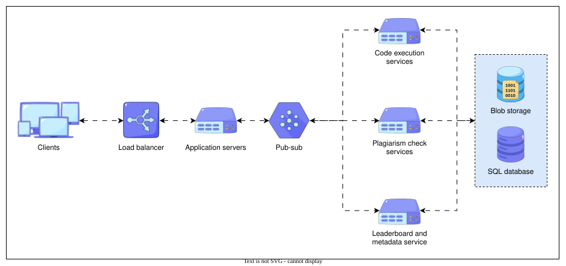

# Design_of_the_LeetCode_System

Source: https://www.educative.io/courses/grokking-the-system-design-interview/design-of-the-leetcode-system

---

[Home](https://www.educative.io/)

[Courses](https://www.educative.io/search?tab=courses)

[Grokking Modern System Design Interview](https://www.educative.io/courses/grokking-the-system-design-interview)

# Design of the LeetCode System

Explore the design, components, and workflows of the LeetCode system to understand how it is built to support efficient, secure, and scalable coding problems and contests.

We'll cover the following...

- [High-level design of LeetCode](https://www.educative.io/courses/grokking-the-system-design-interview/design-of-the-leetcode-system#High-level-design-of-LeetCode)
  - [Workflow](https://www.educative.io/courses/grokking-the-system-design-interview/design-of-the-leetcode-system#Workflow)
  - [API design](https://www.educative.io/courses/grokking-the-system-design-interview/design-of-the-leetcode-system#API-design)
    - [List questions APIs](https://www.educative.io/courses/grokking-the-system-design-interview/design-of-the-leetcode-system#List-questions-APIs)
    - [Language support APIs](https://www.educative.io/courses/grokking-the-system-design-interview/design-of-the-leetcode-system#Language-support-APIs)
    - [Contest registration APIs](https://www.educative.io/courses/grokking-the-system-design-interview/design-of-the-leetcode-system#Contest-registration-APIs)
    - [Submit code APIs](https://www.educative.io/courses/grokking-the-system-design-interview/design-of-the-leetcode-system#Submit-code-APIs)
    - [Leaderboard APIs](https://www.educative.io/courses/grokking-the-system-design-interview/design-of-the-leetcode-system#Leaderboard-APIs)
    - [Interview APIs](https://www.educative.io/courses/grokking-the-system-design-interview/design-of-the-leetcode-system#Interview-APIs)
    - [Discussion APIs](https://www.educative.io/courses/grokking-the-system-design-interview/design-of-the-leetcode-system#Discussion-APIs)
    - [History APIs](https://www.educative.io/courses/grokking-the-system-design-interview/design-of-the-leetcode-system#History-APIs)
  - [Storage schema](https://www.educative.io/courses/grokking-the-system-design-interview/design-of-the-leetcode-system#Storage-schema)
- [Detailed design of LeetCode](https://www.educative.io/courses/grokking-the-system-design-interview/design-of-the-leetcode-system#Detailed-design-of-LeetCode)
  - [Example workflows](https://www.educative.io/courses/grokking-the-system-design-interview/design-of-the-leetcode-system#Example-workflows)
- [LeetCode system evaluation](https://www.educative.io/courses/grokking-the-system-design-interview/design-of-the-leetcode-system#LeetCode-system-evaluation)
- [Conclusion](https://www.educative.io/courses/grokking-the-system-design-interview/design-of-the-leetcode-system#Conclusion)

In this lesson, we’ll explore the high-level and detailed design of a service similar to LeetCode. We’ll learn how different components, such as code execution, plagiarism checks, and leaderboards, work together to deliver a scalable, reliable, and secure platform for coding problems and contests.

Let’s start with the high-level design.

## High-level design of LeetCode[#](https://www.educative.io/courses/grokking-the-system-design-interview/design-of-the-leetcode-system#High-level-design-of-LeetCode)

The following diagram illustrates the high-level architecture of the system:

High-level design of the LeetCode system

The core components of this system are detailed below:

|  |  |
| --- | --- |
| **Component** | **Role in the System** |
| Load balancer | Distributes incoming requests evenly across multiple application servers |
| Application server | Receives client requests and routes them to appropriate backend services |
| Pub-sub service | Manages asynchronous communication between services |
| Code execution service | Runs user-submitted code in secure, isolated environments and captures the results |
| Plagiarism checker | Verifies the originality of code submissions using similarity detection algorithms |
| Leaderboard and metadata service | Manages leaderboard data and contest-related metadata |
| Blob storage | Stores large unstructured files, primarily user-submitted source code |
| Database | Stores all structured data, including user profiles, problem statements, contest information, and references to files in blob storage |

Let’s now look at how these components work together to process a user’s code submission, both for contests and standalone practice problems. While the overall execution pipeline remains the same, certain steps, such as leaderboard updates or plagiarism checks, apply only to contest submissions.

### Workflow[#](https://www.educative.io/courses/grokking-the-system-design-interview/design-of-the-leetcode-system#Workflow)

The following steps outline the flow of a single contest submission:

1. When a user submits a solution to a coding problem during a contest, the load balancer sends this request to an application server.
2. The application server forwards the submission to the pub-sub service, where the request is queued for processing.
3. The code execution service consumes the queued event and runs the submitted code in a secure environment. It stores the execution results (status, runtime, memory) in the database and the raw output logs in blob storage. Once execution is complete, a completion event is published to the results topic in the pub-sub service.
4. Along with the code execution service, the plagiarism checker also receives the code in parallel and evaluates its originality. Results are returned to the pub-sub service for further processing.
5. The leaderboard and metadata service collects the results from both the code execution service and the plagiarism checker and updates the leaderboard in real time. It stores this data for later retrieval and analysis by users.

This workflow ensures that the system can handle large volumes of simultaneous submissions while maintaining performance, fairness, and data integrity.

Now, let’s explore the key APIs that facilitate communication with the various LeetCode services.

### API design[#](https://www.educative.io/courses/grokking-the-system-design-interview/design-of-the-leetcode-system#API-design)

The platform’s functionality is exposed through APIs managed by various microservices. A dedicated API gateway handles request routing, authentication, and rate limiting, forwarding requests to the appropriate backend service.

#### List questions APIs[#](https://www.educative.io/courses/grokking-the-system-design-interview/design-of-the-leetcode-system#List-questions-APIs)

- **List problems:** This API lists problems based on different difficulty levels and topics. The `listProblems()` API sends input parameters to the backend system, which processes them and returns a paginated list of available problems based on the user’s requirements.

Ace Editor

1

listProblems(topic, difficulty\_level)

הההההההההההההההההההההההההההההההההההההההההההההההההההההההההההההההההההההההההההההההההההההההההההההההההההההההההההההההההההההההההההההההההההההההההההההההההההההההההההההההההההההההההההההההההההההההההההההההההההההההההההההההההההההההההההההההההההההההההההההההההההההההההההההההההההההההההההההההההההההההההההההההההההההההההההההההההההההההההההההההההההההההההההההההההההההההההההההההההההההההההההההההההההההההההההההההההההההההההההההההההההההההההההההההההההההההההההההההההההההההההההההההההההההההההההההההההההההההההההההההההההההההההההההההההההההההההההההההה

XXXXXXXXXXXXXXXXXXXXXXXXXXXXXXXXXXXXXXXXXXXXXXXXXXXXXXXXXXXXXXXXXXXXXXXXXXXXXXXXXXXXXXXXXXXXXXXXXXXXXXXXXXXXXXXXXXXXXXXXXXXXXXXXXXXXXXXXXXXXXXXXXXXXXXXXXXXXXXXXXXXXXXXXXXXXXXXXXXXXXXXXXXXXXXXXXXXXXXXXXXXXXXXXXXXXXXXXXXXXXXXXXXXXXXXXXXXXXXXXXXXXXXXXXXXXXXXXXXXXXXXXXXXXXXXXXXXXXXXXXXXXXXXXXXXXXXXXXXXXXXXXXXXXXXXXXXXXXXXXXXXXXXXXXXXXXXXXXXXXXXXXXXXXXXXXXXXXXXXXXXXXXXXXXXXXXXXXXXXXXXXXXXXXXXXXXXXXXXXXXXXXXXXXXXXXXXXXXXXXXXXXXXXXXXXXXXXXXXXXXXXXXXXXXXXXXXXXXXXXXXXXXXXXXXXXXXXXXXXXXXXXXXXXXXXXXXXXXXXXXXXXXXXXXXXX

- **Run code:** This API evaluates the solution by executing it and analyzing the output against the test cases. The `runCode()` API returns the execution result, indicating whether the solution passed or failed. In case of failure, it points out the error so the user can debug and correct the issue.

Ace Editor

1

runCode(user\_id, code, test\_cases, prog\_lang)

הההההההההההההההההההההההההההההההההההההההההההההההההההההההההההההההההההההההההההההההההההההההההההההההההההההההההההההההההההההההההההההההההההההההההההההההההההההההההההההההההההההההההההההההההההההההההההההההההההההההההההההההההההההההההההההההההההההההההההההההההההההההההההההההההההההההההההההההההההההההההההההההההההההההההההההההההההההההההההההההההההההההההההההההההההההההההההההההההההההההההההההההההההההההההההההההההההההההההההההההההההההההההההההההההההההההההההההההההההההההההההההההההההההההההההההההההההההההההההההההההההההההההההההההההההההההההההההההה

XXXXXXXXXXXXXXXXXXXXXXXXXXXXXXXXXXXXXXXXXXXXXXXXXXXXXXXXXXXXXXXXXXXXXXXXXXXXXXXXXXXXXXXXXXXXXXXXXXXXXXXXXXXXXXXXXXXXXXXXXXXXXXXXXXXXXXXXXXXXXXXXXXXXXXXXXXXXXXXXXXXXXXXXXXXXXXXXXXXXXXXXXXXXXXXXXXXXXXXXXXXXXXXXXXXXXXXXXXXXXXXXXXXXXXXXXXXXXXXXXXXXXXXXXXXXXXXXXXXXXXXXXXXXXXXXXXXXXXXXXXXXXXXXXXXXXXXXXXXXXXXXXXXXXXXXXXXXXXXXXXXXXXXXXXXXXXXXXXXXXXXXXXXXXXXXXXXXXXXXXXXXXXXXXXXXXXXXXXXXXXXXXXXXXXXXXXXXXXXXXXXXXXXXXXXXXXXXXXXXXXXXXXXXXXXXXXXXXXXXXXXXXXXXXXXXXXXXXXXXXXXXXXXXXXXXXXXXXXXXXXXXXXXXXXXXXXXXXXXXXXXXXXXXXXXX

- **Search problem:** This API allows users to search for specific problems based on topics or keywords. The `search()` API returns a paginated list of available problems based on the user’s query.

Ace Editor

1

search(query\_text)

הההההההההההההההההההההההההההההההההההההההההההההההההההההההההההההההההההההההההההההההההההההההההההההההההההההההההההההההההההההההההההההההההההההההההההההההההההההההההההההההההההההההההההההההההההההההההההההההההההההההההההההההההההההההההההההההההההההההההההההההההההההההההההההההההההההההההההההההההההההההההההההההההההההההההההההההההההההההההההההההההההההההההההההההההההההההההההההההההההההההההההההההההההההההההההההההההההההההההההההההההההההההההההההההההההההההההההההההההההההההההההההההההההההההההההההההההההההההההההההההההההההההההההההההההההההההההההההההה

XXXXXXXXXXXXXXXXXXXXXXXXXXXXXXXXXXXXXXXXXXXXXXXXXXXXXXXXXXXXXXXXXXXXXXXXXXXXXXXXXXXXXXXXXXXXXXXXXXXXXXXXXXXXXXXXXXXXXXXXXXXXXXXXXXXXXXXXXXXXXXXXXXXXXXXXXXXXXXXXXXXXXXXXXXXXXXXXXXXXXXXXXXXXXXXXXXXXXXXXXXXXXXXXXXXXXXXXXXXXXXXXXXXXXXXXXXXXXXXXXXXXXXXXXXXXXXXXXXXXXXXXXXXXXXXXXXXXXXXXXXXXXXXXXXXXXXXXXXXXXXXXXXXXXXXXXXXXXXXXXXXXXXXXXXXXXXXXXXXXXXXXXXXXXXXXXXXXXXXXXXXXXXXXXXXXXXXXXXXXXXXXXXXXXXXXXXXXXXXXXXXXXXXXXXXXXXXXXXXXXXXXXXXXXXXXXXXXXXXXXXXXXXXXXXXXXXXXXXXXXXXXXXXXXXXXXXXXXXXXXXXXXXXXXXXXXXXXXXXXXXXXXXXXXXXX

**Note:** The difference between `listProblems()` and `search()` lies in how the user explores problems.

- The `listProblems()` API is used when users browse problems using structured filters such as difficulty level, topic, or tags.
- The `search()` API is used when users already have something specific in mind and want to look up problems using free-text keywords.

For example, selecting filters like Medium and Arrays uses `listProblems()`, while typing "two sum" into the search bar uses `search()`.

#### Language support APIs[#](https://www.educative.io/courses/grokking-the-system-design-interview/design-of-the-leetcode-system#Language-support-APIs)

- **Language support:** This API lists the programming languages supported by the platform, along with their execution environment details. Clients use this to populate language selectors and validate submissions before execution.

Ace Editor

1

listSupportedLanguages()

הההההההההההההההההההההההההההההההההההההההההההההההההההההההההההההההההההההההההההההההההההההההההההההההההההההההההההההההההההההההההההההההההההההההההההההההההההההההההההההההההההההההההההההההההההההההההההההההההההההההההההההההההההההההההההההההההההההההההההההההההההההההההההההההההההההההההההההההההההההההההההההההההההההההההההההההההההההההההההההההההההההההההההההההההההההההההההההההההההההההההההההההההההההההההההההההההההההההההההההההההההההההההההההההההההההההההההההההההההההההההההההההההההההההההההההההההההההההההההההההההההההההההההההההההההההההההההההההה

XXXXXXXXXXXXXXXXXXXXXXXXXXXXXXXXXXXXXXXXXXXXXXXXXXXXXXXXXXXXXXXXXXXXXXXXXXXXXXXXXXXXXXXXXXXXXXXXXXXXXXXXXXXXXXXXXXXXXXXXXXXXXXXXXXXXXXXXXXXXXXXXXXXXXXXXXXXXXXXXXXXXXXXXXXXXXXXXXXXXXXXXXXXXXXXXXXXXXXXXXXXXXXXXXXXXXXXXXXXXXXXXXXXXXXXXXXXXXXXXXXXXXXXXXXXXXXXXXXXXXXXXXXXXXXXXXXXXXXXXXXXXXXXXXXXXXXXXXXXXXXXXXXXXXXXXXXXXXXXXXXXXXXXXXXXXXXXXXXXXXXXXXXXXXXXXXXXXXXXXXXXXXXXXXXXXXXXXXXXXXXXXXXXXXXXXXXXXXXXXXXXXXXXXXXXXXXXXXXXXXXXXXXXXXXXXXXXXXXXXXXXXXXXXXXXXXXXXXXXXXXXXXXXXXXXXXXXXXXXXXXXXXXXXXXXXXXXXXXXXXXXXXXXXXXXX

#### Contest registration APIs[#](https://www.educative.io/courses/grokking-the-system-design-interview/design-of-the-leetcode-system#Contest-registration-APIs)

- **Register contest:** This API allows users to register for a contest. The `registerContest()` API returns a success or failure status based on the result of the request.

Ace Editor

1

registerContest(user\_id, contest\_id, other)

הההההההההההההההההההההההההההההההההההההההההההההההההההההההההההההההההההההההההההההההההההההההההההההההההההההההההההההההההההההההההההההההההההההההההההההההההההההההההההההההההההההההההההההההההההההההההההההההההההההההההההההההההההההההההההההההההההההההההההההההההההההההההההההההההההההההההההההההההההההההההההההההההההההההההההההההההההההההההההההההההההההההההההההההההההההההההההההההההההההההההההההההההההההההההההההההההההההההההההההההההההההההההההההההההההההההההההההההההההההההההההההההההההההההההההההההההההההההההההההההההההההההההההההההההההההההההההההההה

XXXXXXXXXXXXXXXXXXXXXXXXXXXXXXXXXXXXXXXXXXXXXXXXXXXXXXXXXXXXXXXXXXXXXXXXXXXXXXXXXXXXXXXXXXXXXXXXXXXXXXXXXXXXXXXXXXXXXXXXXXXXXXXXXXXXXXXXXXXXXXXXXXXXXXXXXXXXXXXXXXXXXXXXXXXXXXXXXXXXXXXXXXXXXXXXXXXXXXXXXXXXXXXXXXXXXXXXXXXXXXXXXXXXXXXXXXXXXXXXXXXXXXXXXXXXXXXXXXXXXXXXXXXXXXXXXXXXXXXXXXXXXXXXXXXXXXXXXXXXXXXXXXXXXXXXXXXXXXXXXXXXXXXXXXXXXXXXXXXXXXXXXXXXXXXXXXXXXXXXXXXXXXXXXXXXXXXXXXXXXXXXXXXXXXXXXXXXXXXXXXXXXXXXXXXXXXXXXXXXXXXXXXXXXXXXXXXXXXXXXXXXXXXXXXXXXXXXXXXXXXXXXXXXXXXXXXXXXXXXXXXXXXXXXXXXXXXXXXXXXXXXXXXXXXXX

#### Submit code APIs[#](https://www.educative.io/courses/grokking-the-system-design-interview/design-of-the-leetcode-system#Submit-code-APIs)

- **Submit code:** The contestant submits code for a specific problem through this API once it is complete. The `submit()` API returns a success or failure status based on the result after submitting the code to the queuing service.

Ace Editor

1

submit(contestant\_id, code, test\_cases, submission\_time, prog\_lang)

הההההההההההההההההההההההההההההההההההההההההההההההההההההההההההההההההההההההההההההההההההההההההההההההההההההההההההההההההההההההההההההההההההההההההההההההההההההההההההההההההההההההההההההההההההההההההההההההההההההההההההההההההההההההההההההההההההההההההההההההההההההההההההההההההההההההההההההההההההההההההההההההההההההההההההההההההההההההההההההההההההההההההההההההההההההההההההההההההההההההההההההההההההההההההההההההההההההההההההההההההההההההההההההההההההההההההההההההההההההההההההההההההההההההההההההההההההההההההההההההההההההההההההההההההההההההההההההההה

XXXXXXXXXXXXXXXXXXXXXXXXXXXXXXXXXXXXXXXXXXXXXXXXXXXXXXXXXXXXXXXXXXXXXXXXXXXXXXXXXXXXXXXXXXXXXXXXXXXXXXXXXXXXXXXXXXXXXXXXXXXXXXXXXXXXXXXXXXXXXXXXXXXXXXXXXXXXXXXXXXXXXXXXXXXXXXXXXXXXXXXXXXXXXXXXXXXXXXXXXXXXXXXXXXXXXXXXXXXXXXXXXXXXXXXXXXXXXXXXXXXXXXXXXXXXXXXXXXXXXXXXXXXXXXXXXXXXXXXXXXXXXXXXXXXXXXXXXXXXXXXXXXXXXXXXXXXXXXXXXXXXXXXXXXXXXXXXXXXXXXXXXXXXXXXXXXXXXXXXXXXXXXXXXXXXXXXXXXXXXXXXXXXXXXXXXXXXXXXXXXXXXXXXXXXXXXXXXXXXXXXXXXXXXXXXXXXXXXXXXXXXXXXXXXXXXXXXXXXXXXXXXXXXXXXXXXXXXXXXXXXXXXXXXXXXXXXXXXXXXXXXXXXXXXXX

#### Leaderboard APIs[#](https://www.educative.io/courses/grokking-the-system-design-interview/design-of-the-leetcode-system#Leaderboard-APIs)

- **Leaderboard:** This API allows contestants to fetch the leaderboard to check their or others’ standing in the competition after attempting the contest. The `leaderboard()` API returns a list of the top N contestants in order of their standings, with details about the marks they obtained.

Ace Editor

1

leaderboard(contest\_id, contestant\_id)

הההההההההההההההההההההההההההההההההההההההההההההההההההההההההההההההההההההההההההההההההההההההההההההההההההההההההההההההההההההההההההההההההההההההההההההההההההההההההההההההההההההההההההההההההההההההההההההההההההההההההההההההההההההההההההההההההההההההההההההההההההההההההההההההההההההההההההההההההההההההההההההההההההההההההההההההההההההההההההההההההההההההההההההההההההההההההההההההההההההההההההההההההההההההההההההההההההההההההההההההההההההההההההההההההההההההההההההההההההההההההההההההההההההההההההההההההההההההההההההההההההההההההההההההההההההההההההההההה

XXXXXXXXXXXXXXXXXXXXXXXXXXXXXXXXXXXXXXXXXXXXXXXXXXXXXXXXXXXXXXXXXXXXXXXXXXXXXXXXXXXXXXXXXXXXXXXXXXXXXXXXXXXXXXXXXXXXXXXXXXXXXXXXXXXXXXXXXXXXXXXXXXXXXXXXXXXXXXXXXXXXXXXXXXXXXXXXXXXXXXXXXXXXXXXXXXXXXXXXXXXXXXXXXXXXXXXXXXXXXXXXXXXXXXXXXXXXXXXXXXXXXXXXXXXXXXXXXXXXXXXXXXXXXXXXXXXXXXXXXXXXXXXXXXXXXXXXXXXXXXXXXXXXXXXXXXXXXXXXXXXXXXXXXXXXXXXXXXXXXXXXXXXXXXXXXXXXXXXXXXXXXXXXXXXXXXXXXXXXXXXXXXXXXXXXXXXXXXXXXXXXXXXXXXXXXXXXXXXXXXXXXXXXXXXXXXXXXXXXXXXXXXXXXXXXXXXXXXXXXXXXXXXXXXXXXXXXXXXXXXXXXXXXXXXXXXXXXXXXXXXXXXXXXXXX

#### Interview APIs[#](https://www.educative.io/courses/grokking-the-system-design-interview/design-of-the-leetcode-system#Interview-APIs)

These APIs support interview-related workflows for users and companies.

- **Schedule interview:** Schedules a mock interview or an interview session on the platform.

Ace Editor

1

scheduleInterview(user\_id, other)

הההההההההההההההההההההההההההההההההההההההההההההההההההההההההההההההההההההההההההההההההההההההההההההההההההההההההההההההההההההההההההההההההההההההההההההההההההההההההההההההההההההההההההההההההההההההההההההההההההההההההההההההההההההההההההההההההההההההההההההההההההההההההההההההההההההההההההההההההההההההההההההההההההההההההההההההההההההההההההההההההההההההההההההההההההההההההההההההההההההההההההההההההההההההההההההההההההההההההההההההההההההההההההההההההההההההההההההההההההההההההההההההההההההההההההההההההההההההההההההההההההההההההההההההההההההההההההההההה

XXXXXXXXXXXXXXXXXXXXXXXXXXXXXXXXXXXXXXXXXXXXXXXXXXXXXXXXXXXXXXXXXXXXXXXXXXXXXXXXXXXXXXXXXXXXXXXXXXXXXXXXXXXXXXXXXXXXXXXXXXXXXXXXXXXXXXXXXXXXXXXXXXXXXXXXXXXXXXXXXXXXXXXXXXXXXXXXXXXXXXXXXXXXXXXXXXXXXXXXXXXXXXXXXXXXXXXXXXXXXXXXXXXXXXXXXXXXXXXXXXXXXXXXXXXXXXXXXXXXXXXXXXXXXXXXXXXXXXXXXXXXXXXXXXXXXXXXXXXXXXXXXXXXXXXXXXXXXXXXXXXXXXXXXXXXXXXXXXXXXXXXXXXXXXXXXXXXXXXXXXXXXXXXXXXXXXXXXXXXXXXXXXXXXXXXXXXXXXXXXXXXXXXXXXXXXXXXXXXXXXXXXXXXXXXXXXXXXXXXXXXXXXXXXXXXXXXXXXXXXXXXXXXXXXXXXXXXXXXXXXXXXXXXXXXXXXXXXXXXXXXXXXXXXXXX

- **Fetch interview problems:** Returns curated interview problem sets based on the company and role.

Ace Editor

1

getInterviewProblems(company\_id, role)

הההההההההההההההההההההההההההההההההההההההההההההההההההההההההההההההההההההההההההההההההההההההההההההההההההההההההההההההההההההההההההההההההההההההההההההההההההההההההההההההההההההההההההההההההההההההההההההההההההההההההההההההההההההההההההההההההההההההההההההההההההההההההההההההההההההההההההההההההההההההההההההההההההההההההההההההההההההההההההההההההההההההההההההההההההההההההההההההההההההההההההההההההההההההההההההההההההההההההההההההההההההההההההההההההההההההההההההההההההההההההההההההההההההההההההההההההההההההההההההההההההההההההההההההההההההההההההההההה

XXXXXXXXXXXXXXXXXXXXXXXXXXXXXXXXXXXXXXXXXXXXXXXXXXXXXXXXXXXXXXXXXXXXXXXXXXXXXXXXXXXXXXXXXXXXXXXXXXXXXXXXXXXXXXXXXXXXXXXXXXXXXXXXXXXXXXXXXXXXXXXXXXXXXXXXXXXXXXXXXXXXXXXXXXXXXXXXXXXXXXXXXXXXXXXXXXXXXXXXXXXXXXXXXXXXXXXXXXXXXXXXXXXXXXXXXXXXXXXXXXXXXXXXXXXXXXXXXXXXXXXXXXXXXXXXXXXXXXXXXXXXXXXXXXXXXXXXXXXXXXXXXXXXXXXXXXXXXXXXXXXXXXXXXXXXXXXXXXXXXXXXXXXXXXXXXXXXXXXXXXXXXXXXXXXXXXXXXXXXXXXXXXXXXXXXXXXXXXXXXXXXXXXXXXXXXXXXXXXXXXXXXXXXXXXXXXXXXXXXXXXXXXXXXXXXXXXXXXXXXXXXXXXXXXXXXXXXXXXXXXXXXXXXXXXXXXXXXXXXXXXXXXXXXXXX

#### Discussion APIs[#](https://www.educative.io/courses/grokking-the-system-design-interview/design-of-the-leetcode-system#Discussion-APIs)

- **Create topic:** This API allows users to create a topic as a starting point for discussion.  
  The `createTopic()` method returns a success or failure status based on the API result.

Ace Editor

1

createTopic(user\_id, topic\_title, topic\_text, date\_created)

הההההההההההההההההההההההההההההההההההההההההההההההההההההההההההההההההההההההההההההההההההההההההההההההההההההההההההההההההההההההההההההההההההההההההההההההההההההההההההההההההההההההההההההההההההההההההההההההההההההההההההההההההההההההההההההההההההההההההההההההההההההההההההההההההההההההההההההההההההההההההההההההההההההההההההההההההההההההההההההההההההההההההההההההההההההההההההההההההההההההההההההההההההההההההההההההההההההההההההההההההההההההההההההההההההההההההההההההההההההההההההההההההההההההההההההההההההההההההההההההההההההההההההההההההההההההההההההההה

XXXXXXXXXXXXXXXXXXXXXXXXXXXXXXXXXXXXXXXXXXXXXXXXXXXXXXXXXXXXXXXXXXXXXXXXXXXXXXXXXXXXXXXXXXXXXXXXXXXXXXXXXXXXXXXXXXXXXXXXXXXXXXXXXXXXXXXXXXXXXXXXXXXXXXXXXXXXXXXXXXXXXXXXXXXXXXXXXXXXXXXXXXXXXXXXXXXXXXXXXXXXXXXXXXXXXXXXXXXXXXXXXXXXXXXXXXXXXXXXXXXXXXXXXXXXXXXXXXXXXXXXXXXXXXXXXXXXXXXXXXXXXXXXXXXXXXXXXXXXXXXXXXXXXXXXXXXXXXXXXXXXXXXXXXXXXXXXXXXXXXXXXXXXXXXXXXXXXXXXXXXXXXXXXXXXXXXXXXXXXXXXXXXXXXXXXXXXXXXXXXXXXXXXXXXXXXXXXXXXXXXXXXXXXXXXXXXXXXXXXXXXXXXXXXXXXXXXXXXXXXXXXXXXXXXXXXXXXXXXXXXXXXXXXXXXXXXXXXXXXXXXXXXXXXXX

- **Update topic:** This API allows users to update an existing topic. The `updateTopic()` method returns a success or failure status based on the API result.

Ace Editor

1

updateTopic(user\_id, topic\_title, topic\_text, topic\_id, date\_created)

הההההההההההההההההההההההההההההההההההההההההההההההההההההההההההההההההההההההההההההההההההההההההההההההההההההההההההההההההההההההההההההההההההההההההההההההההההההההההההההההההההההההההההההההההההההההההההההההההההההההההההההההההההההההההההההההההההההההההההההההההההההההההההההההההההההההההההההההההההההההההההההההההההההההההההההההההההההההההההההההההההההההההההההההההההההההההההההההההההההההההההההההההההההההההההההההההההההההההההההההההההההההההההההההההההההההההההההההההההההההההההההההההההההההההההההההההההההההההההההההההההההההההההההההההההההההההההההההה

XXXXXXXXXXXXXXXXXXXXXXXXXXXXXXXXXXXXXXXXXXXXXXXXXXXXXXXXXXXXXXXXXXXXXXXXXXXXXXXXXXXXXXXXXXXXXXXXXXXXXXXXXXXXXXXXXXXXXXXXXXXXXXXXXXXXXXXXXXXXXXXXXXXXXXXXXXXXXXXXXXXXXXXXXXXXXXXXXXXXXXXXXXXXXXXXXXXXXXXXXXXXXXXXXXXXXXXXXXXXXXXXXXXXXXXXXXXXXXXXXXXXXXXXXXXXXXXXXXXXXXXXXXXXXXXXXXXXXXXXXXXXXXXXXXXXXXXXXXXXXXXXXXXXXXXXXXXXXXXXXXXXXXXXXXXXXXXXXXXXXXXXXXXXXXXXXXXXXXXXXXXXXXXXXXXXXXXXXXXXXXXXXXXXXXXXXXXXXXXXXXXXXXXXXXXXXXXXXXXXXXXXXXXXXXXXXXXXXXXXXXXXXXXXXXXXXXXXXXXXXXXXXXXXXXXXXXXXXXXXXXXXXXXXXXXXXXXXXXXXXXXXXXXXXXXX

- **Comment on the topic:** This API allows users to participate in a discussion by commenting or replying to a specific comment. The `comment()` method returns a success or failure status based on the API result.

Ace Editor

1

comment(user\_id, topic\_id, comment\_text, date\_created)

הההההההההההההההההההההההההההההההההההההההההההההההההההההההההההההההההההההההההההההההההההההההההההההההההההההההההההההההההההההההההההההההההההההההההההההההההההההההההההההההההההההההההההההההההההההההההההההההההההההההההההההההההההההההההההההההההההההההההההההההההההההההההההההההההההההההההההההההההההההההההההההההההההההההההההההההההההההההההההההההההההההההההההההההההההההההההההההההההההההההההההההההההההההההההההההההההההההההההההההההההההההההההההההההההההההההההההההההההההההההההההההההההההההההההההההההההההההההההההההההההההההההההההההההההההההההההההההההה

XXXXXXXXXXXXXXXXXXXXXXXXXXXXXXXXXXXXXXXXXXXXXXXXXXXXXXXXXXXXXXXXXXXXXXXXXXXXXXXXXXXXXXXXXXXXXXXXXXXXXXXXXXXXXXXXXXXXXXXXXXXXXXXXXXXXXXXXXXXXXXXXXXXXXXXXXXXXXXXXXXXXXXXXXXXXXXXXXXXXXXXXXXXXXXXXXXXXXXXXXXXXXXXXXXXXXXXXXXXXXXXXXXXXXXXXXXXXXXXXXXXXXXXXXXXXXXXXXXXXXXXXXXXXXXXXXXXXXXXXXXXXXXXXXXXXXXXXXXXXXXXXXXXXXXXXXXXXXXXXXXXXXXXXXXXXXXXXXXXXXXXXXXXXXXXXXXXXXXXXXXXXXXXXXXXXXXXXXXXXXXXXXXXXXXXXXXXXXXXXXXXXXXXXXXXXXXXXXXXXXXXXXXXXXXXXXXXXXXXXXXXXXXXXXXXXXXXXXXXXXXXXXXXXXXXXXXXXXXXXXXXXXXXXXXXXXXXXXXXXXXXXXXXXXXXX

#### History APIs[#](https://www.educative.io/courses/grokking-the-system-design-interview/design-of-the-leetcode-system#History-APIs)

- **Submission history:** Returns a user’s past submissions, results, and performance metrics.

Ace Editor

1

getSubmissionHistory(user\_id)

הההההההההההההההההההההההההההההההההההההההההההההההההההההההההההההההההההההההההההההההההההההההההההההההההההההההההההההההההההההההההההההההההההההההההההההההההההההההההההההההההההההההההההההההההההההההההההההההההההההההההההההההההההההההההההההההההההההההההההההההההההההההההההההההההההההההההההההההההההההההההההההההההההההההההההההההההההההההההההההההההההההההההההההההההההההההההההההההההההההההההההההההההההההההההההההההההההההההההההההההההההההההההההההההההההההההההההההההההההההההההההההההההההההההההההההההההההההההההההההההההההההההההההההההההההההההההההההההה

XXXXXXXXXXXXXXXXXXXXXXXXXXXXXXXXXXXXXXXXXXXXXXXXXXXXXXXXXXXXXXXXXXXXXXXXXXXXXXXXXXXXXXXXXXXXXXXXXXXXXXXXXXXXXXXXXXXXXXXXXXXXXXXXXXXXXXXXXXXXXXXXXXXXXXXXXXXXXXXXXXXXXXXXXXXXXXXXXXXXXXXXXXXXXXXXXXXXXXXXXXXXXXXXXXXXXXXXXXXXXXXXXXXXXXXXXXXXXXXXXXXXXXXXXXXXXXXXXXXXXXXXXXXXXXXXXXXXXXXXXXXXXXXXXXXXXXXXXXXXXXXXXXXXXXXXXXXXXXXXXXXXXXXXXXXXXXXXXXXXXXXXXXXXXXXXXXXXXXXXXXXXXXXXXXXXXXXXXXXXXXXXXXXXXXXXXXXXXXXXXXXXXXXXXXXXXXXXXXXXXXXXXXXXXXXXXXXXXXXXXXXXXXXXXXXXXXXXXXXXXXXXXXXXXXXXXXXXXXXXXXXXXXXXXXXXXXXXXXXXXXXXXXXXXXXX

- **Contest history:** Returns contests a user has participated in, along with rankings and scores.

Ace Editor

1

getContestHistory(user\_id)

הההההההההההההההההההההההההההההההההההההההההההההההההההההההההההההההההההההההההההההההההההההההההההההההההההההההההההההההההההההההההההההההההההההההההההההההההההההההההההההההההההההההההההההההההההההההההההההההההההההההההההההההההההההההההההההההההההההההההההההההההההההההההההההההההההההההההההההההההההההההההההההההההההההההההההההההההההההההההההההההההההההההההההההההההההההההההההההההההההההההההההההההההההההההההההההההההההההההההההההההההההההההההההההההההההההההההההההההההההההההההההההההההההההההההההההההההההההההההההההההההההההההההההההההההההההההההההההההה

XXXXXXXXXXXXXXXXXXXXXXXXXXXXXXXXXXXXXXXXXXXXXXXXXXXXXXXXXXXXXXXXXXXXXXXXXXXXXXXXXXXXXXXXXXXXXXXXXXXXXXXXXXXXXXXXXXXXXXXXXXXXXXXXXXXXXXXXXXXXXXXXXXXXXXXXXXXXXXXXXXXXXXXXXXXXXXXXXXXXXXXXXXXXXXXXXXXXXXXXXXXXXXXXXXXXXXXXXXXXXXXXXXXXXXXXXXXXXXXXXXXXXXXXXXXXXXXXXXXXXXXXXXXXXXXXXXXXXXXXXXXXXXXXXXXXXXXXXXXXXXXXXXXXXXXXXXXXXXXXXXXXXXXXXXXXXXXXXXXXXXXXXXXXXXXXXXXXXXXXXXXXXXXXXXXXXXXXXXXXXXXXXXXXXXXXXXXXXXXXXXXXXXXXXXXXXXXXXXXXXXXXXXXXXXXXXXXXXXXXXXXXXXXXXXXXXXXXXXXXXXXXXXXXXXXXXXXXXXXXXXXXXXXXXXXXXXXXXXXXXXXXXXXXXXXX

The following table summarizes the key parameters used across the platform's APIs.

|  |  |
| --- | --- |
| **Parameter** | **Description** |
| `user_id` | Unique ID of the authenticated user of the platform |
| `difficulty_level` | Difficulty level of the question (easy, medium, hard) |
| `topic` | Tag/topic used to list problems |
| `query_text` | Free-text query used to search for a problem/topic |
| `code` | Source code submitted for execution/evaluation |
| `prog_lang` | The programming language in which the code is written |
| `test_cases` | Test cases used to evaluate a solution |
| `contest_id` | Unique ID of the contest |
| `contestant_id` | Unique ID of the contestant participating in a contest |
| `contestant_name` | Name of the contestant |
| `submission_time` | Time at which a solution is submitted |
| `other` | Placeholder for optional workflow-specific metadata (e.g., contest registration or interview scheduling details) |
| `topic_id` | Unique ID of the topic (used to update or comment) |
| `topic_title` | Title of the topic |
| `topic_text` | Text/body of the topic |
| `comment_text` | Text of the comment made on a topic |
| `date_created` | Date/time when a topic or comment is created/updated |

Now, let's discuss the storage schema, which helps us understand how different types of data and parameters should be stored:

### Storage schema[#](https://www.educative.io/courses/grokking-the-system-design-interview/design-of-the-leetcode-system#Storage-schema)

The attributes or parameters defined for API calls will function correctly only if they are properly defined in the database. Each service has additional parameters to provide data or responses to users, which are outlined in the database schema. Below is the database schema used for each service:

Storage schema for LeetCode service

**Note:** In the storage schema, fields such as `code`, `test_case`, and `comment_id` do not store the complete data directly. Instead, they store references or IDs to related records or files. For example, user-submitted `code` is stored in blob storage, while the database stores a reference to the file. Test cases and comments are stored in dedicated relational tables and linked to problems, contests, or topics using foreign keys.

After discussing the high-level design, APIs, and database schema, let’s move on to the detailed design of a LeetCode system.

## Detailed design of LeetCode[#](https://www.educative.io/courses/grokking-the-system-design-interview/design-of-the-leetcode-system#Detailed-design-of-LeetCode)

The platform is built on a microservices architecture, where each service has a specific responsibility and communicates asynchronously via a central pub-sub system. This design helps the system scale, handle traffic spikes during contests, and remain resilient. The diagram below illustrates the key services and their interactions:

Detailed design of a LeetCode system with asynchronous job processing via pub-sub

Let’s break down the role of each component in this design.

- **API gateway:** The API gateway is the primary entry point for all client requests. It handles request routing, JWT validation (authentication), authorization checks, and rate limiting before forwarding requests to backend services.
- **User service:** The user service manages user-related functionality such as registration, login, and profile management. It uses a SQL database (e.g., PostgreSQL) to store user credentials and profile data securely.
- **Content service:** The content service manages the core library of coding problems, including descriptions, topics, and test cases. It exposes APIs for browsing and searching the problem set and leverages caching to reduce database load for frequently accessed content.
- **Caching layer:** An in-memory caching layer (e.g., Redis) is used alongside backend services to store frequently accessed data such as problem metadata, contest details, and leaderboard snapshots. This significantly reduces database load and improves read latency, especially during high-traffic events like contests.
- **Contest service:** The contest service manages the life cycle and state of contests. It handles user registration, validates real-time submissions during contests, and publishes submission jobs to the pub-sub system for asynchronous processing.
- **Pub-sub service:** The pub-sub service serves as the system’s communication backbone (e.g., Kafka). It decouples services by managing asynchronous jobs in dedicated queues, allowing the platform to absorb traffic spikes and handle high submission volumes reliably.
- **Code execution service:** The code execution service subscribes to the `code-execution-queue` and runs user-submitted code in ephemeral, containerized sandbox environments managed by a container orchestration platform. Each execution is isolated, resource-limited, and short-lived to ensure security, fairness, and efficient resource utilization.
- **Plagiarism check service:** The plagiarism check service subscribes to the `plagiarism-check-queue` to assess the originality of contest submissions using similarity detection algorithms such as MOSS. This service typically runs asynchronously as a background process so that it does not block code execution or real-time leaderboard updates.
- **Metadata service:** The metadata service acts as the system’s aggregator. It consumes execution results from the `results-topic`, updates cached leaderboard data (for example, using Redis sorted sets), and stores submission history and performance metrics in the database for long-term retrieval and analysis.
- **ZooKeeper:** ZooKeeper coordinates the distributed environment by supporting service discovery and leader election and by tracking worker membership for fault tolerance and failover in the execution and processing services.

Together, these services coordinate to handle user requests in a scalable and reliable way. The following examples illustrate how they interact in the two most common scenarios: submitting a solution during a contest and submitting one for practice.

### Example workflows[#](https://www.educative.io/courses/grokking-the-system-design-interview/design-of-the-leetcode-system#Example-workflows)

For a contest submission, the request is authenticated by the API gateway, then routed to the contest service. After validating contest eligibility, the contest service publishes two jobs to the pub-sub system: one to the `code-execution-queue` and another to the `plagiarism-check-queue`. The code execution service and plagiarism check service process these jobs in parallel, publishing their findings to a shared `results-topic`. The metadata service then consumes these results, updates the contest leaderboard, and makes the feedback available to the user.

For a practice submission, the request is authenticated and sent to the content service, which then publishes a single job to the `code-execution-queue`. The code execution service runs the code and publishes its result to the `results-topic`. The metadata service consumes this result, updates the user’s personal submission history, and provides immediate feedback. This workflow does not use the plagiarism check.

This process flow supports efficient, scalable, and secure handling of individual problem attempts, providing users with timely feedback and progress tracking.

## LeetCode system evaluation[#](https://www.educative.io/courses/grokking-the-system-design-interview/design-of-the-leetcode-system#LeetCode-system-evaluation)

To ensure a comprehensive assessment, we first review how the proposed system meets its core functional requirements, followed by an evaluation of non-functional requirements.

The following table outlines how various functional requirements are met.

|  |  |
| --- | --- |
| **Functional Requirement** | **Explanation** |
| List questions | - The content service enables users to browse and filter problems. - The content service performs indexed database queries to ensure fast retrieval of problems. |
| Contest registration | - The contest service manages user registrations and contest metadata. - The contest service tracks participant submissions and manages leaderboards for ongoing and completed contests. |
| Submit code | - The content service (for practice) and contest service (for contests) handle code submissions through an asynchronous pub-sub pipeline. - Code execution service runs solutions in secure, isolated sandboxes. |
| Leaderboard | - The metadata service consumes execution results to compute and maintain live rankings and performance metrics. - The contest service computes and maintains live rankings and performance metrics for participants. |
| Discussion | - The discussion service enables users to create topics, post comments, and reply, supporting collaborative problem-solving. |
| History tracking | - The platform stores submission history, solved problems, and contest results to allow users to track progress and performance over time. |

The following table discusses how different non-functional requirements are achieved.

|  |  |
| --- | --- |
| **Non-Functional Requirement** | **Explanation** |
| Availability | - The pub-sub system decouples microservices to prevent cascading failures. - Load balancers distribute traffic evenly to avoid single points of failure. |
| Scalability | - The distributed architecture supports horizontal scaling by adding more service instances. - Asynchronous processing and caching prevent performance bottlenecks. |
| Security | - The API gateway handles user authentication and authorization. - User-submitted code is executed in isolated containers (sandboxes) to prevent malicious access. |
| Consistency | - The system ensures deterministic evaluation, where the same code and inputs always produce the same result. - Shared data, like problem statements, appears consistently to all users. |
| Latency | - The system maintains low response times for user-facing interactions. - Intensive tasks are handled asynchronously to avoid degrading platform responsiveness. |

## Conclusion[#](https://www.educative.io/courses/grokking-the-system-design-interview/design-of-the-leetcode-system#Conclusion)

Designing a scalable and efficient coding practice and contest platform requires careful consideration of both functional and non-functional requirements. In this chapter, we explored the design of LeetCode, starting with its functional and non-functional requirements and resource estimation, and we presented both a high-level and detailed design covering key services such as content and contest management.

The design addresses essential components, including asynchronous processing, secure code execution, metadata management, and real-time feedback.

A well-designed system ensures a seamless and secure user experience, enabling millions of software engineers to enhance their coding skills and participate in contests reliably. By leveraging modular architectures and robust workflows, such platforms can scale effectively while maintaining performance and consistency and meet evolving user demands and technological challenges.

Introduction to the LeetCode System

System Design: Google Calendar

Ask

[High-level design of LeetCode](https://www.educative.io/courses/grokking-the-system-design-interview/design-of-the-leetcode-system#High-level-design-of-LeetCode)

[Workflow](https://www.educative.io/courses/grokking-the-system-design-interview/design-of-the-leetcode-system#Workflow)

[API design](https://www.educative.io/courses/grokking-the-system-design-interview/design-of-the-leetcode-system#API-design)

[List questions APIs](https://www.educative.io/courses/grokking-the-system-design-interview/design-of-the-leetcode-system#List-questions-APIs)

[Language support APIs](https://www.educative.io/courses/grokking-the-system-design-interview/design-of-the-leetcode-system#Language-support-APIs)

[Contest registration APIs](https://www.educative.io/courses/grokking-the-system-design-interview/design-of-the-leetcode-system#Contest-registration-APIs)

[Submit code APIs](https://www.educative.io/courses/grokking-the-system-design-interview/design-of-the-leetcode-system#Submit-code-APIs)

[Leaderboard APIs](https://www.educative.io/courses/grokking-the-system-design-interview/design-of-the-leetcode-system#Leaderboard-APIs)

[Interview APIs](https://www.educative.io/courses/grokking-the-system-design-interview/design-of-the-leetcode-system#Interview-APIs)

[Discussion APIs](https://www.educative.io/courses/grokking-the-system-design-interview/design-of-the-leetcode-system#Discussion-APIs)

[History APIs](https://www.educative.io/courses/grokking-the-system-design-interview/design-of-the-leetcode-system#History-APIs)

[Storage schema](https://www.educative.io/courses/grokking-the-system-design-interview/design-of-the-leetcode-system#Storage-schema)

[Detailed design of LeetCode](https://www.educative.io/courses/grokking-the-system-design-interview/design-of-the-leetcode-system#Detailed-design-of-LeetCode)

[Example workflows](https://www.educative.io/courses/grokking-the-system-design-interview/design-of-the-leetcode-system#Example-workflows)

[LeetCode system evaluation](https://www.educative.io/courses/grokking-the-system-design-interview/design-of-the-leetcode-system#LeetCode-system-evaluation)

[Conclusion](https://www.educative.io/courses/grokking-the-system-design-interview/design-of-the-leetcode-system#Conclusion)