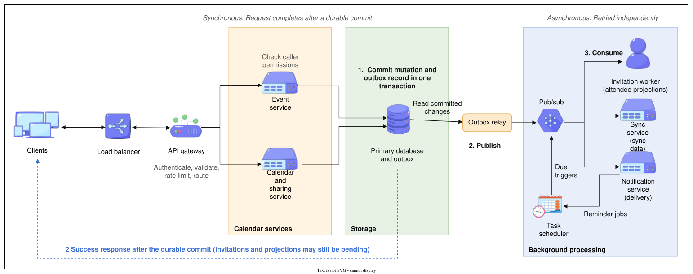
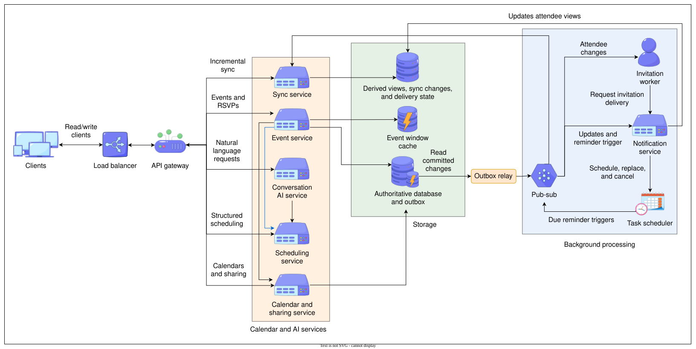

# Design_of_Google_Calendar

Source: https://www.educative.io/courses/grokking-the-system-design-interview/design-of-google-calendar

---

[Home](https://www.educative.io/)

[Courses](https://www.educative.io/search?tab=courses)

[Grokking Modern System Design Interview](https://www.educative.io/courses/grokking-the-system-design-interview)

# Design of Google Calendar

The design of a system akin to Google Calendar encompasses event management, sharing, synchronization, and reminders, with an AI assistant for scheduling. The architecture separates event persistence from synchronization, ensuring durable updates and asynchronous processing of invitations. Key components include an API gateway for request handling, a transactional outbox for reliable event publication, and a robust data model for managing events and recurrence rules. The system employs mechanisms like idempotency keys and version checks to maintain data integrity, while AI features facilitate natural language scheduling, ensuring user confirmation before event creation.

We'll cover the following...

- [High-level design](https://www.educative.io/courses/grokking-the-system-design-interview/design-of-google-calendar#High-level-design)
- [Detailed design](https://www.educative.io/courses/grokking-the-system-design-interview/design-of-google-calendar#Detailed-design)
  - [Service responsibilities](https://www.educative.io/courses/grokking-the-system-design-interview/design-of-google-calendar#Service-responsibilities)
  - [API design](https://www.educative.io/courses/grokking-the-system-design-interview/design-of-google-calendar#API-design)
  - [Data model and storage](https://www.educative.io/courses/grokking-the-system-design-interview/design-of-google-calendar#Data-model-and-storage)
  - [Recurring events and time zones](https://www.educative.io/courses/grokking-the-system-design-interview/design-of-google-calendar#Recurring-events-and-time-zones)
  - [Write correctness](https://www.educative.io/courses/grokking-the-system-design-interview/design-of-google-calendar#Write-correctness)
- [Core workflows](https://www.educative.io/courses/grokking-the-system-design-interview/design-of-google-calendar#Core-workflows)
  - [Event creation and updates](https://www.educative.io/courses/grokking-the-system-design-interview/design-of-google-calendar#Event-creation-and-updates)
  - [Calendar retrieval](https://www.educative.io/courses/grokking-the-system-design-interview/design-of-google-calendar#Calendar-retrieval)
  - [Incremental synchronization and offline edits](https://www.educative.io/courses/grokking-the-system-design-interview/design-of-google-calendar#Incremental-synchronization-and-offline-edits)
  - [Invitations and reminders](https://www.educative.io/courses/grokking-the-system-design-interview/design-of-google-calendar#Invitations-and-reminders)
- [AI-powered meeting suggestions](https://www.educative.io/courses/grokking-the-system-design-interview/design-of-google-calendar#AI-powered-meeting-suggestions)
  - [From intent to suggestions](https://www.educative.io/courses/grokking-the-system-design-interview/design-of-google-calendar#From-intent-to-suggestions)
  - [Confirmation and event creation](https://www.educative.io/courses/grokking-the-system-design-interview/design-of-google-calendar#Confirmation-and-event-creation)
  - [Conversational boundaries](https://www.educative.io/courses/grokking-the-system-design-interview/design-of-google-calendar#Conversational-boundaries)
- [Evaluating the design](https://www.educative.io/courses/grokking-the-system-design-interview/design-of-google-calendar#Evaluating-the-design)
- [Conclusion](https://www.educative.io/courses/grokking-the-system-design-interview/design-of-google-calendar#Conclusion)

In this lesson, we will design a system similar to Google Calendar that supports event management, calendar sharing, recurring events, synchronization, and reminders. We will also integrate an AI assistant that suggests available meeting times. This is a proposed architecture and does not represent Google’s actual internal implementation.

## High-level design[#](https://www.educative.io/courses/grokking-the-system-design-interview/design-of-google-calendar#High-level-design)

The architecture separates event persistence from event synchronization and notification delivery. The system acknowledges an event update only after the change is durably persisted. Invitation emails and attendee synchronization are processed asynchronously after the write succeeds.

Client requests pass through a load balancer to an API gateway. The gateway authenticates callers, validates incoming requests, enforces rate limits, and routes requests to the appropriate services. The receiving service performs resource-level authorization to verify that the caller has permission to perform the requested operation.

Each event update writes the event record and a corresponding outbox entry within the same database transaction. An outbox relay publishes events from committed outbox entries to a publish-subscribe (pub/sub) system. Background workers consume these events to update attendee calendar views, generate synchronization updates, and schedule notifications. The notification service creates reminder jobs, which a task scheduler dispatches at their scheduled times.

High-level design of Google Calendar

If the service crashes right after the commit, the outbox entry is still there for the relay to publish, so no committed change is lost downstream. A successful response therefore means the event and its outbox entry are committed, while attendee updates and invitations continue asynchronously with retries.

## Detailed design[#](https://www.educative.io/courses/grokking-the-system-design-interview/design-of-google-calendar#Detailed-design)

Each type of state has exactly one owner. The event service owns events, recurrence rules, occurrence exceptions, attendees, and RSVPs. The calendar and sharing service owns calendars and access rules. Invitation, sync, and notification components only consume committed changes; they never become a separate source of truth.

Detailed design of Google Calendar

These are logical boundaries. Several components can share a deployment until their workloads need to scale independently.

### Service responsibilities[#](https://www.educative.io/courses/grokking-the-system-design-interview/design-of-google-calendar#Service-responsibilities)

The following table summarizes each component’s responsibility. For example, an RSVP is committed by the event service; the invitation worker only updates projections and arranges delivery.

|  |  |
| --- | --- |
| **Component** | **Main Responsibility** |
| Event service | Manage events, recurring series, exceptions, attendee membership, RSVPs, and permitted availability queries |
| Calendar and sharing service | Manage calendars, ACLs, sharing relationships, and visibility rules |
| Invitation worker | Maintain attendee projections and request invitation or update delivery |
| Sync service | Build and serve incremental changes, issue sync tokens, and support recovery |
| Notification service | Maintain delivery state, schedule reminders, and send email and push notifications |
| Task scheduler | Release reminder jobs when their due times are reached |
| Conversational AI service | Interpret user input and produce validated scheduling intent |
| Scheduling service | Compute feasible meeting intervals and rank candidate times |

### API design[#](https://www.educative.io/courses/grokking-the-system-design-interview/design-of-google-calendar#API-design)

Clients call these APIs through the API gateway. Every mutating call carries an idempotency key so retries are safe, and every update or deletion carries the version the client last read, so concurrent edits are detected instead of overwritten.

**Create event:** Creates a one-time or recurring event on a calendar and returns the committed event, including its `event_id` and version.

Ace Editor

1

createEvent(calendar\_id, event\_details, recurrence\_rule, attendees, reminders, idempotency\_key)

הההההההההההההההההההההההההההההההההההההההההההההההההההההההההההההההההההההההההההההההההההההההההההההההההההההההההההההההההההההההההההההההההההההההההההההההההההההההההההההההההההההההההההההההההההההההההההההההההההההההההההההההההההההההההההההההההההההההההההההההההההההההההההההההההההההההההההההההההההההההההההההההההההההההההההההההההההההההההההההההההההההההההההההההההההההההההההההההההההההההההההההההההההההההההההההההההההההההההההההההההההההההההההההההההההההההההההההההההההההההההההההההההההההההההההההההההההההההההההההההההההההההההההההההההההההההההההההההה

XXXXXXXXXXXXXXXXXXXXXXXXXXXXXXXXXXXXXXXXXXXXXXXXXXXXXXXXXXXXXXXXXXXXXXXXXXXXXXXXXXXXXXXXXXXXXXXXXXXXXXXXXXXXXXXXXXXXXXXXXXXXXXXXXXXXXXXXXXXXXXXXXXXXXXXXXXXXXXXXXXXXXXXXXXXXXXXXXXXXXXXXXXXXXXXXXXXXXXXXXXXXXXXXXXXXXXXXXXXXXXXXXXXXXXXXXXXXXXXXXXXXXXXXXXXXXXXXXXXXXXXXXXXXXXXXXXXXXXXXXXXXXXXXXXXXXXXXXXXXXXXXXXXXXXXXXXXXXXXXXXXXXXXXXXXXXXXXXXXXXXXXXXXXXXXXXXXXXXXXXXXXXXXXXXXXXXXXXXXXXXXXXXXXXXXXXXXXXXXXXXXXXXXXXXXXXXXXXXXXXXXXXXXXXXXXXXXXXXXXXXXXXXXXXXXXXXXXXXXXXXXXXXXXXXXXXXXXXXXXXXXXXXXXXXXXXXXXXXXXXXXXXXXXXXXX

**Update and delete event:** Modify or cancel an event. For a recurring event, scope selects this occurrence, this and following occurrences, or the entire series, and `original_start` identifies the occurrence being changed.

Ace Editor

1

2

updateEvent(event\_id, changes, scope, original\_start, base\_version, idempotency\_key)

deleteEvent(event\_id, scope, original\_start, base\_version, idempotency\_key)

הההההההההההההההההההההההההההההההההההההההההההההההההההההההההההההההההההההההההההההההההההההההההההההההההההההההההההההההההההההההההההההההההההההההההההההההההההההההההההההההההההההההההההההההההההההההההההההההההההההההההההההההההההההההההההההההההההההההההההההההההההההההההההההההההההההההההההההההההההההההההההההההההההההההההההההההההההההההההההההההההההההההההההההההההההההההההההההההההההההההההההההההההההההההההההההההההההההההההההההההההההההההההההההההההההההההההההההההההההההההההההההההההההההההההההההההההההההההההההההההההההההההההההההההההההההההההההההההה

XXXXXXXXXXXXXXXXXXXXXXXXXXXXXXXXXXXXXXXXXXXXXXXXXXXXXXXXXXXXXXXXXXXXXXXXXXXXXXXXXXXXXXXXXXXXXXXXXXXXXXXXXXXXXXXXXXXXXXXXXXXXXXXXXXXXXXXXXXXXXXXXXXXXXXXXXXXXXXXXXXXXXXXXXXXXXXXXXXXXXXXXXXXXXXXXXXXXXXXXXXXXXXXXXXXXXXXXXXXXXXXXXXXXXXXXXXXXXXXXXXXXXXXXXXXXXXXXXXXXXXXXXXXXXXXXXXXXXXXXXXXXXXXXXXXXXXXXXXXXXXXXXXXXXXXXXXXXXXXXXXXXXXXXXXXXXXXXXXXXXXXXXXXXXXXXXXXXXXXXXXXXXXXXXXXXXXXXXXXXXXXXXXXXXXXXXXXXXXXXXXXXXXXXXXXXXXXXXXXXXXXXXXXXXXXXXXXXXXXXXXXXXXXXXXXXXXXXXXXXXXXXXXXXXXXXXXXXXXXXXXXXXXXXXXXXXXXXXXXXXXXXXXXXXXXX

**Respond to invitation:** Records an attendee’s RSVP for an event or a single occurrence.

Ace Editor

1

respondToEvent(event\_id, original\_start, response\_status)

הההההההההההההההההההההההההההההההההההההההההההההההההההההההההההההההההההההההההההההההההההההההההההההההההההההההההההההההההההההההההההההההההההההההההההההההההההההההההההההההההההההההההההההההההההההההההההההההההההההההההההההההההההההההההההההההההההההההההההההההההההההההההההההההההההההההההההההההההההההההההההההההההההההההההההההההההההההההההההההההההההההההההההההההההההההההההההההההההההההההההההההההההההההההההההההההההההההההההההההההההההההההההההההההההההההההההההההההההההההההההההההההההההההההההההההההההההההההההההההההההההההההההההההההההההההההההההההההה

XXXXXXXXXXXXXXXXXXXXXXXXXXXXXXXXXXXXXXXXXXXXXXXXXXXXXXXXXXXXXXXXXXXXXXXXXXXXXXXXXXXXXXXXXXXXXXXXXXXXXXXXXXXXXXXXXXXXXXXXXXXXXXXXXXXXXXXXXXXXXXXXXXXXXXXXXXXXXXXXXXXXXXXXXXXXXXXXXXXXXXXXXXXXXXXXXXXXXXXXXXXXXXXXXXXXXXXXXXXXXXXXXXXXXXXXXXXXXXXXXXXXXXXXXXXXXXXXXXXXXXXXXXXXXXXXXXXXXXXXXXXXXXXXXXXXXXXXXXXXXXXXXXXXXXXXXXXXXXXXXXXXXXXXXXXXXXXXXXXXXXXXXXXXXXXXXXXXXXXXXXXXXXXXXXXXXXXXXXXXXXXXXXXXXXXXXXXXXXXXXXXXXXXXXXXXXXXXXXXXXXXXXXXXXXXXXXXXXXXXXXXXXXXXXXXXXXXXXXXXXXXXXXXXXXXXXXXXXXXXXXXXXXXXXXXXXXXXXXXXXXXXXXXXXXXX

**List events:** Returns the events from the selected calendars that overlap a time window, with recurring series expanded and fields filtered by the caller’s permissions. The optional `min_version` lets a client that just wrote an event avoid reading an older cached result.

Ace Editor

1

listEvents(calendar\_ids, time\_min, time\_max, time\_zone, page\_token, min\_version)

הההההההההההההההההההההההההההההההההההההההההההההההההההההההההההההההההההההההההההההההההההההההההההההההההההההההההההההההההההההההההההההההההההההההההההההההההההההההההההההההההההההההההההההההההההההההההההההההההההההההההההההההההההההההההההההההההההההההההההההההההההההההההההההההההההההההההההההההההההההההההההההההההההההההההההההההההההההההההההההההההההההההההההההההההההההההההההההההההההההההההההההההההההההההההההההההההההההההההההההההההההההההההההההההההההההההההההההההההההההההההההההההההההההההההההההההההההההההההההההההההההההההההההההההההההההההההההההההה

XXXXXXXXXXXXXXXXXXXXXXXXXXXXXXXXXXXXXXXXXXXXXXXXXXXXXXXXXXXXXXXXXXXXXXXXXXXXXXXXXXXXXXXXXXXXXXXXXXXXXXXXXXXXXXXXXXXXXXXXXXXXXXXXXXXXXXXXXXXXXXXXXXXXXXXXXXXXXXXXXXXXXXXXXXXXXXXXXXXXXXXXXXXXXXXXXXXXXXXXXXXXXXXXXXXXXXXXXXXXXXXXXXXXXXXXXXXXXXXXXXXXXXXXXXXXXXXXXXXXXXXXXXXXXXXXXXXXXXXXXXXXXXXXXXXXXXXXXXXXXXXXXXXXXXXXXXXXXXXXXXXXXXXXXXXXXXXXXXXXXXXXXXXXXXXXXXXXXXXXXXXXXXXXXXXXXXXXXXXXXXXXXXXXXXXXXXXXXXXXXXXXXXXXXXXXXXXXXXXXXXXXXXXXXXXXXXXXXXXXXXXXXXXXXXXXXXXXXXXXXXXXXXXXXXXXXXXXXXXXXXXXXXXXXXXXXXXXXXXXXXXXXXXXXXXX

**Sync changes:** Returns changes since the client’s last sync token, including cancellations and deletions, and a new token. An expired token tells the client to perform a full resynchronization.

Ace Editor

1

syncEvents(calendar\_id, sync\_token, page\_token)

הההההההההההההההההההההההההההההההההההההההההההההההההההההההההההההההההההההההההההההההההההההההההההההההההההההההההההההההההההההההההההההההההההההההההההההההההההההההההההההההההההההההההההההההההההההההההההההההההההההההההההההההההההההההההההההההההההההההההההההההההההההההההההההההההההההההההההההההההההההההההההההההההההההההההההההההההההההההההההההההההההההההההההההההההההההההההההההההההההההההההההההההההההההההההההההההההההההההההההההההההההההההההההההההההההההההההההההההההההההההההההההההההההההההההההההההההההההההההההההההההההההההההההההההההההההההההההההההה

XXXXXXXXXXXXXXXXXXXXXXXXXXXXXXXXXXXXXXXXXXXXXXXXXXXXXXXXXXXXXXXXXXXXXXXXXXXXXXXXXXXXXXXXXXXXXXXXXXXXXXXXXXXXXXXXXXXXXXXXXXXXXXXXXXXXXXXXXXXXXXXXXXXXXXXXXXXXXXXXXXXXXXXXXXXXXXXXXXXXXXXXXXXXXXXXXXXXXXXXXXXXXXXXXXXXXXXXXXXXXXXXXXXXXXXXXXXXXXXXXXXXXXXXXXXXXXXXXXXXXXXXXXXXXXXXXXXXXXXXXXXXXXXXXXXXXXXXXXXXXXXXXXXXXXXXXXXXXXXXXXXXXXXXXXXXXXXXXXXXXXXXXXXXXXXXXXXXXXXXXXXXXXXXXXXXXXXXXXXXXXXXXXXXXXXXXXXXXXXXXXXXXXXXXXXXXXXXXXXXXXXXXXXXXXXXXXXXXXXXXXXXXXXXXXXXXXXXXXXXXXXXXXXXXXXXXXXXXXXXXXXXXXXXXXXXXXXXXXXXXXXXXXXXXXXX

**Share calendar:** Grants or changes a principal’s role on a calendar, such as free/busy only, read, or edit.

Ace Editor

1

shareCalendar(calendar\_id, principal, role)

הההההההההההההההההההההההההההההההההההההההההההההההההההההההההההההההההההההההההההההההההההההההההההההההההההההההההההההההההההההההההההההההההההההההההההההההההההההההההההההההההההההההההההההההההההההההההההההההההההההההההההההההההההההההההההההההההההההההההההההההההההההההההההההההההההההההההההההההההההההההההההההההההההההההההההההההההההההההההההההההההההההההההההההההההההההההההההההההההההההההההההההההההההההההההההההההההההההההההההההההההההההההההההההההההההההההההההההההההההההההההההההההההההההההההההההההההההההההההההההההההההההההההההההההההההההההההההההההה

XXXXXXXXXXXXXXXXXXXXXXXXXXXXXXXXXXXXXXXXXXXXXXXXXXXXXXXXXXXXXXXXXXXXXXXXXXXXXXXXXXXXXXXXXXXXXXXXXXXXXXXXXXXXXXXXXXXXXXXXXXXXXXXXXXXXXXXXXXXXXXXXXXXXXXXXXXXXXXXXXXXXXXXXXXXXXXXXXXXXXXXXXXXXXXXXXXXXXXXXXXXXXXXXXXXXXXXXXXXXXXXXXXXXXXXXXXXXXXXXXXXXXXXXXXXXXXXXXXXXXXXXXXXXXXXXXXXXXXXXXXXXXXXXXXXXXXXXXXXXXXXXXXXXXXXXXXXXXXXXXXXXXXXXXXXXXXXXXXXXXXXXXXXXXXXXXXXXXXXXXXXXXXXXXXXXXXXXXXXXXXXXXXXXXXXXXXXXXXXXXXXXXXXXXXXXXXXXXXXXXXXXXXXXXXXXXXXXXXXXXXXXXXXXXXXXXXXXXXXXXXXXXXXXXXXXXXXXXXXXXXXXXXXXXXXXXXXXXXXXXXXXXXXXXXXX

**Suggest and confirm meeting times:** The first call accepts a natural language request and returns either a clarifying question or ranked suggestions. The second call rechecks availability and creates the event through the standard `createEvent` path.

Ace Editor

1

2

suggestMeetingTimes(request\_text, time\_zone, conversation\_id)

confirmSuggestion(suggestion\_id, idempotency\_key)

הההההההההההההההההההההההההההההההההההההההההההההההההההההההההההההההההההההההההההההההההההההההההההההההההההההההההההההההההההההההההההההההההההההההההההההההההההההההההההההההההההההההההההההההההההההההההההההההההההההההההההההההההההההההההההההההההההההההההההההההההההההההההההההההההההההההההההההההההההההההההההההההההההההההההההההההההההההההההההההההההההההההההההההההההההההההההההההההההההההההההההההההההההההההההההההההההההההההההההההההההההההההההההההההההההההההההההההההההההההההההההההההההההההההההההההההההההההההההההההההההההההההההההההההההההההההההההההההה

XXXXXXXXXXXXXXXXXXXXXXXXXXXXXXXXXXXXXXXXXXXXXXXXXXXXXXXXXXXXXXXXXXXXXXXXXXXXXXXXXXXXXXXXXXXXXXXXXXXXXXXXXXXXXXXXXXXXXXXXXXXXXXXXXXXXXXXXXXXXXXXXXXXXXXXXXXXXXXXXXXXXXXXXXXXXXXXXXXXXXXXXXXXXXXXXXXXXXXXXXXXXXXXXXXXXXXXXXXXXXXXXXXXXXXXXXXXXXXXXXXXXXXXXXXXXXXXXXXXXXXXXXXXXXXXXXXXXXXXXXXXXXXXXXXXXXXXXXXXXXXXXXXXXXXXXXXXXXXXXXXXXXXXXXXXXXXXXXXXXXXXXXXXXXXXXXXXXXXXXXXXXXXXXXXXXXXXXXXXXXXXXXXXXXXXXXXXXXXXXXXXXXXXXXXXXXXXXXXXXXXXXXXXXXXXXXXXXXXXXXXXXXXXXXXXXXXXXXXXXXXXXXXXXXXXXXXXXXXXXXXXXXXXXXXXXXXXXXXXXXXXXXXXXXXXX

The following are the explanations of the key terms we used above:

- **`idempotency_key`****:** A client-generated unique ID that lets the server return the original result when a request is retried.
- **`base_version`****:** The event version the client last read. The write succeeds only if the stored version still matches.
- **scope and** **`original_start`****:** Select which occurrences of a recurring event a change applies to and identify the occurrence by its originally scheduled start.
- **`time_min`** **and** **`time_max`****:** The boundaries of the requested calendar window, used for the overlap query.
- **`sync_token`****:** An opaque cursor into the calendar’s change stream, returned by the previous sync.
- **`conversation_id`****:** Links follow-up messages, such as answers to clarifying questions, to the same scheduling request.

Next, we define what each service stores.

### Data model and storage[#](https://www.educative.io/courses/grokking-the-system-design-interview/design-of-google-calendar#Data-model-and-storage)

Besides event details, the data model needs event and occurrence identifiers, versions, and idempotency keys, so the system can retry safely, detect conflicting updates, and change individual occurrences.

|  |  |
| --- | --- |
| **Record** | **Important Fields** |
| Calendar | Calendar ID, owner, display time zone |
| Access rule | Calendar ID, principal, role, permission revision |
| Event | Event ID, calendar ID, organizer, title, visibility, status, version |
| Timed schedule | Start and end instants, relevant IANA time zone |
| All-day schedule | Start date and exclusive end date |
| Recurring series | Local starting schedule, recurrence rule, exclusions |
| Occurrence exception | Series ID, original occurrence start, modified fields or cancellation |
| Attendee | Event or occurrence ID, attendee identity, response status |
| Outbox record | Mutation ID, resource ID, version, change type |

A relational database fits the authoritative records, which need transactions, uniqueness constraints, and conditional updates. Derived attendee views and sync streams can move to a document or key-value store if their scale requires it.

Redis caches frequently requested calendar windows, while the database remains the source of truth.

Partitioning follows the dominant queries: event storage by `calendar_id`, because views read selected calendars, and attendee projections by `user_id`, because users ask for their upcoming meetings. Very large calendars may also need time buckets.

Archiving old events to cold storage is optional. It requires an archive-aware read path and must keep recurring parents that still generate future occurrences.

### Recurring events and time zones[#](https://www.educative.io/courses/grokking-the-system-design-interview/design-of-google-calendar#Recurring-events-and-time-zones)

Store a recurring meeting as a parent event with a recurrence rule and separate exception records for rescheduled, modified, or canceled occurrences. The event service generates occurrences within the requested time range and applies any relevant exceptions. The parent event stores the local start time and an IANA time zone identifier. For example, a weekly meeting scheduled at 9:00 a.m. in `America/New_York` retains its local start time across daylight saving time transitions, while its corresponding UTC time changes.

Each exception keeps the occurrence’s original start, so a Tuesday meeting moved to Wednesday stays linked to the correct occurrence. The table below shows how each type of edit changes the stored data:

|  |  |
| --- | --- |
| **Editing Operation** | **Effect on the Stored Representation** |
| Edit this occurrence | Create or update an exception |
| Edit the entire series | Update the parent and reconcile affected exceptions |
| Edit this and following occurrences | End the earlier series and create a successor series |

Store all-day events using calendar dates rather than UTC timestamps to preserve their intended dates across time zones. Limit recurrence expansion by the requested time range and maximum number of occurrences. Precomputing occurrences within a rolling time window can reduce the cost of availability checks and reminder scheduling. The parent event and its exception records remain authoritative, while precomputed occurrences serve as derived data.

### Write correctness[#](https://www.educative.io/courses/grokking-the-system-design-interview/design-of-google-calendar#Write-correctness)

Retries and concurrent edits cause different problems, so the event service uses two mechanisms:

- **Idempotency keys:** For creates and other retriable mutations, the event service stores the key with a fingerprint of the request and its result. A retry with the same key and payload returns the original result, and reusing the key with a different payload is rejected.
- **Conditional updates:** Updates and deletions include the version the client last read, and the database applies them only if that version still matches. A mismatch means someone else changed the event, so the client fetches the latest version and resolves the conflict.

The mutation and its outbox entry commit in one transaction. Consumers deduplicate messages by mutation ID and compare versions, so a delayed older message never overwrites newer state. Ordering is needed only within a calendar or resource; global ordering would add coordination without improving correctness.

## Core workflows[#](https://www.educative.io/courses/grokking-the-system-design-interview/design-of-google-calendar#Core-workflows)

These components support four workflows: event mutation, calendar retrieval, device synchronization, and invitation and reminder delivery.

### Event creation and updates[#](https://www.educative.io/courses/grokking-the-system-design-interview/design-of-google-calendar#Event-creation-and-updates)

The API gateway routes a mutation to the event service, which checks permissions, validates the schedule and attendees, and applies the idempotency or version check. The transaction commits the event, its new version, and an outbox record, and the response returns the committed event so the client can display it immediately.

The relay then publishes the change, and background consumers update attendee views, sync data, and notifications. A delayed invitation never invalidates a successful write. RSVPs follow the same path after the event service confirms that the caller may respond for that attendee.

### Calendar retrieval[#](https://www.educative.io/courses/grokking-the-system-design-interview/design-of-google-calendar#Calendar-retrieval)

A view request names the calendars and the date range. The event service checks access, retrieves matching records, expands recurring series, applies exceptions, and returns only the fields the caller may see. A timed event belongs in the window if:

Ace Editor

1

event.start < window.end AND event.end > window.start

הההההההההההההההההההההההההההההההההההההההההההההההההההההההההההההההההההההההההההההההההההההההההההההההההההההההההההההההההההההההההההההההההההההההההההההההההההההההההההההההההההההההההההההההההההההההההההההההההההההההההההההההההההההההההההההההההההההההההההההההההההההההההההההההההההההההההההההההההההההההההההההההההההההההההההההההההההההההההההההההההההההההההההההההההההההההההההההההההההההההההההההההההההההההההההההההההההההההההההההההההההההההההההההההההההההההההההההההההההההההההההההההההההההההההההההההההההההההההההההההההההההההההההההההההההההההההההההההה

XXXXXXXXXXXXXXXXXXXXXXXXXXXXXXXXXXXXXXXXXXXXXXXXXXXXXXXXXXXXXXXXXXXXXXXXXXXXXXXXXXXXXXXXXXXXXXXXXXXXXXXXXXXXXXXXXXXXXXXXXXXXXXXXXXXXXXXXXXXXXXXXXXXXXXXXXXXXXXXXXXXXXXXXXXXXXXXXXXXXXXXXXXXXXXXXXXXXXXXXXXXXXXXXXXXXXXXXXXXXXXXXXXXXXXXXXXXXXXXXXXXXXXXXXXXXXXXXXXXXXXXXXXXXXXXXXXXXXXXXXXXXXXXXXXXXXXXXXXXXXXXXXXXXXXXXXXXXXXXXXXXXXXXXXXXXXXXXXXXXXXXXXXXXXXXXXXXXXXXXXXXXXXXXXXXXXXXXXXXXXXXXXXXXXXXXXXXXXXXXXXXXXXXXXXXXXXXXXXXXXXXXXXXXXXXXXXXXXXXXXXXXXXXXXXXXXXXXXXXXXXXXXXXXXXXXXXXXXXXXXXXXXXXXXXXXXXXXXXXXXXXXXXXXXXXX

This includes events that start before the window and continue into it. Recurring parents are selected separately, because their first occurrence may be long before the window, and moved exceptions are matched by their actual interval, so an occurrence moved into the window still appears.

Authorization checks must also apply to cached calendar data. Users with free/busy access can view availability intervals without accessing event titles, descriptions, or other restricted details. Changes to sharing permissions must invalidate affected authorization caches and prevent access to previously cached data that is no longer permitted.

After a successful write, the client can include the returned version in subsequent requests using `min_version`. The service must then bypass cached responses older than that version. Clients may cache calendar data locally, with mobile and desktop applications often relying on persistent storage for offline access. Synchronization mechanisms keep these copies updated when connectivity is available.

### Incremental synchronization and offline edits[#](https://www.educative.io/courses/grokking-the-system-design-interview/design-of-google-calendar#Incremental-synchronization-and-offline-edits)

After the initial full synchronization, the client stores an opaque sync token and uses it to fetch incremental changes, including updates, cancellations, and deletions. The sync service builds tokens from committed changes in the durable change log and keeps one consistent checkpoint across paginated responses, so the client saves the final token only after applying every page.

The service keeps deletion tombstones for a defined period so clients can detect removed events. A client whose sync token has expired must perform a full synchronization.

Offline edits keep their idempotency keys and base versions. On reconnect, valid mutations are applied and stale ones are rejected, so the client can show a conflict instead of silently overwriting another user’s change. Push signals reduce sync delay, but devices also sync on reconnect, when brought to the foreground, and periodically, in case a signal is missed.

### Invitations and reminders[#](https://www.educative.io/courses/grokking-the-system-design-interview/design-of-google-calendar#Invitations-and-reminders)

Once attendees are committed, the invitation worker updates their projections and asks the notification service to deliver invitations. Whether attendees must reconfirm after a change is a product policy decision.

Reminders are durable jobs tied to an occurrence, a recipient, and a schedule revision. The notification service creates them for a rolling future window and replaces them when the schedule changes. When a job is due, the task scheduler publishes a trigger, and the notification service confirms that the occurrence still exists and the job matches the current schedule before sending. Retries and deduplication limit repeats, but external providers can’t guarantee exactly-once delivery, so the system monitors duplicates, failures, and lateness.

## AI-powered meeting suggestions[#](https://www.educative.io/courses/grokking-the-system-design-interview/design-of-google-calendar#AI-powered-meeting-suggestions)

The AI extension adds a natural language interface to scheduling. The model only turns a request into structured intent; calendar services still enforce permissions and availability, and the scheduling service decides which times work. This follows the model-as-component pattern from the AI building blocks chapter: the model has a narrow output contract, and nothing acts on its output until deterministic code has validated it.

For example, a user may ask:

Find a 30-minute meeting with Aisha and Omar next week, during everyone’s working hours, preferably before my lunch break.

The conversational AI service sends the request to an LLM along with the current date, the user’s time zone, and a response schema. With schema-constrained output, the model returns a proposed scheduling intent and resolves relative dates, such as “next week,” from the supplied date. For a request submitted on Thursday, October 15, 2026, in the `America/New_York` time zone, the model might return:

Ace Editor

1

2

3

4

5

6

7

8

{

"attendees": ["Aisha", "Omar"],

"duration\_minutes": 30,

"date\_range": { "start": "2026-10-19", "end": "2026-10-23" },

"time\_zone": "America/New\_York",

"hard\_constraints": ["all\_attendees\_required", "within\_working\_hours"],

"preferences": [{ "type": "end\_before", "anchor": "requester\_lunch\_break" }]

}

הההההההההההההההההההההההההההההההההההההההההההההההההההההההההההההההההההההההההההההההההההההההההההההההההההההההההההההההההההההההההההההההההההההההההההההההההההההההההההההההההההההההההההההההההההההההההההההההההההההההההההההההההההההההההההההההההההההההההההההההההההההההההההההההההההההההההההההההההההההההההההההההההההההההההההההההההההההההההההההההההההההההההההההההההההההההההההההההההההההההההההההההההההההההההההההההההההההההההההההההההההההההההההההההההההההההההההההההההההההההההההההההההההההההההההההההההההההההההההההההההההההההההההההההההההההההההההההההה

XXXXXXXXXXXXXXXXXXXXXXXXXXXXXXXXXXXXXXXXXXXXXXXXXXXXXXXXXXXXXXXXXXXXXXXXXXXXXXXXXXXXXXXXXXXXXXXXXXXXXXXXXXXXXXXXXXXXXXXXXXXXXXXXXXXXXXXXXXXXXXXXXXXXXXXXXXXXXXXXXXXXXXXXXXXXXXXXXXXXXXXXXXXXXXXXXXXXXXXXXXXXXXXXXXXXXXXXXXXXXXXXXXXXXXXXXXXXXXXXXXXXXXXXXXXXXXXXXXXXXXXXXXXXXXXXXXXXXXXXXXXXXXXXXXXXXXXXXXXXXXXXXXXXXXXXXXXXXXXXXXXXXXXXXXXXXXXXXXXXXXXXXXXXXXXXXXXXXXXXXXXXXXXXXXXXXXXXXXXXXXXXXXXXXXXXXXXXXXXXXXXXXXXXXXXXXXXXXXXXXXXXXXXXXXXXXXXXXXXXXXXXXXXXXXXXXXXXXXXXXXXXXXXXXXXXXXXXXXXXXXXXXXXXXXXXXXXXXXXXXXXXXXXXXXXX

The model never sees contacts or calendar data. The application validates its output against the schema, matches “Aisha” and “Omar” to entries in the requester’s contacts or organization directory, and asks a clarifying question when a name is ambiguous or a preference such as “before my lunch break” has no defined time.

### From intent to suggestions[#](https://www.educative.io/courses/grokking-the-system-design-interview/design-of-google-calendar#From-intent-to-suggestions)

Validation turns the draft into constraints. Required attendees and the meeting duration become hard constraints, while preferences such as an earlier time only affect ranking.

The scheduling service then requests free/busy intervals from the event service, which enforces sharing permissions and accounts for recurring events. A failed or unauthorized lookup is treated as unknown, never as free time. For each date, the service converts every participant’s working hours into UTC intervals, which respects daylight saving changes, subtracts busy periods, and intersects the remaining free time.

Candidates are ranked by preferences such as a preferred time, fewer gaps between meetings, or a fair spread of inconvenient hours. A rules-based scorer is enough to start, and each suggestion shows participants’ local times and a one-line reason.

### Confirmation and event creation[#](https://www.educative.io/courses/grokking-the-system-design-interview/design-of-google-calendar#Confirmation-and-event-creation)

Meeting availability may change after suggestions are generated, so selecting a suggested time triggers fresh authorization and availability checks. If the selected time is no longer available, the application reports the conflict or offers alternative times. If validation succeeds, the application creates the event through the standard event-creation workflow.

An availability check does not reserve the time slot, so another event may still be created between validation and commit. Personal calendars generally allow overlapping events, so this is acceptable. Exclusive resources, such as meeting rooms, are different: they need an atomic check-and-reserve step to prevent double bookings.

Confirming a suggestion before event creation

Note that event versions protect edits to an existing event; they don’t stop a different event from taking the same time.

### Conversational boundaries[#](https://www.educative.io/courses/grokking-the-system-design-interview/design-of-google-calendar#Conversational-boundaries)

Typed requests, voice transcripts, and authorized email excerpts are processed through the same intent extraction interface. Because the model may incorrectly interpret dates, participant identities, or time zones, the application requires user confirmation of the proposed event details before creating or modifying calendar events. The assistant receives only the data required for scheduling, typically free/busy intervals rather than event titles or descriptions. The application treats instructions embedded in external content as untrusted and enforces authorization and validation independently of model output. These are the trust-boundary controls from the lesson on evaluating and protecting AI features, applied to scheduling.

Trust boundaries around the AI assistant

AI requests run on separate capacity with their own quotas, timeouts, and bounded availability queries, so they can’t overload calendar services, and manual event creation keeps working if the model fails.

## Evaluating the design[#](https://www.educative.io/courses/grokking-the-system-design-interview/design-of-google-calendar#Evaluating-the-design)

The table below summarizes how the design meets each nonfunctional requirement and how to verify it in production:

|  |  |
| --- | --- |
| **Concern** | **Design Approach and Verification** |
| Consistency | Acknowledge authoritative writes after commit; reject stale edits; measure projection lag |
| Read latency | Bound query windows and recurrence expansion; measure p95 latency for representative views |
| Availability | Scale services independently and test failover and degraded operation |
| Durability | Use replication, backups, and replay; verify recovery procedures |
| Privacy | Enforce current permissions on reads and writes; test revocation against caches and projections |
| Device freshness | Measure commit-to-device lag and verify recovery after missed signals |
| Reminder timeliness | Measure delivery lateness, duplicates, and stale-job suppression |
| AI quality and cost | Measure intent errors, unavailable data, suggestion selection, latency, and cost |

Failure scenarios make a good test plan for these guarantees:

- **Relay crash after commit:** The committed change is still published once the relay recovers.
- **Conflicting offline edits:** Version checks detect the conflict instead of silently overwriting.
- **Rescheduled recurring occurrence:** Range queries apply the exception and show the occurrence at its new time.
- **Revoked access:** Authorization checks block previously visible data, including cached results.
- **AI-suggested slot taken before confirmation:** The availability recheck catches it and offers alternatives.

## Conclusion[#](https://www.educative.io/courses/grokking-the-system-design-interview/design-of-google-calendar#Conclusion)

The design keeps data consistent through clear state ownership, versioned writes, and reliable event publication. Recurring events preserve local start times and time zones, and background workers propagate updates with retries and recovery. The AI assistant reuses the same authorization and write path: it extracts intent, checks authorized availability, ranks times with application logic, and creates the event only after the user confirms.

System Design: Google Calendar

System Design: Metrics Monitoring and Alerting System

Ask

[High-level design](https://www.educative.io/courses/grokking-the-system-design-interview/design-of-google-calendar#High-level-design)

[Detailed design](https://www.educative.io/courses/grokking-the-system-design-interview/design-of-google-calendar#Detailed-design)

[Service responsibilities](https://www.educative.io/courses/grokking-the-system-design-interview/design-of-google-calendar#Service-responsibilities)

[API design](https://www.educative.io/courses/grokking-the-system-design-interview/design-of-google-calendar#API-design)

[Data model and storage](https://www.educative.io/courses/grokking-the-system-design-interview/design-of-google-calendar#Data-model-and-storage)

[Recurring events and time zones](https://www.educative.io/courses/grokking-the-system-design-interview/design-of-google-calendar#Recurring-events-and-time-zones)

[Write correctness](https://www.educative.io/courses/grokking-the-system-design-interview/design-of-google-calendar#Write-correctness)

[Core workflows](https://www.educative.io/courses/grokking-the-system-design-interview/design-of-google-calendar#Core-workflows)

[Event creation and updates](https://www.educative.io/courses/grokking-the-system-design-interview/design-of-google-calendar#Event-creation-and-updates)

[Calendar retrieval](https://www.educative.io/courses/grokking-the-system-design-interview/design-of-google-calendar#Calendar-retrieval)

[Incremental synchronization and offline edits](https://www.educative.io/courses/grokking-the-system-design-interview/design-of-google-calendar#Incremental-synchronization-and-offline-edits)

[Invitations and reminders](https://www.educative.io/courses/grokking-the-system-design-interview/design-of-google-calendar#Invitations-and-reminders)

[AI-powered meeting suggestions](https://www.educative.io/courses/grokking-the-system-design-interview/design-of-google-calendar#AI-powered-meeting-suggestions)

[From intent to suggestions](https://www.educative.io/courses/grokking-the-system-design-interview/design-of-google-calendar#From-intent-to-suggestions)

[Confirmation and event creation](https://www.educative.io/courses/grokking-the-system-design-interview/design-of-google-calendar#Confirmation-and-event-creation)

[Conversational boundaries](https://www.educative.io/courses/grokking-the-system-design-interview/design-of-google-calendar#Conversational-boundaries)

[Evaluating the design](https://www.educative.io/courses/grokking-the-system-design-interview/design-of-google-calendar#Evaluating-the-design)

[Conclusion](https://www.educative.io/courses/grokking-the-system-design-interview/design-of-google-calendar#Conclusion)