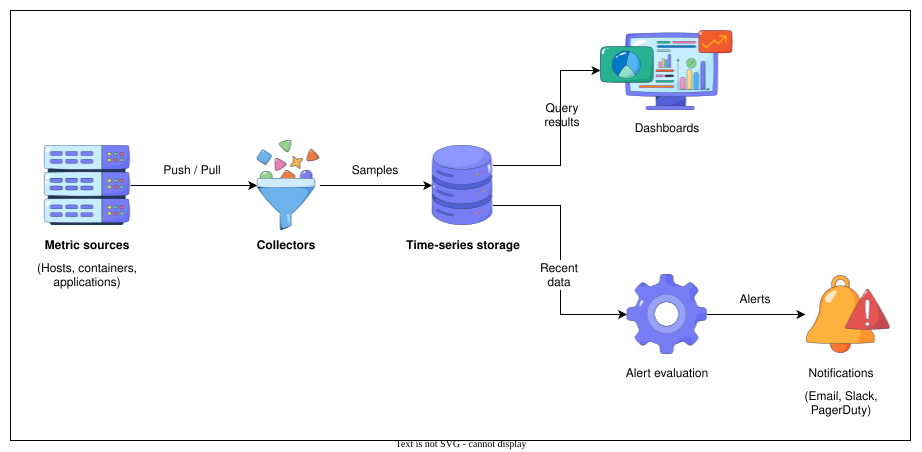

# System_Design_Metrics_Monitoring_and_Alerting_System

Source: https://www.educative.io/courses/grokking-the-system-design-interview/system-design-metrics-monitoring-and-alerting-system

---

[Home](https://www.educative.io/)

[Courses](https://www.educative.io/search?tab=courses)

[Grokking Modern System Design Interview](https://www.educative.io/courses/grokking-the-system-design-interview)

# System Design: Metrics Monitoring and Alerting System

A metrics monitoring and alerting system is essential for managing large-scale services, enabling operators to detect issues before they impact customers. It involves collecting numerical telemetry, storing it as time series data, and evaluating alert rules. Key requirements include metrics collection, time-series storage, alert management, and efficient querying. The system must handle high ingestion rates, ensure low-latency reads, and maintain reliability and cost efficiency. Resource estimation for storage, bandwidth, and server needs is crucial, alongside the integration of AI-assisted features for incident analysis, all of which shape the overall architecture of the system.

We'll cover the following...

- [Introduction](https://www.educative.io/courses/grokking-the-system-design-interview/system-design-metrics-monitoring-and-alerting-system#Introduction)
- [Requirements](https://www.educative.io/courses/grokking-the-system-design-interview/system-design-metrics-monitoring-and-alerting-system#Requirements)
  - [Functional requirements](https://www.educative.io/courses/grokking-the-system-design-interview/system-design-metrics-monitoring-and-alerting-system#Functional-requirements)
  - [Non-functional requirements](https://www.educative.io/courses/grokking-the-system-design-interview/system-design-metrics-monitoring-and-alerting-system#Non-functional-requirements)
- [Resource estimation](https://www.educative.io/courses/grokking-the-system-design-interview/system-design-metrics-monitoring-and-alerting-system#Resource-estimation)
  - [Storage estimation](https://www.educative.io/courses/grokking-the-system-design-interview/system-design-metrics-monitoring-and-alerting-system#Storage-estimation)
    - [A retention example](https://www.educative.io/courses/grokking-the-system-design-interview/system-design-metrics-monitoring-and-alerting-system#A-retention-example)
    - [Why rollups are mandatory](https://www.educative.io/courses/grokking-the-system-design-interview/system-design-metrics-monitoring-and-alerting-system#Why-rollups-are-mandatory)
  - [Bandwidth estimation](https://www.educative.io/courses/grokking-the-system-design-interview/system-design-metrics-monitoring-and-alerting-system#Bandwidth-estimation)
  - [Estimating the number of servers](https://www.educative.io/courses/grokking-the-system-design-interview/system-design-metrics-monitoring-and-alerting-system#Estimating-the-number-of-servers)
    - [Estimating the AI workload](https://www.educative.io/courses/grokking-the-system-design-interview/system-design-metrics-monitoring-and-alerting-system#Estimating-the-AI-workload)
- [Building blocks we will use](https://www.educative.io/courses/grokking-the-system-design-interview/system-design-metrics-monitoring-and-alerting-system#Building-blocks-we-will-use)

## Introduction[#](https://www.educative.io/courses/grokking-the-system-design-interview/system-design-metrics-monitoring-and-alerting-system#Introduction)

A large service can have hundreds of thousands of machines, and each one can emit health signals every few seconds. If a bad deploy pushes latency up in one region, operators need the monitoring stack to surface it before customers open incident tickets.

From a System Design perspective, a metrics monitoring and alerting system handles that flow by collecting numerical telemetry, storing it as time series, serving dashboards, and continuously evaluating alert rules.

The following illustration shows the high-level workflow of a metrics monitoring and alerting system, from metric collection to alert notification:

High-level workflow of a metrics monitoring and alerting system

A **metric** is a numeric measurement recorded at a specific point in time. Common examples include CPU utilization, request latency, error rate, queue depth, and throughput. Each measurement is called a **sample**, and it usually carries labels such as service, region, environment, and instance ID so the system can group and filter later.

**Note:** A single sample is small, but the system never stops receiving new ones.

Time-series data behaves differently from transactional data. Metric data is ingested continuously, making data freshness essential for timely and accurate alerting. To optimize storage efficiency and query performance, historical data is typically downsampled and retained at a lower resolution while preserving meaningful trends and patterns. These mechanics create three main tensions for this design: observability scale, alert freshness, and cost efficiency.

In this chapter, we will focus on designing a metrics monitoring and alerting system. This lesson covers its requirements, scale, and capacity. Let’s start by identifying the requirements for such a system.

## Requirements[#](https://www.educative.io/courses/grokking-the-system-design-interview/system-design-metrics-monitoring-and-alerting-system#Requirements)

The design starts with the data path. Hosts, containers, and services expose or emit measurements, and the platform ingests them through either push or pull collection. The incoming samples must be normalized into a common schema of metric name, timestamp, value, and labels before storage. This design focuses on metrics and the alerts built on them.

### Functional requirements[#](https://www.educative.io/courses/grokking-the-system-design-interview/system-design-metrics-monitoring-and-alerting-system#Functional-requirements)

The system must support the following core capabilities:

- **Metrics collection:** The system must accept measurements from infrastructure and application sources using agents, SDKs, scrapers, or exporters.
- **Time-series storage:** The system must persist timestamped values together with labels so later queries can filter and aggregate them.
- **Retention management:** The system must keep raw high-resolution data for a short window and retain downsampled rollups for longer windows.
- **Querying and dashboards:** The query path must support filtering, grouping, aggregation, and percentile views over arbitrary time ranges.
- **Alert rule management:** Users must be able to create, update, and delete alert rules that define a condition, a threshold, a duration, a severity, and a notification target.
- **Alert evaluation:** The alert evaluator must evaluate threshold and rate conditions over recent windows and apply duration clauses to avoid alerts on one-off spikes.
- **Notification delivery:** The alert pipeline must route events to channels such as email, Slack, PagerDuty, SMS, or webhooks.
- **AI-assisted incident analysis:** When a grouped critical alert fires, the system must analyze related metrics, alert history, and runbooks, then share a summary of correlated signals and potential contributing causes as a follow-up to the incident, without delaying alert delivery.
- **Natural-language metric queries:** Users must be able to ask questions about their metrics in plain language and review the generated query before it runs.

Metrics collection can follow two different models, and the choice affects how the platform reaches its sources.

**Push vs. pull collection:** Pull collection suits long-lived services with stable metrics endpoints, since scrapers can discover them and fetch data on a schedule. Push collection suits short-lived jobs, serverless functions, and edge devices that may disappear before a scraper reaches them. Many systems combine both to cover all workloads on one platform.

### Non-functional requirements[#](https://www.educative.io/courses/grokking-the-system-design-interview/system-design-metrics-monitoring-and-alerting-system#Non-functional-requirements)

The non-functional side shapes the architecture just as strongly:

- **High ingestion throughput:** The write path must absorb millions of samples per second without backpressure collapsing upstream agents.
- **Low-latency reads:** Dashboards and alert evaluations must fetch recent windows quickly, typically within a second or two.
- **Horizontal scalability:** Collectors, storage, and query servers must scale out by adding partitions and instances as the fleet grows.
- **Reliability and availability:** The system must keep operating during failures so operators always have visibility, especially during incidents.
- **Durability:** Temporary failures must not silently drop metrics.
- **Consistency:** The system can accept eventual consistency. A dashboard that shows data a few seconds late is acceptable, while a monitoring outage is not, so the design favors availability.
- **Cost efficiency:** Compression, rollups, and tiered storage must control long-term footprint.
- **Cardinality control:** The platform must reject or constrain unbounded labels because cardinality drives series explosion, storage growth, and query slowdown.
- **AI isolation:** AI features must stay outside the alert delivery path. They get read-only access to metrics, must cite the data behind each finding, and run under quotas and timeouts so that a slow or unavailable LLM never delays or blocks an alert.

The following illustration summarizes the functional and non-functional requirements of the system:

Functional and non-functional requirements for designing a metrics monitoring and alerting system

Next, we estimate the storage, bandwidth, and servers needed to meet these requirements.

## Resource estimation[#](https://www.educative.io/courses/grokking-the-system-design-interview/system-design-metrics-monitoring-and-alerting-system#Resource-estimation)

We base the estimates on the following assumptions:

- **Monitored hosts:** 100,000
- **Active time series per host:** 500
- **Collection interval:** 10 seconds
- **Sample size on disk:** 2 bytes after compression
- **Replication factor:** 3

### Storage estimation[#](https://www.educative.io/courses/grokking-the-system-design-interview/system-design-metrics-monitoring-and-alerting-system#Storage-estimation)

The fleet has 100,000 × 500 = 50 million active time series, and each one produces a sample every 10 seconds:

Ingestion rate=50 million10 s=5 million samples/sSamples per day=5 million×86,400 s=432 billion\begin{gather\*}
\text{Ingestion rate} = \frac{\text{50 million}}{\text{10 s}} = \text{5 million samples/s} \\[8pt]
\text{Samples per day} = \text{5 million} \times \text{86,400 s} = \text{432 billion}
\end{gather\*}Ingestion rate=10 s50 million​=5 million samples/sSamples per day=5 million×86,400 s=432 billion​

Time-series databases compress samples heavily, because timestamps arrive at regular intervals and consecutive values change very little. At about 2 bytes per sample and a replication factor of 3, the daily storage is as follows:

Daily storage=432 billion×2 B×3≈2.6 TB\begin{gather\*}
\text{Daily storage} = \text{432 billion} \times \text{2 B} \times 3 \approx \text{2.6 TB}
\end{gather\*}Daily storage=432 billion×2 B×3≈2.6 TB​

In practice, the true footprint is larger because the storage layer also keeps indexes, write-ahead logs, and metadata, and may materialize rollups separately.

#### A retention example[#](https://www.educative.io/courses/grokking-the-system-design-interview/system-design-metrics-monitoring-and-alerting-system#A-retention-example)

Recent data serves operations, while older data serves trend analysis. A practical retention policy might keep raw 10-second samples for 7 days, 1-minute rollups for 30 days, and 1-hour rollups for 1 year. With this policy, each sample’s storage cost drops as it ages.

#### Why rollups are mandatory[#](https://www.educative.io/courses/grokking-the-system-design-interview/system-design-metrics-monitoring-and-alerting-system#Why-rollups-are-mandatory)

Full-resolution storage for all historical data is like keeping every CCTV frame forever when most investigations only need summaries after a week. The system keeps fresh detail where alerts and live debugging need it, then compacts older windows into coarser aggregates.

**Attention:** Replication factor multiplies storage and network cost, even when the logical sample count stays unchanged.

To make these trade-offs concrete, the following calculator lets you vary the core assumptions.

#### Estimating storage requirements

|  |  |  |
| --- | --- | --- |
| Monitored hosts | 100000 | hosts |
| Time series per host | 500 | series/host |
| Active time series | f50 | million |
| Collection interval | 10 | seconds |
| Ingestion rate | f5 | million samples/s |
| Samples per day | f432 | billion |
| Sample size on disk | 2 | bytes |
| Replication factor | 3 | replicas |
| Daily storage | f2.592 | TB/day |

### Bandwidth estimation[#](https://www.educative.io/courses/grokking-the-system-design-interview/system-design-metrics-monitoring-and-alerting-system#Bandwidth-estimation)

A monitoring system is also an always-on network system. Incoming bandwidth depends on the sample rate and the encoded size of each sample, and batching, compression, and local aggregation all reduce it.

Network traffic falls into four classes:

- **Incoming ingest traffic:** Agents and scrapers continuously send metric batches to collectors.
- **Internal replication traffic:** Queues, storage replicas, and rollup workers copy or fan out data across nodes and sometimes across availability zones.
- **Query response traffic:** Dashboards and APIs return recent series and aggregates to operators.
- **Alert delivery traffic:** Notification systems send pages, chat messages, emails, or webhook calls when rule states change.

Each sample takes about 30 bytes on the network, since it travels before storage compresses it and includes the series reference and protocol overhead. The incoming bandwidth is as follows:

Incoming bandwidth=5 million/s×30 B=150 MB/s=1.2 Gbps\begin{gather\*}
\text{Incoming bandwidth} = \text{5 million/s} \times \text{30 B} = \text{150 MB/s} = \text{1.2 Gbps}
\end{gather\*}Incoming bandwidth=5 million/s×30 B=150 MB/s=1.2 Gbps​

Replication multiplies this traffic. With a replication factor of 3, each incoming sample is copied to two more nodes:

Replication bandwidth=150 MB/s×2=300 MB/s=2.4 Gbps\begin{gather\*}
\text{Replication bandwidth} = \text{150 MB/s} \times 2 = \text{300 MB/s} = \text{2.4 Gbps}
\end{gather\*}Replication bandwidth=150 MB/s×2=300 MB/s=2.4 Gbps​

If those copies cross zones or regions, the network bill rises with the fault-tolerance target.

For query response traffic, assume operators run about 2,000 dashboard queries per second, and each response averages 100 KB:

Outgoing bandwidth=2,000/s×100 KB=200 MB/s=1.6 Gbps\begin{gather\*}
\text{Outgoing bandwidth} = \text{2,000/s} \times \text{100 KB} = \text{200 MB/s} = \text{1.6 Gbps}
\end{gather\*}Outgoing bandwidth=2,000/s×100 KB=200 MB/s=1.6 Gbps​

Query traffic spikes during incidents, when many engineers open the same dashboards at once. Planning for a tenfold surge raises outgoing bandwidth to about 16 Gbps. Alert delivery traffic stays small in comparison, since notifications fire only when rule states change.

**Note:** Low alert latency means recent windows must remain quickly queryable. Cold storage alone cannot support the alert path.

The following calculator lets you adjust these bandwidth assumptions.

#### Estimating bandwidth requirements

|  |  |  |
| --- | --- | --- |
| Ingestion rate | 5 | million samples/s |
| Sample size on network | 30 | bytes |
| Incoming bandwidth | f1.2 | Gbps |
| Replication factor | 3 | replicas |
| Replication bandwidth | f2.4 | Gbps |
| Dashboard queries | 2000 | queries/s |
| Response size | 100 | KB |
| Outgoing bandwidth | f1.6 | Gbps |
| Peak multiplier | 10 | × |
| Peak outgoing bandwidth | f16 | Gbps |

With storage and bandwidth estimated, the last step is to estimate the number of servers the system needs.

### Estimating the number of servers[#](https://www.educative.io/courses/grokking-the-system-design-interview/system-design-metrics-monitoring-and-alerting-system#Estimating-the-number-of-servers)

The write path has two tiers that scale on different loads. Collectors are responsible for ingesting incoming metric samples at the required rate, while storage nodes must accommodate the higher write throughput resulting from the replication factor, ensuring data durability and availability without compromising ingestion performance.

Following the approach from “[Back-of-the-envelope Calculations](https://www.educative.io/courses/grokking-the-system-design-interview/put-back-of-the-envelope-numbers-in-perspective)”, we divide each tier’s load by what one server can handle. Time-series writes arrive in batches and are much lighter than general requests, so we use the following throughput figures:

- **Collector throughput:** 250,000 samples per second per server
- **Storage node throughput:** 500,000 samples per second per node

These figures are conservative. A single well-tuned time-series server can ingest around 1 million samples per second, but production systems leave headroom for traffic spikes and background work such as compaction.

The number of collectors is as follows:

Collectors=5 million samples/s250,000 samples/s=20\begin{gather\*}
\text{Collectors} = \frac{\text{5 million samples/s}}{\text{250,000 samples/s}} = 20
\end{gather\*}Collectors=250,000 samples/s5 million samples/s​=20​

Collectors forward each sample once, and the storage tier copies it to three nodes, so storage handles three times the incoming rate:

Storage nodes=5 million samples/s×3500,000 samples/s=30\begin{gather\*}
\text{Storage nodes} = \frac{\text{5 million samples/s} \times 3}{\text{500,000 samples/s}} = 30
\end{gather\*}Storage nodes=500,000 samples/s5 million samples/s×3​=30​

In total, the write path needs about 50 servers. Query servers scale separately with dashboard load, and they can scale out automatically during incidents when query traffic surges.

Number of servers required for a metrics monitoring and alerting system

#### Estimating the AI workload[#](https://www.educative.io/courses/grokking-the-system-design-interview/system-design-metrics-monitoring-and-alerting-system#Estimating-the-AI-workload)

The AI-assisted features add a different kind of load. Assume an estimated workload of 500 grouped critical incidents per day, with each incident undergoing a single analysis requiring approximately 20,000 input tokens and 1,000 output tokens. The input context includes the triggering alert rule, relevant runbook instructions, recent incident history, and summaries of related metrics.  Also assume 5,000 engineers ask about 10 natural-language questions per day, or 50,000 questions per day, each using about 4,000 tokens, including the candidate metric names and labels.

This translates to approximately 10 million tokens per day for incident analysis and 200 million tokens per day for questions, at well under one request per second on average. That is tiny next to 5 million samples per second, but each LLM call takes seconds and costs far more than a metrics query. Two practical consequences follow. The assistant must send aggregated or downsampled series rather than raw samples, since one hour of 10-second samples for just 100 series is 36,000 values. It also needs per-team quotas, because question traffic spikes during incidents, exactly when many engineers open dashboards at once.

These estimates naturally lead to design choices around batching, queue buffering, partitioning, compressed time-series blocks, and tiered storage, which is where the architecture starts to take shape.

## Building blocks we will use[#](https://www.educative.io/courses/grokking-the-system-design-interview/system-design-metrics-monitoring-and-alerting-system#Building-blocks-we-will-use)

The design uses the following building blocks:

Building blocks for designing a metrics monitoring and alerting system

- [**Load balancer**](https://www.educative.io/courses/grokking-the-system-design-interview/introduction-to-load-balancers)**:** Distributes incoming metric traffic and query requests across collectors and query servers.
- [**Pub-sub system**](https://www.educative.io/courses/grokking-the-system-design-interview/system-design-the-pub-sub-abstraction)**:** Buffers samples between collectors and storage, absorbs traffic bursts, and allows replay after storage failures.
- [**Databases**](https://www.educative.io/courses/grokking-the-system-design-interview/introduction-to-databases)**:** Store metric samples in a time-series database, and store alert rules and dashboard definitions in a relational database.
- [**Blob storage**](https://www.educative.io/courses/grokking-the-system-design-interview/system-design-a-blob-store)**:** Holds older, compacted data at a lower cost for long-term retention.
- [**Distributed cache**](https://www.educative.io/courses/grokking-the-system-design-interview/system-design-the-distributed-cache)**:** Stores results for frequently viewed dashboard panels to reduce load on storage.

The architecture also incorporates monitoring-specific components, such as collectors, an alert evaluator, and an alert manager. For the AI-assisted features, an AI assistant service calls a hosted large language model (LLM), which we treat as an external, rate-limited dependency that stays outside the alert delivery path. The next lesson brings these components together with the previously discussed architectural building blocks to develop a complete, scalable, and resilient monitoring system design.

Design of Google Calendar

Design of a Metrics Monitoring and Alerting System

Ask

[Introduction](https://www.educative.io/courses/grokking-the-system-design-interview/system-design-metrics-monitoring-and-alerting-system#Introduction)

[Requirements](https://www.educative.io/courses/grokking-the-system-design-interview/system-design-metrics-monitoring-and-alerting-system#Requirements)

[Functional requirements](https://www.educative.io/courses/grokking-the-system-design-interview/system-design-metrics-monitoring-and-alerting-system#Functional-requirements)

[Non-functional requirements](https://www.educative.io/courses/grokking-the-system-design-interview/system-design-metrics-monitoring-and-alerting-system#Non-functional-requirements)

[Resource estimation](https://www.educative.io/courses/grokking-the-system-design-interview/system-design-metrics-monitoring-and-alerting-system#Resource-estimation)

[Storage estimation](https://www.educative.io/courses/grokking-the-system-design-interview/system-design-metrics-monitoring-and-alerting-system#Storage-estimation)

[A retention example](https://www.educative.io/courses/grokking-the-system-design-interview/system-design-metrics-monitoring-and-alerting-system#A-retention-example)

[Why rollups are mandatory](https://www.educative.io/courses/grokking-the-system-design-interview/system-design-metrics-monitoring-and-alerting-system#Why-rollups-are-mandatory)

[Bandwidth estimation](https://www.educative.io/courses/grokking-the-system-design-interview/system-design-metrics-monitoring-and-alerting-system#Bandwidth-estimation)

[Estimating the number of servers](https://www.educative.io/courses/grokking-the-system-design-interview/system-design-metrics-monitoring-and-alerting-system#Estimating-the-number-of-servers)

[Estimating the AI workload](https://www.educative.io/courses/grokking-the-system-design-interview/system-design-metrics-monitoring-and-alerting-system#Estimating-the-AI-workload)

[Building blocks we will use](https://www.educative.io/courses/grokking-the-system-design-interview/system-design-metrics-monitoring-and-alerting-system#Building-blocks-we-will-use)