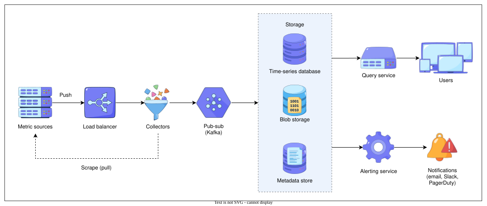

# Design_of_a_Metrics_Monitoring_and_Alerting_System

Source: https://www.educative.io/courses/grokking-the-system-design-interview/design-of-a-metrics-monitoring-and-alerting-system

---

[Home](https://www.educative.io/)

[Courses](https://www.educative.io/search?tab=courses)

[Grokking Modern System Design Interview](https://www.educative.io/courses/grokking-the-system-design-interview)

# Design of a Metrics Monitoring and Alerting System

The design of a metrics monitoring and alerting system involves a structured architecture that transforms raw metric samples into actionable insights through dashboards and alerts. Key components include collectors, a pub-sub system, a time-series database, and an alert manager, all working in tandem to ensure efficient data processing and problem detection. The system supports both push and pull data collection methods, and incorporates AI-assisted features for incident analysis and natural language querying. This design emphasizes scalability, fault tolerance, and the ability to handle high volumes of data while maintaining alert quality and operational efficiency.

We'll cover the following...

- [High-level design](https://www.educative.io/courses/grokking-the-system-design-interview/design-of-a-metrics-monitoring-and-alerting-system#High-level-design)
  - [Workflow](https://www.educative.io/courses/grokking-the-system-design-interview/design-of-a-metrics-monitoring-and-alerting-system#Workflow)
  - [API design](https://www.educative.io/courses/grokking-the-system-design-interview/design-of-a-metrics-monitoring-and-alerting-system#API-design)
    - [Metrics collection APIs](https://www.educative.io/courses/grokking-the-system-design-interview/design-of-a-metrics-monitoring-and-alerting-system#Metrics-collection-APIs)
    - [Query APIs](https://www.educative.io/courses/grokking-the-system-design-interview/design-of-a-metrics-monitoring-and-alerting-system#Query-APIs)
    - [Alert rule management APIs](https://www.educative.io/courses/grokking-the-system-design-interview/design-of-a-metrics-monitoring-and-alerting-system#Alert-rule-management-APIs)
    - [Notification APIs](https://www.educative.io/courses/grokking-the-system-design-interview/design-of-a-metrics-monitoring-and-alerting-system#Notification-APIs)
    - [AI-assisted APIs](https://www.educative.io/courses/grokking-the-system-design-interview/design-of-a-metrics-monitoring-and-alerting-system#AI-assisted-APIs)
  - [Storage schema](https://www.educative.io/courses/grokking-the-system-design-interview/design-of-a-metrics-monitoring-and-alerting-system#Storage-schema)
- [Detailed design](https://www.educative.io/courses/grokking-the-system-design-interview/design-of-a-metrics-monitoring-and-alerting-system#Detailed-design)
- [Workflow of the monitoring system](https://www.educative.io/courses/grokking-the-system-design-interview/design-of-a-metrics-monitoring-and-alerting-system#Workflow-of-the-monitoring-system)
- [AI-assisted features](https://www.educative.io/courses/grokking-the-system-design-interview/design-of-a-metrics-monitoring-and-alerting-system#AI-assisted-features)
  - [AI assistant service](https://www.educative.io/courses/grokking-the-system-design-interview/design-of-a-metrics-monitoring-and-alerting-system#AI-assistant-service)
  - [AI-assisted incident analysis](https://www.educative.io/courses/grokking-the-system-design-interview/design-of-a-metrics-monitoring-and-alerting-system#AI-assisted-incident-analysis)
  - [Natural-language metric queries](https://www.educative.io/courses/grokking-the-system-design-interview/design-of-a-metrics-monitoring-and-alerting-system#Natural-language-metric-queries)
- [Achieving requirements](https://www.educative.io/courses/grokking-the-system-design-interview/design-of-a-metrics-monitoring-and-alerting-system#Achieving-requirements)
- [Conclusion](https://www.educative.io/courses/grokking-the-system-design-interview/design-of-a-metrics-monitoring-and-alerting-system#Conclusion)

In this lesson, we’ll design the architecture that turns raw metric samples into dashboards and timely alerts. We’ll see how collectors, a pub-sub system, a time-series database, a query service, an alert evaluator, an alert manager, and an AI assistant service work together to detect problems quickly and reach the right responders. We’ll begin with the high-level design, expand it into a detailed design, and then add AI-assisted features on top.

## High-level design[#](https://www.educative.io/courses/grokking-the-system-design-interview/design-of-a-metrics-monitoring-and-alerting-system#High-level-design)

The following illustration shows the high-level architecture of the system, including both push and pull collection and the separate paths for alerting and historical queries:

High-level design of a metrics monitoring and alerting system

At the center of the design is a time-series database (TSDB). The following table describes the role of each component:

|  |  |
| --- | --- |
| **Component** | **Role in the System** |
| Load balancer | Distributes pushed metric traffic across collectors |
| Collectors | Scrape pull targets or receive pushed samples, then validate and normalize them |
| Pub-sub system | Buffers samples between collectors and storage and allows replay after failures |
| Time-series database | Stores recent samples and rollups for fast writes and range queries |
| Blob storage | Holds older, compacted data at a lower cost |
| Query service | Runs queries over stored metrics for dashboards and APIs |
| Metadata store | Stores alert rules, dashboard definitions, and notification policies |
| Alerting service | Checks alert rules against recent data and sends notifications when a rule fires |

### Workflow[#](https://www.educative.io/courses/grokking-the-system-design-interview/design-of-a-metrics-monitoring-and-alerting-system#Workflow)

The following steps show how a sample moves through the system, from collection to alert:

1. Metric sources either expose metrics for collectors to scrape or push them in batches through the load balancer.
2. Collectors validate and normalize the samples, then publish them to the pub-sub system.
3. Storage consumers read the samples from the pub-sub system and write them to the time-series database. As data ages, it is compacted and moved to blob storage.
4. When an engineer opens a dashboard, the query service reads recent data from the time-series database and older data from blob storage, then returns the results.
5. The alerting service periodically evaluates rules from the metadata store against recent data in the time-series database. When a rule fires, it sends a notification to the right channel.

Decoupling these stages lets each one scale on its own load, and the pub-sub system absorbs traffic bursts before they reach storage.

### API design[#](https://www.educative.io/courses/grokking-the-system-design-interview/design-of-a-metrics-monitoring-and-alerting-system#API-design)

Metric sources and users interact with the system through the following APIs. Time-series storage, data retention, and alert evaluation are handled internally, so they don’t need user-facing APIs.

#### Metrics collection APIs[#](https://www.educative.io/courses/grokking-the-system-design-interview/design-of-a-metrics-monitoring-and-alerting-system#Metrics-collection-APIs)

**Write metrics:** Sources that use push collection send samples in batches through this API. The `writeMetrics()` API returns a success or failure status for the batch.

Ace Editor

1

writeMetrics(api\_key, samples)

הההההההההההההההההההההההההההההההההההההההההההההההההההההההההההההההההההההההההההההההההההההההההההההההההההההההההההההההההההההההההההההההההההההההההההההההההההההההההההההההההההההההההההההההההההההההההההההההההההההההההההההההההההההההההההההההההההההההההההההההההההההההההההההההההההההההההההההההההההההההההההההההההההההההההההההההההההההההההההההההההההההההההההההההההההההההההההההההההההההההההההההההההההההההההההההההההההההההההההההההההההההההההההההההההההההההההההההההההההההההההההההההההההההההההההההההההההההההההההההההההההההההההההההההההההההההההההההההה

XXXXXXXXXXXXXXXXXXXXXXXXXXXXXXXXXXXXXXXXXXXXXXXXXXXXXXXXXXXXXXXXXXXXXXXXXXXXXXXXXXXXXXXXXXXXXXXXXXXXXXXXXXXXXXXXXXXXXXXXXXXXXXXXXXXXXXXXXXXXXXXXXXXXXXXXXXXXXXXXXXXXXXXXXXXXXXXXXXXXXXXXXXXXXXXXXXXXXXXXXXXXXXXXXXXXXXXXXXXXXXXXXXXXXXXXXXXXXXXXXXXXXXXXXXXXXXXXXXXXXXXXXXXXXXXXXXXXXXXXXXXXXXXXXXXXXXXXXXXXXXXXXXXXXXXXXXXXXXXXXXXXXXXXXXXXXXXXXXXXXXXXXXXXXXXXXXXXXXXXXXXXXXXXXXXXXXXXXXXXXXXXXXXXXXXXXXXXXXXXXXXXXXXXXXXXXXXXXXXXXXXXXXXXXXXXXXXXXXXXXXXXXXXXXXXXXXXXXXXXXXXXXXXXXXXXXXXXXXXXXXXXXXXXXXXXXXXXXXXXXXXXXXXXXXXX

Each item in `samples` contains a metric name, labels, a timestamp, and a value. Pull collection skips this API, since collectors fetch metrics from an endpoint, usually `/metrics`, that each source exposes.

#### Query APIs[#](https://www.educative.io/courses/grokking-the-system-design-interview/design-of-a-metrics-monitoring-and-alerting-system#Query-APIs)

**Query metrics:** Dashboards and users retrieve metric data over a time range through this API. The `queryMetrics()` API returns the matching time series, with one value per step interval.

Ace Editor

1

queryMetrics(user\_id, query, start\_time, end\_time, step)

הההההההההההההההההההההההההההההההההההההההההההההההההההההההההההההההההההההההההההההההההההההההההההההההההההההההההההההההההההההההההההההההההההההההההההההההההההההההההההההההההההההההההההההההההההההההההההההההההההההההההההההההההההההההההההההההההההההההההההההההההההההההההההההההההההההההההההההההההההההההההההההההההההההההההההההההההההההההההההההההההההההההההההההההההההההההההההההההההההההההההההההההההההההההההההההההההההההההההההההההההההההההההההההההההההההההההההההההההההההההההההההההההההההההההההההההההההההההההההההההההההההההההההההההההההההההההההההההה

XXXXXXXXXXXXXXXXXXXXXXXXXXXXXXXXXXXXXXXXXXXXXXXXXXXXXXXXXXXXXXXXXXXXXXXXXXXXXXXXXXXXXXXXXXXXXXXXXXXXXXXXXXXXXXXXXXXXXXXXXXXXXXXXXXXXXXXXXXXXXXXXXXXXXXXXXXXXXXXXXXXXXXXXXXXXXXXXXXXXXXXXXXXXXXXXXXXXXXXXXXXXXXXXXXXXXXXXXXXXXXXXXXXXXXXXXXXXXXXXXXXXXXXXXXXXXXXXXXXXXXXXXXXXXXXXXXXXXXXXXXXXXXXXXXXXXXXXXXXXXXXXXXXXXXXXXXXXXXXXXXXXXXXXXXXXXXXXXXXXXXXXXXXXXXXXXXXXXXXXXXXXXXXXXXXXXXXXXXXXXXXXXXXXXXXXXXXXXXXXXXXXXXXXXXXXXXXXXXXXXXXXXXXXXXXXXXXXXXXXXXXXXXXXXXXXXXXXXXXXXXXXXXXXXXXXXXXXXXXXXXXXXXXXXXXXXXXXXXXXXXXXXXXXXXXX

For example, the query `rate(http_requests_total{status=~"5.."}[5m])` returns the per-second rate of requests with a 5xx status, averaged over a 5-minute window. The `=~` operator applies a regular expression, so `"5.."` matches any three-digit status code that starts with 5.

#### Alert rule management APIs[#](https://www.educative.io/courses/grokking-the-system-design-interview/design-of-a-metrics-monitoring-and-alerting-system#Alert-rule-management-APIs)

**Create alert rule:** Users define a new alert rule through this API. The `createAlertRule()` API returns the ID of the new rule.

Ace Editor

1

createAlertRule(user\_id, rule\_name, expression, duration, severity, channel\_id)

הההההההההההההההההההההההההההההההההההההההההההההההההההההההההההההההההההההההההההההההההההההההההההההההההההההההההההההההההההההההההההההההההההההההההההההההההההההההההההההההההההההההההההההההההההההההההההההההההההההההההההההההההההההההההההההההההההההההההההההההההההההההההההההההההההההההההההההההההההההההההההההההההההההההההההההההההההההההההההההההההההההההההההההההההההההההההההההההההההההההההההההההההההההההההההההההההההההההההההההההההההההההההההההההההההההההההההההההההההההההההההההההההההההההההההההההההההההההההההההההההההההההההההההההההההההההההההההההה

XXXXXXXXXXXXXXXXXXXXXXXXXXXXXXXXXXXXXXXXXXXXXXXXXXXXXXXXXXXXXXXXXXXXXXXXXXXXXXXXXXXXXXXXXXXXXXXXXXXXXXXXXXXXXXXXXXXXXXXXXXXXXXXXXXXXXXXXXXXXXXXXXXXXXXXXXXXXXXXXXXXXXXXXXXXXXXXXXXXXXXXXXXXXXXXXXXXXXXXXXXXXXXXXXXXXXXXXXXXXXXXXXXXXXXXXXXXXXXXXXXXXXXXXXXXXXXXXXXXXXXXXXXXXXXXXXXXXXXXXXXXXXXXXXXXXXXXXXXXXXXXXXXXXXXXXXXXXXXXXXXXXXXXXXXXXXXXXXXXXXXXXXXXXXXXXXXXXXXXXXXXXXXXXXXXXXXXXXXXXXXXXXXXXXXXXXXXXXXXXXXXXXXXXXXXXXXXXXXXXXXXXXXXXXXXXXXXXXXXXXXXXXXXXXXXXXXXXXXXXXXXXXXXXXXXXXXXXXXXXXXXXXXXXXXXXXXXXXXXXXXXXXXXXXXXX

**Update alert rule:** Users change an existing rule’s condition, duration, severity, or notification target. The `updateAlertRule()` API returns a success or failure status.

Ace Editor

1

updateAlertRule(user\_id, rule\_id, rule\_name, expression, duration, severity, channel\_id)

הההההההההההההההההההההההההההההההההההההההההההההההההההההההההההההההההההההההההההההההההההההההההההההההההההההההההההההההההההההההההההההההההההההההההההההההההההההההההההההההההההההההההההההההההההההההההההההההההההההההההההההההההההההההההההההההההההההההההההההההההההההההההההההההההההההההההההההההההההההההההההההההההההההההההההההההההההההההההההההההההההההההההההההההההההההההההההההההההההההההההההההההההההההההההההההההההההההההההההההההההההההההההההההההההההההההההההההההההההההההההההההההההההההההההההההההההההההההההההההההההההההההההההההההההההההההההההההההה

XXXXXXXXXXXXXXXXXXXXXXXXXXXXXXXXXXXXXXXXXXXXXXXXXXXXXXXXXXXXXXXXXXXXXXXXXXXXXXXXXXXXXXXXXXXXXXXXXXXXXXXXXXXXXXXXXXXXXXXXXXXXXXXXXXXXXXXXXXXXXXXXXXXXXXXXXXXXXXXXXXXXXXXXXXXXXXXXXXXXXXXXXXXXXXXXXXXXXXXXXXXXXXXXXXXXXXXXXXXXXXXXXXXXXXXXXXXXXXXXXXXXXXXXXXXXXXXXXXXXXXXXXXXXXXXXXXXXXXXXXXXXXXXXXXXXXXXXXXXXXXXXXXXXXXXXXXXXXXXXXXXXXXXXXXXXXXXXXXXXXXXXXXXXXXXXXXXXXXXXXXXXXXXXXXXXXXXXXXXXXXXXXXXXXXXXXXXXXXXXXXXXXXXXXXXXXXXXXXXXXXXXXXXXXXXXXXXXXXXXXXXXXXXXXXXXXXXXXXXXXXXXXXXXXXXXXXXXXXXXXXXXXXXXXXXXXXXXXXXXXXXXXXXXXXXX

**Delete alert rule:** Users remove a rule they no longer need. The `deleteAlertRule()` API returns a success or failure status.

Ace Editor

1

deleteAlertRule(user\_id, rule\_id)

הההההההההההההההההההההההההההההההההההההההההההההההההההההההההההההההההההההההההההההההההההההההההההההההההההההההההההההההההההההההההההההההההההההההההההההההההההההההההההההההההההההההההההההההההההההההההההההההההההההההההההההההההההההההההההההההההההההההההההההההההההההההההההההההההההההההההההההההההההההההההההההההההההההההההההההההההההההההההההההההההההההההההההההההההההההההההההההההההההההההההההההההההההההההההההההההההההההההההההההההההההההההההההההההההההההההההההההההההההההההההההההההההההההההההההההההההההההההההההההההההההההההההההההההההההההההההההההההה

XXXXXXXXXXXXXXXXXXXXXXXXXXXXXXXXXXXXXXXXXXXXXXXXXXXXXXXXXXXXXXXXXXXXXXXXXXXXXXXXXXXXXXXXXXXXXXXXXXXXXXXXXXXXXXXXXXXXXXXXXXXXXXXXXXXXXXXXXXXXXXXXXXXXXXXXXXXXXXXXXXXXXXXXXXXXXXXXXXXXXXXXXXXXXXXXXXXXXXXXXXXXXXXXXXXXXXXXXXXXXXXXXXXXXXXXXXXXXXXXXXXXXXXXXXXXXXXXXXXXXXXXXXXXXXXXXXXXXXXXXXXXXXXXXXXXXXXXXXXXXXXXXXXXXXXXXXXXXXXXXXXXXXXXXXXXXXXXXXXXXXXXXXXXXXXXXXXXXXXXXXXXXXXXXXXXXXXXXXXXXXXXXXXXXXXXXXXXXXXXXXXXXXXXXXXXXXXXXXXXXXXXXXXXXXXXXXXXXXXXXXXXXXXXXXXXXXXXXXXXXXXXXXXXXXXXXXXXXXXXXXXXXXXXXXXXXXXXXXXXXXXXXXXXXXXX

#### Notification APIs[#](https://www.educative.io/courses/grokking-the-system-design-interview/design-of-a-metrics-monitoring-and-alerting-system#Notification-APIs)

**Create notification channel:** Users register where alerts should be sent, such as an email address, a Slack channel, or a PagerDuty service. The `createNotificationChannel()` API returns the ID of the new channel, which alert rules reference.

Ace Editor

1

createNotificationChannel(user\_id, channel\_type, destination)

הההההההההההההההההההההההההההההההההההההההההההההההההההההההההההההההההההההההההההההההההההההההההההההההההההההההההההההההההההההההההההההההההההההההההההההההההההההההההההההההההההההההההההההההההההההההההההההההההההההההההההההההההההההההההההההההההההההההההההההההההההההההההההההההההההההההההההההההההההההההההההההההההההההההההההההההההההההההההההההההההההההההההההההההההההההההההההההההההההההההההההההההההההההההההההההההההההההההההההההההההההההההההההההההההההההההההההההההההההההההההההההההההההההההההההההההההההההההההההההההההההההההההההההההההההההההההההההההה

XXXXXXXXXXXXXXXXXXXXXXXXXXXXXXXXXXXXXXXXXXXXXXXXXXXXXXXXXXXXXXXXXXXXXXXXXXXXXXXXXXXXXXXXXXXXXXXXXXXXXXXXXXXXXXXXXXXXXXXXXXXXXXXXXXXXXXXXXXXXXXXXXXXXXXXXXXXXXXXXXXXXXXXXXXXXXXXXXXXXXXXXXXXXXXXXXXXXXXXXXXXXXXXXXXXXXXXXXXXXXXXXXXXXXXXXXXXXXXXXXXXXXXXXXXXXXXXXXXXXXXXXXXXXXXXXXXXXXXXXXXXXXXXXXXXXXXXXXXXXXXXXXXXXXXXXXXXXXXXXXXXXXXXXXXXXXXXXXXXXXXXXXXXXXXXXXXXXXXXXXXXXXXXXXXXXXXXXXXXXXXXXXXXXXXXXXXXXXXXXXXXXXXXXXXXXXXXXXXXXXXXXXXXXXXXXXXXXXXXXXXXXXXXXXXXXXXXXXXXXXXXXXXXXXXXXXXXXXXXXXXXXXXXXXXXXXXXXXXXXXXXXXXXXXXXX

#### AI-assisted APIs[#](https://www.educative.io/courses/grokking-the-system-design-interview/design-of-a-metrics-monitoring-and-alerting-system#AI-assisted-APIs)

**Ask a question:** Users ask questions about their metrics in plain language. The `askQuestion()` API returns a generated query and a short explanation of what it does.

Ace Editor

1

askQuestion(user\_id, question)

הההההההההההההההההההההההההההההההההההההההההההההההההההההההההההההההההההההההההההההההההההההההההההההההההההההההההההההההההההההההההההההההההההההההההההההההההההההההההההההההההההההההההההההההההההההההההההההההההההההההההההההההההההההההההההההההההההההההההההההההההההההההההההההההההההההההההההההההההההההההההההההההההההההההההההההההההההההההההההההההההההההההההההההההההההההההההההההההההההההההההההההההההההההההההההההההההההההההההההההההההההההההההההההההההההההההההההההההההההההההההההההההההההההההההההההההההההההההההההההההההההההההההההההההההההההההההההההההה

XXXXXXXXXXXXXXXXXXXXXXXXXXXXXXXXXXXXXXXXXXXXXXXXXXXXXXXXXXXXXXXXXXXXXXXXXXXXXXXXXXXXXXXXXXXXXXXXXXXXXXXXXXXXXXXXXXXXXXXXXXXXXXXXXXXXXXXXXXXXXXXXXXXXXXXXXXXXXXXXXXXXXXXXXXXXXXXXXXXXXXXXXXXXXXXXXXXXXXXXXXXXXXXXXXXXXXXXXXXXXXXXXXXXXXXXXXXXXXXXXXXXXXXXXXXXXXXXXXXXXXXXXXXXXXXXXXXXXXXXXXXXXXXXXXXXXXXXXXXXXXXXXXXXXXXXXXXXXXXXXXXXXXXXXXXXXXXXXXXXXXXXXXXXXXXXXXXXXXXXXXXXXXXXXXXXXXXXXXXXXXXXXXXXXXXXXXXXXXXXXXXXXXXXXXXXXXXXXXXXXXXXXXXXXXXXXXXXXXXXXXXXXXXXXXXXXXXXXXXXXXXXXXXXXXXXXXXXXXXXXXXXXXXXXXXXXXXXXXXXXXXXXXXXXXXX

**Get incident analysis:** Users retrieve the AI analysis for an incident. The `getIncidentAnalysis()` API returns the summary, the findings with their supporting metrics, and the analysis status.

Ace Editor

1

getIncidentAnalysis(user\_id, incident\_id)

הההההההההההההההההההההההההההההההההההההההההההההההההההההההההההההההההההההההההההההההההההההההההההההההההההההההההההההההההההההההההההההההההההההההההההההההההההההההההההההההההההההההההההההההההההההההההההההההההההההההההההההההההההההההההההההההההההההההההההההההההההההההההההההההההההההההההההההההההההההההההההההההההההההההההההההההההההההההההההההההההההההההההההההההההההההההההההההההההההההההההההההההההההההההההההההההההההההההההההההההההההההההההההההההההההההההההההההההההההההההההההההההההההההההההההההההההההההההההההההההההההההההההההההההההההההההההההההההה

XXXXXXXXXXXXXXXXXXXXXXXXXXXXXXXXXXXXXXXXXXXXXXXXXXXXXXXXXXXXXXXXXXXXXXXXXXXXXXXXXXXXXXXXXXXXXXXXXXXXXXXXXXXXXXXXXXXXXXXXXXXXXXXXXXXXXXXXXXXXXXXXXXXXXXXXXXXXXXXXXXXXXXXXXXXXXXXXXXXXXXXXXXXXXXXXXXXXXXXXXXXXXXXXXXXXXXXXXXXXXXXXXXXXXXXXXXXXXXXXXXXXXXXXXXXXXXXXXXXXXXXXXXXXXXXXXXXXXXXXXXXXXXXXXXXXXXXXXXXXXXXXXXXXXXXXXXXXXXXXXXXXXXXXXXXXXXXXXXXXXXXXXXXXXXXXXXXXXXXXXXXXXXXXXXXXXXXXXXXXXXXXXXXXXXXXXXXXXXXXXXXXXXXXXXXXXXXXXXXXXXXXXXXXXXXXXXXXXXXXXXXXXXXXXXXXXXXXXXXXXXXXXXXXXXXXXXXXXXXXXXXXXXXXXXXXXXXXXXXXXXXXXXXXXXXX

The following table describes the parameters used across these APIs:

|  |  |
| --- | --- |
| **Parameter** | **Description** |
| `api_key` | Key that authenticates a metric source when it pushes data |
| `samples` | Batch of samples, each with a metric name, labels, a timestamp, and a value |
| `user_id` | Unique ID of the authenticated user |
| `query` | Query expression that selects, filters, and aggregates metrics |
| `start_time` | Start of the time range to query |
| `end_time` | End of the time range to query |
| `step` | Interval between returned data points, such as 1 minute |
| `rule_id` | Unique ID of an alert rule |
| `rule_name` | Readable name of an alert rule |
| `expression` | Condition the rule checks, such as an error rate above 5% |
| `duration` | How long the condition must hold before the alert fires, such as 5 minutes |
| `severity` | Priority of the alert, such as critical or warning |
| `channel_id` | Unique ID of a notification channel |
| `channel_type` | Type of notification channel, such as email, Slack, or PagerDuty |
| `destination` | Where the channel sends alerts, such as an email address or webhook URL |
| `question` | Question about metrics, written in plain language |
| `incident_id` | Unique ID of a grouped incident created by the alert manager |

### Storage schema[#](https://www.educative.io/courses/grokking-the-system-design-interview/design-of-a-metrics-monitoring-and-alerting-system#Storage-schema)

The system stores two kinds of data with very different access patterns. Metric samples arrive at millions per second and go to the time-series database. Alert rules, notification channels, alert history, and user data have much lower storage and go to the metadata store, which is a relational database.

Storage schema for a metrics monitoring and alerting system

The Series table stores each unique combination of a metric name and its labels once and assigns it a `series_id`. Samples and rollups then refer to that ID, so the labels are not repeated for every sample.

The AlertState table tracks whether each alert rule is pending, firing, or resolved, allowing the alert manager to prevent duplicate notifications for alerts that are already firing.  The schema simplifies this to one state per rule. In practice, a rule such as “error rate above 1% per service” can fire separately for each matching label set, so state is tracked per rule and label set.

The AlertHistory table keeps a record of past alerts and the incidents they belonged to, since AlertState stores only each rule's current state. The IncidentAnalysis table stores each AI-generated analysis along with its status, which is pending, completed, or failed.

**Note:** Blob storage keeps older samples and rollups in the same series and sample structure. The time-series database compacts them into large compressed blocks and moves those blocks to blob storage as files.

Next, we expand the architecture into a detailed design and look at how each component handles scale and failures.

## Detailed design[#](https://www.educative.io/courses/grokking-the-system-design-interview/design-of-a-metrics-monitoring-and-alerting-system#Detailed-design)

The platform works as a pipeline of independent stages. Each stage performs a narrow function and passes its output to the next. That separation keeps ingestion, storage, querying, and alerting from failing together.

Instrumentation starts inside services. Libraries such as OpenTelemetry or Prometheus client libraries collect and expose counters, gauges, and histograms, along with labels such as service, region, instance, and version. A histogram supports latency tracking without sending every raw value. Labels make queries expressive, but excessive label variation creates expensive series growth.

The following illustration expands the high-level design with the components that handle validation, processing, caching, alert handling, and presentation:

Detailed design of a metrics monitoring and alerting system

Each component owns one stage of the metric life cycle:

- **Collectors and agents:** They scrape exporters or receive pushed samples, attach instance and environment metadata, and perform lightweight validation before forwarding records.
- **Ingestion gateway:** It authenticates writers, enforces quotas per team or source, rate-limits abusive streams, and protects downstream systems from malformed payloads.
- **Pub-sub system (Kafka):** It partitions samples by series so consumers can scale out and replay missed data after failures. Like a shock absorber, it takes the force of traffic spikes so storage receives a steadier flow.
- **Stream processor:** It enriches metrics, computes preaggregations for common queries, and removes invalid samples before storage.
- **Time-series database:** It stores recent raw samples at high resolution and older rollups at lower granularity, and it moves compacted blocks to blob storage as they age.
- **Blob storage:** It holds older, compacted blocks at a lower cost, and the query service reads from it for long time ranges.
- **Metadata store:** It keeps alert rules, notification channels, alert state and history, incident analyses, and dashboard definitions.
- **Query service:** It executes range scans, group-by aggregations, rollups, and approximate percentile queries for dashboards and APIs.
- **Distributed cache:** It stores results for frequently viewed dashboard panels to reduce load on storage.
- **Alert evaluator:** It evaluates thresholds, rate-of-change logic, and burn-rate rules over sliding windows.
- **Alert manager:** It groups related alerts, suppresses duplicates, honors maintenance windows, and escalates unresolved incidents. It also applies inhibition.
- **Dashboard service:** It renders operational views of service and infrastructure health, such as latency, error rates, and resource usage.

**Attention:** High-cardinality labels such as `user_id` can explode series count and destabilize both storage and queries.

The following table compares each component’s scaling concern and failure mode:

|  |  |  |  |
| --- | --- | --- | --- |
| **Component** | **Responsibility** | **Scaling Concern** | **Failure Mode** |
| Collector | Ingests and forwards telemetry from sources | Backlog growth under bursty or sustained load | Dropped, delayed, or unevenly buffered data |
| Pub-sub system (Kafka) | Buffers and transports event streams between services | Hot partitions causing uneven load and throughput limits | Lag, partition saturation, or delayed delivery |
| Time-series database | Stores and indexes time-series data for retrieval | High-cardinality labels increasing memory and storage pressure | Slow writes and reads, compaction stress, or query timeouts |
| Query service | Executes reads and aggregations over stored metrics | Expensive wide queries consuming CPU and I/O | Slow responses, timeouts, or partial results |
| Alert evaluator | Evaluates rules and triggers alerts from metric data | Delayed rule evaluation as rule volume or query cost rises | Late, skipped, or outdated alerts |
| Alert manager | Routes, deduplicates, and sends alert notifications | Fan-out and retry pressure across channels | Duplicate notifications or missed sends |
| Dashboard service | Renders visual views and summaries for users | Concurrent users and dependency latency | Stale or partial views |

Next, we follow one sample from emission to alert delivery.

## Workflow of the monitoring system[#](https://www.educative.io/courses/grokking-the-system-design-interview/design-of-a-metrics-monitoring-and-alerting-system#Workflow-of-the-monitoring-system)

The runtime flow starts when an application instance boots and exposes metrics on an endpoint or pushes them through a sidecar agent. Pushed batches pass through the load balancer to the ingestion gateway, which authenticates the producer, validates the metric schema, and applies quotas.

For pull collection, collectors discover the target through service discovery and scrape it directly. In both cases, collectors normalize labels and timestamps. If clocks are skewed, the collector can clamp or reject obviously invalid timestamps before forwarding them.

- **From sample ingestion to durable storage:** Collectors publish the normalized samples to Kafka. With this indirection, a traffic surge increases queue depth first, which gives storage time to catch up.
- **Fresh writes and rollups:** The stream processor reads from Kafka partitions, removes invalid samples, and writes the rest to the time-series database. It also computes preaggregations so common dashboard queries avoid scanning full raw history.
- **Query path for humans and APIs:** When engineers open a dashboard, the dashboard service sends queries to the query service. The query service checks the distributed cache first, then reads recent data from the time-series database and older rollups from blob storage, and returns groupings and p95 or p99 approximations. A burn-rate alert uses the same query primitives over short and long windows.
- **From evaluation to notification:** In parallel, the alert evaluator checks rules against recent windows in the time-series database, such as a 5xx error rate above 1% or p95 latency above target. Limiting checks to recent data keeps them fast. If a rule fires, the alert manager deduplicates and groups the alerts, checks maintenance windows, and routes critical incidents to pagers and lower-severity ones to Slack or email.

**Practical tip:** Fast alerts should still require hold times or consecutive failing windows. One noisy spike should rarely wake someone up.

Replay from Kafka and replicated storage keep the system working during downstream faults. Alert quality depends on choosing the right signals as much as on writing correct rules.

## AI-assisted features[#](https://www.educative.io/courses/grokking-the-system-design-interview/design-of-a-metrics-monitoring-and-alerting-system#AI-assisted-features)

The core design detects problems and notifies the appropriate people. Two LLM-powered features extend it. One helps engineers understand incidents faster, and the other lets users explore metrics without learning a query language. Both run on a single new component, the AI assistant service, which uses the existing services through their normal interfaces.

### AI assistant service[#](https://www.educative.io/courses/grokking-the-system-design-interview/design-of-a-metrics-monitoring-and-alerting-system#AI-assistant-service)

The AI assistant service has the following responsibilities:

- **Receiving requests:** It accepts questions from the dashboard service and incident triggers from the alert manager.
- **Gathering context:** It retrieves metrics through the query service, and alert rules, runbook links, and alert history from the metadata store.
- **Calling the LLM:** It sends that context to an LLM and turns the response into structured results.
- **Storing results:** It saves incident analyses in the IncidentAnalysis table.

The service has read-only access to metric data and reaches it only through the query service, using scoped permissions. It never writes to the time-series database or changes alert rules.

### AI-assisted incident analysis[#](https://www.educative.io/courses/grokking-the-system-design-interview/design-of-a-metrics-monitoring-and-alerting-system#AI-assisted-incident-analysis)

When the alert manager groups related alerts into a critical incident, it delivers the notification first, then forwards the incident to the AI assistant service for analysis. Triggering analysis only for grouped critical incidents reduces LLM usage, as even an alert storm involving hundreds of alerts results in a single analysis per incident.

The service then takes the following steps:

1. It loads the alert rule, its runbook link, and past incidents for the same rule from alert history.
2. It queries related metrics through the query service, such as other metrics from the same service and region over the same time window.
3. It sends this context to the LLM, which summarizes correlated signals and suggests potential contributing causes.
4. It stores the analysis and posts it as a follow-up to the incident, for example, in the same Slack thread as the alert. Users can also retrieve it later through the `getIncidentAnalysis()` API.

Each finding references the metrics and time ranges it's based on, so engineers can verify it before acting. To know whether the analyses help, track how often responders mark findings as useful and how often the cited metrics actually support each finding.

AI-assisted incident analysis in action

**Note:** The analysis runs after the notification is sent. If the AI assistant service or the LLM is slow or unavailable, alerts still reach responders on time, and the analysis arrives later or not at all.

### Natural-language metric queries[#](https://www.educative.io/courses/grokking-the-system-design-interview/design-of-a-metrics-monitoring-and-alerting-system#Natural-language-metric-queries)

A user types a question in a dashboard, such as "Which services had the highest error rate in the last hour?" The dashboard service sends it to the AI assistant service through the `askQuestion()` API, and the service does the following:

- **Retrieves matching metrics:** It looks up relevant metric names and labels through the query service, so the LLM works with metrics that exist.
- **Generates and validates a query:** It asks the LLM to translate the question into a query, then checks the query's syntax and metric names.
- **Returns the query for review:** The user reviews the query and runs it through the existing query service. Users can also save a reviewed query as an alert rule.

Validation catches malformed queries, but a valid query can still answer a different question than the user intended. That's why the user reviews it before it runs. Grounding the model in metric names that actually exist is the same idea as retrieval-augmented generation from the AI building blocks chapter: retrieve real context first, then let the model generate.

**Practical tip:** Treat LLM output as a starting point for an investigation. Show the evidence with every finding, and let engineers decide what to act on.

**Guardrails:** The AI assistant service keeps the model from affecting core monitoring in three ways:

- **Untrusted inputs:** Runbook text, alert descriptions, and metric labels are treated as data rather than instructions, so text embedded in a runbook cannot change what the service does.
- **Limited outputs:** Its only outputs are a stored analysis, a follow-up message, and a suggested query that a user must approve, so a manipulated or incorrect response cannot silence alerts, change rules, or write metrics.
- **Bounded cost:** Per-team quotas on askQuestion() calls, a cap on how much metric context each request carries, and one analysis per grouped incident keep inference cost predictable even during alert storms.

These controls apply the trust-boundary practices from the lesson on evaluating and protecting AI features.

This design gives the AI assistant access to metrics, alert history, and runbooks. Production systems often add logs, traces, and deployment events, which give the analysis more context.

## Achieving requirements[#](https://www.educative.io/courses/grokking-the-system-design-interview/design-of-a-metrics-monitoring-and-alerting-system#Achieving-requirements)

The following table summarizes how the design meets each non-functional requirement from the previous lesson:

|  |  |
| --- | --- |
| **Non-Functional Requirement** | **Explanation** |
| High ingestion throughput | Batched writes, horizontally scaled collectors, and partitioned Kafka topics absorb millions of samples per second. |
| Low-latency reads | Append-heavy writes, selective indexing, precomputed rollups, cached query responses, and bounded rule windows keep dashboards and alerts fast. |
| Horizontal scalability | Collectors, Kafka partitions, storage shards, and stateless query services scale out by adding instances, and alert evaluators shard rules across instances. |
| Reliability and availability | Redundant collectors, replicated brokers, multi-AZ storage, and stateless query services behind load balancers remove single points of failure. |
| Durability | At-least-once ingestion, replay from Kafka after a consumer failure, and replicated storage prevent silent data loss. |
| Consistency | The design accepts eventual consistency, so dashboards may lag by a few seconds. Deduplication keys remove duplicate samples caused by at-least-once delivery. |
| Cost efficiency | Retention tiers, downsampling, blob storage for older data, and collecting high-resolution samples only where needed control long-term cost. |
| Cardinality control | The ingestion gateway enforces quotas, and cardinality limits reject or constrain unbounded labels before they reach storage. |
| AI isolation and cost | The AI assistant service runs only after notifications are sent, reads metrics through the query service with read-only access, and is bounded by per-team quotas and one analysis per grouped incident, so AI slowness or failure never delays alerts. |

**Note:** Monitoring systems often fail during the same bursts they are supposed to explain. Buffering and backpressure matter for correctness as well as performance.

## Conclusion[#](https://www.educative.io/courses/grokking-the-system-design-interview/design-of-a-metrics-monitoring-and-alerting-system#Conclusion)

A metrics monitoring and alerting system is a pipeline that collects telemetry, buffers it safely, stores it efficiently, evaluates rules continuously, and routes incidents with context. Its main trade-offs are pull vs. push collection, buffered vs. direct writes, retention vs. storage cost, and fast detection vs. alert fatigue. The AI features help engineers analyze incidents and query metrics while staying outside the alert delivery path.

System Design: Metrics Monitoring and Alerting System

System Design: ChatGPT System

Ask

[High-level design](https://www.educative.io/courses/grokking-the-system-design-interview/design-of-a-metrics-monitoring-and-alerting-system#High-level-design)

[Workflow](https://www.educative.io/courses/grokking-the-system-design-interview/design-of-a-metrics-monitoring-and-alerting-system#Workflow)

[API design](https://www.educative.io/courses/grokking-the-system-design-interview/design-of-a-metrics-monitoring-and-alerting-system#API-design)

[Metrics collection APIs](https://www.educative.io/courses/grokking-the-system-design-interview/design-of-a-metrics-monitoring-and-alerting-system#Metrics-collection-APIs)

[Query APIs](https://www.educative.io/courses/grokking-the-system-design-interview/design-of-a-metrics-monitoring-and-alerting-system#Query-APIs)

[Alert rule management APIs](https://www.educative.io/courses/grokking-the-system-design-interview/design-of-a-metrics-monitoring-and-alerting-system#Alert-rule-management-APIs)

[Notification APIs](https://www.educative.io/courses/grokking-the-system-design-interview/design-of-a-metrics-monitoring-and-alerting-system#Notification-APIs)

[AI-assisted APIs](https://www.educative.io/courses/grokking-the-system-design-interview/design-of-a-metrics-monitoring-and-alerting-system#AI-assisted-APIs)

[Storage schema](https://www.educative.io/courses/grokking-the-system-design-interview/design-of-a-metrics-monitoring-and-alerting-system#Storage-schema)

[Detailed design](https://www.educative.io/courses/grokking-the-system-design-interview/design-of-a-metrics-monitoring-and-alerting-system#Detailed-design)

[Workflow of the monitoring system](https://www.educative.io/courses/grokking-the-system-design-interview/design-of-a-metrics-monitoring-and-alerting-system#Workflow-of-the-monitoring-system)

[AI-assisted features](https://www.educative.io/courses/grokking-the-system-design-interview/design-of-a-metrics-monitoring-and-alerting-system#AI-assisted-features)

[AI assistant service](https://www.educative.io/courses/grokking-the-system-design-interview/design-of-a-metrics-monitoring-and-alerting-system#AI-assistant-service)

[AI-assisted incident analysis](https://www.educative.io/courses/grokking-the-system-design-interview/design-of-a-metrics-monitoring-and-alerting-system#AI-assisted-incident-analysis)

[Natural-language metric queries](https://www.educative.io/courses/grokking-the-system-design-interview/design-of-a-metrics-monitoring-and-alerting-system#Natural-language-metric-queries)

[Achieving requirements](https://www.educative.io/courses/grokking-the-system-design-interview/design-of-a-metrics-monitoring-and-alerting-system#Achieving-requirements)

[Conclusion](https://www.educative.io/courses/grokking-the-system-design-interview/design-of-a-metrics-monitoring-and-alerting-system#Conclusion)