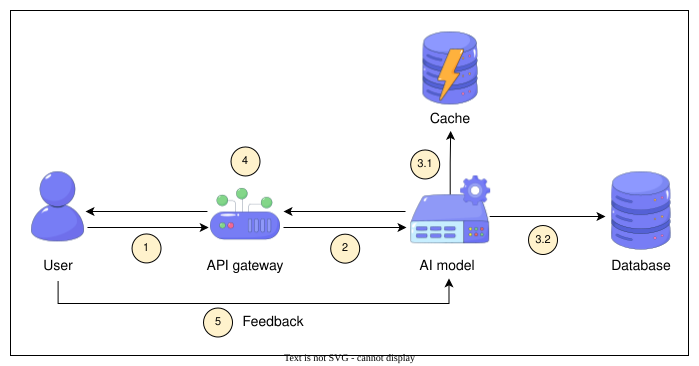

# Design_of_a_ChatGPT_System

Source: https://www.educative.io/courses/grokking-the-system-design-interview/design-of-a-chatgpt-system

---

[Home](https://www.educative.io/)

[Courses](https://www.educative.io/search?tab=courses)

[Grokking Modern System Design Interview](https://www.educative.io/courses/grokking-the-system-design-interview)

# Design of a ChatGPT System

The design of a ChatGPT-like system involves a structured architecture that facilitates real-time, context-aware conversations. Key components include an API gateway for request management, a model server for processing prompts, and a vector database for retrieving relevant past interactions. The system employs a caching layer to enhance response times, a content moderation system to filter inappropriate content, and a user profile service for personalization. Feedback mechanisms are integrated to continuously improve the model's performance. Overall, the design emphasizes scalability, reliability, and security while ensuring efficient handling of user interactions.

We'll cover the following...

- [High-level design of ChatGPT](https://www.educative.io/courses/grokking-the-system-design-interview/design-of-a-chatgpt-system#High-level-design-of-ChatGPT)
- [Detailed design of ChatGPT](https://www.educative.io/courses/grokking-the-system-design-interview/design-of-a-chatgpt-system#Detailed-design-of-ChatGPT)
  - [Components in the detailed design of ChatGPT](https://www.educative.io/courses/grokking-the-system-design-interview/design-of-a-chatgpt-system#Components-in-the-detailed-design-of-ChatGPT)
  - [Workflow of the ChatGPT system](https://www.educative.io/courses/grokking-the-system-design-interview/design-of-a-chatgpt-system#Workflow-of-the-ChatGPT-system)
  - [Achieving requirements](https://www.educative.io/courses/grokking-the-system-design-interview/design-of-a-chatgpt-system#Achieving-requirements)
    - [Achieving functional requirements](https://www.educative.io/courses/grokking-the-system-design-interview/design-of-a-chatgpt-system#Achieving-functional-requirements)
    - [Achieving non-functional requirements](https://www.educative.io/courses/grokking-the-system-design-interview/design-of-a-chatgpt-system#Achieving-non-functional-requirements)
- [Conclusion](https://www.educative.io/courses/grokking-the-system-design-interview/design-of-a-chatgpt-system#Conclusion)

We have identified the requirements, storage needs, and foundational components. Now, we will detail the system design to understand how these components ensure real-time, context-aware conversations.

## High-level design of ChatGPT[#](https://www.educative.io/courses/grokking-the-system-design-interview/design-of-a-chatgpt-system#High-level-design-of-ChatGPT)

The high-level design illustrates how the system handles real-time conversations. The following workflow outlines the component interactions.

The high-level design of the ChatGPT system

The workflow for the high-level design is provided below:

1. **User input:** The user submits a text prompt via the interface or API.
2. **Gateway processing:** The API gateway authenticates the request, applies rate limiting, manages the session, and forwards the prompt to the model server.
3. **Model inference:** The AI model processes the prompt using conversation history. Responses are cached for retrieval and logged in the database.
4. **Response delivery:** The generated response is returned to the user via the API gateway.
5. **Feedback loop:** User feedback is collected to improve system performance and fine-tune future models.

User feedback is essential for fine-tuning the system, enhancing its accuracy, and natural language generation.  
To understand this process, read “[System Design of a Text-to-Text Generation System](https://www.educative.io/courses/generative-ai-system-design/design-a-text-to-text-generation-system).”

1.

Is a typical cache (like LRU or TTL-based) sufficient for storing AI-generated responses?

Show Answer

Did you find this helpful?

Let’s examine the specific components that enable this architecture.

## Detailed design of ChatGPT[#](https://www.educative.io/courses/grokking-the-system-design-interview/design-of-a-chatgpt-system#Detailed-design-of-ChatGPT)

The detailed design breaks down the technical implementation of the system. We will define the key components before mapping the complete workflow.

### Components in the detailed design of ChatGPT[#](https://www.educative.io/courses/grokking-the-system-design-interview/design-of-a-chatgpt-system#Components-in-the-detailed-design-of-ChatGPT)

Requests are routed through the API gateway to a load balancer, which distributes traffic across application servers. The system relies on the following core components:

- **Pre-processing (NLU service):** Extracts meaning, intent, and entities from user input. It converts text into numerical embeddings to capture semantic relationships.
- **Model server:** The core processing unit hosting AI models. It generates responses based on user queries.
- **Vector database:** Stores vector embeddings of conversation history and external knowledge. This enables the retrieval of semantically similar content for context-aware responses.
- **Redis (caching layer):** Temporarily stores recent conversation history to prevent redundant database lookups and improve latency.

Detailed design of a text-to-text generation system like ChatGPT

- **Content moderation system:** Scans generated responses for policy violations and sensitive content before delivery.
- **User profile service:** Manages authentication, session tracking, and user preferences to personalize interactions.
- **Zookeeper (orchestrator):** Coordinates model servers by tracking active instances, distributing workloads, and handling failovers.
- **Pub/sub:** Manages asynchronous communication (e.g., billing, logging) to ensure events propagate without blocking API calls.
- **Payment processing system:** Handles transaction logging, billing, and payments, coordinated via the pub/sub system.
- **MongoDB (user database):** Stores structured data, such as session metadata and billing history. MongoDB is selected for its flexible data models and horizontal scalability.

1.

How does the payment system determine how much to charge a user for a request in a system like ChatGPT, especially when billing is based on token usage or premium features?

Show Answer

Did you find this helpful?

The following steps outline the journey of a user prompt through the system.

### Workflow of the ChatGPT system[#](https://www.educative.io/courses/grokking-the-system-design-interview/design-of-a-chatgpt-system#Workflow-of-the-ChatGPT-system)

When a user enters a prompt through a web or mobile interface, the request first reaches the API gateway, which manages authentication, authorization, and rate limiting. From there, a load balancer distributes the request across multiple application servers to ensure efficient handling.

Before reaching the model, the prompt passes through the preprocessing NLU service. If the user has interacted before, a user profile service retrieves relevant historical data to personalize the response. Once preprocessed, the request is sent to the model servers, where the large language model (LLM) generates a response. When additional context is required, the system queries the vector database to retrieve semantically relevant information from past interactions.

Before the response is returned, it passes through the content moderation system to filter out harmful or inappropriate content. Zookeeper coordinates the model servers by managing configuration, leader election, and health monitoring during scaling and failover.

If the request involves a paid feature, the payment processing system logs the transaction and updates records in MongoDB. Meanwhile, a CDN ensures static assets, such as UI elements, load quickly, but generated responses from the model are handled separately.

Finally, the response is sent back to the user. If the user provides feedback, it is collected via the feedback module and stored in the feedback database. Structured feedback (e.g., ratings or thumbs up/down) is stored in a relational database (e.g., PostgreSQL or MySQL). In contrast, unstructured feedback (such as comments or session metadata) is stored in a document database, such as MongoDB. This data helps improve the system over time through analysis and model updates.

AI Powered

Saved

2 attempts left

Reset

Content moderation

Why is content moderation placed after response generation rather than before?

You have 2 attempts to answer.

We have detailed the design and workflow. Next, we assess how the system meets key requirements.

### Achieving requirements[#](https://www.educative.io/courses/grokking-the-system-design-interview/design-of-a-chatgpt-system#Achieving-requirements)

The following sections evaluate the design against the previously identified functional and non-functional requirements.

#### Achieving functional requirements[#](https://www.educative.io/courses/grokking-the-system-design-interview/design-of-a-chatgpt-system#Achieving-functional-requirements)

The table below illustrates how the design addresses the functional objectives.

|  |  |
| --- | --- |
| **Functional Requirements** | **Techniques** |
| Dialogue management | - The pre-processing NLU service interprets user input. - The model server generates context-aware responses. - User profile service maintains the session context. |
| Natural language understanding | - The pre-processing NLU service extracts intent and entities and understands user input. - Vector DB enables semantic retrieval. - Redis caches recent context for fast access. |
| Personalization | - User profile stores preferences and history. - Model server uses this data for tailored responses. |
| Feedback | - Feedback module logs user ratings and comments, which are used to refine the system through offline training and model improvements. |

#### Achieving non-functional requirements[#](https://www.educative.io/courses/grokking-the-system-design-interview/design-of-a-chatgpt-system#Achieving-non-functional-requirements)

Non-functional requirements define performance, reliability, and scalability. The table below highlights how the design satisfies these constraints.

|  |  |
| --- | --- |
| **Non-Functional Requirements** | **Techniques** |
| Scalability | - The load balancers distribute traffic across multiple servers. - Model servers and vector database scale horizontally as demand grows. - Redis caching reduces redundant processing. |
| Reliability and availability | - Zookeeper coordinates distributed components for fault tolerance. - Redundant model servers and databases ensure continued operation in case of failures. - Pub-sub enables decoupled communication for real-time updates and seamless failure recovery. |
| Low latency | - Redis caching accelerates responses for frequently queried data. - Vector database efficiently retrieves contextual information, reducing unnecessary recomputation. - CDN reduces latency by caching and serving static content closer to users. |
| Security and privacy | - API gateway enforces authentication, authorization, and rate limiting. - Payment processing system ensures secure financial transactions. - End-to-end encryption secures requests and responses from interception. - MongoDB stores user data with encryption and access control. |

## Conclusion[#](https://www.educative.io/courses/grokking-the-system-design-interview/design-of-a-chatgpt-system#Conclusion)

In this chapter, we designed a ChatGPT-like system, covering the system architecture and detailed workflows. We examined how components like caching, content moderation, and distributed model hosting ensure scalability, reliability, and security.

But this is only the beginning.

- While we discussed the context-awareness module, how is that actually created and integrated into the system?
- How is user feedback incorporated in the subsequent responses generated by the GenAI System?

To develop a deeper understanding of the questions above, explore [Grokking the Generative AI System Design](https://www.educative.io/courses//generative-ai-system-design).

Looking ahead, advances in LLMs, RAG, and efficient inference will enhance performance, while trends such as multimodal AI and on-device inference may make ChatGPT-like systems more responsive and personalized.

System Design: ChatGPT System

ChatGPT System Design

Ask

[High-level design of ChatGPT](https://www.educative.io/courses/grokking-the-system-design-interview/design-of-a-chatgpt-system#High-level-design-of-ChatGPT)

[Detailed design of ChatGPT](https://www.educative.io/courses/grokking-the-system-design-interview/design-of-a-chatgpt-system#Detailed-design-of-ChatGPT)

[Components in the detailed design of ChatGPT](https://www.educative.io/courses/grokking-the-system-design-interview/design-of-a-chatgpt-system#Components-in-the-detailed-design-of-ChatGPT)

[Workflow of the ChatGPT system](https://www.educative.io/courses/grokking-the-system-design-interview/design-of-a-chatgpt-system#Workflow-of-the-ChatGPT-system)

[Achieving requirements](https://www.educative.io/courses/grokking-the-system-design-interview/design-of-a-chatgpt-system#Achieving-requirements)

[Achieving functional requirements](https://www.educative.io/courses/grokking-the-system-design-interview/design-of-a-chatgpt-system#Achieving-functional-requirements)

[Achieving non-functional requirements](https://www.educative.io/courses/grokking-the-system-design-interview/design-of-a-chatgpt-system#Achieving-non-functional-requirements)

[Conclusion](https://www.educative.io/courses/grokking-the-system-design-interview/design-of-a-chatgpt-system#Conclusion)