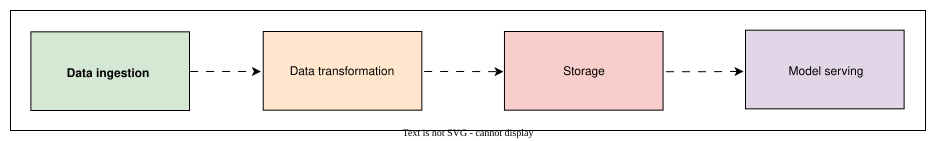

# System_Design_Data_Infrastructure_for_AIML_Systems

Source: https://www.educative.io/courses/grokking-the-system-design-interview/system-design-data-infrastructure-for-ai-ml-systems

---

[Home](https://www.educative.io/)

[Courses](https://www.educative.io/search?tab=courses)

[Grokking Modern System Design Interview](https://www.educative.io/courses/grokking-the-system-design-interview)

# System Design: Data Infrastructure for AI/ML Systems

The design of data infrastructure for AI and ML systems is crucial due to their high demand for scalable, reliable, and efficient data management. A well-architected infrastructure facilitates data collection, processing, storage, and serving, addressing challenges like data silos, quality inconsistencies, and reproducibility issues. Traditional architectures often fail to meet the unique needs of ML, leading to problems such as training-serving skew and scalability bottlenecks. Effective infrastructure must ensure high throughput, low latency, and robust security while accommodating diverse workloads and future growth, utilizing technologies like blob storage, CDNs, and message queues for optimal performance.

We'll cover the following...

- [The need for data infrastructure for AI/ML](https://www.educative.io/courses/grokking-the-system-design-interview/system-design-data-infrastructure-for-ai-ml-systems#The-need-for-data-infrastructure-for-AIML)
- [The challenges of traditional architectures](https://www.educative.io/courses/grokking-the-system-design-interview/system-design-data-infrastructure-for-ai-ml-systems#The-challenges-of-traditional-architectures)
- [Requirements](https://www.educative.io/courses/grokking-the-system-design-interview/system-design-data-infrastructure-for-ai-ml-systems#Requirements)
  - [Functional requirements](https://www.educative.io/courses/grokking-the-system-design-interview/system-design-data-infrastructure-for-ai-ml-systems#Functional-requirements)
  - [Non-functional requirements](https://www.educative.io/courses/grokking-the-system-design-interview/system-design-data-infrastructure-for-ai-ml-systems#Non-functional-requirements)
- [Resource estimation](https://www.educative.io/courses/grokking-the-system-design-interview/system-design-data-infrastructure-for-ai-ml-systems#Resource-estimation)
  - [Storage estimation](https://www.educative.io/courses/grokking-the-system-design-interview/system-design-data-infrastructure-for-ai-ml-systems#Storage-estimation)
  - [Number of servers](https://www.educative.io/courses/grokking-the-system-design-interview/system-design-data-infrastructure-for-ai-ml-systems#Number-of-servers)
    - [1. Ingestion servers](https://www.educative.io/courses/grokking-the-system-design-interview/system-design-data-infrastructure-for-ai-ml-systems#1-Ingestion-servers)
    - [2. Data processing servers](https://www.educative.io/courses/grokking-the-system-design-interview/system-design-data-infrastructure-for-ai-ml-systems#2-Data-processing-servers)
    - [3. Model serving nodes (online inference)](https://www.educative.io/courses/grokking-the-system-design-interview/system-design-data-infrastructure-for-ai-ml-systems#3-Model-serving-nodes-online-inference)
    - [4. Orchestration and monitoring servers](https://www.educative.io/courses/grokking-the-system-design-interview/system-design-data-infrastructure-for-ai-ml-systems#4-Orchestration-and-monitoring-servers)
  - [Bandwidth estimation](https://www.educative.io/courses/grokking-the-system-design-interview/system-design-data-infrastructure-for-ai-ml-systems#Bandwidth-estimation)
    - [Incoming bandwidth](https://www.educative.io/courses/grokking-the-system-design-interview/system-design-data-infrastructure-for-ai-ml-systems#Incoming-bandwidth)
    - [Outgoing (serving) bandwidth](https://www.educative.io/courses/grokking-the-system-design-interview/system-design-data-infrastructure-for-ai-ml-systems#Outgoing-serving-bandwidth)
- [Building blocks we will use](https://www.educative.io/courses/grokking-the-system-design-interview/system-design-data-infrastructure-for-ai-ml-systems#Building-blocks-we-will-use)

Scalable and reliable data infrastructure is essential for modern machine learning (ML) and artificial intelligence (AI) systems. This infrastructure supports data collection, processing, storage, and serving across the ML life cycle.

Rather than a single application, it is a foundational system supporting diverse workloads, including large-scale ingestion, transformation, feature storage, and low-latency inference.

Overview of the data pipeline for AI/ML

## The need for data infrastructure for AI/ML[#](https://www.educative.io/courses/grokking-the-system-design-interview/system-design-data-infrastructure-for-ai-ml-systems#The-need-for-data-infrastructure-for-AIML)

Modern ML systems rely on high-quality, available data. A robust infrastructure enables data scientists and engineers to experiment, iterate, and deploy models reliably. It solves challenges like data silos and  inconsistent data quality while ensuring reproducibility. The platform must provide high throughput, low latency, and scalability.

Designing these platforms is difficult. Many organizations struggle because standard architectures cannot meet ML demands.

## The challenges of traditional architectures[#](https://www.educative.io/courses/grokking-the-system-design-interview/system-design-data-infrastructure-for-ai-ml-systems#The-challenges-of-traditional-architectures)

General-purpose data warehouses or data lakes are not designed for the ML data life cycle, leading to critical issues:

- **Training-serving skew:** Discrepancies between training and live data degrade model performance.
- **Lack of feature reusability:** Without a centralized platform, teams recreate features, causing waste and inconsistency.
- **Reproducibility issues:** Mutable data complicates experiment reproduction. Strict data and code versioning is essential.
- **Scalability bottlenecks:** Traditional systems struggle with computationally heavy transformations as data volumes grow.

Beyond these core architectural issues, problems such as high latency in feature computation, monitoring for data drift, and bridging the collaboration gap between data and ML teams also present significant difficulties.

Technical Quiz

1.

What is training-serving skew?

A.

The difference in time it takes to train a model versus serving a prediction.

B.

Using different server hardware (e.g., CPUs vs. GPUs) for training and serving.

C.

Discrepancies between the data or features used for training and for live predictions.

D.

When a model is trained on significantly more data than it is served.

---

1 / 1

## Requirements[#](https://www.educative.io/courses/grokking-the-system-design-interview/system-design-data-infrastructure-for-ai-ml-systems#Requirements)

To design a scalable data infrastructure, let’s scope the problem to the following functional and non-functional requirements.

### Functional requirements[#](https://www.educative.io/courses/grokking-the-system-design-interview/system-design-data-infrastructure-for-ai-ml-systems#Functional-requirements)

- **Data collection:** Ingest data from multiple sources, including databases, real-time event streams, APIs, and logs.
- **Data processing and transformation:** Convert raw data into model-ready formats. This involves cleaning, normalization, and feature engineering.
- **Batch and real-time handling:** Support both historical batch data for training and real-time streams for inference.
- **Data storage:** Efficiently store raw, processed, and feature data using appropriate storage solutions.
- **Serving data to ML/AI models:** Serve versioned features and datasets to models for training and inference with low latency.
- **Data monitoring:** Track data quality, lineage, and model-data interactions.

Functional and non-functional requirements of a data infrastructure for AI/ML systems

### Non-functional requirements[#](https://www.educative.io/courses/grokking-the-system-design-interview/system-design-data-infrastructure-for-ai-ml-systems#Non-functional-requirements)

- **Reliability:** Ensure continuous, accurate processing even in the face of failures.
- **Security and privacy:** Protect data via encryption and access controls. Enforce regulations like GDPR or HIPAA.
- **Scalability:** Handle increasing data volumes, users, and concurrent models without performance degradation.
- **Performance:** Minimize latency for batch jobs and online predictions.
- **Low latency:** Serve features for real-time inference in milliseconds.

## Resource estimation[#](https://www.educative.io/courses/grokking-the-system-design-interview/system-design-data-infrastructure-for-ai-ml-systems#Resource-estimation)

We will estimate storage, compute, and bandwidth for a high-traffic e-commerce scenario.

**Note:** These estimates rely on specific assumptions. Actual requirements vary based on workload types (e.g., read vs. write-heavy), data characteristics, and performance SLAs.

### Storage estimation[#](https://www.educative.io/courses/grokking-the-system-design-interview/system-design-data-infrastructure-for-ai-ml-systems#Storage-estimation)

We estimate storage requirements based on these assumptions:

- **Daily raw data ingestion:** 1.5 TB/day (Based on 10,000 events/sec at 1.5 KB/event, plus overhead)
- **Data transformation factor:** 2.5 times the size of the raw data (due to denormalization, enrichment, and metadata)
- **Feature data size:** 0.5 times the size of the raw data (aggregated and derived values)

Total daily storage required:

Total daily storage = Raw data + Transformed data + Features\text{Total\ daily\ storage = Raw\ data + Transformed\ data + Features}Total daily storage = Raw data + Transformed data + Features

Total daily storage = 1.5 TB + (1.5 TB×2.5) + (1.5 TB×0.5) = 6 TB\text{Total daily storage = 1.5 TB + (1.5 TB}\times\text{2.5) + (1.5 TB}\times\text{0.5) = 6 TB}Total daily storage = 1.5 TB + (1.5 TB×2.5) + (1.5 TB×0.5) = 6 TB

Total storage required for one year:

Total annual storage = 6 TB×365 days = 2.2 PB\text{Total annual storage = 6 TB} \times \text{365 days = 2.2 PB}Total annual storage = 6 TB×365 days = 2.2 PB

#### Estimating storage requirements

|  |  |  |
| --- | --- | --- |
| Daily raw data ingestion | 1.5 | TB |
| Data transformation factor | 2.5 | Times |
| Feature data factor | 0.5 | Times |
| Total daily storage | f6 | TB |
| Total annual storage | f2.2 | PB |

**Note:** This is a foundational estimate. Real-world systems require additional storage for versioning, redundancy, backups, and metadata.

### Number of servers[#](https://www.educative.io/courses/grokking-the-system-design-interview/system-design-data-infrastructure-for-ai-ml-systems#Number-of-servers)

We estimate compute resources for specific workloads:

- Data ingestion servers
- Batch and ETL processing servers
- Model serving / inference servers
- Monitoring and orchestration servers

#### 1. Ingestion servers[#](https://www.educative.io/courses/grokking-the-system-design-interview/system-design-data-infrastructure-for-ai-ml-systems#1-Ingestion-servers)

The ingestion cluster (e.g., Kafka) handles raw data flow.

Assumptions:

- **Total ingestion throughput:** Peak of 53 MB/s (Up to 3 times the average incoming bandwidth to handle spikes).
- **Per-node throughput:** 10 MB/s. While a 1 Gbps NIC allows more, real-world throughput is limited by disk I/O, replication, and serialization.

Estimated ingestion servers:

Number of ingestion servers=Total required throughputPer-node throughput\text{Number of ingestion servers} =
\frac{\text{Total required throughput}}{\text{Per-node
throughput}}
Number of ingestion servers=Per-node throughputTotal required throughput​

Number of ingestion servers=53 MB/s10 MB/s≈6\text{\ Number of ingestion servers} = \frac{53 \text{ MB/s}}{10 \text{ MB/s}} \approx6  Number of ingestion servers=10 MB/s53 MB/s​≈6

#### Estimating ingestion servers

|  |  |  |
| --- | --- | --- |
| Total ingestion throughput | 53 | MB/s |
| Per-node capacity | 10 | MB/s |
| Estimated servers | f6 | Nodes |

#### 2. Data processing servers[#](https://www.educative.io/courses/grokking-the-system-design-interview/system-design-data-infrastructure-for-ai-ml-systems#2-Data-processing-servers)

The processing cluster (e.g., Apache Spark) transforms raw data into features.

Assumptions:

- **Total daily data volume:** 6 TB (derived from storage estimates)
- **Processing capacity per node:** 500 GB/day (typical Spark/ETL performance)
- **Processing SLA:** Data processed within a 4-hour window

Estimated processing servers:

Number of processing servers=Total daily data volumeProcessing capacity per node\text{\ Number of processing servers} = \frac{\text{Total daily data volume}}{\text{Processing capacity per node}} Number of processing servers=Processing capacity per nodeTotal daily data volume​

Number of processing servers=6000 GB500 GB=12 nodes\text{\ Number of processing servers} =\frac{6000 \text{ GB}}{500 \text{ GB}} = 12 \text{ nodes} Number of processing servers=500 GB6000 GB​=12 nodes

We add a 20% buffer for data skew, retries, and slowdowns to ensure SLA compliance:

12+(12×0.2)≈1512 + (12 \times 0.2) \approx1512+(12×0.2)≈15

#### Estimating processing servers

|  |  |  |
| --- | --- | --- |
| Total daily data | 6000 | GB |
| Per-node capacity | 500 | GB/day |
| Base node requirement | f12 | Nodes |
| Buffer factor | 20 | % |
| Estimated processing servers | f15 | Nodes |

#### 3. Model serving nodes (online inference)[#](https://www.educative.io/courses/grokking-the-system-design-interview/system-design-data-infrastructure-for-ai-ml-systems#3-Model-serving-nodes-online-inference)

The serving cluster handles real-time predictions.

Assumptions:

- **Peak online serving load:** 15,000 RPS
- **Requests handled per server:** 500 RPS (typical for lightweight lookups)

Estimated serving nodes:

Number of model serving nodes=Peak RPSRequests handled per nodes per second\text{\ Number of model serving nodes} = \frac{\text{Peak RPS}}{\text{Requests handled per nodes per second}} Number of model serving nodes=Requests handled per nodes per secondPeak RPS​

Number of model serving nodes=15000500=30 serving nodes\text{\ Number of model serving nodes} =\frac{15000}{500} = 30 \text{ serving nodes} Number of model serving nodes=50015000​=30 serving nodes

**Note:** Designing and sizing production-grade AI systems involves many trade-offs across data, compute, and serving layers. For a deeper, end-to-end walkthrough of these design decisions, explore our [Grokking the Generative AI System Design](https://www.educative.io/courses/generative-ai-system-design) course.

#### Estimating model serving nodes

|  |  |  |  |
| --- | --- | --- | --- |
|  | A | B | C |
| 1 | Peak online serving load | 15000 | RPS |
| 2 | Requests handled per server | 500 | RPS |
| 3 | Number of serving servers | f30 | Nodes |

#### 4. Orchestration and monitoring servers[#](https://www.educative.io/courses/grokking-the-system-design-interview/system-design-data-infrastructure-for-ai-ml-systems#4-Orchestration-and-monitoring-servers)

We allocate 10–15% of total nodes for support services. This includes orchestrators (Apache Airflow, Kubeflow), monitoring (Prometheus, Grafana), and networking.

We apply growth and redundancy factors for production readiness:

- **Growth buffer:** 20–30% extra capacity for future growth
- **Fault tolerance:** N+1 redundancy or 1–2 extra nodes per cluster
- **Environment duplication:** 2–3 times the server count for staging and development environments

### Bandwidth estimation[#](https://www.educative.io/courses/grokking-the-system-design-interview/system-design-data-infrastructure-for-ai-ml-systems#Bandwidth-estimation)

We estimate network bandwidth using these assumptions:

- **Peak ingestion factor:** Up to 3 times the normal load to handle bursty traffic.
- **Average feature vector size:** 2 KB.
- **Peak online serving load:** 15,000 RPS.

Estimated incoming and outgoing bandwidth:

#### Incoming bandwidth[#](https://www.educative.io/courses/grokking-the-system-design-interview/system-design-data-infrastructure-for-ai-ml-systems#Incoming-bandwidth)

The incoming bandwidth represents the rate at which raw data flows into the ingestion layer from producers such as applications, services, and event streams.

Average = 1.5 TB / 86400 = 17.4 MB/s\text{Average = 1.5 TB / 86400 = 17.4 MB/s}Average = 1.5 TB / 86400 = 17.4 MB/s

Peak = 17.4 MB/s×3 = 52.5 MB/s\text{Peak = 17.4 MB/s}\times\text{3 = 52.5 MB/s}Peak = 17.4 MB/s×3 = 52.5 MB/s

#### Outgoing (serving) bandwidth [#](https://www.educative.io/courses/grokking-the-system-design-interview/system-design-data-infrastructure-for-ai-ml-systems#Outgoing-serving-bandwidth)

Outgoing bandwidth is the data sent from the system to online inference services during real-time predictions.

15000 RPS×2 KB/query = 30 MB/s\text{15000 RPS}\times\text{2 KB/query = 30 MB/s}15000 RPS×2 KB/query = 30 MB/s

#### Estimating incoming and outgoing bandwidth requirements

|  |  |  |
| --- | --- | --- |
| Daily raw data | 1.5 | TB |
| Seconds per day | f86400 | Seconds |
| Average incoming bandwidth | f17.4 | MB/s |
| Peak ingestion factor | 3 | Times |
| Peak incoming bandwidth | f52.2 | MB/s |
| Peak online serving load | 15000 | RPS |
| Average feature vector size | 2 | KB |
| Outgoing bandwidth | f30 | MB/s |

**Note:** The most significant network load is internal traffic between the storage layer and the processing cluster. This often reaches multi-gigabit-per-second (Gbps) speeds and requires a carefully designed network architecture.

Technical Quiz

1.

Why do we estimate system resources (like bandwidth and server count) based on peak throughput (e.g., 3 times average) rather than just the daily average throughput?

A.

Because cloud providers only allow provisioning based on peak metrics.

B.

To ensure the system remains stable and does not drop data during natural traffic surges.

C.

Because calculating the average throughput is mathematically impossible for big data.

D.

To handle the theoretical edge case where all daily data arrives in a single second.

---

1 / 1

## Building blocks we will use[#](https://www.educative.io/courses/grokking-the-system-design-interview/system-design-data-infrastructure-for-ai-ml-systems#Building-blocks-we-will-use)

We will use the following foundational technologies to handle large-scale data:

Building blocks required to design a scalable data infrastructure

- [**Blob storage**](https://www.educative.io/courses/grokking-the-system-design-interview/system-design-a-blob-store)**:** Use it as a primary data lake for cost-effective, durable storage of raw and processed data.
- [**CDN**](https://www.educative.io/courses/grokking-the-system-design-interview/system-design-the-content-delivery-network-cdn)**:** Caches feature data geographically closer to inference models to reduce latency.
- [**Key-value store**](https://www.educative.io/courses/grokking-the-system-design-interview/system-design-the-key-value-store)**:** High-performance online feature store for low-latency access during inference.
- [**Load balancers**](https://www.educative.io/courses/grokking-the-system-design-interview/introduction-to-load-balancers)**:** Distribute traffic across ingestion and serving clusters for high availability.
- [**Message queue**](https://www.educative.io/courses/grokking-the-system-design-interview/system-design-the-distributed-messaging-queue)**:** Buffer real-time streams to decouple producers from consumers and mitigate spikes.

Having established the requirements, initial resource estimates, and the core building blocks, we can now proceed to the high-level design of the platform in the next lesson.

ChatGPT System Design

High-Level Design of Scalable Data Infrastructure for AI/ML

Ask

[The need for data infrastructure for AI/ML](https://www.educative.io/courses/grokking-the-system-design-interview/system-design-data-infrastructure-for-ai-ml-systems#The-need-for-data-infrastructure-for-AIML)

[The challenges of traditional architectures](https://www.educative.io/courses/grokking-the-system-design-interview/system-design-data-infrastructure-for-ai-ml-systems#The-challenges-of-traditional-architectures)

[Requirements](https://www.educative.io/courses/grokking-the-system-design-interview/system-design-data-infrastructure-for-ai-ml-systems#Requirements)

[Functional requirements](https://www.educative.io/courses/grokking-the-system-design-interview/system-design-data-infrastructure-for-ai-ml-systems#Functional-requirements)

[Non-functional requirements](https://www.educative.io/courses/grokking-the-system-design-interview/system-design-data-infrastructure-for-ai-ml-systems#Non-functional-requirements)

[Resource estimation](https://www.educative.io/courses/grokking-the-system-design-interview/system-design-data-infrastructure-for-ai-ml-systems#Resource-estimation)

[Storage estimation](https://www.educative.io/courses/grokking-the-system-design-interview/system-design-data-infrastructure-for-ai-ml-systems#Storage-estimation)

[Number of servers](https://www.educative.io/courses/grokking-the-system-design-interview/system-design-data-infrastructure-for-ai-ml-systems#Number-of-servers)

[1. Ingestion servers](https://www.educative.io/courses/grokking-the-system-design-interview/system-design-data-infrastructure-for-ai-ml-systems#1-Ingestion-servers)

[2. Data processing servers](https://www.educative.io/courses/grokking-the-system-design-interview/system-design-data-infrastructure-for-ai-ml-systems#2-Data-processing-servers)

[3. Model serving nodes (online inference)](https://www.educative.io/courses/grokking-the-system-design-interview/system-design-data-infrastructure-for-ai-ml-systems#3-Model-serving-nodes-online-inference)

[4. Orchestration and monitoring servers](https://www.educative.io/courses/grokking-the-system-design-interview/system-design-data-infrastructure-for-ai-ml-systems#4-Orchestration-and-monitoring-servers)

[Bandwidth estimation](https://www.educative.io/courses/grokking-the-system-design-interview/system-design-data-infrastructure-for-ai-ml-systems#Bandwidth-estimation)

[Incoming bandwidth](https://www.educative.io/courses/grokking-the-system-design-interview/system-design-data-infrastructure-for-ai-ml-systems#Incoming-bandwidth)

[Outgoing (serving) bandwidth](https://www.educative.io/courses/grokking-the-system-design-interview/system-design-data-infrastructure-for-ai-ml-systems#Outgoing-serving-bandwidth)

[Building blocks we will use](https://www.educative.io/courses/grokking-the-system-design-interview/system-design-data-infrastructure-for-ai-ml-systems#Building-blocks-we-will-use)