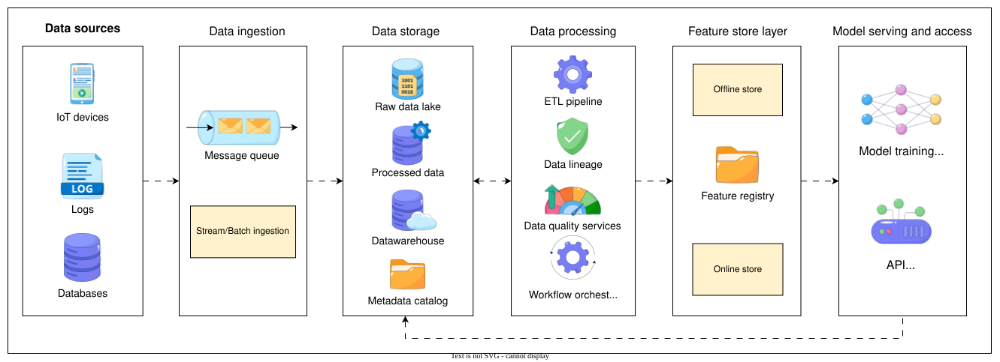

# High-Level_Design_of_Scalable_Data_Infrastructure_for_AIML

Source: https://www.educative.io/courses/grokking-the-system-design-interview/high-level-design-of-scalable-data-infrastructure-for-ai-ml

---

[Home](https://www.educative.io/)

[Courses](https://www.educative.io/search?tab=courses)

[Grokking Modern System Design Interview](https://www.educative.io/courses/grokking-the-system-design-interview)

# High-Level Design of Scalable Data Infrastructure for AI/ML

The high-level design of a scalable data infrastructure for AI/ML is structured around five core layers: data ingestion, raw data storage, data processing, processed data storage, and model serving. Data is ingested from various sources and stored in a raw data lake, where it undergoes transformation through ETL pipelines. The processed data is stored in analytical warehouses and feature stores, facilitating efficient model training and inference. APIs manage data and feature interactions, while a well-organized storage schema ensures efficient access and scalability. This architecture supports seamless data flow, enabling effective training and deployment of ML models.

We'll cover the following...

- [High-level design](https://www.educative.io/courses/grokking-the-system-design-interview/high-level-design-of-scalable-data-infrastructure-for-ai-ml#High-level-design)
  - [Key components and responsibilities](https://www.educative.io/courses/grokking-the-system-design-interview/high-level-design-of-scalable-data-infrastructure-for-ai-ml#Key-components-and-responsibilities)
- [API design](https://www.educative.io/courses/grokking-the-system-design-interview/high-level-design-of-scalable-data-infrastructure-for-ai-ml#API-design)
  - [1. Ingestion and processing APIs](https://www.educative.io/courses/grokking-the-system-design-interview/high-level-design-of-scalable-data-infrastructure-for-ai-ml#1-Ingestion-and-processing-APIs)
  - [2. Dataset management APIs](https://www.educative.io/courses/grokking-the-system-design-interview/high-level-design-of-scalable-data-infrastructure-for-ai-ml#2-Dataset-management-APIs)
  - [3. Feature store APIs](https://www.educative.io/courses/grokking-the-system-design-interview/high-level-design-of-scalable-data-infrastructure-for-ai-ml#3-Feature-store-APIs)
  - [4. Serving APIs](https://www.educative.io/courses/grokking-the-system-design-interview/high-level-design-of-scalable-data-infrastructure-for-ai-ml#4-Serving-APIs)
- [Storage schema](https://www.educative.io/courses/grokking-the-system-design-interview/high-level-design-of-scalable-data-infrastructure-for-ai-ml#Storage-schema)
  - [Feature store schema](https://www.educative.io/courses/grokking-the-system-design-interview/high-level-design-of-scalable-data-infrastructure-for-ai-ml#Feature-store-schema)
  - [Data lake directory structure](https://www.educative.io/courses/grokking-the-system-design-interview/high-level-design-of-scalable-data-infrastructure-for-ai-ml#Data-lake-directory-structure)
- [Conclusion](https://www.educative.io/courses/grokking-the-system-design-interview/high-level-design-of-scalable-data-infrastructure-for-ai-ml#Conclusion)

Building on the requirements and estimations from the previous lesson, we now focus on the system’s high-level design.

## High-level design[#](https://www.educative.io/courses/grokking-the-system-design-interview/high-level-design-of-scalable-data-infrastructure-for-ai-ml#High-level-design)

The platform consists of five core layers that establish a clear data flow from ingestion to serving. This structure ensures the system meets both functional and non-functional requirements.

High-level design of the AI/ML data platform

The high-level workflow operates as follows:

1. **Data ingestion:** Data originates from diverse sources such as logs, transactional databases (CDC), IoT devices, and third-party SaaS platforms. These sources push data through API connectors for synchronous loads or publish events to message queues for real-time streams. The ingestion layer is split into specialized stream and batch ingestion components. Stream ingestion handles real-time events continuously, while batch ingestion manages scheduled bulk loads.
2. **Raw data storage layer:** Ingested data lands in the raw data lake, typically using scalable object storage like S3. It employs a “schema-on-read” approach to preserve original fidelity for compliance and reprocessing.
3. **Data processing:** The data processing layer pulls raw data for transformation. ETL pipelines, managed by workflow orchestration tools, execute the cleaning and feature engineering logic. During this stage, data quality services, such as null detection, validate the data, and data lineage is tracked to maintain a clear history of transformations.
4. **Processed data storage layer:** The transformed data is written back into the data storage layer, populating the processed data stores and the analytical data warehouse. The metadata catalog is updated with the new schemas, table statistics, and partition locations, making the data discoverable for analysts.
5. **Feature store population:** Simultaneously, the processing layer extracts model-specific attributes and sends them to the feature store layer. This layer acts as a dual-publisher.
6. **Model serving and access:** The model serving and access layer consumes the prepared features. Model training pipelines query the offline storage to build and train models, which are then versioned in the model registry. For live predictions, the API (serving/access) component queries the online storage to fetch precomputed features in milliseconds.

### Key components and responsibilities[#](https://www.educative.io/courses/grokking-the-system-design-interview/high-level-design-of-scalable-data-infrastructure-for-ai-ml#Key-components-and-responsibilities)

The table below summarizes the core services in the high-level architecture and their specific roles.

|  |  |  |
| --- | --- | --- |
| **Layer** | **Component** | **Purpose** |
| Data ingestion | Message queue | Buffers high-throughput real-time event streams (e.g., Kafka) to decouple producers from consumers. |
| Stream/Batch ingestion | Standardizes, validates, and batches incoming data from diverse sources before writing to storage. |
| Data storage | Raw data lake | Stores immutable, raw data in its original format (e.g., JSON, Avro) for compliance and reprocessing. |
| Processed data lake | Stores cleaned, transformed, and optimized data (e.g., Parquet) ready for analytics. |
| Data warehouse | A structured SQL engine (e.g., BigQuery) for high-performance analytics and reporting. |
| Metadata catalog | A central repository that stores schemas, lineage, and statistics for all datasets in the platform. |
| Data processing | ETL pipelines | Executes the business logic to clean, transform, and aggregate raw data into useful information. |
| Data quality service | Enforces validation checks (completeness, accuracy) to prevent bad data from propagating downstream. |
| Workflow orchestrator | Manages the schedule, dependencies, and retries of data pipelines (e.g., Airflow). |
| Feature store | Feature registry | A catalog specifically for ML features, tracking definitions, versions, owners, and logic to enable reusability. |
| Offline storage | Stores historical feature values (e.g., in Parquet/BigQuery) for creating point-in-time correct training datasets. |
| Online storage | A low-latency store (e.g., Redis) holding only the latest feature values for real-time inference. |
| Model serving and access | Serving API | Provides low-latency access to features and model predictions for live applications. |

Functional operations rely on specific APIs to manage data, features, and pipelines.

## API design[#](https://www.educative.io/courses/grokking-the-system-design-interview/high-level-design-of-scalable-data-infrastructure-for-ai-ml#API-design)

The following APIs are essential for managing the platform.

### 1. Ingestion and processing APIs[#](https://www.educative.io/courses/grokking-the-system-design-interview/high-level-design-of-scalable-data-infrastructure-for-ai-ml#1-Ingestion-and-processing-APIs)

These APIs manage data ingestion and transformation jobs.

- **`triggerPipeline()`****:** Manually triggers an ETL or feature computation job. It returns a `job_id` for tracking. While pipelines usually run on schedules, this API allows manual execution for retries.

Ace Editor

1

triggerPipeline(pipeline\_id: string, parameters: JSON)

הההההההההההההההההההההההההההההההההההההההההההההההההההההההההההההההההההההההההההההההההההההההההההההההההההההההההההההההההההההההההההההההההההההההההההההההההההההההההההההההההההההההההההההההההההההההההההההההההההההההההההההההההההההההההההההההההההההההההההההההההההההההההההההההההההההההההההההההההההההההההההההההההההההההההההההההההההההההההההההההההההההההההההההההההההההההההההההההההההההההההההההההההההההההההההההההההההההההההההההההההההההההההההההההההההההההההההההההההההההההההההההההההההההההההההההההההההההההההההההההההההההההההההההההההההההההההההההההה

XXXXXXXXXXXXXXXXXXXXXXXXXXXXXXXXXXXXXXXXXXXXXXXXXXXXXXXXXXXXXXXXXXXXXXXXXXXXXXXXXXXXXXXXXXXXXXXXXXXXXXXXXXXXXXXXXXXXXXXXXXXXXXXXXXXXXXXXXXXXXXXXXXXXXXXXXXXXXXXXXXXXXXXXXXXXXXXXXXXXXXXXXXXXXXXXXXXXXXXXXXXXXXXXXXXXXXXXXXXXXXXXXXXXXXXXXXXXXXXXXXXXXXXXXXXXXXXXXXXXXXXXXXXXXXXXXXXXXXXXXXXXXXXXXXXXXXXXXXXXXXXXXXXXXXXXXXXXXXXXXXXXXXXXXXXXXXXXXXXXXXXXXXXXXXXXXXXXXXXXXXXXXXXXXXXXXXXXXXXXXXXXXXXXXXXXXXXXXXXXXXXXXXXXXXXXXXXXXXXXXXXXXXXXXXXXXXXXXXXXXXXXXXXXXXXXXXXXXXXXXXXXXXXXXXXXXXXXXXXXXXXXXXXXXXXXXXXXXXXXXXXXXXXXXXXX

|  |  |
| --- | --- |
| **Parameter** | **Description** |
| `pipeline_id` | The unique identifier for the pipeline to run. It is defined in the infrastructure-as-code or job definition YAML files. |
| `parameters` | A JSON object with parameters for the pipeline run. |

For example, to re-run the `etl-daily-sales-processing` pipeline for a specific past date:

Ace Editor

1

2

3

4

5

6

{

"execution\_date": "2023-10-25",

"region": "us-east-1",

"force\_reload": true,

"source\_bucket": "s3://my-raw-data-bucket/sales/2023/10/25/"

}

הההההההההההההההההההההההההההההההההההההההההההההההההההההההההההההההההההההההההההההההההההההההההההההההההההההההההההההההההההההההההההההההההההההההההההההההההההההההההההההההההההההההההההההההההההההההההההההההההההההההההההההההההההההההההההההההההההההההההההההההההההההההההההההההההההההההההההההההההההההההההההההההההההההההההההההההההההההההההההההההההההההההההההההההההההההההההההההההההההההההההההההההההההההההההההההההההההההההההההההההההההההההההההההההההההההההההההההההההההההההההההההההההההההההההההההההההההההההההההההההההההההההההההההההההההההההההההההההה

XXXXXXXXXXXXXXXXXXXXXXXXXXXXXXXXXXXXXXXXXXXXXXXXXXXXXXXXXXXXXXXXXXXXXXXXXXXXXXXXXXXXXXXXXXXXXXXXXXXXXXXXXXXXXXXXXXXXXXXXXXXXXXXXXXXXXXXXXXXXXXXXXXXXXXXXXXXXXXXXXXXXXXXXXXXXXXXXXXXXXXXXXXXXXXXXXXXXXXXXXXXXXXXXXXXXXXXXXXXXXXXXXXXXXXXXXXXXXXXXXXXXXXXXXXXXXXXXXXXXXXXXXXXXXXXXXXXXXXXXXXXXXXXXXXXXXXXXXXXXXXXXXXXXXXXXXXXXXXXXXXXXXXXXXXXXXXXXXXXXXXXXXXXXXXXXXXXXXXXXXXXXXXXXXXXXXXXXXXXXXXXXXXXXXXXXXXXXXXXXXXXXXXXXXXXXXXXXXXXXXXXXXXXXXXXXXXXXXXXXXXXXXXXXXXXXXXXXXXXXXXXXXXXXXXXXXXXXXXXXXXXXXXXXXXXXXXXXXXXXXXXXXXXXXXXX

- **`getPipelineStatus()`****:** Returns the status and logs of a specific job (`job_id`). This enables monitoring and debugging of running, succeeded, or failed jobs.

Ace Editor

1

getPipelineStatus(pipeline\_id: string)

הההההההההההההההההההההההההההההההההההההההההההההההההההההההההההההההההההההההההההההההההההההההההההההההההההההההההההההההההההההההההההההההההההההההההההההההההההההההההההההההההההההההההההההההההההההההההההההההההההההההההההההההההההההההההההההההההההההההההההההההההההההההההההההההההההההההההההההההההההההההההההההההההההההההההההההההההההההההההההההההההההההההההההההההההההההההההההההההההההההההההההההההההההההההההההההההההההההההההההההההההההההההההההההההההההההההההההההההההההההההההההההההההההההההההההההההההההההההההההההההההההההההההההההההההההההההההההההההה

XXXXXXXXXXXXXXXXXXXXXXXXXXXXXXXXXXXXXXXXXXXXXXXXXXXXXXXXXXXXXXXXXXXXXXXXXXXXXXXXXXXXXXXXXXXXXXXXXXXXXXXXXXXXXXXXXXXXXXXXXXXXXXXXXXXXXXXXXXXXXXXXXXXXXXXXXXXXXXXXXXXXXXXXXXXXXXXXXXXXXXXXXXXXXXXXXXXXXXXXXXXXXXXXXXXXXXXXXXXXXXXXXXXXXXXXXXXXXXXXXXXXXXXXXXXXXXXXXXXXXXXXXXXXXXXXXXXXXXXXXXXXXXXXXXXXXXXXXXXXXXXXXXXXXXXXXXXXXXXXXXXXXXXXXXXXXXXXXXXXXXXXXXXXXXXXXXXXXXXXXXXXXXXXXXXXXXXXXXXXXXXXXXXXXXXXXXXXXXXXXXXXXXXXXXXXXXXXXXXXXXXXXXXXXXXXXXXXXXXXXXXXXXXXXXXXXXXXXXXXXXXXXXXXXXXXXXXXXXXXXXXXXXXXXXXXXXXXXXXXXXXXXXXXXXXX

### 2. Dataset management APIs[#](https://www.educative.io/courses/grokking-the-system-design-interview/high-level-design-of-scalable-data-infrastructure-for-ai-ml#2-Dataset-management-APIs)

These APIs manage dataset life cycles.

- **`listDatasets()`****:** Returns a paginated list of available datasets and their metadata.

Ace Editor

1

listDatasets(page: int, page\_size: int, filter: JSON)

הההההההההההההההההההההההההההההההההההההההההההההההההההההההההההההההההההההההההההההההההההההההההההההההההההההההההההההההההההההההההההההההההההההההההההההההההההההההההההההההההההההההההההההההההההההההההההההההההההההההההההההההההההההההההההההההההההההההההההההההההההההההההההההההההההההההההההההההההההההההההההההההההההההההההההההההההההההההההההההההההההההההההההההההההההההההההההההההההההההההההההההההההההההההההההההההההההההההההההההההההההההההההההההההההההההההההההההההההההההההההההההההההההההההההההההההההההההההההההההההההההההההההההההההההההההההההההההההה

XXXXXXXXXXXXXXXXXXXXXXXXXXXXXXXXXXXXXXXXXXXXXXXXXXXXXXXXXXXXXXXXXXXXXXXXXXXXXXXXXXXXXXXXXXXXXXXXXXXXXXXXXXXXXXXXXXXXXXXXXXXXXXXXXXXXXXXXXXXXXXXXXXXXXXXXXXXXXXXXXXXXXXXXXXXXXXXXXXXXXXXXXXXXXXXXXXXXXXXXXXXXXXXXXXXXXXXXXXXXXXXXXXXXXXXXXXXXXXXXXXXXXXXXXXXXXXXXXXXXXXXXXXXXXXXXXXXXXXXXXXXXXXXXXXXXXXXXXXXXXXXXXXXXXXXXXXXXXXXXXXXXXXXXXXXXXXXXXXXXXXXXXXXXXXXXXXXXXXXXXXXXXXXXXXXXXXXXXXXXXXXXXXXXXXXXXXXXXXXXXXXXXXXXXXXXXXXXXXXXXXXXXXXXXXXXXXXXXXXXXXXXXXXXXXXXXXXXXXXXXXXXXXXXXXXXXXXXXXXXXXXXXXXXXXXXXXXXXXXXXXXXXXXXXXXX

|  |  |
| --- | --- |
| **Parameter** | **Description** |
| `page` | Page number to retrieve (default: 1) |
| `page_size` | Number of datasets per page (default: 50) |
| `filter` | Optional filters, e.g., by owner, type, or tags |

- **`getDataset()`****:** Fetches a specific version of a processed dataset. Training pipelines use this to ensure reproducibility by retrieving exact data snapshots.

Ace Editor

1

getDataset(dataset\_id: string, version: string)

הההההההההההההההההההההההההההההההההההההההההההההההההההההההההההההההההההההההההההההההההההההההההההההההההההההההההההההההההההההההההההההההההההההההההההההההההההההההההההההההההההההההההההההההההההההההההההההההההההההההההההההההההההההההההההההההההההההההההההההההההההההההההההההההההההההההההההההההההההההההההההההההההההההההההההההההההההההההההההההההההההההההההההההההההההההההההההההההההההההההההההההההההההההההההההההההההההההההההההההההההההההההההההההההההההההההההההההההההההההההההההההההההההההההההההההההההההההההההההההההההההההההההההההההההההההההההההההההה

XXXXXXXXXXXXXXXXXXXXXXXXXXXXXXXXXXXXXXXXXXXXXXXXXXXXXXXXXXXXXXXXXXXXXXXXXXXXXXXXXXXXXXXXXXXXXXXXXXXXXXXXXXXXXXXXXXXXXXXXXXXXXXXXXXXXXXXXXXXXXXXXXXXXXXXXXXXXXXXXXXXXXXXXXXXXXXXXXXXXXXXXXXXXXXXXXXXXXXXXXXXXXXXXXXXXXXXXXXXXXXXXXXXXXXXXXXXXXXXXXXXXXXXXXXXXXXXXXXXXXXXXXXXXXXXXXXXXXXXXXXXXXXXXXXXXXXXXXXXXXXXXXXXXXXXXXXXXXXXXXXXXXXXXXXXXXXXXXXXXXXXXXXXXXXXXXXXXXXXXXXXXXXXXXXXXXXXXXXXXXXXXXXXXXXXXXXXXXXXXXXXXXXXXXXXXXXXXXXXXXXXXXXXXXXXXXXXXXXXXXXXXXXXXXXXXXXXXXXXXXXXXXXXXXXXXXXXXXXXXXXXXXXXXXXXXXXXXXXXXXXXXXXXXXXXX

|  |  |
| --- | --- |
| **Parameter** | **Description** |
| `dataset_id` | The unique identifier for the dataset. |
| `version` | The specific version of the dataset to retrieve. |

- **`registerDataset()`****:** Registers a new dataset in the data catalog, defining schema and ownership before ingestion begins.

Ace Editor

1

registerDataset(name: string, schema: JSON, source: string, owner: string)

הההההההההההההההההההההההההההההההההההההההההההההההההההההההההההההההההההההההההההההההההההההההההההההההההההההההההההההההההההההההההההההההההההההההההההההההההההההההההההההההההההההההההההההההההההההההההההההההההההההההההההההההההההההההההההההההההההההההההההההההההההההההההההההההההההההההההההההההההההההההההההההההההההההההההההההההההההההההההההההההההההההההההההההההההההההההההההההההההההההההההההההההההההההההההההההההההההההההההההההההההההההההההההההההההההההההההההההההההההההההההההההההההההההההההההההההההההההההההההההההההההההההההההההההההההההההההההההההה

XXXXXXXXXXXXXXXXXXXXXXXXXXXXXXXXXXXXXXXXXXXXXXXXXXXXXXXXXXXXXXXXXXXXXXXXXXXXXXXXXXXXXXXXXXXXXXXXXXXXXXXXXXXXXXXXXXXXXXXXXXXXXXXXXXXXXXXXXXXXXXXXXXXXXXXXXXXXXXXXXXXXXXXXXXXXXXXXXXXXXXXXXXXXXXXXXXXXXXXXXXXXXXXXXXXXXXXXXXXXXXXXXXXXXXXXXXXXXXXXXXXXXXXXXXXXXXXXXXXXXXXXXXXXXXXXXXXXXXXXXXXXXXXXXXXXXXXXXXXXXXXXXXXXXXXXXXXXXXXXXXXXXXXXXXXXXXXXXXXXXXXXXXXXXXXXXXXXXXXXXXXXXXXXXXXXXXXXXXXXXXXXXXXXXXXXXXXXXXXXXXXXXXXXXXXXXXXXXXXXXXXXXXXXXXXXXXXXXXXXXXXXXXXXXXXXXXXXXXXXXXXXXXXXXXXXXXXXXXXXXXXXXXXXXXXXXXXXXXXXXXXXXXXXXXXX

|  |  |
| --- | --- |
| **Parameter** | **Description** |
| `name` | The name of the new dataset. |
| `schema` | The schema definition of the dataset is in JSON format. |
| `source` | The origin of the dataset (e.g., "user\_events\_stream"). |
| `owner` | The organization, team, or individual responsible for the dataset. |

- **`deleteDataset()`****:** Archives a dataset. This operation is restricted to authorized users, such as admins or owners.

Ace Editor

1

deleteDataset(dataset\_id: string)

הההההההההההההההההההההההההההההההההההההההההההההההההההההההההההההההההההההההההההההההההההההההההההההההההההההההההההההההההההההההההההההההההההההההההההההההההההההההההההההההההההההההההההההההההההההההההההההההההההההההההההההההההההההההההההההההההההההההההההההההההההההההההההההההההההההההההההההההההההההההההההההההההההההההההההההההההההההההההההההההההההההההההההההההההההההההההההההההההההההההההההההההההההההההההההההההההההההההההההההההההההההההההההההההההההההההההההההההההההההההההההההההההההההההההההההההההההההההההההההההההההההההההההההההההההההההההההההההה

XXXXXXXXXXXXXXXXXXXXXXXXXXXXXXXXXXXXXXXXXXXXXXXXXXXXXXXXXXXXXXXXXXXXXXXXXXXXXXXXXXXXXXXXXXXXXXXXXXXXXXXXXXXXXXXXXXXXXXXXXXXXXXXXXXXXXXXXXXXXXXXXXXXXXXXXXXXXXXXXXXXXXXXXXXXXXXXXXXXXXXXXXXXXXXXXXXXXXXXXXXXXXXXXXXXXXXXXXXXXXXXXXXXXXXXXXXXXXXXXXXXXXXXXXXXXXXXXXXXXXXXXXXXXXXXXXXXXXXXXXXXXXXXXXXXXXXXXXXXXXXXXXXXXXXXXXXXXXXXXXXXXXXXXXXXXXXXXXXXXXXXXXXXXXXXXXXXXXXXXXXXXXXXXXXXXXXXXXXXXXXXXXXXXXXXXXXXXXXXXXXXXXXXXXXXXXXXXXXXXXXXXXXXXXXXXXXXXXXXXXXXXXXXXXXXXXXXXXXXXXXXXXXXXXXXXXXXXXXXXXXXXXXXXXXXXXXXXXXXXXXXXXXXXXXXX

### 3. Feature store APIs[#](https://www.educative.io/courses/grokking-the-system-design-interview/high-level-design-of-scalable-data-infrastructure-for-ai-ml#3-Feature-store-APIs)

These APIs interact with the feature store.

- **`listFeatures()`****:** Returns all available features with metadata (version, owner, `last_updated`).

Ace Editor

1

listFeatures()

הההההההההההההההההההההההההההההההההההההההההההההההההההההההההההההההההההההההההההההההההההההההההההההההההההההההההההההההההההההההההההההההההההההההההההההההההההההההההההההההההההההההההההההההההההההההההההההההההההההההההההההההההההההההההההההההההההההההההההההההההההההההההההההההההההההההההההההההההההההההההההההההההההההההההההההההההההההההההההההההההההההההההההההההההההההההההההההההההההההההההההההההההההההההההההההההההההההההההההההההההההההההההההההההההההההההההההההההההההההההההההההההההההההההההההההההההההההההההההההההההההההההההההההההההההההההההההההההה

XXXXXXXXXXXXXXXXXXXXXXXXXXXXXXXXXXXXXXXXXXXXXXXXXXXXXXXXXXXXXXXXXXXXXXXXXXXXXXXXXXXXXXXXXXXXXXXXXXXXXXXXXXXXXXXXXXXXXXXXXXXXXXXXXXXXXXXXXXXXXXXXXXXXXXXXXXXXXXXXXXXXXXXXXXXXXXXXXXXXXXXXXXXXXXXXXXXXXXXXXXXXXXXXXXXXXXXXXXXXXXXXXXXXXXXXXXXXXXXXXXXXXXXXXXXXXXXXXXXXXXXXXXXXXXXXXXXXXXXXXXXXXXXXXXXXXXXXXXXXXXXXXXXXXXXXXXXXXXXXXXXXXXXXXXXXXXXXXXXXXXXXXXXXXXXXXXXXXXXXXXXXXXXXXXXXXXXXXXXXXXXXXXXXXXXXXXXXXXXXXXXXXXXXXXXXXXXXXXXXXXXXXXXXXXXXXXXXXXXXXXXXXXXXXXXXXXXXXXXXXXXXXXXXXXXXXXXXXXXXXXXXXXXXXXXXXXXXXXXXXXXXXXXXXXXX

- **`getFeatures()`****:** Retrieves the latest feature values for a specific entity.

Ace Editor

1

getFeatures(entity\_id: string, feature\_names: array)

הההההההההההההההההההההההההההההההההההההההההההההההההההההההההההההההההההההההההההההההההההההההההההההההההההההההההההההההההההההההההההההההההההההההההההההההההההההההההההההההההההההההההההההההההההההההההההההההההההההההההההההההההההההההההההההההההההההההההההההההההההההההההההההההההההההההההההההההההההההההההההההההההההההההההההההההההההההההההההההההההההההההההההההההההההההההההההההההההההההההההההההההההההההההההההההההההההההההההההההההההההההההההההההההההההההההההההההההההההההההההההההההההההההההההההההההההההההההההההההההההההההההההההההההההההההההההההההההה

XXXXXXXXXXXXXXXXXXXXXXXXXXXXXXXXXXXXXXXXXXXXXXXXXXXXXXXXXXXXXXXXXXXXXXXXXXXXXXXXXXXXXXXXXXXXXXXXXXXXXXXXXXXXXXXXXXXXXXXXXXXXXXXXXXXXXXXXXXXXXXXXXXXXXXXXXXXXXXXXXXXXXXXXXXXXXXXXXXXXXXXXXXXXXXXXXXXXXXXXXXXXXXXXXXXXXXXXXXXXXXXXXXXXXXXXXXXXXXXXXXXXXXXXXXXXXXXXXXXXXXXXXXXXXXXXXXXXXXXXXXXXXXXXXXXXXXXXXXXXXXXXXXXXXXXXXXXXXXXXXXXXXXXXXXXXXXXXXXXXXXXXXXXXXXXXXXXXXXXXXXXXXXXXXXXXXXXXXXXXXXXXXXXXXXXXXXXXXXXXXXXXXXXXXXXXXXXXXXXXXXXXXXXXXXXXXXXXXXXXXXXXXXXXXXXXXXXXXXXXXXXXXXXXXXXXXXXXXXXXXXXXXXXXXXXXXXXXXXXXXXXXXXXXXXXX

|  |  |
| --- | --- |
| **Parameter** | **Description** |
| `entity_id` | The entity for which to retrieve features (e.g., a feature collection ID). |
| `feature_names` | An array of feature names to retrieve. |

**Note:** If you don’t know which features are available, you must first discover them using the `listFeatures()` API. In a production model, the required `feature_names` are usually hardcoded or configured in the model service, so `getFeatures` is used strictly for retrieval.

- **`getBatchFeatures()`****:** Retrieves historical feature data from offline storage, returning a dataframe of values at specific past timestamps.

Ace Editor

1

getBatchFeatures(entity\_ids: array, feature\_names: array, start\_time: timestamp, end\_time: timestamp)

הההההההההההההההההההההההההההההההההההההההההההההההההההההההההההההההההההההההההההההההההההההההההההההההההההההההההההההההההההההההההההההההההההההההההההההההההההההההההההההההההההההההההההההההההההההההההההההההההההההההההההההההההההההההההההההההההההההההההההההההההההההההההההההההההההההההההההההההההההההההההההההההההההההההההההההההההההההההההההההההההההההההההההההההההההההההההההההההההההההההההההההההההההההההההההההההההההההההההההההההההההההההההההההההההההההההההההההההההההההההההההההההההההההההההההההההההההההההההההההההההההההההההההההההההההההההההההההההה

XXXXXXXXXXXXXXXXXXXXXXXXXXXXXXXXXXXXXXXXXXXXXXXXXXXXXXXXXXXXXXXXXXXXXXXXXXXXXXXXXXXXXXXXXXXXXXXXXXXXXXXXXXXXXXXXXXXXXXXXXXXXXXXXXXXXXXXXXXXXXXXXXXXXXXXXXXXXXXXXXXXXXXXXXXXXXXXXXXXXXXXXXXXXXXXXXXXXXXXXXXXXXXXXXXXXXXXXXXXXXXXXXXXXXXXXXXXXXXXXXXXXXXXXXXXXXXXXXXXXXXXXXXXXXXXXXXXXXXXXXXXXXXXXXXXXXXXXXXXXXXXXXXXXXXXXXXXXXXXXXXXXXXXXXXXXXXXXXXXXXXXXXXXXXXXXXXXXXXXXXXXXXXXXXXXXXXXXXXXXXXXXXXXXXXXXXXXXXXXXXXXXXXXXXXXXXXXXXXXXXXXXXXXXXXXXXXXXXXXXXXXXXXXXXXXXXXXXXXXXXXXXXXXXXXXXXXXXXXXXXXXXXXXXXXXXXXXXXXXXXXXXXXXXXXXX

|  |  |
| --- | --- |
| **Parameter** | **Description** |
| `entity_ids` | An array of entity IDs. |
| `feature_names` | An array of feature names. |
| `start_time` | The start of the time window for historical features. |
| `end_time` | The end of the time window for historical features. |

### 4. Serving APIs[#](https://www.educative.io/courses/grokking-the-system-design-interview/high-level-design-of-scalable-data-infrastructure-for-ai-ml#4-Serving-APIs)

These APIs are optimized for production model serving.

- **`serveFeatures()`****:** Fetches feature vectors for real-time inference. This high-performance endpoint enriches request contexts with features before prediction.

Ace Editor

1

serveFeatures(model\_id: string, entity\_ids: array)

הההההההההההההההההההההההההההההההההההההההההההההההההההההההההההההההההההההההההההההההההההההההההההההההההההההההההההההההההההההההההההההההההההההההההההההההההההההההההההההההההההההההההההההההההההההההההההההההההההההההההההההההההההההההההההההההההההההההההההההההההההההההההההההההההההההההההההההההההההההההההההההההההההההההההההההההההההההההההההההההההההההההההההההההההההההההההההההההההההההההההההההההההההההההההההההההההההההההההההההההההההההההההההההההההההההההההההההההההההההההההההההההההההההההההההההההההההההההההההההההההההההההההההההההההההההההההההההההה

XXXXXXXXXXXXXXXXXXXXXXXXXXXXXXXXXXXXXXXXXXXXXXXXXXXXXXXXXXXXXXXXXXXXXXXXXXXXXXXXXXXXXXXXXXXXXXXXXXXXXXXXXXXXXXXXXXXXXXXXXXXXXXXXXXXXXXXXXXXXXXXXXXXXXXXXXXXXXXXXXXXXXXXXXXXXXXXXXXXXXXXXXXXXXXXXXXXXXXXXXXXXXXXXXXXXXXXXXXXXXXXXXXXXXXXXXXXXXXXXXXXXXXXXXXXXXXXXXXXXXXXXXXXXXXXXXXXXXXXXXXXXXXXXXXXXXXXXXXXXXXXXXXXXXXXXXXXXXXXXXXXXXXXXXXXXXXXXXXXXXXXXXXXXXXXXXXXXXXXXXXXXXXXXXXXXXXXXXXXXXXXXXXXXXXXXXXXXXXXXXXXXXXXXXXXXXXXXXXXXXXXXXXXXXXXXXXXXXXXXXXXXXXXXXXXXXXXXXXXXXXXXXXXXXXXXXXXXXXXXXXXXXXXXXXXXXXXXXXXXXXXXXXXXXXXX

|  |  |
| --- | --- |
| **Parameter** | **Description** |
| `model_id` | The ID of the model requesting the features. |
| `entity_ids` | An array of entity IDs for which to get feature vectors. |

AI Powered

Saved

1 attempt left

Reset

Deploying a Model with New Real-Time Features

A data science team has trained a new recommendation model (v2) that now relies on a brand-new, real-time feature: `user_last_clicked_category_7d`. The previous model (v1) did not use this feature. The team has already updated the “data processing” pipeline to calculate this new feature, and the `triggerPipeline()` API has been run. The pipeline is now successfully writing this feature to both offline and online storage. Based on the high-level design, what are the next key steps and which components/APIs must be used to get this new v2 model into production so it can serve live predictions using the new feature?

This is your last attempt.

The storage schema structures data across three main zones to ensure efficient access and scalability.

## Storage schema[#](https://www.educative.io/courses/grokking-the-system-design-interview/high-level-design-of-scalable-data-infrastructure-for-ai-ml#Storage-schema)

The schema defines how data is organized to support ML workflows.

- **Raw zone:** Stores unprocessed data (JSON, Avro) using a flexible schema-on-read approach.
- **Processed zone:** Contains cleaned, transformed data using a strict schema-on-write approach. Stored in columnar formats like Apache Parquet.
- **Feature zone:** Holds structured, versioned feature datasets, divided into offline and online storage.

### Feature store schema[#](https://www.educative.io/courses/grokking-the-system-design-interview/high-level-design-of-scalable-data-infrastructure-for-ai-ml#Feature-store-schema)

The Feature Zone uses two storage components:

- **Offline storage:** Uses a columnar format to store historical data for training.

|  |  |  |  |
| --- | --- | --- | --- |
| **user\_id** | **feature\_name** | **feature\_value** | **event\_timestamp** |
| 101 | avg\_txn\_amount | 250.75 | 2025-10-15T09:00Z |

**Note:** Columnar formats in Offline Store are optimized for large-scale analytical queries (OLAP), the primary workload for training.

- **Online storage:** Key-value store optimized for low-latency lookups of the latest values.

|  |  |
| --- | --- |
| **key (user\_id)** | **feature\_dict** |
| 101 | {“avg\_txn\_amount”: 250.75, “txn\_count\_7d”: 12} |

### Data lake directory structure[#](https://www.educative.io/courses/grokking-the-system-design-interview/high-level-design-of-scalable-data-infrastructure-for-ai-ml#Data-lake-directory-structure)

The data lake’s logical directory structure reflects this schema, ensuring organization and discoverability.

Logical directory structure for data lake

Top-level separation between raw and processed zones maintains data integrity while providing clean sources for analytics. Deeper levels use hive-style partitioning (e.g., `year=.../month=...`). This transforms the directory structure into an indexed column, enabling query engines to skip irrelevant folders (partition pruning) for high performance.

## Conclusion[#](https://www.educative.io/courses/grokking-the-system-design-interview/high-level-design-of-scalable-data-infrastructure-for-ai-ml#Conclusion)

This lesson outlined the high-level architecture, APIs, and storage schemas of a scalable AI/ML data infrastructure. We established a clear flow from ingestion to serving, ensuring scalability and reproducibility. The next lesson will detail the design of a massive data infrastructure for ML/AI systems.

System Design: Data Infrastructure for AI/ML Systems

Detailed Design of Scalable Data Infrastructure for AI/ML

Ask

[High-level design](https://www.educative.io/courses/grokking-the-system-design-interview/high-level-design-of-scalable-data-infrastructure-for-ai-ml#High-level-design)

[Key components and responsibilities](https://www.educative.io/courses/grokking-the-system-design-interview/high-level-design-of-scalable-data-infrastructure-for-ai-ml#Key-components-and-responsibilities)

[API design](https://www.educative.io/courses/grokking-the-system-design-interview/high-level-design-of-scalable-data-infrastructure-for-ai-ml#API-design)

[1. Ingestion and processing APIs](https://www.educative.io/courses/grokking-the-system-design-interview/high-level-design-of-scalable-data-infrastructure-for-ai-ml#1-Ingestion-and-processing-APIs)

[2. Dataset management APIs](https://www.educative.io/courses/grokking-the-system-design-interview/high-level-design-of-scalable-data-infrastructure-for-ai-ml#2-Dataset-management-APIs)

[3. Feature store APIs](https://www.educative.io/courses/grokking-the-system-design-interview/high-level-design-of-scalable-data-infrastructure-for-ai-ml#3-Feature-store-APIs)

[4. Serving APIs](https://www.educative.io/courses/grokking-the-system-design-interview/high-level-design-of-scalable-data-infrastructure-for-ai-ml#4-Serving-APIs)

[Storage schema](https://www.educative.io/courses/grokking-the-system-design-interview/high-level-design-of-scalable-data-infrastructure-for-ai-ml#Storage-schema)

[Feature store schema](https://www.educative.io/courses/grokking-the-system-design-interview/high-level-design-of-scalable-data-infrastructure-for-ai-ml#Feature-store-schema)

[Data lake directory structure](https://www.educative.io/courses/grokking-the-system-design-interview/high-level-design-of-scalable-data-infrastructure-for-ai-ml#Data-lake-directory-structure)

[Conclusion](https://www.educative.io/courses/grokking-the-system-design-interview/high-level-design-of-scalable-data-infrastructure-for-ai-ml#Conclusion)