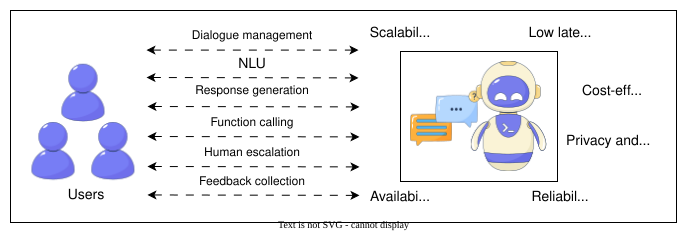

# System_Design_LLM-Powered_Customer_Support_Bot

Source: https://www.educative.io/courses/grokking-the-system-design-interview/system-design-llm-powered-customer-support-bot

---

[Home](https://www.educative.io/)

[Courses](https://www.educative.io/search?tab=courses)

[Grokking Modern System Design Interview](https://www.educative.io/courses/grokking-the-system-design-interview)

# System Design: LLM-Powered Customer Support Bot

Traditional rule-based chatbots struggle with varied queries, leading to poor user experiences. An LLM-powered customer support bot enhances interaction by understanding intent, maintaining context, and generating natural responses. It employs Retrieval-Augmented Generation to ground answers in real-time data, minimizing inaccuracies. Key functional requirements include dialogue management, natural language understanding, and human escalation, while non-functional requirements focus on scalability, low latency, and privacy. Resource estimation for infrastructure involves calculating server, storage, and bandwidth needs based on user activity, ensuring the system can efficiently handle high demand and maintain performance over time.

We'll cover the following...

- [Functional requirements](https://www.educative.io/courses/grokking-the-system-design-interview/system-design-llm-powered-customer-support-bot#Functional-requirements)
- [Nonfunctional requirements](https://www.educative.io/courses/grokking-the-system-design-interview/system-design-llm-powered-customer-support-bot#Nonfunctional-requirements)
- [Resource estimation](https://www.educative.io/courses/grokking-the-system-design-interview/system-design-llm-powered-customer-support-bot#Resource-estimation)
  - [Number of servers estimation](https://www.educative.io/courses/grokking-the-system-design-interview/system-design-llm-powered-customer-support-bot#Number-of-servers-estimation)
  - [Storage estimation](https://www.educative.io/courses/grokking-the-system-design-interview/system-design-llm-powered-customer-support-bot#Storage-estimation)
  - [Bandwidth estimation](https://www.educative.io/courses/grokking-the-system-design-interview/system-design-llm-powered-customer-support-bot#Bandwidth-estimation)
- [Building blocks](https://www.educative.io/courses/grokking-the-system-design-interview/system-design-llm-powered-customer-support-bot#Building-blocks)
- [Conclusion](https://www.educative.io/courses/grokking-the-system-design-interview/system-design-llm-powered-customer-support-bot#Conclusion)

Traditional rule-based chatbots break down when user input falls outside predefined scripts, often returning fallback or nonspecific responses. This degrades the user experience and increases reliance on human escalation, which raises operational costs.

An LLM-powered customer support bot addresses this gap by leveraging large language models to interpret intent, maintain conversational context across multiple exchanges, and generate natural responses. Modern production architectures go further by combining LLMs with retrieval-augmented generation (RAG), which grounds every response in company-specific knowledge bases and real-time data rather than relying on the model’s static training data. This significantly reduces hallucination rates and improves response accuracy. In this chapter, we design such a system.

This lesson establishes three things: functional requirements, nonfunctional requirements, and resource estimation for designing an LLM-powered customer support bot.

Let’s start with the functional requirements.

## Functional requirements[#](https://www.educative.io/courses/grokking-the-system-design-interview/system-design-llm-powered-customer-support-bot#Functional-requirements)

The following functional requirements define the system’s core behavior:

- **Dialogue management:** The system must maintain a multi-turn conversation history so that follow-up questions like “What about the other item?” are interpreted correctly within the ongoing session rather than treated as isolated queries.
- **Natural language understanding:** The system must interpret user intent, extract key entities such as order IDs and product names, and disambiguate vague queries using contextual cues from the conversation.
- **Response generation:** The system must fetch relevant documents from a company’s knowledge base or vector database and generate accurate, grounded answers instead of hallucinating information.
- **Function calling:** The system must invoke backend APIs when the user’s intent maps to an actionable operation, such as checking order status or initiating a refund.
- **Human escalation:** The system must detect when confidence is too low to resolve a query reliably and transfer the conversation to a human agent while preserving the full conversation context.
- **Feedback collection:** The system should collect user ratings on responses to build a signal for improving response quality over time.

These functional requirements ensure that the bot is not just conversational, but genuinely useful.

Functional and nonfunctional requirements of an LLM-powered customer support bot

Knowing what the system does is only half the picture. We also need to define how well it must perform under real-world conditions, which is captured in the nonfunctional requirements.

## Nonfunctional requirements[#](https://www.educative.io/courses/grokking-the-system-design-interview/system-design-llm-powered-customer-support-bot#Nonfunctional-requirements)

The following nonfunctional requirements are essential for a customer support bot serving millions of users.

- **Scalability:** The system must handle millions of concurrent users and scale horizontally, particularly during peak support hours such as holiday shopping seasons or product launches.
- **Low latency:** Responses should arrive within two to three seconds to maintain a natural conversational feel. This requires efficient inference pipelines, caching frequently repeated queries, and cost-aware request routing.
- **Availability:** The system should target 99.9% uptime because customer support is a business-critical function where downtime directly impacts revenue and trust.
- **Reliability:** The system must produce consistent responses and degrade gracefully under heavy load rather than returning errors or nonsensical outputs.
- **Cost efficiency:** LLM inference is expensive at scale, so the architecture must incorporate tiered model selection, response caching, and batched inference to control operational costs.
- **Privacy and security:** User conversations often contain sensitive personal or financial data. The system must encrypt data in transit and at rest, comply with regulations like GDPR, and enforce strict access controls.

**Educative byte:** LLM performance can degrade within 30 to 90 days due to model drift. Without continuous monitoring and periodic retraining, response quality can silently erode.

With requirements locked down, we can now estimate the infrastructure needed to support this system at scale. Let’s estimate the number of servers and the storage and bandwidth requirements.

## Resource estimation[#](https://www.educative.io/courses/grokking-the-system-design-interview/system-design-llm-powered-customer-support-bot#Resource-estimation)

[Back-of-the-envelope calculations](https://www.educative.io/courses/grokking-the-system-design-interview/put-back-of-the-envelope-numbers-in-perspective) help us understand the magnitude of infrastructure required before committing to an architecture. Our estimates are based on the following assumptions:

- **Total registered users:** 500 million
- **Daily active users (DAUs):** 50 million
- **Average queries per user per day:** 5
- **Total requests per day:** 250 million
- **Average request size:** ~2 KB (metadata, headers, and user text)
- **Average response size:** ~4 KB (LLM-generated text is usually longer than the input)

Now let’s move on to estimating the number of servers.

### Number of servers estimation[#](https://www.educative.io/courses/grokking-the-system-design-interview/system-design-llm-powered-customer-support-bot#Number-of-servers-estimation)

To estimate the number of servers, we first need to estimate the total number of requests per second. We assume that all requests from daily active users (50 million) arrive at once to estimate peak load. Under this worst-case scenario, we consider 50 million requests per second.

Number of requests/second=50 Million\text{Number of requests/second}= 50 \text{ Million}Number of requests/second=50 Million

The number of servers required at peak load is calculated as follows:

Servers required at peak load=Number of requests/secondRPS of a server\text{Servers required at peak load} = \frac{\text{Number of requests/second}}{\text{RPS of a server}}Servers required at peak load=RPS of a serverNumber of requests/second​

Using 64,000 RPS as the estimated capacity per server from the [back-of-the-envelope calculations](https://www.educative.io/courses/grokking-the-system-design-interview/put-back-of-the-envelope-numbers-in-perspective) section, we can determine the number of servers required as follows:

Servers required at peak load=50 Million64,000≈782 servers\text{Servers required at peak load} = \frac{\text{50 Million}}{\text{64,000}} \approx 782 \text{ servers}Servers required at peak load=64,00050 Million​≈782 servers

The number of estimated servers

However, GPU inference servers are the real bottleneck. Assuming that each GPU server handles approximately 200 inference requests per second, the number of GPU servers required would be:

GPU servers=50 M200=250 K servers\text{GPU servers}= \frac{50 \text{ M}}{200}= 250 \text{ K servers} GPU servers=20050 M​=250 K servers

**Practical tip:** In practice, this number would be significantly lower. Real-world traffic is typically distributed over time rather than arriving all at once, which lowers the effective peak load. Additionally, inference optimizations such as batching, caching, and efficient model serving greatly improve throughput. As a result, the infrastructure requirement would likely scale to hundreds or a few thousand GPU servers, depending on the model size and latency requirements.

#### Servers Requirements Estimation Calculator

|  |  |  |
| --- | --- | --- |
| Daily Active Users (DAUs) | 50 | million |
| Average daily requests per user | 5 | requests/user |
| Total daily requests | f250 | million |
| RPS of a server | 64000 | RPS |
| Total servers required | f782 | servers |

### Storage estimation[#](https://www.educative.io/courses/grokking-the-system-design-interview/system-design-llm-powered-customer-support-bot#Storage-estimation)

In an LLM-powered customer support bot, the request size is typically around 2 KB, which includes the user query, metadata, and headers. The response size is usually larger, around 4 KB, because the LLM generates longer explanatory replies. The combined request–response size is 6 KB. Based on this estimate, the storage per day and per year is as follows:

Storage required per day=6KB×50 M×5≈1.5 TB per day\text{Storage required per day}= 6 \text{KB} \times 50 \text{ M} \times 5 \approx 1.5 \text{ TB per day}Storage required per day=6KB×50 M×5≈1.5 TB per day

Storage required per year=6KB×50 M×5×365≈548 TB per year\text{Storage required per year}= 6 \text{KB} \times 50 \text{ M} \times 5 \times 365 \approx 548 \text{ TB per year}Storage required per year=6KB×50 M×5×365≈548 TB per year

Estimated storage for the system

Model storage also contributes to the total storage requirements. A 1-trillion-parameter model stored in FP16 precision requires about 2 TB of storage. This is a fixed requirement and remains constant unless the model size or precision changes (e.g., upgrading to a larger model or a different data type).

#### Storage Requirement Estimation Calculator

|  |  |  |
| --- | --- | --- |
| Daily Active Users (DAUs) | 50 | million |
| Average daily requests per user | 5 | requests/user |
| Total daily requests | f250 | million |
| Single request and response size | 6 | KB |
| Total storage per day | f1.5 | TB |
| Total storage per year | f548 | TB |

### Bandwidth estimation[#](https://www.educative.io/courses/grokking-the-system-design-interview/system-design-llm-powered-customer-support-bot#Bandwidth-estimation)

Assuming a 2 KB request size and a 4 KB response size, we can estimate the incoming and outgoing bandwidth requirements as follows:

Incoming bandwidth =Number of requests per second×Single request size=50 M/s×2 KB=100 GBps\begin{align\*}
\text{Incoming bandwidth } &= \text{Number of requests per second} \times \text{Single request size} \\
&= 50 \text{ M/s} \times 2 \text{ KB} \\
&= 100 \text{ GBps}
\end{align\*}Incoming bandwidth ​=Number of requests per second×Single request size=50 M/s×2 KB=100 GBps​

Outgoing bandwidth is calculated as follows:

Outgoing bandwidth =Total responses per second×Single response size=50 M/s×4 KB=200 GBps\begin{align\*}
\text{Outgoing bandwidth } &= \text{Total responses per second} \times \text{Single response size} \\
&= 50 \text{ M/s} \times 4 \text{ KB} \\
&= 200 \text{ GBps}
\end{align\*}Outgoing bandwidth ​=Total responses per second×Single response size=50 M/s×4 KB=200 GBps​

The total bandwidth required by the system

#### Bandwidth Requirements Estimation Calculator

|  |  |  |
| --- | --- | --- |
| Daily Active Users (DAUs) | 50 | million |
| Average daily requests per user | 5 | requests/user |
| Total daily requests | f250 | million |
| Request size | 2 | KB |
| Response size | 4 | KB |
| Incoming bandwidth | f100 | GBps |
| Outgoing bandwidth | f200 | GBps |

Now that we understand the scale of the infrastructure involved, let’s identify the specific components we’ll need to assemble in the next lesson.

## Building blocks[#](https://www.educative.io/courses/grokking-the-system-design-interview/system-design-llm-powered-customer-support-bot#Building-blocks)

Designing this system requires a set of well-defined building blocks, each addressing a specific concern surfaced by our requirements and resource estimates.

The following components will form the backbone of the architecture:

- [**Load balancers**](https://www.educative.io/courses/grokking-the-system-design-interview/introduction-to-load-balancers) distribute incoming user requests across application and inference servers to prevent hotspots.
- [**Database**](https://www.educative.io/courses/grokking-the-system-design-interview/introduction-to-databases) maintains session context across multi-turn dialogues so that follow-up questions resolve correctly.
- The [**cache layer**](https://www.educative.io/courses/grokking-the-system-design-interview/system-design-the-distributed-cache) stores frequent query-response pairs to reduce redundant LLM inference calls, directly supporting cost-aware routing.
- [**Pub-sub system**](https://www.educative.io/courses/grokking-the-system-design-interview/system-design-the-pub-sub-abstraction) enables asynchronous event processing for logging, feedback collection, and analytics without blocking the main request path.
- [**Rate limiter**](https://www.educative.io/courses/grokking-the-system-design-interview/system-design-the-rate-limiter) controls the number of requests a user or client can send within a specific time window.

Building blocks required to design a system for an LLM-powered customer support bot

Before moving to the design lesson, test your ability to apply these concepts to a realistic scenario.

AI Powered

Saved

6 attempts left

Reset

LLM Customer Support Bot Design Challenge

Welcome! This assessment evaluates your ability to apply System Design concepts to a real-world LLM-powered customer support scenario.

Hi, I'm Ed! Let's work through designing an LLM-powered customer support bot for an e-commerce company.

You have 6 attempts to answer.

## Conclusion[#](https://www.educative.io/courses/grokking-the-system-design-interview/system-design-llm-powered-customer-support-bot#Conclusion)

This lesson introduced the foundation for designing an LLM-based customer support system, covering key requirements, system constraints, and resource estimates. It also highlighted critical challenges, such as GPU inference scaling, cost management, and model drift monitoring. In the next lesson, we will combine these insights to build the complete System Design.

Detailed Design of Scalable Data Infrastructure for AI/ML

Design of an LLM-Powered Customer Support Bot

Ask

[Functional requirements](https://www.educative.io/courses/grokking-the-system-design-interview/system-design-llm-powered-customer-support-bot#Functional-requirements)

[Nonfunctional requirements](https://www.educative.io/courses/grokking-the-system-design-interview/system-design-llm-powered-customer-support-bot#Nonfunctional-requirements)

[Resource estimation](https://www.educative.io/courses/grokking-the-system-design-interview/system-design-llm-powered-customer-support-bot#Resource-estimation)

[Number of servers estimation](https://www.educative.io/courses/grokking-the-system-design-interview/system-design-llm-powered-customer-support-bot#Number-of-servers-estimation)

[Storage estimation](https://www.educative.io/courses/grokking-the-system-design-interview/system-design-llm-powered-customer-support-bot#Storage-estimation)

[Bandwidth estimation](https://www.educative.io/courses/grokking-the-system-design-interview/system-design-llm-powered-customer-support-bot#Bandwidth-estimation)

[Building blocks](https://www.educative.io/courses/grokking-the-system-design-interview/system-design-llm-powered-customer-support-bot#Building-blocks)

[Conclusion](https://www.educative.io/courses/grokking-the-system-design-interview/system-design-llm-powered-customer-support-bot#Conclusion)