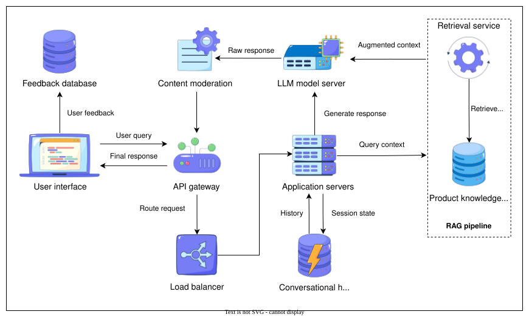

# Design_of_an_LLM-Powered_Customer_Support_Bot

Source: https://www.educative.io/courses/grokking-the-system-design-interview/design-of-an-llm-powered-customer-support-bot

---

[Home](https://www.educative.io/)

[Courses](https://www.educative.io/search?tab=courses)

[Grokking Modern System Design Interview](https://www.educative.io/courses/grokking-the-system-design-interview)

# Design of an LLM-Powered Customer Support Bot

The design of an LLM-powered customer support bot emphasizes the need for accurate, context-rich responses while managing costs. Utilizing a Retrieval-Augmented Generation (RAG) approach, the system retrieves up-to-date knowledge from a vector database and integrates it with a large language model (LLM) to generate responses. Key components include an API for user queries, a cost-aware routing mechanism to optimize resource use, and a human escalation module for complex queries. Continuous monitoring and feedback collection ensure the system remains effective and adapts to changing information, enhancing user satisfaction and operational efficiency.

We'll cover the following...

- [High-level design of an LLM-powered customer support bot](https://www.educative.io/courses/grokking-the-system-design-interview/design-of-an-llm-powered-customer-support-bot#High-level-design-of-an-LLM-powered-customer-support-bot)
- [API design](https://www.educative.io/courses/grokking-the-system-design-interview/design-of-an-llm-powered-customer-support-bot#API-design)
- [Detailed design of an LLM-powered customer support bot](https://www.educative.io/courses/grokking-the-system-design-interview/design-of-an-llm-powered-customer-support-bot#Detailed-design-of-an-LLM-powered-customer-support-bot)
  - [Components in the detailed design of an LLM-powered customer support bot](https://www.educative.io/courses/grokking-the-system-design-interview/design-of-an-llm-powered-customer-support-bot#Components-in-the-detailed-design-of-an-LLM-powered-customer-support-bot)
  - [Workflow of the support bot system](https://www.educative.io/courses/grokking-the-system-design-interview/design-of-an-llm-powered-customer-support-bot#Workflow-of-the-support-bot-system)
- [Requirements compliance](https://www.educative.io/courses/grokking-the-system-design-interview/design-of-an-llm-powered-customer-support-bot#Requirements-compliance)
- [Conclusion](https://www.educative.io/courses/grokking-the-system-design-interview/design-of-an-llm-powered-customer-support-bot#Conclusion)

In the previous lesson, we explored the requirements and resource estimates for an LLM-powered customer support bot. Building on that, we’ll move to the system’s high-level design.

## High-level design of an LLM-powered customer support bot[#](https://www.educative.io/courses/grokking-the-system-design-interview/design-of-an-llm-powered-customer-support-bot#High-level-design-of-an-LLM-powered-customer-support-bot)

Production support bots can become outdated quickly as product details and policies evolve, which can lead to inaccurate responses and lower user satisfaction. Systems must continuously incorporate up-to-date knowledge while managing LLM-related costs.

The following high-level design uses retrieval-augmented generation (RAG) with cost-aware routing to deliver accurate, context-rich responses. The workflow is as follows: a user submits a query through the web or mobile client. The request is processed by the API gateway for authentication, rate limiting, and session management before the gateway forwards it to the backend services. The RAG pipeline retrieves relevant knowledge from a vector database and augments the prompt, which is then passed to the LLM to generate a response. The response goes through content moderation before it is returned to the user, and the conversation is logged while feedback is collected.

This architecture ensures that the system references up-to-date product knowledge rather than relying solely on what the model learned during training.

High-level design of an LLM-powered customer support bot

**Educative byte:** Parametric memory refers to the knowledge baked into an LLM’s weights during training. It becomes stale the moment source documents are updated, which is why retrieval-augmented approaches are essential for production support bots.

With the high-level flow established, the next step is to design the system’s APIs.

## API design[#](https://www.educative.io/courses/grokking-the-system-design-interview/design-of-an-llm-powered-customer-support-bot#API-design)

To support the functional requirements, we define a set of APIs that enable communication between system components and handle key operations within the LLM-powered customer support bot.

- **sendMessage():** Handles incoming user queries, maintains session context, and returns a response by orchestrating the NLU, RAG, and LLM components. It ensures multi-turn dialogue by attaching conversation history to each request.

Ace Editor

1

sendMessage(session\_id: string, user\_id: string, message: string)

הההההההההההההההההההההההההההההההההההההההההההההההההההההההההההההההההההההההההההההההההההההההההההההההההההההההההההההההההההההההההההההההההההההההההההההההההההההההההההההההההההההההההההההההההההההההההההההההההההההההההההההההההההההההההההההההההההההההההההההההההההההההההההההההההההההההההההההההההההההההההההההההההההההההההההההההההההההההההההההההההההההההההההההההההההההההההההההההההההההההההההההההההההההההההההההההההההההההההההההההההההההההההההההההההההההההההההההההההההההההההההההההההההההההההההההההההההההההההההההההההההההההההההההההההההההההההההההההה

XXXXXXXXXXXXXXXXXXXXXXXXXXXXXXXXXXXXXXXXXXXXXXXXXXXXXXXXXXXXXXXXXXXXXXXXXXXXXXXXXXXXXXXXXXXXXXXXXXXXXXXXXXXXXXXXXXXXXXXXXXXXXXXXXXXXXXXXXXXXXXXXXXXXXXXXXXXXXXXXXXXXXXXXXXXXXXXXXXXXXXXXXXXXXXXXXXXXXXXXXXXXXXXXXXXXXXXXXXXXXXXXXXXXXXXXXXXXXXXXXXXXXXXXXXXXXXXXXXXXXXXXXXXXXXXXXXXXXXXXXXXXXXXXXXXXXXXXXXXXXXXXXXXXXXXXXXXXXXXXXXXXXXXXXXXXXXXXXXXXXXXXXXXXXXXXXXXXXXXXXXXXXXXXXXXXXXXXXXXXXXXXXXXXXXXXXXXXXXXXXXXXXXXXXXXXXXXXXXXXXXXXXXXXXXXXXXXXXXXXXXXXXXXXXXXXXXXXXXXXXXXXXXXXXXXXXXXXXXXXXXXXXXXXXXXXXXXXXXXXXXXXXXXXXXXX

|  |  |
| --- | --- |
| **Parameters** | **Description** |
| `session_id` | A unique identifier for the conversation session |
| `user_id` | A unique identifier for the user |
| `message` | User’s input text query |

- **parseQuery():** Extracts user intent and key entities (for example, order ID and product name) from the input text. This API is used by the NLU service to structure unstructured queries for downstream processing.

Ace Editor

1

parseQuery(text: string)

הההההההההההההההההההההההההההההההההההההההההההההההההההההההההההההההההההההההההההההההההההההההההההההההההההההההההההההההההההההההההההההההההההההההההההההההההההההההההההההההההההההההההההההההההההההההההההההההההההההההההההההההההההההההההההההההההההההההההההההההההההההההההההההההההההההההההההההההההההההההההההההההההההההההההההההההההההההההההההההההההההההההההההההההההההההההההההההההההההההההההההההההההההההההההההההההההההההההההההההההההההההההההההההההההההההההההההההההההההההההההההההההההההההההההההההההההההההההההההההההההההההההההההההההההההההההההההההההה

XXXXXXXXXXXXXXXXXXXXXXXXXXXXXXXXXXXXXXXXXXXXXXXXXXXXXXXXXXXXXXXXXXXXXXXXXXXXXXXXXXXXXXXXXXXXXXXXXXXXXXXXXXXXXXXXXXXXXXXXXXXXXXXXXXXXXXXXXXXXXXXXXXXXXXXXXXXXXXXXXXXXXXXXXXXXXXXXXXXXXXXXXXXXXXXXXXXXXXXXXXXXXXXXXXXXXXXXXXXXXXXXXXXXXXXXXXXXXXXXXXXXXXXXXXXXXXXXXXXXXXXXXXXXXXXXXXXXXXXXXXXXXXXXXXXXXXXXXXXXXXXXXXXXXXXXXXXXXXXXXXXXXXXXXXXXXXXXXXXXXXXXXXXXXXXXXXXXXXXXXXXXXXXXXXXXXXXXXXXXXXXXXXXXXXXXXXXXXXXXXXXXXXXXXXXXXXXXXXXXXXXXXXXXXXXXXXXXXXXXXXXXXXXXXXXXXXXXXXXXXXXXXXXXXXXXXXXXXXXXXXXXXXXXXXXXXXXXXXXXXXXXXXXXXXXX

|  |  |
| --- | --- |
| **Parameters** | **Description** |
| `text` | Raw user query in natural language |

- **retrieveAndGenerate():** Fetches relevant documents from the vector database and generates a grounded response using the LLM. It ensures that answers are based on up-to-date knowledge instead of model memory.

Ace Editor

1

retrieveAndGenerate(query: string, session\_id: string)

הההההההההההההההההההההההההההההההההההההההההההההההההההההההההההההההההההההההההההההההההההההההההההההההההההההההההההההההההההההההההההההההההההההההההההההההההההההההההההההההההההההההההההההההההההההההההההההההההההההההההההההההההההההההההההההההההההההההההההההההההההההההההההההההההההההההההההההההההההההההההההההההההההההההההההההההההההההההההההההההההההההההההההההההההההההההההההההההההההההההההההההההההההההההההההההההההההההההההההההההההההההההההההההההההההההההההההההההההההההההההההההההההההההההההההההההההההההההההההההההההההההההההההההההההההההההההההההההה

XXXXXXXXXXXXXXXXXXXXXXXXXXXXXXXXXXXXXXXXXXXXXXXXXXXXXXXXXXXXXXXXXXXXXXXXXXXXXXXXXXXXXXXXXXXXXXXXXXXXXXXXXXXXXXXXXXXXXXXXXXXXXXXXXXXXXXXXXXXXXXXXXXXXXXXXXXXXXXXXXXXXXXXXXXXXXXXXXXXXXXXXXXXXXXXXXXXXXXXXXXXXXXXXXXXXXXXXXXXXXXXXXXXXXXXXXXXXXXXXXXXXXXXXXXXXXXXXXXXXXXXXXXXXXXXXXXXXXXXXXXXXXXXXXXXXXXXXXXXXXXXXXXXXXXXXXXXXXXXXXXXXXXXXXXXXXXXXXXXXXXXXXXXXXXXXXXXXXXXXXXXXXXXXXXXXXXXXXXXXXXXXXXXXXXXXXXXXXXXXXXXXXXXXXXXXXXXXXXXXXXXXXXXXXXXXXXXXXXXXXXXXXXXXXXXXXXXXXXXXXXXXXXXXXXXXXXXXXXXXXXXXXXXXXXXXXXXXXXXXXXXXXXXXXXXX

|  |  |
| --- | --- |
| **Parameters** | **Description** |
| `query` | User query (possibly enriched with context) |

- **executeAction():** Invokes backend services when a query requires an action, such as checking order status or initiating a refund. It bridges the LLM and external systems through function calling.

Ace Editor

1

executeAction(action: string, parameters: JSON)

הההההההההההההההההההההההההההההההההההההההההההההההההההההההההההההההההההההההההההההההההההההההההההההההההההההההההההההההההההההההההההההההההההההההההההההההההההההההההההההההההההההההההההההההההההההההההההההההההההההההההההההההההההההההההההההההההההההההההההההההההההההההההההההההההההההההההההההההההההההההההההההההההההההההההההההההההההההההההההההההההההההההההההההההההההההההההההההההההההההההההההההההההההההההההההההההההההההההההההההההההההההההההההההההההההההההההההההההההההההההההההההההההההההההההההההההההההההההההההההההההההההההההההההההההההההההההההההההה

XXXXXXXXXXXXXXXXXXXXXXXXXXXXXXXXXXXXXXXXXXXXXXXXXXXXXXXXXXXXXXXXXXXXXXXXXXXXXXXXXXXXXXXXXXXXXXXXXXXXXXXXXXXXXXXXXXXXXXXXXXXXXXXXXXXXXXXXXXXXXXXXXXXXXXXXXXXXXXXXXXXXXXXXXXXXXXXXXXXXXXXXXXXXXXXXXXXXXXXXXXXXXXXXXXXXXXXXXXXXXXXXXXXXXXXXXXXXXXXXXXXXXXXXXXXXXXXXXXXXXXXXXXXXXXXXXXXXXXXXXXXXXXXXXXXXXXXXXXXXXXXXXXXXXXXXXXXXXXXXXXXXXXXXXXXXXXXXXXXXXXXXXXXXXXXXXXXXXXXXXXXXXXXXXXXXXXXXXXXXXXXXXXXXXXXXXXXXXXXXXXXXXXXXXXXXXXXXXXXXXXXXXXXXXXXXXXXXXXXXXXXXXXXXXXXXXXXXXXXXXXXXXXXXXXXXXXXXXXXXXXXXXXXXXXXXXXXXXXXXXXXXXXXXXXXX

|  |  |
| --- | --- |
| **Parameters** | **Description** |
| `action` | Name of the operation (e.g., "check\_order\_status", "initiate\_refund") |
| `parameters` | Key-value pairs required for the action (e.g., `{ "order_id": "1234" }`) |

- **escalateToHuman():** Transfers the conversation to a human agent when the system detects low confidence or complex queries. It preserves the full conversation context for a seamless handoff.

Ace Editor

1

escalateToHuman(session\_id: string, reason: string)

הההההההההההההההההההההההההההההההההההההההההההההההההההההההההההההההההההההההההההההההההההההההההההההההההההההההההההההההההההההההההההההההההההההההההההההההההההההההההההההההההההההההההההההההההההההההההההההההההההההההההההההההההההההההההההההההההההההההההההההההההההההההההההההההההההההההההההההההההההההההההההההההההההההההההההההההההההההההההההההההההההההההההההההההההההההההההההההההההההההההההההההההההההההההההההההההההההההההההההההההההההההההההההההההההההההההההההההההההההההההההההההההההההההההההההההההההההההההההההההההההההההההההההההההההההההההההההההההה

XXXXXXXXXXXXXXXXXXXXXXXXXXXXXXXXXXXXXXXXXXXXXXXXXXXXXXXXXXXXXXXXXXXXXXXXXXXXXXXXXXXXXXXXXXXXXXXXXXXXXXXXXXXXXXXXXXXXXXXXXXXXXXXXXXXXXXXXXXXXXXXXXXXXXXXXXXXXXXXXXXXXXXXXXXXXXXXXXXXXXXXXXXXXXXXXXXXXXXXXXXXXXXXXXXXXXXXXXXXXXXXXXXXXXXXXXXXXXXXXXXXXXXXXXXXXXXXXXXXXXXXXXXXXXXXXXXXXXXXXXXXXXXXXXXXXXXXXXXXXXXXXXXXXXXXXXXXXXXXXXXXXXXXXXXXXXXXXXXXXXXXXXXXXXXXXXXXXXXXXXXXXXXXXXXXXXXXXXXXXXXXXXXXXXXXXXXXXXXXXXXXXXXXXXXXXXXXXXXXXXXXXXXXXXXXXXXXXXXXXXXXXXXXXXXXXXXXXXXXXXXXXXXXXXXXXXXXXXXXXXXXXXXXXXXXXXXXXXXXXXXXXXXXXXXXX

|  |  |
| --- | --- |
| **Parameters** | **Description** |
| `reason` | Cause for escalation (e.g., "low\_confidence", "complex\_query") |

- **submitFeedback():** Collects user ratings and feedback on responses to improve system performance over time. This data is used for monitoring, retraining, and quality evaluation.

Ace Editor

1

submitFeedback(session\_id: string, message\_id: string, rating: string, comment?: string)

הההההההההההההההההההההההההההההההההההההההההההההההההההההההההההההההההההההההההההההההההההההההההההההההההההההההההההההההההההההההההההההההההההההההההההההההההההההההההההההההההההההההההההההההההההההההההההההההההההההההההההההההההההההההההההההההההההההההההההההההההההההההההההההההההההההההההההההההההההההההההההההההההההההההההההההההההההההההההההההההההההההההההההההההההההההההההההההההההההההההההההההההההההההההההההההההההההההההההההההההההההההההההההההההההההההההההההההההההההההההההההההההההההההההההההההההההההההההההההההההההההההההההההההההההההההההההההההההה

XXXXXXXXXXXXXXXXXXXXXXXXXXXXXXXXXXXXXXXXXXXXXXXXXXXXXXXXXXXXXXXXXXXXXXXXXXXXXXXXXXXXXXXXXXXXXXXXXXXXXXXXXXXXXXXXXXXXXXXXXXXXXXXXXXXXXXXXXXXXXXXXXXXXXXXXXXXXXXXXXXXXXXXXXXXXXXXXXXXXXXXXXXXXXXXXXXXXXXXXXXXXXXXXXXXXXXXXXXXXXXXXXXXXXXXXXXXXXXXXXXXXXXXXXXXXXXXXXXXXXXXXXXXXXXXXXXXXXXXXXXXXXXXXXXXXXXXXXXXXXXXXXXXXXXXXXXXXXXXXXXXXXXXXXXXXXXXXXXXXXXXXXXXXXXXXXXXXXXXXXXXXXXXXXXXXXXXXXXXXXXXXXXXXXXXXXXXXXXXXXXXXXXXXXXXXXXXXXXXXXXXXXXXXXXXXXXXXXXXXXXXXXXXXXXXXXXXXXXXXXXXXXXXXXXXXXXXXXXXXXXXXXXXXXXXXXXXXXXXXXXXXXXXXXXXX

|  |  |
| --- | --- |
| **Parameters** | **Description** |
| `message_id` | Identifier of the specific response being rated |
| `rating` | Feedback value (e.g., "thumbs\_up", "thumbs\_down") |
| `comment (optional)` | Additional user feedback text |

Now, let’s examine how each component is engineered to work together under production constraints.

## Detailed design of an LLM-powered customer support bot[#](https://www.educative.io/courses/grokking-the-system-design-interview/design-of-an-llm-powered-customer-support-bot#Detailed-design-of-an-LLM-powered-customer-support-bot)

The high-level architecture shows what the system does. The detailed design reveals how it does it, and that’s where the real engineering complexity lives. Each component must be carefully orchestrated to handle concerns that only surface at scale, including LLM performance degradation over time, cost management across model tiers, and seamless human-agent escalation when the bot reaches its limits.

The detailed architecture diagram below expands on every service, data store, and communication path involved in processing a single user query.

Detailed design of an LLM-powered customer support bot

Let’s break down each component and its role in the detailed system design.

### Components in the detailed design of an LLM-powered customer support bot[#](https://www.educative.io/courses/grokking-the-system-design-interview/design-of-an-llm-powered-customer-support-bot#Components-in-the-detailed-design-of-an-LLM-powered-customer-support-bot)

The architecture comprises several interconnected services, each addressing a specific production concern. Here’s how they work together.

- **Entry layer and app servers:** The entry layer handles incoming requests by managing authentication, rate limiting, and traffic distribution to ensure security and stability. The app servers process requests, manage business logic and user context, and prepare them for the pre-processing (NLU) unit.
- **Pre-processing (NLU service):** This service classifies user intent (billing inquiry, technical issue, or order status) and extracts entities such as order IDs and product names. It acts as a triage layer, classifying the request before routing it to the appropriate service or handler.
- **Cost-aware router:** This component evaluates query complexity and routes simple, high-confidence requests, such as store hours or return-policy questions, to a lightweight, lower-cost model. It routes complex or ambiguous requests to a full-capability LLM. Without this layer, every FAQ lookup burns the same compute budget as a multi-step troubleshooting session.
- **RAG pipeline:** The retrieval service converts the query into a vector embedding, searches the vector database for semantically similar product documentation chunks, ranks results by relevance, and injects the top-k results into the LLM prompt as grounding context. This ensures that responses reflect current product knowledge rather than stale training data.
- **LLM core servers:** These host the large language model with function calling capabilities, which enable the bot to invoke external APIs for order status lookups, support ticket creation, and refund processing as structured tool calls.
- **Vector database:** This stores chunked and embedded product documentation, FAQs, troubleshooting guides, and policy documents. A knowledge ingestion pipeline updates these embeddings whenever source documents change, keeping the retrieval layer up to date.
- **Redis caching layer:** This stores recent conversation history per session, maintaining multi-turn context without repeated database lookups. Each new prompt includes relevant prior turns so the LLM can reference what the user said earlier.
- **Content moderation service:** This scans LLM outputs for policy violations, PII leakage, or harmful content before delivery to the user.
- **Human escalation module:** This uses confidence scoring to detect when the LLM cannot adequately resolve a query and routes the conversation to a live agent, preserving the full conversation context for the agent.
- **Monitoring service:** This continuously tracks LLM response accuracy, latency, user satisfaction scores, and cost per query. It detects performance degradation early and can trigger knowledge base updates or model retraining.
- **MongoDB:** This stores conversation logs, user profiles, ticket metadata, and escalation records for audit and analytics purposes.

**Practical tip:** When implementing the cost-aware router, start by logging query classifications for two weeks before activating routing decisions. This lets you validate the classifier’s accuracy without risking degraded responses for real users.

The following table illustrates how the cost-aware routing strategy distributes queries across model tiers.

|  |  |  |  |  |  |
| --- | --- | --- | --- | --- | --- |
| **Query Tier** | **Example Queries** | **Model Used** | **Avg Latency** | **Relative Cost** | **Accuracy Target** |
| Simple/FAQ | "What are your return policies?" "Store hours" | Lightweight model (e.g., fine-tuned small LLM) | <200ms | Low | >95% |
| Moderate | "Help me troubleshoot my device not charging." | Full LLM with RAG | 500ms–1s | Medium | >90% |
| Complex/Sensitive | "I want to dispute a charge and escalate to a manager." | Full LLM with RAG + human escalation | 1–3s (before handoff) | High | >85% (with human fallback) |

With each component defined, the next section traces how a single user query flows through the entire system, from submission to response.

### Workflow of the support bot system[#](https://www.educative.io/courses/grokking-the-system-design-interview/design-of-an-llm-powered-customer-support-bot#Workflow-of-the-support-bot-system)

Understanding the end-to-end workflow clarifies how these components coordinate in real time. Each step below maps directly to a component described above.

1. User submits a query through the web or mobile chat interface.
2. The API gateway authenticates the request, enforces rate limits, and forwards it to the load balancer.
3. The load balancer distributes the request to an available application server.
4. The pre-processing NLU service classifies intent and extracts entities (order IDs and product names).
5. The cost-aware router evaluates query complexity. Simple queries are sent to the lightweight model. Complex queries proceed to the full RAG-augmented LLM pipeline.
6. For RAG-routed queries, the retrieval service searches the vector database for relevant documentation chunks and ranks them by semantic similarity.
7. The top-k retrieved chunks are injected into the prompt alongside conversation history from Redis. The LLM generates a response, optionally invoking function calls such as an order lookup API.
8. The content moderation service scans the response for policy violations or PII before it leaves the system.
9. If the LLM’s confidence score falls below a threshold, the human escalation module routes the conversation to a live agent via pub/sub, preserving full context.
10. The validated response is returned to the user through the API gateway.
11. The conversation is logged in MongoDB, and user feedback (thumbs up/down and comments) is collected and stored for continuous improvement and model retraining.

**Attention:** Confidence scoring thresholds for human escalation require careful calibration. Setting the threshold too low floods agents with unnecessary escalations. Setting it too high means that frustrated users never reach a human. Monitor escalation rates weekly and adjust.

The following assessment tests your ability to apply these architectural concepts to a realistic production scenario.

AI Powered

Saved

6 attempts left

Reset

Production LLM Architecture Assessment

Hi, I'm Ed! Let's work through a real production scenario together. You're tasked with fixing an e-commerce support bot that's giving outdated return policy information to 15% of users while also burning through your LLM budget. First question: Which specific components in the architecture are responsible for the outdated response problem, and how would the knowledge ingestion pipeline and vector database solve it?

You have 6 attempts to answer.

The next section evaluates how the complete architecture maps to the requirements defined earlier.

## Requirements compliance[#](https://www.educative.io/courses/grokking-the-system-design-interview/design-of-an-llm-powered-customer-support-bot#Requirements-compliance)

A well-engineered system must demonstrate that every requirement traces back to specific architectural decisions. Functional requirements ensure that the bot performs its intended tasks. Nonfunctional requirements define how well it performs under real-world conditions at scale. The following table maps each requirement to the components that fulfill it.

|  |  |
| --- | --- |
| **Functional Requirement** | **How It Is Achieved** |
| Accurate responses grounded in product knowledge | RAG pipeline retrieves current documentation from the vector database, preventing hallucination |
| Multi-turn conversation support | The Redis caching layer maintains session-level conversation history injected into each prompt |
| Function calls, i.e., Order status and account actions | API calling enables the LLM to invoke external APIs for real-time data retrieval |
| Human escalation | Confidence scoring triggers routing to live agents via pub/sub with full context preservation |
| Feedback collection | The feedback module captures structured and unstructured feedback stored in MongoDB |

Nonfunctional requirements include scalability, low latency, availability, reliability, cost efficiency, and security and privacy. The table below highlights how the design satisfies these constraints.

|  |  |
| --- | --- |
| **Nonfunctional Requirement** | **How It Is Achieved** |
| Scalability | the load balancer distributes traffic across app servers, and horizontal scaling of stateless services (LLM servers, RAG pipeline, vector DB) handles millions of concurrent users. |
| Low latency | Cost-aware routing sends simple queries to lightweight models, while caching (Redis) and efficient RAG retrieval reduce response time to 2–3 seconds. |
| Availability | Redundant services (API gateway, load balancer, distributed servers) and monitoring ensure high uptime (99.9%). |
| Reliability | RAG grounding ensures consistent, accurate responses, while graceful degradation via routing and human escalation prevents failures under load. |
| Cost efficiency | Tiered model selection, caching frequent responses, and batched inference reduce expensive LLM usage. |
| Privacy and security | API gateway enforces authentication, encryption protects data in transit and at rest, and content moderation prevents PII leakage and ensures compliance (e.g., GDPR). |

## Conclusion[#](https://www.educative.io/courses/grokking-the-system-design-interview/design-of-an-llm-powered-customer-support-bot#Conclusion)

This lesson presented a production-ready architecture for an LLM-powered customer support bot that combines RAG for accurate, up-to-date responses with cost-aware routing to optimize efficiency at scale. By integrating components such as NLU, vector search, caching, function calling, and human escalation, the system balances accuracy, latency, and cost while maintaining a seamless user experience. Continuous monitoring and knowledge ingestion ensure that the system adapts to changing data and avoids model drift, which makes it more robust for real-world deployment. This design shows how grounded retrieval, intelligent routing, and human-in-the-loop mechanisms provide the foundation for reliable and scalable LLM applications.

System Design: LLM-Powered Customer Support Bot

System Design: AI-Powered Code Assistant

Ask

[High-level design of an LLM-powered customer support bot](https://www.educative.io/courses/grokking-the-system-design-interview/design-of-an-llm-powered-customer-support-bot#High-level-design-of-an-LLM-powered-customer-support-bot)

[API design](https://www.educative.io/courses/grokking-the-system-design-interview/design-of-an-llm-powered-customer-support-bot#API-design)

[Detailed design of an LLM-powered customer support bot](https://www.educative.io/courses/grokking-the-system-design-interview/design-of-an-llm-powered-customer-support-bot#Detailed-design-of-an-LLM-powered-customer-support-bot)

[Components in the detailed design of an LLM-powered customer support bot](https://www.educative.io/courses/grokking-the-system-design-interview/design-of-an-llm-powered-customer-support-bot#Components-in-the-detailed-design-of-an-LLM-powered-customer-support-bot)

[Workflow of the support bot system](https://www.educative.io/courses/grokking-the-system-design-interview/design-of-an-llm-powered-customer-support-bot#Workflow-of-the-support-bot-system)

[Requirements compliance](https://www.educative.io/courses/grokking-the-system-design-interview/design-of-an-llm-powered-customer-support-bot#Requirements-compliance)

[Conclusion](https://www.educative.io/courses/grokking-the-system-design-interview/design-of-an-llm-powered-customer-support-bot#Conclusion)