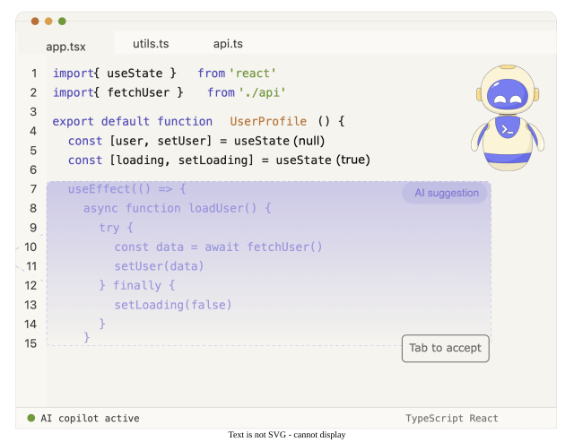

# System_Design_AI-Powered_Code_Assistant

Source: https://www.educative.io/courses/grokking-the-system-design-interview/system-design-ai-powered-code-assistant

---

[Home](https://www.educative.io/)

[Courses](https://www.educative.io/search?tab=courses)

[Grokking Modern System Design Interview](https://www.educative.io/courses/grokking-the-system-design-interview)

# System Design: AI-Powered Code Assistant

AI-powered code assistants, integrated into developers' IDEs, automate repetitive coding tasks by providing real-time suggestions and code generation based on context and natural language prompts. These tools enhance productivity but face challenges like maintaining low latency, high availability, and scalability to support millions of users. Key functional requirements include context-aware suggestions, multi-language support, and code explanation capabilities, while non-functional requirements emphasize performance metrics such as latency and fault tolerance. Resource estimation for such systems involves calculating server needs, bandwidth, and storage, laying the groundwork for a robust architecture to support efficient coding workflows.

We'll cover the following...

- [What is a code assistant?](https://www.educative.io/courses/grokking-the-system-design-interview/system-design-ai-powered-code-assistant#What-is-a-code-assistant)
- [Requirements](https://www.educative.io/courses/grokking-the-system-design-interview/system-design-ai-powered-code-assistant#Requirements)
- [Functional requirements](https://www.educative.io/courses/grokking-the-system-design-interview/system-design-ai-powered-code-assistant#Functional-requirements)
- [Nonfunctional requirements](https://www.educative.io/courses/grokking-the-system-design-interview/system-design-ai-powered-code-assistant#Nonfunctional-requirements)
- [Resource estimation](https://www.educative.io/courses/grokking-the-system-design-interview/system-design-ai-powered-code-assistant#Resource-estimation)
  - [Estimating the number of servers](https://www.educative.io/courses/grokking-the-system-design-interview/system-design-ai-powered-code-assistant#Estimating-the-number-of-servers)
  - [Storage estimation](https://www.educative.io/courses/grokking-the-system-design-interview/system-design-ai-powered-code-assistant#Storage-estimation)
  - [Bandwidth estimation](https://www.educative.io/courses/grokking-the-system-design-interview/system-design-ai-powered-code-assistant#Bandwidth-estimation)
- [Building blocks](https://www.educative.io/courses/grokking-the-system-design-interview/system-design-ai-powered-code-assistant#Building-blocks)
- [Conclusion](https://www.educative.io/courses/grokking-the-system-design-interview/system-design-ai-powered-code-assistant#Conclusion)

Developers spend a significant portion of their time on repetitive tasks such as writing boilerplate code, navigating documentation, and fixing minor syntax errors. These tasks are frequent but low-cognitive-value, which makes them ideal candidates for automation. **AI-powered code assistants** attempt to reduce this friction by embedding large language model (LLM) inference directly into the developer’s IDE and generating suggestions in real time as code is written.

Industry reports and developer surveys indicate that AI-assisted coding improves perceived productivity, while controlled studies report mixed results in actual task-completion time.

This tension frames a real design constraint. This lesson focuses on understanding the problem space, defining requirements, and estimating resources to prepare for the full system architecture in the next lesson.

## What is a code assistant?[#](https://www.educative.io/courses/grokking-the-system-design-interview/system-design-ai-powered-code-assistant#What-is-a-code-assistant)

A **code assistant**, often called Copilot, is an AI-powered tool embedded in a developer’s IDE (Integrated Development Environment) that provides real-time code suggestions, completions, and generation based on natural language prompts and surrounding code context.

The core capabilities of a modern code assistant span several categories:

- **Inline code completion:** The system predicts and suggests the next few tokens or lines as the developer types.
- **Multi-line function generation:** Given a function signature or partial implementation, the system generates a complete function body.
- **Natural language to code translation:** A developer writes a comment like `// sort array in descending order`, and the system produces the corresponding code.
- **Code editing and refactoring:** The system can modify existing code blocks, for example, rewriting a loop for efficiency or converting synchronous code into asynchronous patterns.
- **Code explanation and documentation:** The system can describe what a selected code block does in plain English.
- **Context-aware suggestions:** Completions are informed by the current file, open tabs, imported modules, project structure, and other signals that are assembled into a structured context window before being sent to the LLM.

An example of an AI code assistant

Unlike traditional autocomplete systems that rely on symbol tables and static analysis, Copilot uses deep learning models trained on vast code corpora to predict semantically meaningful code blocks. To provide context-aware suggestions, the system uses a *context extractor* within the IDE to truncate and rank relevant snippets (for example, using Jaccard similarity or BM25) before sending them to the LLM. Sending entire files would exceed context windows and increase latency.

Because this system must support millions of concurrent developers, it becomes a distributed systems problem that requires low-latency inference, high availability, and effective context management. Given this workflow, the next step is to define the system’s functional and nonfunctional requirements.

## Requirements[#](https://www.educative.io/courses/grokking-the-system-design-interview/system-design-ai-powered-code-assistant#Requirements)

Clearly scoping requirements (functional and nonfunctional) is one of the most critical steps in any system design interview. These will inform both the resource estimation later in this lesson and the architectural choices explored in the next lesson.

## Functional requirements[#](https://www.educative.io/courses/grokking-the-system-design-interview/system-design-ai-powered-code-assistant#Functional-requirements)

The functional requirements define what the code assistant must do from the user’s perspective.

- **Real-time code completion:** The system should generate and return code suggestions within a strict latency budget of under 300 ms as the developer types, ensuring that suggestions arrive before the developer’s attention moves on.
- **Context-aware suggestions:** The system must accept and process contextual signals, including current file content, cursor position, open files, project structure, and programming language, to produce relevant completions rather than generic ones.
- **Multi-language support:** The system should support popular programming languages such as Python, JavaScript, TypeScript, Java, Go, and C++, requiring the underlying model to handle diverse syntax and semantics.
- **Natural language to code:** The system should translate developer comments or prompts written in natural language into functional code snippets, requiring an instruction-tuned LLM.
- **Code explanation and documentation:** The system should explain selected code blocks in natural language, helping developers understand unfamiliar codebases.
- **Streaming responses:** For longer generations, the system should support streaming tokens back to the IDE incrementally using mechanisms such as server-sent events (SSE), WebSockets, or streaming APIs.
- **User feedback loop:** The system should capture accept/reject signals from developers to build a telemetry pipeline for model fine-tuning over time.

The following table summarizes these requirements alongside their design implications.

|  |  |  |  |
| --- | --- | --- | --- |
| **Requirement** | **Description** | **Example** | **Design Implication** |
| Real-time code completion | Generate suggestions under 300ms | The developer types a function signature and gets the body | Requires low-latency inference and caching |
| Context-aware suggestions | Process file and project context | Uses imports and variable names to tailor output | Needs a context preprocessing pipeline |
| Multi-language support | Handle 10+ programming languages | Python, JS, Go, Java | The model must be trained on multilingual corpora |
| Natural language to code | Convert comments to code | "// sort array in descending order" generates sorting logic | Requires instruction-tuned LLM |
| Streaming responses | Incremental token delivery | Long function generation streams line by line | Needs server-sent events or WebSocket support |
| User feedback loop | Capture accept/reject signals | The developer dismisses a suggestion | Telemetry pipeline for model fine-tuning |

These functional requirements tell us what the system does. Equally important is defining how well it must perform under real-world conditions.

## Nonfunctional requirements[#](https://www.educative.io/courses/grokking-the-system-design-interview/system-design-ai-powered-code-assistant#Nonfunctional-requirements)

Nonfunctional requirements define the quality attributes that determine whether the system is viable at production scale.

- **Low latency:** Developers typically type 40–80 words per minute, which means that suggestions must appear within a few hundred milliseconds (time to first token, or TTFT) to remain relevant before the user continues typing.
- **High availability:** The system should target 99.9%+ uptime because developers rely on it continuously during active coding sessions. Downtime directly disrupts productivity.
- **Scalability:** The system must scale horizontally to handle millions of concurrent developers across global regions, with traffic patterns that spike during business hours in different time zones.
- **Fault tolerance:** Failures in the inference layer should degrade gracefully by returning no suggestion rather than crashing the IDE plugin or displaying error messages.
- **Security and privacy:** Code context sent to the backend may contain proprietary source code. Data must be encrypted in transit using TLS and at rest, with options for enterprise customers to restrict data retention entirely.

  - **Safety and compliance:** Generated code should pass security and license checks to avoid introducing vulnerabilities or incompatible code into repositories.
- **Suggestion relevance:** Generated code should be syntactically valid and contextually relevant to minimize developer correction effort.
- **Cost efficiency:** LLM inference is GPU-intensive, so the system must optimize compute costs through techniques like model quantization, response caching, and batched inference.

Functional and non-functional requirements of an LLM-powered code assistant

> **Note:** AWS research identifies a review and QA bottleneck in which AI-generated code increases output volume faster than teams can review and validate it. This quality-assurance concern is a real nonfunctional consideration that affects how the system’s success is measured beyond raw throughput.

The following quiz tests your understanding of how these nonfunctional requirements translate into system behavior.

Lesson Quiz

1.

A code assistant must return inline suggestions within a strict latency budget. If the inference service experiences a transient failure, what is the most appropriate system behavior?

A.

Return an error message in the IDE editor.

B.

Retry the request up to 3 times with exponential backoff before timing out.

C.

Degrade by showing no suggestion and logging the failure for monitoring.

D.

Queue the request and deliver the suggestion when the service recovers.

---

1 / 1

With requirements defined, we can now estimate the resources needed to operate this system at scale.

## Resource estimation[#](https://www.educative.io/courses/grokking-the-system-design-interview/system-design-ai-powered-code-assistant#Resource-estimation)

Resource estimation translates requirements into concrete infrastructure numbers. This is where system design moves from abstract to actionable.

The estimation begins with these assumptions:

- Five million active developers
- 50 requests per developer per active hour
- Four active coding hours per day
- Users are distributed across five major global regions

Total daily requests come to:5M×50×4=1,000,000,000≈1 Billion requests per day.5M×50×4=1,000,000,000 ≈ 1\ Billion\ requests\ per\ day.5M×50×4=1,000,000,000≈1 Billion requests per day.

### Estimating the number of servers[#](https://www.educative.io/courses/grokking-the-system-design-interview/system-design-ai-powered-code-assistant#Estimating-the-number-of-servers)

We estimate servers for peak traffic, and we assume that all users are active and making requests, which results in five million requests per second. We’ll use the following formula to calculate the number of servers:

Servers needed at peak load=Number of requests/secondRPS of the server\text{ Servers needed at peak load} = \frac{\text{Number of requests/second}}{\text{RPS of the server}} Servers needed at peak load=RPS of the serverNumber of requests/second​

Using 64,000 as the estimated RPS a server can handle from the [back-of-the-envelope calculation](https://www.educative.io/courses/grokking-the-system-design-interview/put-back-of-the-envelope-numbers-in-perspective) section, we’ll calculate the required number of servers as follows:

Servers needed at peak load=5 million64,000≈79 servers\text{Servers\ needed\ at\ peak\ load} = \frac{5\ million}{64,000} \approx \text{79 servers}Servers needed at peak load=64,0005 million​≈79 servers

#### Servers Required

|  |  |  |
| --- | --- | --- |
| Daily Active Users (DAUs) | 5 | million |
| RPS of a server | 64000 | RPS |
| Total servers required | f79 | servers |

The above estimate is for application servers. Because the LLM’s suggestions rely heavily on GPU servers for fast inference, it’s crucial to factor them in. If a single GPU server handles approximately 200 inference requests per second, then at peak, the system needs roughly 5 million200≈25 K\frac{5\ million}{200} \approx 25\ K2005 million​≈25 K GPU servers, distributed across regions with redundancy.

The number of estimated servers

> **Note:** Caching frequently requested completions and applying model quantization can reduce the GPU server count by 30–40%, which translates directly into significant cost savings at this scale. For a quick, accurate estimate of GPU requirements, check out the [back-of-the-envelope calculations](https://www.educative.io/courses/generative-ai-system-design/estimating-training-compute-and-cost).

### Storage estimation[#](https://www.educative.io/courses/grokking-the-system-design-interview/system-design-ai-powered-code-assistant#Storage-estimation)

If each request-response pair generates about4 KB4\ KB4 KB of telemetry, then at one billion requests per day, the system produces roughly4 TB4\ TB4 TB of telemetry data per day.

1,000,000,000×4 KB=4,000,000,000 KB≈4 TB/day1{,}000{,}000{,}000 \times 4 \text{ KB} = 4{,}000{,}000{,}000 \text{ KB} \approx 4\ TB/day1,000,000,000×4 KB=4,000,000,000 KB≈4 TB/day

Below is a calculator to help us estimate the required resources.

#### Storage required for text-based requests on ChatGPT

|  |  |  |
| --- | --- | --- |
| Daily Active Users | 5 | million |
| Average Daily Requests per User | 200 | requests/user |
| Total Daily Requests | f1000 | million |
| Request size | 4 | KB |
| Total Storage per day | f4 | TB |

### Bandwidth estimation[#](https://www.educative.io/courses/grokking-the-system-design-interview/system-design-ai-powered-code-assistant#Bandwidth-estimation)

Assuming a 3 KB request size and a 1 KB response size, based on the assumptions made in the storage estimation section, we can estimate the incoming and outgoing bandwidth requirements as follows:

Incoming bandwidth is calculated as follows:

Incoming bandwidth =Total requests×Single request size=5 M/s×3 KB=15 GBps\begin{align\*}
\text{Incoming bandwidth } &= \text{Total requests} \times \text{Single request size} \\
&= 5 \text{ M/s} \times 3 \text{ KB} \\
&= 15 \text{ GBps}
\end{align\*}Incoming bandwidth ​=Total requests×Single request size=5 M/s×3 KB=15 GBps​

Outgoing bandwidth is calculated as follows:

Outgoing bandwidth =Total requests×Single request size=5 M/s×1 KB=5 GBps\begin{align\*}
\text{Outgoing bandwidth } &= \text{Total requests} \times \text{Single request size} \\
&= 5 \text{ M/s} \times 1 \text{ KB} \\
&= 5 \text{ GBps}
\end{align\*}Outgoing bandwidth ​=Total requests×Single request size=5 M/s×1 KB=5 GBps​

#### Incoming and Outgoing Bandwidth Requirement

|  |  |  |
| --- | --- | --- |
| Daily Active Users (DAUs) | 5 | million |
| Average daily requests per user per second | 1 | requests/user |
| Total daily requests | f5 | million |
| Request size | 3 | KB |
| Response size | 1 | KB |
| Incoming bandwidth | f15 | GBps |
| Outgoing bandwidth | f5 | GBps |

The total bandwidth required by an LLM-based code assistant

These estimates establish the infrastructure baseline. The next step is identifying the distributed system building blocks that will form the architecture.

## Building blocks[#](https://www.educative.io/courses/grokking-the-system-design-interview/system-design-ai-powered-code-assistant#Building-blocks)

Designing a code assistant at this scale requires composing several well-known distributed system components. The building blocks that will form the architecture in the next lesson include the following:

- **Load balancers** distribute inference requests across GPU server clusters and handle regional traffic routing.
- **Blob storage** reliably stores and versions model weights and training artifacts.
- **Key-value stores** such as Redis cache frequent completions and session context, reducing redundant inference calls.
- **Vector databases** or embedding stores retrieve semantically relevant code snippets from the repository to enrich the model context.
- **CDNs and edge nodes** minimize latency by serving cached responses closer to developers in each region.
- **Pub-sub systems or message queues** handle asynchronous telemetry ingestion for accept/reject signals and usage logs without blocking the inference path.
- **Monitoring services** track inference latency, error rates, GPU utilization, and model quality metrics such as suggestion acceptance rate.

Building blocks required to design a system for an LLM-powered code assistant

> **Note:** None of these components is unique to AI systems. The challenge lies in how these components are composed to meet strict latency, availability, and cost constraints for real-time LLM inference workloads.

These building blocks will be assembled into a complete system architecture in the next lesson. Before moving on, test your ability to apply the concepts from this lesson to a realistic design scenario.

AI Powered

Saved

12 attempts left

Reset

AI Code Assistant Design Challenge

Hi, I'm Ed! Let's work through this design challenge together. You are a system design engineer at a company planning to launch an AI code assistant for 2 million internal developers across 3 global regions. The company's primary concerns are keeping inline suggestion latency under 200ms, ensuring code privacy since developers work on proprietary codebases, and managing GPU infrastructure costs. Identify which functional and non-functional requirements from this lesson are most critical given these constraints and explain why?

You have 12 attempts to answer.

## Conclusion[#](https://www.educative.io/courses/grokking-the-system-design-interview/system-design-ai-powered-code-assistant#Conclusion)

A code assistant is a **latency-sensitive distributed system** that integrates LLM inference directly into the developer’s coding workflow. As developers type, the system must assemble relevant code context, perform inference, and return suggestions within a few hundred milliseconds so the output remains useful.

Designing such a system introduces key challenges: managing code context within model limits, delivering low-latency inference globally, and continuously improving suggestion quality through developer feedback.

In the next lesson, we translate these requirements and estimates into a concrete system architecture.

Design of an LLM-Powered Customer Support Bot

System Design of an AI-Powered Code Assistant

Ask

[What is a code assistant?](https://www.educative.io/courses/grokking-the-system-design-interview/system-design-ai-powered-code-assistant#What-is-a-code-assistant)

[Requirements](https://www.educative.io/courses/grokking-the-system-design-interview/system-design-ai-powered-code-assistant#Requirements)

[Functional requirements](https://www.educative.io/courses/grokking-the-system-design-interview/system-design-ai-powered-code-assistant#Functional-requirements)

[Nonfunctional requirements](https://www.educative.io/courses/grokking-the-system-design-interview/system-design-ai-powered-code-assistant#Nonfunctional-requirements)

[Resource estimation](https://www.educative.io/courses/grokking-the-system-design-interview/system-design-ai-powered-code-assistant#Resource-estimation)

[Estimating the number of servers](https://www.educative.io/courses/grokking-the-system-design-interview/system-design-ai-powered-code-assistant#Estimating-the-number-of-servers)

[Storage estimation](https://www.educative.io/courses/grokking-the-system-design-interview/system-design-ai-powered-code-assistant#Storage-estimation)

[Bandwidth estimation](https://www.educative.io/courses/grokking-the-system-design-interview/system-design-ai-powered-code-assistant#Bandwidth-estimation)

[Building blocks](https://www.educative.io/courses/grokking-the-system-design-interview/system-design-ai-powered-code-assistant#Building-blocks)

[Conclusion](https://www.educative.io/courses/grokking-the-system-design-interview/system-design-ai-powered-code-assistant#Conclusion)