# System_Design_of_an_AI-Powered_Code_Assistant

Source: https://www.educative.io/courses/grokking-the-system-design-interview/system-design-of-an-ai-powered-code-assistant

---

[Home](https://www.educative.io/)

[Courses](https://www.educative.io/search?tab=courses)

[Grokking Modern System Design Interview](https://www.educative.io/courses/grokking-the-system-design-interview)

# System Design of an AI-Powered Code Assistant

The design of an AI-powered code assistant focuses on delivering low-latency code suggestions through a well-structured architecture. It involves an IDE plugin that captures developer context and communicates with backend services via defined APIs. The system employs caching to optimize GPU load and utilizes telemetry for continuous improvement based on user feedback. Key components include an orchestration service, GPU inference clusters, and a robust storage schema for caching and telemetry data. The architecture ensures compliance with operational requirements while maintaining responsiveness and enhancing developer productivity through real-time, context-aware suggestions.

We'll cover the following...

- [High-level design of the code assistant](https://www.educative.io/courses/grokking-the-system-design-interview/system-design-of-an-ai-powered-code-assistant#High-level-design-of-the-code-assistant)
- [API design](https://www.educative.io/courses/grokking-the-system-design-interview/system-design-of-an-ai-powered-code-assistant#API-design)
- [Storage schema](https://www.educative.io/courses/grokking-the-system-design-interview/system-design-of-an-ai-powered-code-assistant#Storage-schema)
- [Detailed design of a code assistant](https://www.educative.io/courses/grokking-the-system-design-interview/system-design-of-an-ai-powered-code-assistant#Detailed-design-of-a-code-assistant)
  - [Inference path](https://www.educative.io/courses/grokking-the-system-design-interview/system-design-of-an-ai-powered-code-assistant#Inference-path)
  - [Telemetry path](https://www.educative.io/courses/grokking-the-system-design-interview/system-design-of-an-ai-powered-code-assistant#Telemetry-path)
- [Requirements compliance](https://www.educative.io/courses/grokking-the-system-design-interview/system-design-of-an-ai-powered-code-assistant#Requirements-compliance)
- [Conclusion](https://www.educative.io/courses/grokking-the-system-design-interview/system-design-of-an-ai-powered-code-assistant#Conclusion)

In the previous lesson, we defined the requirements and resource estimates for a production AI code assistant. This lesson translates those constraints into a concrete architecture, showing how the system components interact to deliver low-latency code suggestions at global scale.

We will walk through the high-level architecture, define the API contracts between the IDE plugin and backend services, lay out the storage schema for caching and telemetry, and then dive into the detailed component interactions for both the inference and telemetry paths. We then validate the full system architecture against the previously defined requirements to ensure that they are all covered.

## High-level design of the code assistant[#](https://www.educative.io/courses/grokking-the-system-design-interview/system-design-of-an-ai-powered-code-assistant#High-level-design-of-the-code-assistant)

The high-level workflow is as follows: A developer enters code or a comment. The IDE plugin captures the context, including the cursor position, open files, and language metadata. The IDE plugin sends a request through an API gateway that handles authentication, rate limiting, and routing before forwarding it to the orchestration service. The backend orchestration service preprocesses context, applies safety filters, and routes the request to an LLM inference cluster. The model generates candidate completions, and the results return to the IDE with minimal latency.

The following diagram illustrates this end-to-end request flow, from the developer’s keystroke to the rendered suggestion.

Code assistant request lifecycle showing the complete round-trip from the IDE to the inference service

Regional deployment is essential. Load balancers distribute traffic across GPU clusters deployed in multiple geographic regions, keeping requests close to developers and meeting both latency and availability targets. The cache layer can reduce GPU load for repeated prompt hashes from identical or highly similar contexts. Even modest cache hit rates (for example, 10–20%) can significantly reduce GPU inference load at scale.

> **Note:** The cache hit rate directly impacts cost efficiency. Even a five percent improvement in cache hits can eliminate thousands of GPU-hours per month at scale.

With the high-level architecture established, we can now define the precise contracts that the IDE plugin uses to communicate with these backend services.

## API design[#](https://www.educative.io/courses/grokking-the-system-design-interview/system-design-of-an-ai-powered-code-assistant#API-design)

The API layer acts as the contract between the IDE plugin and backend services, mapping developer actions to system operations. The following APIs define the system’s external interface:

- `getCompletion` is a POST endpoint that returns a stream of suggested tokens along with a `completion_id`, delivered via server-sent events (SSE). This streaming approach helps ensure that the first token arrives within the 300 ms budget, even though full generation may take longer.

Ace Editor

1

getCompletion(session\_id, file\_content, cursor\_position, language, open\_files)

הההההההההההההההההההההההההההההההההההההההההההההההההההההההההההההההההההההההההההההההההההההההההההההההההההההההההההההההההההההההההההההההההההההההההההההההההההההההההההההההההההההההההההההההההההההההההההההההההההההההההההההההההההההההההההההההההההההההההההההההההההההההההההההההההההההההההההההההההההההההההההההההההההההההההההההההההההההההההההההההההההההההההההההההההההההההההההההההההההההההההההההההההההההההההההההההההההההההההההההההההההההההההההההההההההההההההההההההההההההההההההההההההההההההההההההההההההההההההההההההההההההההההההההההההההההההההההההההה

XXXXXXXXXXXXXXXXXXXXXXXXXXXXXXXXXXXXXXXXXXXXXXXXXXXXXXXXXXXXXXXXXXXXXXXXXXXXXXXXXXXXXXXXXXXXXXXXXXXXXXXXXXXXXXXXXXXXXXXXXXXXXXXXXXXXXXXXXXXXXXXXXXXXXXXXXXXXXXXXXXXXXXXXXXXXXXXXXXXXXXXXXXXXXXXXXXXXXXXXXXXXXXXXXXXXXXXXXXXXXXXXXXXXXXXXXXXXXXXXXXXXXXXXXXXXXXXXXXXXXXXXXXXXXXXXXXXXXXXXXXXXXXXXXXXXXXXXXXXXXXXXXXXXXXXXXXXXXXXXXXXXXXXXXXXXXXXXXXXXXXXXXXXXXXXXXXXXXXXXXXXXXXXXXXXXXXXXXXXXXXXXXXXXXXXXXXXXXXXXXXXXXXXXXXXXXXXXXXXXXXXXXXXXXXXXXXXXXXXXXXXXXXXXXXXXXXXXXXXXXXXXXXXXXXXXXXXXXXXXXXXXXXXXXXXXXXXXXXXXXXXXXXXXXXXX

|  |  |
| --- | --- |
| **Parameter** | **Description** |
| `session_id` | Unique identifier for the developer session |
| `file_content` | Current file content is being edited |
| `cursor_position` | Current cursor location in the file |
| `language` | Programming language of the file |
| `open_files` | Additional open files used for context |

- `submitFeedback` is a POST endpoint that uses a fire-and-forget pattern from the client’s perspective and routes messages through the pub-sub system so the IDE is not blocked waiting for a write acknowledgment.

Ace Editor

1

submitFeedback(completion\_id, action, session\_id)

הההההההההההההההההההההההההההההההההההההההההההההההההההההההההההההההההההההההההההההההההההההההההההההההההההההההההההההההההההההההההההההההההההההההההההההההההההההההההההההההההההההההההההההההההההההההההההההההההההההההההההההההההההההההההההההההההההההההההההההההההההההההההההההההההההההההההההההההההההההההההההההההההההההההההההההההההההההההההההההההההההההההההההההההההההההההההההההההההההההההההההההההההההההההההההההההההההההההההההההההההההההההההההההההההההההההההההההההההההההההההההההההההההההההההההההההההההההההההההההההההההההההההההההההההההההההההההההההה

XXXXXXXXXXXXXXXXXXXXXXXXXXXXXXXXXXXXXXXXXXXXXXXXXXXXXXXXXXXXXXXXXXXXXXXXXXXXXXXXXXXXXXXXXXXXXXXXXXXXXXXXXXXXXXXXXXXXXXXXXXXXXXXXXXXXXXXXXXXXXXXXXXXXXXXXXXXXXXXXXXXXXXXXXXXXXXXXXXXXXXXXXXXXXXXXXXXXXXXXXXXXXXXXXXXXXXXXXXXXXXXXXXXXXXXXXXXXXXXXXXXXXXXXXXXXXXXXXXXXXXXXXXXXXXXXXXXXXXXXXXXXXXXXXXXXXXXXXXXXXXXXXXXXXXXXXXXXXXXXXXXXXXXXXXXXXXXXXXXXXXXXXXXXXXXXXXXXXXXXXXXXXXXXXXXXXXXXXXXXXXXXXXXXXXXXXXXXXXXXXXXXXXXXXXXXXXXXXXXXXXXXXXXXXXXXXXXXXXXXXXXXXXXXXXXXXXXXXXXXXXXXXXXXXXXXXXXXXXXXXXXXXXXXXXXXXXXXXXXXXXXXXXXXXXXX

|  |  |
| --- | --- |
| **Parameter** | **Description** |
| `completion_id` | Unique identifier for the generated suggestion |
| `action` | Developer action (accepted, rejected, modified) |
| `session_id` | Session identifier for correlating feedback |

- `explainCode` is a POST endpoint that accepts a code block, language, and `session_id`, returning a streamed natural-language explanation of the selected code. It uses the same inference infrastructure to generate explanations for selected code blocks.

Ace Editor

1

explainCode(code\_block, language, session\_id)

הההההההההההההההההההההההההההההההההההההההההההההההההההההההההההההההההההההההההההההההההההההההההההההההההההההההההההההההההההההההההההההההההההההההההההההההההההההההההההההההההההההההההההההההההההההההההההההההההההההההההההההההההההההההההההההההההההההההההההההההההההההההההההההההההההההההההההההההההההההההההההההההההההההההההההההההההההההההההההההההההההההההההההההההההההההההההההההההההההההההההההההההההההההההההההההההההההההההההההההההההההההההההההההההההההההההההההההההההההההההההההההההההההההההההההההההההההההההההההההההההההההההההההההההההההההההההההההההה

XXXXXXXXXXXXXXXXXXXXXXXXXXXXXXXXXXXXXXXXXXXXXXXXXXXXXXXXXXXXXXXXXXXXXXXXXXXXXXXXXXXXXXXXXXXXXXXXXXXXXXXXXXXXXXXXXXXXXXXXXXXXXXXXXXXXXXXXXXXXXXXXXXXXXXXXXXXXXXXXXXXXXXXXXXXXXXXXXXXXXXXXXXXXXXXXXXXXXXXXXXXXXXXXXXXXXXXXXXXXXXXXXXXXXXXXXXXXXXXXXXXXXXXXXXXXXXXXXXXXXXXXXXXXXXXXXXXXXXXXXXXXXXXXXXXXXXXXXXXXXXXXXXXXXXXXXXXXXXXXXXXXXXXXXXXXXXXXXXXXXXXXXXXXXXXXXXXXXXXXXXXXXXXXXXXXXXXXXXXXXXXXXXXXXXXXXXXXXXXXXXXXXXXXXXXXXXXXXXXXXXXXXXXXXXXXXXXXXXXXXXXXXXXXXXXXXXXXXXXXXXXXXXXXXXXXXXXXXXXXXXXXXXXXXXXXXXXXXXXXXXXXXXXXXXXX

|  |  |
| --- | --- |
| **Parameter** | **Description** |
| `code_block` | Selected code snippet to explain |
| `language` | Programming language of the code |
| `session_id` | Session identifier |

- `getStatus` is a GET endpoint that returns a synchronous health check, allowing the IDE plugin to verify backend availability before sending inference requests.

Ace Editor

1

getStatus()

הההההההההההההההההההההההההההההההההההההההההההההההההההההההההההההההההההההההההההההההההההההההההההההההההההההההההההההההההההההההההההההההההההההההההההההההההההההההההההההההההההההההההההההההההההההההההההההההההההההההההההההההההההההההההההההההההההההההההההההההההההההההההההההההההההההההההההההההההההההההההההההההההההההההההההההההההההההההההההההההההההההההההההההההההההההההההההההההההההההההההההההההההההההההההההההההההההההההההההההההההההההההההההההההההההההההההההההההההההההההההההההההההההההההההההההההההההההההההההההההההההההההההההההההההההההההההההההההה

XXXXXXXXXXXXXXXXXXXXXXXXXXXXXXXXXXXXXXXXXXXXXXXXXXXXXXXXXXXXXXXXXXXXXXXXXXXXXXXXXXXXXXXXXXXXXXXXXXXXXXXXXXXXXXXXXXXXXXXXXXXXXXXXXXXXXXXXXXXXXXXXXXXXXXXXXXXXXXXXXXXXXXXXXXXXXXXXXXXXXXXXXXXXXXXXXXXXXXXXXXXXXXXXXXXXXXXXXXXXXXXXXXXXXXXXXXXXXXXXXXXXXXXXXXXXXXXXXXXXXXXXXXXXXXXXXXXXXXXXXXXXXXXXXXXXXXXXXXXXXXXXXXXXXXXXXXXXXXXXXXXXXXXXXXXXXXXXXXXXXXXXXXXXXXXXXXXXXXXXXXXXXXXXXXXXXXXXXXXXXXXXXXXXXXXXXXXXXXXXXXXXXXXXXXXXXXXXXXXXXXXXXXXXXXXXXXXXXXXXXXXXXXXXXXXXXXXXXXXXXXXXXXXXXXXXXXXXXXXXXXXXXXXXXXXXXXXXXXXXXXXXXXXXXXXX

> **Practical tip:** Adding a client-side debounce of 150–200 ms before calling `getCompletion` prevents excessive requests on every keystroke and reduces backend load.

The table below summarizes these APIs and their key characteristics.

## API Endpoints Overview

|  |  |  |  |  |  |
| --- | --- | --- | --- | --- | --- |
| **API Endpoint** | **Method** | **Key Parameters** | **Response Type** | **Purpose** | **Notes** |
| `getCompletion` | POST | `context`, `cursor_position`, `language`, `file_content`, `open_files`, `session_id` | Streaming (SSE) | Generate code suggestions | Sub-300ms time-to-first-token target |
| `submitFeedback` | POST | `completion_id`, `action`, `session_id` | Async fire-and-forget | Capture user acceptance signals | Routed through pub-sub to avoid blocking the IDE |
| `explainCode` | POST | `code_block`, `language`, `session_id` | Streaming (SSE) | Explain the selected code in natural language | Uses the same inference cluster with an instruction-tuned prompt |
| `getStatus` | GET | None | Sync | Health check for backend availability | Called before inference requests to enable client-side fallback |

Now that the API contracts are defined, we need to design the storage layer that supports caching, telemetry ingestion, and model management.

## Storage schema[#](https://www.educative.io/courses/grokking-the-system-design-interview/system-design-of-an-ai-powered-code-assistant#Storage-schema)

The storage layer is shaped directly by the APIs and the two data flows described above. Four distinct schemas serve different parts of the system.

- **Completion cache (Redis)** stores a hashed representation of the assembled prompt as the key, mapped to the generated completion text, a TTL for automatic expiration, and metadata such as language and model version. The TTL ensures that stale suggestions are evicted as code context evolves. Consistent hashing distributes entries across Redis nodes to avoid hotspots.
- **Telemetry events (columnar store** (such as ClickHouse, BigQuery, or Snowflake)**)** capture each feedback signal with fields for `completion_id`, `session_id`, `timestamp`, action (accepted, rejected, or modified), language, and latency metrics. This store ingests approximately 4 TB per day based on previous estimates and must support efficient batch reads for model fine-tuning pipelines.
- **Model registry (blob storage)** tracks each model artifact with `model_version`, `upload_timestamp`, quantization level, `file_path`, and `deployment_status`. This registry enables safe rollouts and rollbacks of model versions.
- **Session context (ephemeral store)** holds minimal session metadata used for request correlation and rate limiting.

> **Note:** Setting TTLs too low can significantly reduce the cache hit rate, while setting them too high can result in outdated suggestions being served. Benchmark against real usage patterns to determine the optimal balance.

The following quiz tests your understanding of the storage and API design decisions covered so far.

Lesson Quiz

1.

Why does the submitFeedback API use an asynchronous fire-and-forget pattern delivery through a pub-sub system rather than synchronous writes?

A.

To reduce storage costs

B.

To avoid blocking the developer's IDE experience and the inference path

C.

Because feedback data is not important

D.

To encrypt the data in transit

---

1 / 2

With the storage layer in place, we can now examine how these components interact in detail during both the inference and telemetry workflows.

## Detailed design of a code assistant[#](https://www.educative.io/courses/grokking-the-system-design-interview/system-design-of-an-ai-powered-code-assistant#Detailed-design-of-a-code-assistant)

The system’s behavior is best understood by tracing two parallel paths: the inference path, which generates suggestions, and the telemetry path, which captures feedback for continuous improvement.

### Inference path[#](https://www.educative.io/courses/grokking-the-system-design-interview/system-design-of-an-ai-powered-code-assistant#Inference-path)

When a developer types in the IDE, the plugin sends a request through the API gateway, which handles authentication, rate limiting, and routing. The request is then passed to the context aggregation service, where relevant signals, such as the current file, cursor position, open tabs, and language metadata, are assembled into a prompt. This prompt is truncated to fit within the model’s context window.

To improve relevance, the system may enrich this prompt using a **retrieval layer**, which queries a vector database of repository embeddings and adds semantically related code snippets. This is especially useful for large codebases, where important context may not be present in the currently open files.

Before invoking the model, the orchestration layer performs a cache lookup using a hash of the assembled prompt:

- On a **cache hit**, the stored completion is streamed back immediately.
- On a **cache miss**, the request is forwarded to the inference cluster.

The request then reaches the GPU inference cluster, where a model serving framework such as vLLM performs batched inference. By grouping multiple requests into a single GPU execution and leveraging KV cache optimization, the system improves throughput while keeping latency low.

As soon as generation begins, tokens are streamed back to the IDE using SSE. This reduces time to first token (TTFT), even if full response generation takes longer. Once generation completes, the response is cached for reuse.

The following illustration highlights the real-time flow of the inference layer:

Real-time flow from IDE through context processing, caching, and GPU inference to deliver streamed code suggestions

### Telemetry path[#](https://www.educative.io/courses/grokking-the-system-design-interview/system-design-of-an-ai-powered-code-assistant#Telemetry-path)

While the inference path is latency-critical, the telemetry path is designed to be fully asynchronous, ensuring that it never impacts the developer experience. When a developer interacts with a suggestion, the IDE sends feedback signals such as accepted, rejected, or modified. These events are published to a message queue (e.g., Kafka), which decouples ingestion from downstream processing. A telemetry consumer service then processes these events and writes them to a columnar data store optimized for large-scale analytical queries.

Over time, aggregation jobs compute key metrics, including:

- Acceptance rates per model version
- Latency distributions
- Performance across languages or repositories

These aggregated signals feed into fine-tuning pipelines, evaluation systems, and monitoring dashboards. Together, these components form a continuous feedback loop that improves model quality and relevance over time without impacting real-time inference performance.

One industry-observed risk is a review and QA bottleneck, where AI-generated code volume outpaces a team’s review capacity and stalls overall delivery speed. The monitoring service must therefore track not just throughput and latency, but also suggestion acceptance rates and downstream code quality metrics to detect this pattern early.

The following diagram illustrates this complete architecture with all major components and their interactions:

End-to-end system combining inference, telemetry, and ML pipelines for scalable code generation and continuous improvement

Supporting this system at scale requires careful infrastructure design. The GPU inference layer uses techniques such as model quantization (e.g., INT8) to reduce memory usage and improve throughput where supported. Auto-scaling policies dynamically adjust GPU capacity based on regional traffic patterns.

From a reliability perspective, the system follows a graceful degradation model:

- If inference fails or exceeds latency thresholds, the system returns no suggestion instead of an error.
- Cached responses provide a partial fallback for frequently seen requests.

This ensures that even under failure conditions, the IDE remains responsive, and the developer workflow is not disrupted. With the detailed design in place, we now verify systematically that all requirements from the previous lesson are addressed.

## Requirements compliance[#](https://www.educative.io/courses/grokking-the-system-design-interview/system-design-of-an-ai-powered-code-assistant#Requirements-compliance)

To ensure that the proposed architecture satisfies the system goals defined in the previous lesson, we map each requirement to the architectural components responsible for implementing it. This verification step confirms that every functional capability and operational constraint is explicitly supported by the design.

|  |  |  |
| --- | --- | --- |
| **Functional Requirement** | **Architectural Component** | **How the Architecture Satisfies It** |
| Real-time code completion | GPU inference cluster + streaming API | The inference service generates suggestions and streams tokens to the IDE, ensuring the first token arrives within the sub-300 ms latency target. |
| Context-aware suggestions | Context aggregation service | The orchestration layer assembles prompts using signals such as the current file, cursor position, open tabs, and language metadata before sending them to the model. |
| Multi-language support | Polyglot LLM (or specialized model set) | The inference cluster hosts models trained on diverse programming languages, enabling suggestions across ecosystems like Python, JavaScript, Java, Go, and C++. |
| Natural language to code | Instruction-tuned prompting in inference service | Developer comments are translated into executable code using prompts optimized for instruction-following behavior. |
| Code explanation and documentation | explainCode  API + inference cluster | Selected code blocks are sent to the model with explanation prompts, returning natural-language descriptions to the IDE. |
| Streaming responses | SSE streaming pipeline | Tokens are streamed incrementally using Server-Sent Events, so developers see suggestions immediately while generation continues. |
| User feedback loop | Pub-sub telemetry pipeline | Feedback signals from the IDE are asynchronously published to a message queue and later aggregated for quality monitoring and model improvement. |

Beyond supporting core features, the architecture must also satisfy strict operational constraints. The following table shows how the System Design addresses each nonfunctional requirement.

|  |  |  |
| --- | --- | --- |
| **Nonfunctional Requirement** | **Architectural Component** | **How the Architecture Satisfies It** |
| Low latency | Regional deployment + Redis cache + batched inference | Requests are routed to the nearest region, cached completions bypass GPU inference, and batching improves GPU throughput. |
| High availability | Multi-region deployment + load balancers | Traffic can be routed across regions, ensuring service continuity during regional disruptions. |
| Scalability | Horizontally scalable GPU clusters + auto-scaling policies | GPU nodes are added or removed dynamically based on traffic patterns across time zones. |
| Fault tolerance | Graceful degradation + cache fallback | If inference fails, the system returns an empty suggestion while maintaining IDE responsiveness. |
| Security and privacy | API gateway authentication + TLS + data retention controls | Requests are authenticated, encrypted in transit, and subject to enterprise data governance policies. |
| Cost efficiency | Model quantization + prompt caching + auto-scaling | Quantized models reduce GPU memory usage, caching avoids redundant inference, and capacity scales with demand. |

While infrastructure metrics ensure that the system operates reliably, the architecture also tracks developer-centric quality signals to evaluate real-world effectiveness. Monitoring services collect metrics such as:

- Suggestion acceptance rate
- Edit distance between the suggested code and the final code
- Time-to-first-token latency
- Model performance by language or repository type

Tracking these signals helps detect issues such as the review and QA bottleneck, where AI-generated code volume grows faster than teams can review it.

Research into the perception gap suggests that developers often believe AI assistance makes them faster, yet empirical data sometimes shows no measurable improvement. This reinforces why the monitoring service must track actual developer productivity metrics, such as acceptance rates, edit distances on accepted suggestions, and deployment frequency, rather than relying solely on raw suggestion throughput.

To test your ability to apply these design principles under pressure, consider the following scenario.

AI Powered

Saved

10 attempts left

Reset

AI Code Assistant Performance Crisis

Hi, I'm Ed! Let's work through this design challenge together. First question: A company is deploying an internal code assistant for 50,000 developers across three regions. During peak hours, the GPU inference cluster in one region becomes overloaded, cache hit rates drop to 15%, and p99 latency spikes to 800ms. Identify at least three architectural changes or optimizations that could address this situation, explain the trade-offs of each change, and describe how the monitoring service should be configured to detect and respond to this scenario before it impacts developers

You have 10 attempts to answer.

## Conclusion[#](https://www.educative.io/courses/grokking-the-system-design-interview/system-design-of-an-ai-powered-code-assistant#Conclusion)

In this chapter, we explored how AI-powered code assistants evolve from a developer productivity problem into a large-scale, latency-sensitive distributed system. We began by defining the problem space, key capabilities, and strict requirements, particularly the need for real-time, context-aware suggestions under tight latency constraints. We then translated those requirements into a concrete architecture, showing how components like API gateways, context aggregation services, GPU inference clusters, caching layers, and telemetry pipelines work together to meet these demands at scale.

Designing such systems goes beyond enabling code generation and requires balancing competing constraints, including low latency, high availability, cost-efficient GPU utilization, and continuous improvement via feedback loops. The success of a code assistant depends not only on system performance but also on the quality and usefulness of its suggestions within the developer workflow.

System Design: AI-Powered Code Assistant

Lessons from System Failures

Ask

[High-level design of the code assistant](https://www.educative.io/courses/grokking-the-system-design-interview/system-design-of-an-ai-powered-code-assistant#High-level-design-of-the-code-assistant)

[API design](https://www.educative.io/courses/grokking-the-system-design-interview/system-design-of-an-ai-powered-code-assistant#API-design)

[Storage schema](https://www.educative.io/courses/grokking-the-system-design-interview/system-design-of-an-ai-powered-code-assistant#Storage-schema)

[Detailed design of a code assistant](https://www.educative.io/courses/grokking-the-system-design-interview/system-design-of-an-ai-powered-code-assistant#Detailed-design-of-a-code-assistant)

[Inference path](https://www.educative.io/courses/grokking-the-system-design-interview/system-design-of-an-ai-powered-code-assistant#Inference-path)

[Telemetry path](https://www.educative.io/courses/grokking-the-system-design-interview/system-design-of-an-ai-powered-code-assistant#Telemetry-path)

[Requirements compliance](https://www.educative.io/courses/grokking-the-system-design-interview/system-design-of-an-ai-powered-code-assistant#Requirements-compliance)

[Conclusion](https://www.educative.io/courses/grokking-the-system-design-interview/system-design-of-an-ai-powered-code-assistant#Conclusion)