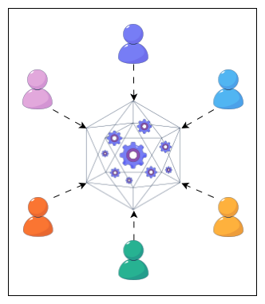
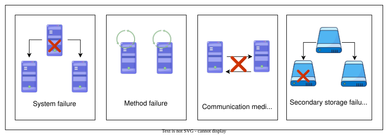

# Lessons_from_System_Failures

Source: https://www.educative.io/courses/grokking-the-system-design-interview/lessons-from-system-failures

---

[Home](https://www.educative.io/)

[Courses](https://www.educative.io/search?tab=courses)

[Grokking Modern System Design Interview](https://www.educative.io/courses/grokking-the-system-design-interview)

# Lessons from System Failures

Learn why complex distributed systems are prone to failure due to evolving user needs and emergent properties. Define the four core failure types. Understand how using independent vantage points and failure domains ensures system resilience and graceful degradation.

We'll cover the following...

- [Introduction](https://www.educative.io/courses/grokking-the-system-design-interview/lessons-from-system-failures#Introduction)
- [Types of failure in distributed systems](https://www.educative.io/courses/grokking-the-system-design-interview/lessons-from-system-failures#Types-of-failure-in-distributed-systems)
- [Vantage points](https://www.educative.io/courses/grokking-the-system-design-interview/lessons-from-system-failures#Vantage-points)
  - [Importance of independent service providers](https://www.educative.io/courses/grokking-the-system-design-interview/lessons-from-system-failures#Importance-of-independent-service-providers)

## Introduction[#](https://www.educative.io/courses/grokking-the-system-design-interview/lessons-from-system-failures#Introduction)

Even widely used services experience failures, which can disrupt both individuals and businesses. System designers must understand why mature services built by experienced teams still experience outages. This chapter examines major failures in widely used services and the techniques used to mitigate them.

Two primary factors contribute to these failures:

- **Diverse users and evolution:** User needs evolve, requiring software updates. While stagnant software is stable, it lacks necessary features. Continuous updates introduce the risk of instability.
- **Complex systems:** Systems possess emergent properties, in which the interactions of components create a complexity greater than the sum of the individual parts.

Diverse users interacting with a complex system

## Types of failure in distributed systems[#](https://www.educative.io/courses/grokking-the-system-design-interview/lessons-from-system-failures#Types-of-failure-in-distributed-systems)

Modern services are designed to contain failures, localizing impact to a subset of users. Common failure types in distributed systems include:

- **System failure:** The most common cause, resulting from software or hardware crashes. Data in primary memory is lost, but data in secondary storage or replicas remains safe. The system typically reboots to recover.
- **Method failure:** These failures suspend system operations. They may cause incorrect process execution or force the system into a deadlock state.
- **Communication medium failure:** Occurs when a component or service cannot reach other internal or external entities due to network issues.
- **Secondary storage failure:** Occurs when secondary storage or replicas go down. Data on these nodes becomes inaccessible, requiring primary nodes to generate new replicas to ensure reliability.

Types of failure in a distributed system

## Vantage points[#](https://www.educative.io/courses/grokking-the-system-design-interview/lessons-from-system-failures#Vantage-points)

In large-scale systems, component failures occur regularly. The goal is graceful degradation so that only a small portion of users are affected for a short period. Effective monitoring requires globally distributed vantage points to independently verify service availability and performance.

> **Note:** Services like Downdetector rely on crowd-sourced reporting. If you check the status of popular applications, you will almost always find users somewhere in the world experiencing issues.

### Importance of independent service providers[#](https://www.educative.io/courses/grokking-the-system-design-interview/lessons-from-system-failures#Importance-of-independent-service-providers)

The original internet was designed for resilience: if one part failed, the rest continued to operate.

With the consolidation of service providers, critics have raised concerns about centralization and the impact of failures. While most companies provide status dashboards, these internal tools often fail alongside the services they support.

When dashboards fail, companies often communicate updates via external channels like Twitter. Independent third-party services are therefore essential for objective failure detection and status dissemination.

> **Note:** This relates to failure domains. A **failure domain** isolates components so that a failure within one domain (or network) does not affect others. Two domains are considered independent if they lie outside each other’s "blast radius."

Importance of independent service

The following lessons analyze failures in well-known services, their causes, and the mitigation techniques used to avoid them. While analyzing past failures is an excellent way to learn, our ultimate goal is to prevent them from occurring in the first place.

System Design of an AI-Powered Code Assistant

Facebook, WhatsApp, Instagram, Oculus Outage

Ask

[Introduction](https://www.educative.io/courses/grokking-the-system-design-interview/lessons-from-system-failures#Introduction)

[Types of failure in distributed systems](https://www.educative.io/courses/grokking-the-system-design-interview/lessons-from-system-failures#Types-of-failure-in-distributed-systems)

[Vantage points](https://www.educative.io/courses/grokking-the-system-design-interview/lessons-from-system-failures#Vantage-points)

[Importance of independent service providers](https://www.educative.io/courses/grokking-the-system-design-interview/lessons-from-system-failures#Importance-of-independent-service-providers)