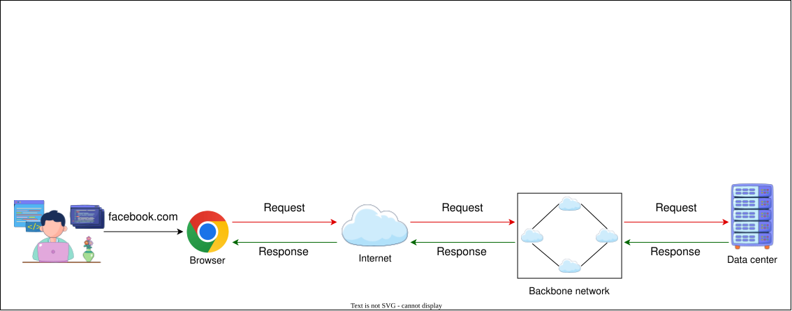
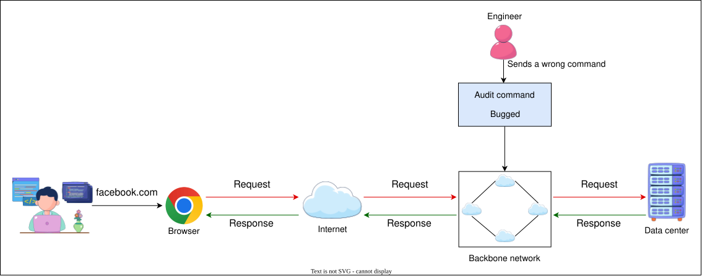
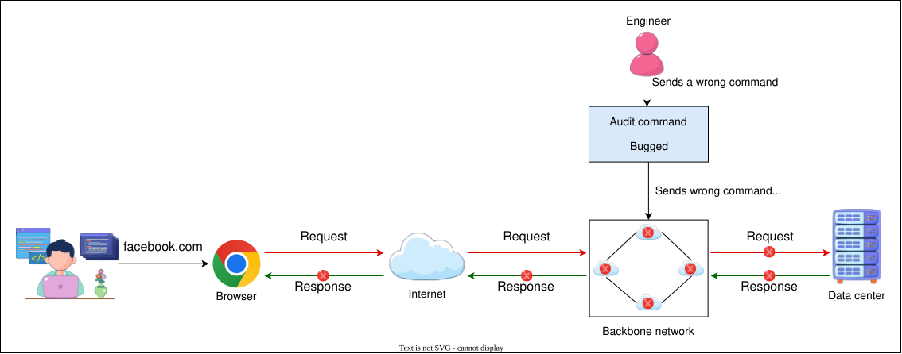

# Facebook,_WhatsApp,_Instagram,_Oculus_Outage

Source: https://www.educative.io/courses/grokking-the-system-design-interview/facebook-whatsapp-instagram-oculus-outage

---

[Home](https://www.educative.io/)

[Courses](https://www.educative.io/search?tab=courses)

[Grokking Modern System Design Interview](https://www.educative.io/courses/grokking-the-system-design-interview)

# Facebook, WhatsApp, Instagram, Oculus Outage

Discover how a routine configuration change led to the 2021 Facebook global outage through cascading failures and DNS withdrawal. Learn essential System Design lessons on avoiding automation pitfalls, ensuring operational readiness, and implementing simple, robust contingency plans for core services.

We'll cover the following...

- [The sequence of events](https://www.educative.io/courses/grokking-the-system-design-interview/facebook-whatsapp-instagram-oculus-outage#The-sequence-of-events)
- [Analysis](https://www.educative.io/courses/grokking-the-system-design-interview/facebook-whatsapp-instagram-oculus-outage#Analysis)
- [Lessons learned](https://www.educative.io/courses/grokking-the-system-design-interview/facebook-whatsapp-instagram-oculus-outage#Lessons-learned)

In October 2021, Facebook experienced a six-hour global outage affecting related services, including Messenger, WhatsApp, Instagram, and Oculus. The New York Times described the event with the headline: “Gone in Minutes, Out for Hours: Outage Shakes Facebook.” Estimates suggest the outage cost Facebook about $100 million in revenue and billions in market value. The following sequence of events led to the outage:

## The sequence of events[#](https://www.educative.io/courses/grokking-the-system-design-interview/facebook-whatsapp-instagram-oculus-outage#The-sequence-of-events)

A chain reaction of technical failures led to the total blackout:

- **Routine maintenance:** An automated system attempted to assess spare capacity on Facebook’s backbone network.
- **Configuration error:** A faulty command accidentally disconnected all data centers from the backbone network. An automated audit tool, designed to catch such errors, failed to detect the bug.
- **DNS health checks:** Facebook’s authoritative DNS servers monitor network health. Because they could not reach the internal data centers, they executed a fail-safe protocol to stop advertising their presence on the internet by withdrawing their BGP routes.
- **Resolution failure:** With routes withdrawn, the authoritative DNS servers became unreachable. Public DNS resolvers (like Google or Cloudflare) could not refresh their records. As cached entries for [www.facebook.com](http://www.facebook.com) timed out, the domain became unresolvable globally.
- **Total outage:** Consequently, no traffic could reach Facebook or its subsidiaries.

The slides below visually depict these events:

1 / 5

Facebook’s high-level architecture

1 / 5

A maintenance team sent the wrong commands to the backbone network

 couldn’t identify the problem with the command and sent the command forward to the backbone network")

1 / 5

The review tool (an audit command) couldn’t identify the problem with the command and sent the command forward to the backbone network

1 / 5

Due to faulty commands, the backbone network malfunctioned

1 / 5

As a result of the faulty commands, Facebook becomes unreachable

## Analysis[#](https://www.educative.io/courses/grokking-the-system-design-interview/facebook-whatsapp-instagram-oculus-outage#Analysis)

Key takeaways from the incident include:

- **Cascading failures:** A routine maintenance task triggered a catastrophic chain reaction. A configuration bug, combined with a flawed audit tool, caused a cascading failure in which one error triggers subsequent failures, ultimately bringing down the entire system.
- **Slow restoration:** The outage lasted six hours because it severed remote access tools. Engineers could not remotely fix the backbone because the internal network was down. Physical and digital security protocols at data centers further delayed the necessary manual intervention.
- **Edge cases:** The system logic, DNS servers disconnecting themselves when data centers are unreachable, was designed for reliability. However, it failed catastrophically when *all* data centers simultaneously became unreachable.
- **Pitfalls of automation:** While automation reduces human error, it introduces the risk of software bugs causing widespread damage at speed.

## Lessons learned[#](https://www.educative.io/courses/grokking-the-system-design-interview/facebook-whatsapp-instagram-oculus-outage#Lessons-learned)

- **Operational readiness:** Complex systems contain hidden single points of failure. Operations teams must train for high-stress, “black swan” events where standard remote tools fail.
- **System complexity:** As systems grow, emergent behaviors arise. Keeping designs simple and evolving slowly helps, but continuous monitoring is essential to detect cascading failures early.
- **External dependencies:** Third-party services relying on Facebook for Single Sign-On (SSO) failed even though their own infrastructure was healthy. This highlights the risk of tight coupling with external providers.
- **DNS strategy:** Hosting DNS with independent providers can prevent internal network failures from taking down DNS resolution. However, for hyperscalers like Facebook, this introduces trade-offs in terms of cost, security, and integration with backbone traffic engineering.
- **Security vs. recovery trade-offs:** Strict physical and digital security slowed down the manual repair process. There is a difficult trade-off between securing infrastructure and enabling rapid emergency access.
- **Retry storms:** The outage caused a massive surge in DNS traffic to public resolvers (such as Google and Cloudflare) due to clients’ constant retries.
- **Cold start challenges:** Restarting a massive system requires care. A sudden surge in power usage when bringing data centers back online can strain electrical grids, and systems must be restored to a steady state gradually.

1.

What can we do to safeguard against the kinds of faults experienced by Facebook?

Show Answer

Did you find this helpful?

Lessons from System Failures

AWS Kinesis Outage Affecting Many Organizations

Ask

[The sequence of events](https://www.educative.io/courses/grokking-the-system-design-interview/facebook-whatsapp-instagram-oculus-outage#The-sequence-of-events)

[Analysis](https://www.educative.io/courses/grokking-the-system-design-interview/facebook-whatsapp-instagram-oculus-outage#Analysis)

[Lessons learned](https://www.educative.io/courses/grokking-the-system-design-interview/facebook-whatsapp-instagram-oculus-outage#Lessons-learned)