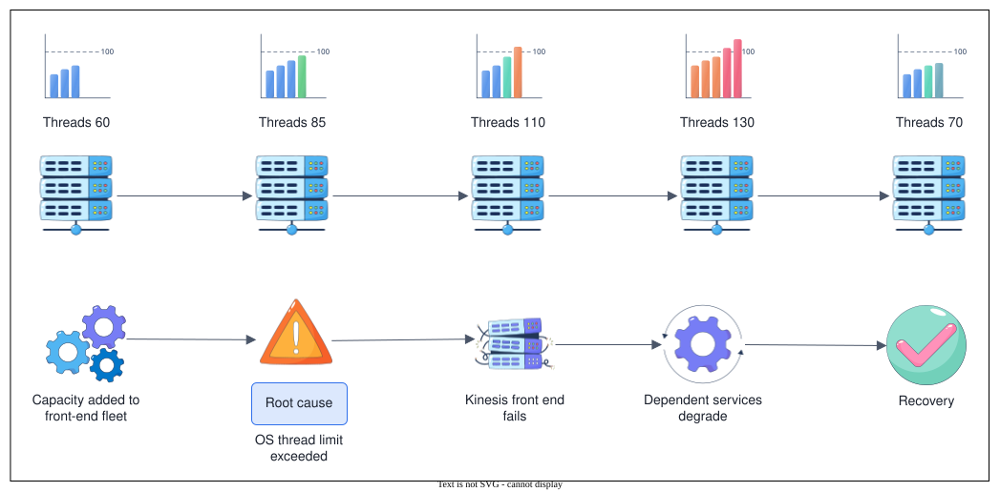
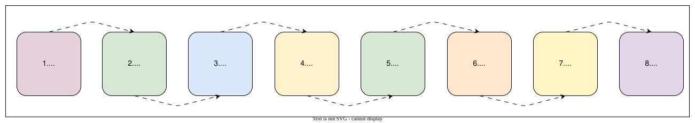

# AWS_Kinesis_Outage_Affecting_Many_Organizations

Source: https://www.educative.io/courses/grokking-the-system-design-interview/aws-kinesis-outage-affecting-many-organizations

---

[Home](https://www.educative.io/)

[Courses](https://www.educative.io/search?tab=courses)

[Grokking Modern System Design Interview](https://www.educative.io/courses/grokking-the-system-design-interview)

# AWS Kinesis Outage Affecting Many Organizations

Discover how a simple capacity addition triggered the massive AWS Kinesis outage, causing cascading failures across dependent services. Learn critical lessons regarding operational readiness, rigorous testing, and managing dependencies in complex distributed System Design.

We'll cover the following...

- [Sequence of events](https://www.educative.io/courses/grokking-the-system-design-interview/aws-kinesis-outage-affecting-many-organizations#Sequence-of-events)
- [Analysis](https://www.educative.io/courses/grokking-the-system-design-interview/aws-kinesis-outage-affecting-many-organizations#Analysis)
- [Lessons learned](https://www.educative.io/courses/grokking-the-system-design-interview/aws-kinesis-outage-affecting-many-organizations#Lessons-learned)

**Amazon Kinesis** ingests and processes real-time streaming data. Its front end handles authentication, throttling, and routes workloads to backend clusters using sharding. On November 25, 2020, a disruption in the US-East-1 region caused widespread outages across internet services and third-party applications.

Adding capacity pushed servers past the OS thread limit and triggered the outage

## Sequence of events[#](https://www.educative.io/courses/grokking-the-system-design-interview/aws-kinesis-outage-affecting-many-organizations#Sequence-of-events)

- **Trigger:** Amazon added capacity to the front-end server fleet between 2:44 a.m. and 3:47 a.m. PST.
- **Root cause:** The new capacity caused the fleet to exceed the maximum thread count allowed by the operating system configuration.
- **System failure:** Exceeding the thread limit caused cache construction to fail. Front-end servers ended up with useless shard maps and could not route requests to back-end clusters.
- **Impact on primary services:**

  - **Amazon Cognito:** Cognito uses Kinesis Data Streams to analyze API usage. A latent bug in the buffering code caused Cognito web servers to block when Kinesis buffers were backlogged. This prevented external users from authenticating or receiving AWS credentials.
  - **CloudWatch:** CloudWatch uses Kinesis to process metrics and logs. The `PutMetricData` and `PutLogEvents` APIs failed, and alerts triggered `INSUFFICIENT DATA` states. Internal and external clients could not persist metric data.

Sequence of events

- **AutoScaling and Lambda:** AutoScaling policies relying on CloudWatch were delayed. Lambda functions buffered metric data locally because CloudWatch was unavailable, leading to memory congestion on service hosts and higher error rates.
- **EventBridge, ECS, and EKS:** Increased API failures disrupted EventBridge, which manages cluster jobs. This impacted cluster provisioning, scaling, and task deprovisioning.
- **Communication delays:** The Service Health Dashboard, intended to communicate status, went down because it depended on the impacted Cognito service.
- **Third-party impact:** Thousands of external services, including Adobe Spark, Coinbase, and the *Washington Post*, experienced disruptions.

## Analysis[#](https://www.educative.io/courses/grokking-the-system-design-interview/aws-kinesis-outage-affecting-many-organizations#Analysis)

- **Scalability complexity:** While horizontal scalability is a core design principle, this event proves that adding capacity to a live cluster is complex and can trigger unintended side effects.
- **Team training:** The production team initially suspected memory pressure rather than thread limits, delaying recovery. Teams must be trained to diagnose root causes under time pressure.
- **Bootstrap dependencies:** During bootstrapping, servers should read from an authoritative metadata store rather than other front-end servers to minimize failure propagation.
- **Early fault detection:** Automated processes are necessary to identify failure causes immediately upon occurrence.
- **Testing limitations:** The thread limit issue was a bug that should have been caught before deployment. Simulators are needed to test capacity changes before they are deployed to the production fleet.

Shared dependencies spread the failure; better testing and automation would have limited it

- **Automated resource allocation:** The Cognito team manually added capacity to mitigate buffering issues. Resource allocation during incidents should be automated.
- **Latent bugs:** The Kinesis failure triggered a dormant bug in Cognito’s buffering code. Potential bugs must be identified and fixed before critical events, such as capacity additions.

## Lessons learned[#](https://www.educative.io/courses/grokking-the-system-design-interview/aws-kinesis-outage-affecting-many-organizations#Lessons-learned)

- **Testing:** Rigorous testing is essential. The OS thread limit was a predictable constraint that acted as a bug.
- **Operational readiness:** A single bug halted the system. Operations teams must be prepared for "single point of failure" scenarios in complex distributed systems.
- **Reducing server count:** To increase thread headroom, Amazon plans to move to powerful servers with higher CPU and memory. Fewer servers require fewer inter-fleet connection threads.
- **Front-end architecture:** Amazon is optimizing the front-end fleet's cold start time and moving the cache to a dedicated fleet.
- **Isolation:** Critical services like CloudWatch should move to a separate, partitioned front-end fleet to prevent recurrent cascading failures.

1.

What possible measures should Amazon have adopted to safeguard against the kind of failures they faced in Kinesis Data Streams?

Show Answer

Did you find this helpful?

Facebook, WhatsApp, Instagram, Oculus Outage

AWS Wide Spread Outage

Ask

[Sequence of events](https://www.educative.io/courses/grokking-the-system-design-interview/aws-kinesis-outage-affecting-many-organizations#Sequence-of-events)

[Analysis](https://www.educative.io/courses/grokking-the-system-design-interview/aws-kinesis-outage-affecting-many-organizations#Analysis)

[Lessons learned](https://www.educative.io/courses/grokking-the-system-design-interview/aws-kinesis-outage-affecting-many-organizations#Lessons-learned)