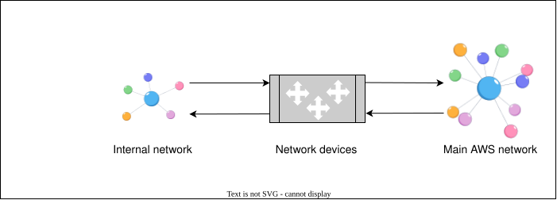
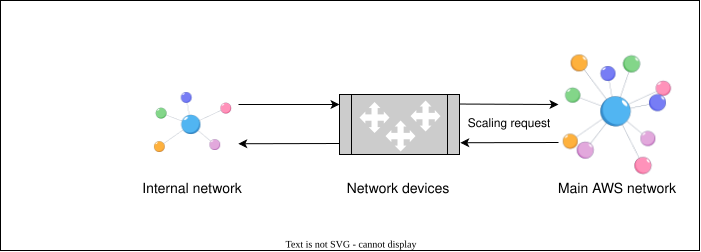
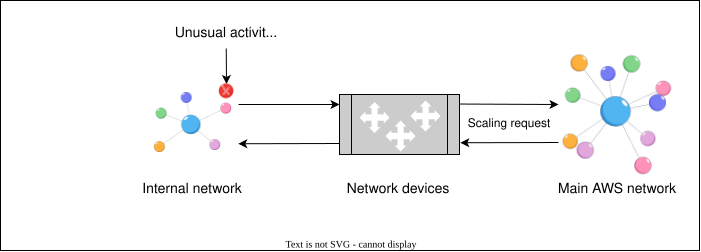
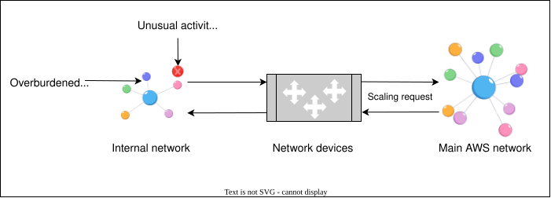
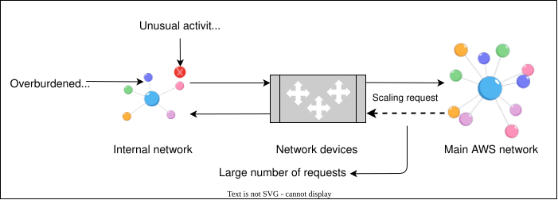

# AWS_Wide_Spread_Outage

Source: https://www.educative.io/courses/grokking-the-system-design-interview/aws-wide-spread-outage

---

[Home](https://www.educative.io/)

[Courses](https://www.educative.io/search?tab=courses)

[Grokking Modern System Design Interview](https://www.educative.io/courses/grokking-the-system-design-interview)

# AWS Wide Spread Outage

Examine the 2021 AWS outage to understand how internal network congestion and monitoring failures cascade into global service disruption. Learn crucial System Design lessons about identifying hidden dependencies, implementing contingency plans, and ensuring independent communication systems for resilience.

We'll cover the following...

- [Introduction](https://www.educative.io/courses/grokking-the-system-design-interview/aws-wide-spread-outage#Introduction)
- [Sequence of events](https://www.educative.io/courses/grokking-the-system-design-interview/aws-wide-spread-outage#Sequence-of-events)
- [Analysis](https://www.educative.io/courses/grokking-the-system-design-interview/aws-wide-spread-outage#Analysis)
- [Lessons learned](https://www.educative.io/courses/grokking-the-system-design-interview/aws-wide-spread-outage#Lessons-learned)

## Introduction[#](https://www.educative.io/courses/grokking-the-system-design-interview/aws-wide-spread-outage#Introduction)

On December 7, 2021, a major AWS outage disrupted services for over eight hours. The incident propagated across many internet services, affecting both consumer devices and large commercial platforms. Headlines like the Financial Times’ “From angry Adele fans to broken robot vacuums” highlighted the scale of the disruption across users and businesses. This event highlighted the risks of heavy reliance on centralized cloud providers. According to Gartner, five companies account for roughly 80% of the cloud market, with Amazon holding a 41% share. Failures at this scale can cause widespread disruptions. Such outages reflect Leslie Lamport’s well-known definition: “A distributed system is one in which the failure of a computer you didn’t even know existed can render your own computer unusable.”

The following sequence describes the chain of technical events that led to the outage.

## Sequence of events[#](https://www.educative.io/courses/grokking-the-system-design-interview/aws-wide-spread-outage#Sequence-of-events)

- **Trigger:** An automated capacity expansion in the internal network triggered unexpected behavior from a large number of clients.
- **Congestion:** A surge in connection activity overwhelmed the networking equipment linking the internal network to the main AWS network.
- **Retry storm:** Communication delays increased latency and error rates. This triggered a feedback loop of aggressive retries and ping requests.
- **Device overload:** The persistent traffic spike caused constant overload and performance degradation in the devices connecting the two networks.
- **Monitoring blindness:** The network congestion cut off real-time monitoring data, preventing operations teams from identifying the root cause.
- **Manual diagnosis:** Blind to the system state, operators relied on logs and eventually identified a spike in internal DNS failures.

The following slides visualize the series of events.

1 / 7

The high-level infrastructure of Amazon. The main AWS network connects the internal network using networking device

1 / 7

The main AWS network makes a scaling request to the internal network

1 / 7

The scaling request resulted in unusual behavior in the internal network

1 / 7

The internal network received a large number of client requests, which overburdened the network

1 / 7

Additional requests from the main AWS network are received

## Analysis[#](https://www.educative.io/courses/grokking-the-system-design-interview/aws-wide-spread-outage#Analysis)

- **Hampered AWS services:** Networking issues disrupted services relying on the internal network. While the primary network remained functional, services like Amazon RDS, EMR, and Workspaces could not generate resources because the system failed to launch new EC2 instances.
- **Impaired control plane:** Control planes managing resources were hit hard. Existing EC2 instances ran normally, but EC2 APIs experienced high latency and errors, preventing management actions.
- **Slow restoration:** With monitoring down, operators manually identified traffic sources. They prioritized moving internal DNS traffic away from congestion to restore stability.
- **Elastic Load Balancers (ELB):** Existing ELBs functioned correctly, but API errors delayed the provisioning of new load balancers.

## Lessons learned[#](https://www.educative.io/courses/grokking-the-system-design-interview/aws-wide-spread-outage#Lessons-learned)

- **Verify isolation:** The internal network was not truly independent of the main network. Identifying and severing hidden dependencies is crucial for resilience.
- **Contingency planning:** The severity of the failure overwhelmed standard safeguards. Organizations need risk-based plans for extreme "black swan" scenarios.
- **Operational readiness:** Complex systems have single points of failure. Teams must be trained to handle total system halts without standard monitoring tools.
- **Redundancy strategy:** Use multi-region or multi-cloud strategies to prevent a single provider failure from taking down all operations. While difficult to implement, it prevents total blackouts.
- **Stress testing:** Rigorous testing is needed to understand how network devices behave under extreme load, such as during retry storms.

1.

What can we do to safeguard against the series of faults experienced by Amazon?

Show Answer

Did you find this helpful?

AWS Kinesis Outage Affecting Many Organizations

Conclusions

Ask

[Introduction](https://www.educative.io/courses/grokking-the-system-design-interview/aws-wide-spread-outage#Introduction)

[Sequence of events](https://www.educative.io/courses/grokking-the-system-design-interview/aws-wide-spread-outage#Sequence-of-events)

[Analysis](https://www.educative.io/courses/grokking-the-system-design-interview/aws-wide-spread-outage#Analysis)

[Lessons learned](https://www.educative.io/courses/grokking-the-system-design-interview/aws-wide-spread-outage#Lessons-learned)