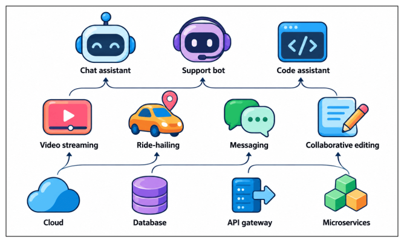

# Conclusions

Source: https://www.educative.io/courses/grokking-the-system-design-interview/conclusions

---

[Home](https://www.educative.io/)

[Courses](https://www.educative.io/search?tab=courses)

[Grokking Modern System Design Interview](https://www.educative.io/courses/grokking-the-system-design-interview)

# Conclusions

Reflect on the System Design building blocks and architectural patterns learned across diverse design problems. Understand how to select the right tools for any job, translating complex requirements into reliable solutions. Explore recommended next steps, including advanced courses and mock interviews, to solidify your expertise.

We'll cover the following...

- [Next steps](https://www.educative.io/courses/grokking-the-system-design-interview/conclusions#Next-steps)

Congratulations on completing this challenging course!

We explored System Design through the lens of basic building blocks. This approach allowed us to focus on specific business use cases without repeating recurring concepts.

The course built complete systems, including AI systems, from reusable building blocks

We selected design problems from diverse domains. Each problem highlights unique aspects and challenges of System Design.

## Unique Aspects of Each Design Problem

|  |  |
| --- | --- |
| **Design Problem** | **Unique Aspect of Design** |
| YouTube | Building custom data stores like Vitess and BigTable to meet scalability needs |
| Quora | Vertical sharding of MySQL database to meet the scalability requirements |
| Google Maps | The use of segmentation of a map to meet scalability needs and achieve high performance |
| Yelp | Usage of Quadtrees for speedy access to spatial data |
| Uber | Improved payment service to ensure fraud detection, and matching the driver and rider on maps |
| Twitter | The use of client-side load balancers for multiple services that had thousands of instances in order to reduce latency |
| Newsfeed | A recommendation system to ensure ranking and feed suggestions |
| Instagram | A perfect example of how different building blocks combine to build a scalable and performant system |
| TinyURL | Encoding IDs in the base-58 system for generating unique short URLs |
| Web crawler | Detection, identification, and resolution of Web crawler traps |
| WhatsApp | Message management for offline users |
| Typeahead | The usage of an efficient trie data structure to provide suggestions |
| Google Docs | Concurrency management for simultaneous writes, using techniques like operational transformation (OT) and Conflict-free Replicated Data Type (CRDT) |
| Deployment System | Blue-green, canary, and rolling deployment strategies to achieve zero-downtime releases and minimize blast radius. |
| Payment System | Strong consistency and reconciliation layers to guarantee reliable, fraud-free financial transactions. |
| LeetCode System | Secure, isolated code execution at scale using sandboxed workers, distributed job queues, and resource limits for evaluating submissions across multiple programming languages. |
| ChatGPT System | Large-scale model inference and retrieval integration using distributed GPU clusters for low-latency responses. |
| Data Infrastructure System | Scalable and modular data pipelines that cleanly separate ingestion, processing, storage, and serving layers while emphasizing fault tolerance and real-time & batch hybrid processing. |
| LLM-powered Customer Support Bot | Integrating LLM reasoning with retrieval (RAG), orchestration layers, and feedback loops to deliver context-aware, scalable, and continuously improving customer support automation. |
| AI-powered Code Assistant | Combine LLM-based code generation with contextual understanding (via embeddings/RAG), developer tooling integration, and iterative feedback loops to ensure accurate, context-aware, and assistive coding support. |

You now have a set of System Design techniques and patterns that help you choose appropriate solutions for different design problems. This course introduces core concepts that can be combined to design new systems. Use these concepts to design reliable and scalable systems.

## Next steps[#](https://www.educative.io/courses/grokking-the-system-design-interview/conclusions#Next-steps)

To expand your skill set, we recommend the following three courses:

- [**Grokking the Generative AI System Design**](https://www.educative.io/courses/lta/generative-ai-system-design) provides a comprehensive framework for designing scalable machine learning systems. You will learn to identify and handle challenges ranging from data acquisition to model deployment.
- [**Grokking the Principles and Practices of Advanced System Design**](https://www.educative.io/courses/grokking-the-principles-and-practices-of-advanced-system-design) targets senior roles. This course elevates your System Design skills by addressing complex problems such as consensus algorithms, storage systems, file systems, and concurrency management.
- [**Grokking the Product Architecture Design Interview**](https://www.educative.io/courses/grokking-the-api-design-interview) focuses on product architecture design, which ensures services communicate effectively. Mastering API design principles is critical for creating reliable, compatible APIs that support modern software architectures.

---

We also recommend testing your skills with a [Mock Interviewer](https://www.mockinterviews.dev/).

Thank you for completing this course. We hope you had a great experience. Please share any suggestions via email or our community forum.

— Team Educative

AWS Wide Spread Outage

Resources to Prepare for a System Design Interview

Ask

[Next steps](https://www.educative.io/courses/grokking-the-system-design-interview/conclusions#Next-steps)