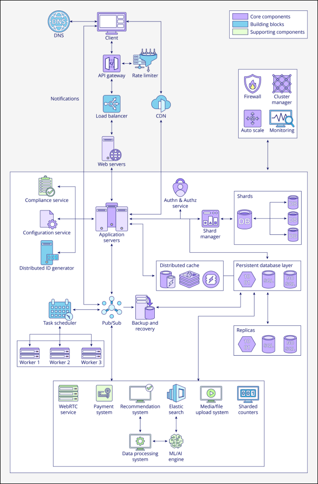

# The_All-in-One_System_Design_Master_Template

Source: https://www.educative.io/courses/grokking-the-system-design-interview/the-all-in-one-system-design-master-template

---

[Home](https://www.educative.io/)

[Courses](https://www.educative.io/search?tab=courses)

[Grokking Modern System Design Interview](https://www.educative.io/courses/grokking-the-system-design-interview)

# The All-in-One System Design Master Template

The All-in-One System Design Master Template emphasizes the importance of structured design in system architecture, particularly for scalability and resilience. It outlines a phased approach to building systems, starting from a basic setup and evolving through stages that introduce components like load balancers, sharding, and caching. Each stage addresses specific challenges, such as traffic management and performance optimization, ultimately leading to a robust system capable of handling growth and user demands. The template serves as a foundational blueprint for designing complex systems, ensuring they remain efficient and adaptable over time.

We'll cover the following...

- [Case study of Twitter (now known as X)](https://www.educative.io/courses/grokking-the-system-design-interview/the-all-in-one-system-design-master-template#Case-study-of-Twitter-now-known-as-X)
- [System Design template](https://www.educative.io/courses/grokking-the-system-design-interview/the-all-in-one-system-design-master-template#System-Design-template)
  - [Stage 1: The basic setup](https://www.educative.io/courses/grokking-the-system-design-interview/the-all-in-one-system-design-master-template#Stage-1-The-basic-setup)
  - [Stage 2: Scaling for traffic](https://www.educative.io/courses/grokking-the-system-design-interview/the-all-in-one-system-design-master-template#Stage-2-Scaling-for-traffic)
  - [Stage 3: Ensuring high availability](https://www.educative.io/courses/grokking-the-system-design-interview/the-all-in-one-system-design-master-template#Stage-3-Ensuring-high-availability)
  - [Stage 4: Streamlining traffic and task management](https://www.educative.io/courses/grokking-the-system-design-interview/the-all-in-one-system-design-master-template#Stage-4-Streamlining-traffic-and-task-management)
  - [Stage 5: Optimizing performance](https://www.educative.io/courses/grokking-the-system-design-interview/the-all-in-one-system-design-master-template#Stage-5-Optimizing-performance)
  - [Stage 6: Feature expansion](https://www.educative.io/courses/grokking-the-system-design-interview/the-all-in-one-system-design-master-template#Stage-6-Feature-expansion)
  - [Stage 7: Personalization and intelligence](https://www.educative.io/courses/grokking-the-system-design-interview/the-all-in-one-system-design-master-template#Stage-7-Personalization-and-intelligence)
  - [Stage 8: Compliance and system management](https://www.educative.io/courses/grokking-the-system-design-interview/the-all-in-one-system-design-master-template#Stage-8-Compliance-and-system-management)
  - [Stage 9: Security and monitoring](https://www.educative.io/courses/grokking-the-system-design-interview/the-all-in-one-system-design-master-template#Stage-9-Security-and-monitoring)
  - [Stage 10: Designing YouTube with the master template](https://www.educative.io/courses/grokking-the-system-design-interview/the-all-in-one-system-design-master-template#Stage-10-Designing-YouTube-with-the-master-template)
- [Conclusion](https://www.educative.io/courses/grokking-the-system-design-interview/the-all-in-one-system-design-master-template#Conclusion)

System Design interviews evaluate more than just immediate problem-solving. They evaluate a candidate's ability to think long-term, envisioning how a system can scale, adapt, and remain resilient under growing pressure. This involves anticipating future growth and designing a system that can evolve as demand changes over time. This is where a System Design master template becomes essential.

Fill out the form to download your FREE template

Email\*

First name

Last name

Rather than approaching each new design problem from scratch, a structured template provides a blueprint that incorporates best practices, proven strategies, and scalable architecture. In an interview, having this foundational design in mind can demonstrate a clear understanding of how to build robust systems that are built to last.

The following is a System Design master template by Educative, meticulously crafted by ex-FAANG engineers:

## Case study of Twitter (now known as X)[#](https://www.educative.io/courses/grokking-the-system-design-interview/the-all-in-one-system-design-master-template#Case-study-of-Twitter-now-known-as-X)

> **Disclaimer:** For this lesson, the social platform now called X is referred to as Twitter.

A relevant case study is Twitter, whose early architecture illustrates the consequences of not planning for scale.

In its early years, Twitter began as a side project. Like many startups, the focus was on launching quickly rather than building a robust infrastructure. The system was simple: a single server, a basic database, and minimal redundancy. This was sufficient at first.

As Twitter’s popularity grew, the architecture could no longer keep up. The infamous “fail whale” became a common sight whenever traffic spiked. Frequent downtime, delayed tweets, and occasional data loss created a poor user experience.

If the initial design had anticipated growth using a structured master template, key components such as load balancers, sharding, and failover mechanisms could have been incorporated early. This would have minimized the scaling challenges.

This case study demonstrates that a System Design template is about building a system that can thrive, even when success exceeds expectations.

## System Design template[#](https://www.educative.io/courses/grokking-the-system-design-interview/the-all-in-one-system-design-master-template#System-Design-template)

It is not easy to become familiar with every component of a typical System Design. To simplify the process, the elements of a master System Design are organized into three categories:

|  |  |  |
| --- | --- | --- |
| **Core Components** | **Building Blocks** | **Supporting Services** |
| - Application and web servers - API gateway - Worker servers - Authn and Authz service - Database and distributed cache - Shards and shard manager - Firewalls - Cluster managers - Configuration service - Backup and recovery | - Load balancers - CDNs - Rate limiters - DNS - Distributed ID generator - Task scheduler - Elasticsearch - Queuing or Pub/Sub service - Monitoring service - Sharded counters | - Media/file upload service - Recommendation system - ML/AI engine - Data processing system - Payment system - Compliance service - WebRTC service |

These components are used together to gradually build a scalable and resilient system. The following sections explain how each stage of a system’s evolution introduces new components and patterns.

### Stage 1: The basic setup[#](https://www.educative.io/courses/grokking-the-system-design-interview/the-all-in-one-system-design-master-template#Stage-1-The-basic-setup)

**Scenario:** Consider a simple social media platform. At this early stage, the primary objective is to launch the core functionality quickly, allowing users to sign up, create posts, and read posts from others.

A single application server manages all requests, including authentication, post creation, and page rendering. A relational database stores user information and posts. This type of setup works well for small projects or early-stage startups that want to validate their idea.

Basic System Design for a social media platform

However, this design has clear limitations. Because the entire system depends on a single server, performance drops when too many users are active. If the server fails, the service stops entirely.

When the platform becomes popular, and user activity increases, response times slow, and requests begin to time out. At this point, scalability becomes the most urgent goal.

### Stage 2: Scaling for traffic[#](https://www.educative.io/courses/grokking-the-system-design-interview/the-all-in-one-system-design-master-template#Stage-2-Scaling-for-traffic)

To support higher traffic, improve reliability, and prepare for continued growth, the system must move from a single-node design to a distributed one. Several components are introduced in this stage.

- Multiple application servers
- Load balancers
- Replication of databases

Adding multiple servers prevents a single node from becoming overloaded. A load balancer directs requests to available servers so that user traffic is evenly distributed. Database replication improves performance because read operations can be directed to replicas, while write operations are handled by the primary database.

System Design of social media platform scaled for traffic

These steps significantly improve throughput and stability. Yet new problems appear. Replication lag can create temporary data inconsistencies. Write operations can still become a bottleneck. Sudden traffic spikes can also create uneven load distribution.

To maintain the system’s speed and reliability, the next step is to design for constant availability and fault tolerance.

### Stage 3: Ensuring high availability[#](https://www.educative.io/courses/grokking-the-system-design-interview/the-all-in-one-system-design-master-template#Stage-3-Ensuring-high-availability)

At this stage, the goal is to keep the platform available at all times, even during periods of heavy traffic or server outages. The following additions help achieve this goal.

- Database sharding
- Shard manager
- Backup and recovery service

Database sharding divides the data into smaller, more manageable parts, known as shards. Each shard stores only part of the dataset, which helps distribute load across multiple database nodes and can improve query performance. For example, one shard might handle users one to one million, and another handles users one million to two million.

A shard manager keeps track of where each shard’s data is located and directs queries to the correct shard so that retrieval remains fast and efficient even when the number of shards grows.

1.

Which component manages data distribution across shards, and how does it ensure efficient data retrieval?

Show Answer

Did you find this helpful?

Horizontal scaling further enhances reliability by adding additional servers rather than upgrading existing ones. This method increases fault tolerance because the failure of one node does not affect the whole system. A backup and recovery service adds a layer of safety by maintaining data replicas and automating recovery in the event of failures.

Updated System Design to ensure availability

With these improvements, the system achieves consistent uptime, redundancy, and faster data access. It is now ready for the next phase, which focuses on better traffic control and task management.

### Stage 4: Streamlining traffic and task management[#](https://www.educative.io/courses/grokking-the-system-design-interview/the-all-in-one-system-design-master-template#Stage-4-Streamlining-traffic-and-task-management)

As the system grows, managing traffic and asynchronous work becomes increasingly important. This stage introduces components that improve control and efficiency.

- API gateway
- Rate limiter
- Worker servers
- Task scheduler
- Distributed ID generator

The API gateway acts as a single entry point for requests and handles routing, authentication, and version control. A rate limiter protects the system by restricting how many requests a user or service can make within a given time period.

Worker processes handle background jobs that do not need an immediate response, such as image processing or analytics pipelines. A job queue or scheduler assigns this work to available workers so the main application can return responses without waiting for background processing to finish. A distributed ID service generates unique IDs for each request, event, or background job so records can be traced reliably across multiple services.

Updated System Design with traffic and task management components

Together, these additions help the system handle spikes in activity, offload heavy work, and maintain a smooth experience for users. The next step focuses on improving speed and responsiveness.

### Stage 5: Optimizing performance[#](https://www.educative.io/courses/grokking-the-system-design-interview/the-all-in-one-system-design-master-template#Stage-5-Optimizing-performance)

To make the platform faster and more responsive, several performance-enhancing components are added.

- Cache
- Content delivery network
- Pub/Sub system

A cache stores frequently accessed data so that the system does not need to repeatedly query the database. This reduces latency and improves the user experience. A content delivery network (CDN) serves static assets such as images and CSS from edge locations closer to the user. This shortens loading times and reduces pressure on the main servers.

A pub and sub system enables real-time communication between services. It handles background message queues and supports live features such as notifications and activity feeds. By offloading tasks to background processing, it keeps application servers responsive even under high demand.

Updated System Design to optimize performance

At this stage, the platform delivers better performance and near real-time interactions. The next goal is to introduce more advanced features that enhance user engagement.

### Stage 6: Feature expansion[#](https://www.educative.io/courses/grokking-the-system-design-interview/the-all-in-one-system-design-master-template#Stage-6-Feature-expansion)

As the system matures, users begin to expect richer features and more dynamic interaction. This stage introduces the following additions.

- Media/file upload system
- Blob store
- Search service
- Sharded counters
- WebRTC service

The media upload service processes large files and generates multiple output formats to support different bandwidth and client requirements. These files are stored in a blob store that is optimized for large data objects. A search service indexes user data and posts so that users can quickly locate content.

Sharded counters efficiently track user activity such as likes, comments, and shares. A WebRTC service provides real-time communication between users and supports voice, video, and chat functionality.

1.

How would you efficiently and correctly track millions of likes, dislikes, and comments while allowing users to interact with rich media content like photos and videos?

Show Answer

Did you find this helpful?

Updated System Design to support feature expansion

With these capabilities in place, the platform can now deliver multimedia features and instant communication. The next focus is on personalization and data intelligence.

### Stage 7: Personalization and intelligence[#](https://www.educative.io/courses/grokking-the-system-design-interview/the-all-in-one-system-design-master-template#Stage-7-Personalization-and-intelligence)

At this stage, the goal is to make the system smarter and more tailored to individual users. The following components are introduced.

- Recommendation system
- Data processing service
- ML/AI engine
- Payment system

The recommendation system analyzes user behavior to provide personalized content. It uses both real-time and batch data processed by a data pipeline. The ML and AI engine applies algorithms that combine collaborative filtering and content-based methods to produce intelligent recommendations.

The payment system enables monetization and premium features. It handles transactions securely and supports subscription or purchase flows.

System Design powered with personalization and intelligence

1.

How does a data processing service collect and process data?

Show Answer

Did you find this helpful?

Together, these systems make the platform more engaging by delivering relevant content and unlocking new revenue opportunities. The next phase focuses on compliance, scalability, and system management.

### Stage 8: Compliance and system management [#](https://www.educative.io/courses/grokking-the-system-design-interview/the-all-in-one-system-design-master-template#Stage-8-Compliance-and-system-management)

When the platform reaches global scale, managing resources and following regional regulations becomes essential. The following components are added.

- Auto-scaling
- Web servers
- Authentication and authorization service
- Compliance and configuration services
- Cluster manager

Auto scaling adjusts resources automatically based on usage patterns, which keeps performance consistent while controlling cost. Web servers handle static content such as images or style sheets, allowing application servers to focus on business logic.

A separate authentication and authorization service manages user identities and permissions more securely. Compliance services enforce data protection laws across regions. Configuration services maintain consistent system settings and simplify deployments.

Cluster managers handle orchestration and resource allocation across multiple machines, ensuring optimal utilization and high availability.

System Design to ensure compliance and system management

After implementing these components, the platform becomes easier to manage and more reliable across regions. The final step focuses on security and monitoring.

### Stage 9: Security and monitoring[#](https://www.educative.io/courses/grokking-the-system-design-interview/the-all-in-one-system-design-master-template#Stage-9-Security-and-monitoring)

Security and visibility are vital when the platform operates at scale. The final stage integrates monitoring and protection layers.

- Firewalls
- Monitoring and logging service

Firewalls manage traffic between internal and external networks, blocking unauthorized access and reducing the risk of attacks. Monitoring systems track system activity and detect anomalies that may indicate performance degradation or security incidents. Logging services record detailed information about operations and user activity, which helps engineers troubleshoot problems and maintain transparency.

Existing components such as the API gateway, rate limiter, and authentication services also contribute to security by managing access and protecting the system from overload.

System Design integrated with security and monitoring

With these measures in place, the platform is secure, observable, and resilient. It now represents a complete master template for modern, large-scale systems.

### Stage 10: Designing YouTube with the master template[#](https://www.educative.io/courses/grokking-the-system-design-interview/the-all-in-one-system-design-master-template#Stage-10-Designing-YouTube-with-the-master-template)

YouTube is an excellent example of how the master template can be applied to a real-world system. A video streaming platform must handle massive volumes of video content, concurrent users, and live interactions while maintaining high performance and reliability.

Using the System Design master template, we can design YouTube by including the following key components and their roles.

- The API gateway receives all incoming requests and directs them to the appropriate services. The rate limiter prevents overload by controlling request frequency during heavy traffic.
- Web servers manage static content such as thumbnails, style sheets, and homepage data.
- Application servers handle dynamic requests such as uploading videos, authenticating users, and generating recommendations.
- The media or file upload service processes video files and stores them in a blob storage system that can manage large datasets efficiently.
- Worker servers perform background operations such as encoding videos and generating thumbnails, coordinated through the task scheduler.
- The pub and sub system manages real-time features such as notifications, live comments, and streaming interactions between users and services.
- Sharded counters record interactions like views, likes, and comments across distributed storage.
- The recommendation system, powered by the ML and AI engine, suggests videos based on user preferences and viewing history. The data processing system analyzes user behavior and provides the feedback loop needed for continuous improvement of recommendations.

System Design of YouTube from master template

This setup ensures scalability, real-time communication, and data-driven personalization. It allows YouTube to serve millions of users simultaneously while maintaining low latency and high reliability.

**Challenge:** Imagine you are designing an online multiplayer gaming platform where users can join, compete, and interact in real time. The system must handle millions of simultaneous players, manage live communication, and track game statistics accurately. It should also support features such as matchmaking, leaderboards, progress tracking, and in-game purchases.

Using the System Design master template, design this gaming platform so that it can scale effectively while maintaining performance and user satisfaction.

## Conclusion[#](https://www.educative.io/courses/grokking-the-system-design-interview/the-all-in-one-system-design-master-template#Conclusion)

With the completion of the System Design master template and its application to a complex video streaming system, it becomes clear how a structured, stage-based approach can address the challenges of modern large-scale architecture.

Each stage of the template introduces new components that build upon the previous layers. The system evolves from a basic setup into a scalable, resilient, and intelligent platform. From managing workloads and real-time interactions to implementing personalization, compliance, and security, every enhancement ensures that the system can grow and adapt with user demand.

As you begin your own System Design journey, use this master template as a flexible foundation. Adjust the design patterns based on your system requirements, whether you are building a social app, an e-commerce platform, or an internal enterprise system.

The goal is to design one that thrives under scale and change.

Resources to Prepare for a System Design Interview

System Design Primer

Ask

[Case study of Twitter (now known as X)](https://www.educative.io/courses/grokking-the-system-design-interview/the-all-in-one-system-design-master-template#Case-study-of-Twitter-now-known-as-X)

[System Design template](https://www.educative.io/courses/grokking-the-system-design-interview/the-all-in-one-system-design-master-template#System-Design-template)

[Stage 1: The basic setup](https://www.educative.io/courses/grokking-the-system-design-interview/the-all-in-one-system-design-master-template#Stage-1-The-basic-setup)

[Stage 2: Scaling for traffic](https://www.educative.io/courses/grokking-the-system-design-interview/the-all-in-one-system-design-master-template#Stage-2-Scaling-for-traffic)

[Stage 3: Ensuring high availability](https://www.educative.io/courses/grokking-the-system-design-interview/the-all-in-one-system-design-master-template#Stage-3-Ensuring-high-availability)

[Stage 4: Streamlining traffic and task management](https://www.educative.io/courses/grokking-the-system-design-interview/the-all-in-one-system-design-master-template#Stage-4-Streamlining-traffic-and-task-management)

[Stage 5: Optimizing performance](https://www.educative.io/courses/grokking-the-system-design-interview/the-all-in-one-system-design-master-template#Stage-5-Optimizing-performance)

[Stage 6: Feature expansion](https://www.educative.io/courses/grokking-the-system-design-interview/the-all-in-one-system-design-master-template#Stage-6-Feature-expansion)

[Stage 7: Personalization and intelligence](https://www.educative.io/courses/grokking-the-system-design-interview/the-all-in-one-system-design-master-template#Stage-7-Personalization-and-intelligence)

[Stage 8: Compliance and system management](https://www.educative.io/courses/grokking-the-system-design-interview/the-all-in-one-system-design-master-template#Stage-8-Compliance-and-system-management)

[Stage 9: Security and monitoring](https://www.educative.io/courses/grokking-the-system-design-interview/the-all-in-one-system-design-master-template#Stage-9-Security-and-monitoring)

[Stage 10: Designing YouTube with the master template](https://www.educative.io/courses/grokking-the-system-design-interview/the-all-in-one-system-design-master-template#Stage-10-Designing-YouTube-with-the-master-template)

[Conclusion](https://www.educative.io/courses/grokking-the-system-design-interview/the-all-in-one-system-design-master-template#Conclusion)