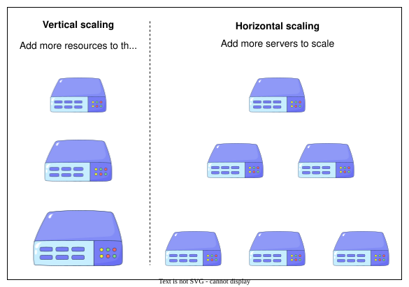

# Distributed_Systems_Considerations_and_Trade-Offs

Source: https://www.educative.io/courses/grokking-the-system-design-interview/distributed-systems-considerations-and-trade-offs

---

[Home](https://www.educative.io/)

[Courses](https://www.educative.io/search?tab=courses)

[Grokking Modern System Design Interview](https://www.educative.io/courses/grokking-the-system-design-interview)

# Distributed Systems Considerations and Trade-Offs

Learn how distributed systems balance trade-offs with the CAP Theorem and PACELC, and explore advanced patterns.

We'll cover the following...

- [What is a distributed system?](https://www.educative.io/courses/grokking-the-system-design-interview/distributed-systems-considerations-and-trade-offs#What-is-a-distributed-system)
  - [Decentralized vs. distributed](https://www.educative.io/courses/grokking-the-system-design-interview/distributed-systems-considerations-and-trade-offs#Decentralized-vs-distributed)
- [Benefits of a distributed system](https://www.educative.io/courses/grokking-the-system-design-interview/distributed-systems-considerations-and-trade-offs#Benefits-of-a-distributed-system)
- [Design issues with distributed systems](https://www.educative.io/courses/grokking-the-system-design-interview/distributed-systems-considerations-and-trade-offs#Design-issues-with-distributed-systems)
  - [Consistency models and the PACELC principle](https://www.educative.io/courses/grokking-the-system-design-interview/distributed-systems-considerations-and-trade-offs#Consistency-models-and-the-PACELC-principle)
- [Cloud vs. distributed systems](https://www.educative.io/courses/grokking-the-system-design-interview/distributed-systems-considerations-and-trade-offs#Cloud-vs-distributed-systems)
  - [Partitioning, replication, and consensus](https://www.educative.io/courses/grokking-the-system-design-interview/distributed-systems-considerations-and-trade-offs#Partitioning-replication-and-consensus)
- [Examples of distributed systems](https://www.educative.io/courses/grokking-the-system-design-interview/distributed-systems-considerations-and-trade-offs#Examples-of-distributed-systems)
  - [Architectural patterns in distributed systems](https://www.educative.io/courses/grokking-the-system-design-interview/distributed-systems-considerations-and-trade-offs#Architectural-patterns-in-distributed-systems)
  - [Observability and recovery in distributed systems](https://www.educative.io/courses/grokking-the-system-design-interview/distributed-systems-considerations-and-trade-offs#Observability-and-recovery-in-distributed-systems)
- [Conclusion](https://www.educative.io/courses/grokking-the-system-design-interview/distributed-systems-considerations-and-trade-offs#Conclusion)

Now that we have a foundational understanding, it’s time to explore the deeper design issues. In this lesson, we will focus on the benefits, trade-offs, and advanced patterns essential for building robust, high-availability, and scalable distributed systems.

## What is a distributed system?[#](https://www.educative.io/courses/grokking-the-system-design-interview/distributed-systems-considerations-and-trade-offs#What-is-a-distributed-system)

At a basic level, a distributed system is a collection of computers that work together to form a single, unified system for the end user.

All these distributed machines share a single state and operate concurrently. They can fail independently without damaging the whole system, much like microservices. These autonomous computers are connected over a network to communicate and exchange data while coordinating their work.

> **Note:** Distributed systems must have a shared network to connect their components, which can be connected using an IP address or physical cables.

Unlike traditional databases, which are stored on a single machine, in a distributed system, a user must be able to communicate with any machine without knowing that it is part of a single system.

Most applications today use some form of a distributed database and must account for their homogeneous or heterogeneous nature. In a homogeneous distributed database, each system shares a common data model and database management system.

Generally, these are easier to manage by adding nodes.

Heterogeneous databases support multiple data models or different database management systems and use gateways to translate data between nodes. Generally, there are three kinds of distributed computing systems with the following goals:

- **Distributed information systems:** distribute information across different servers via multiple communication models
- **Distributed pervasive systems:** use embedded computer devices (i.e., ECG monitors, sensors, mobile devices)
- **Distributed computing systems:** computers in a network communicate via message passing

> **Note:** A crucial aspect of distributed systems is the CAP theorem, which states that a distributed data store cannot simultaneously be consistent, available, and partition-tolerant.

### Decentralized vs. distributed[#](https://www.educative.io/courses/grokking-the-system-design-interview/distributed-systems-considerations-and-trade-offs#Decentralized-vs-distributed)

There is often debate on the difference between decentralized and distributed systems. On a technical level, a decentralized system is a type of distributed system. However, the key difference is usually ownership.

- A distributed system is typically owned and managed by a single entity (like a company) that controls all the nodes.
- A decentralized system is often not owned by a single source. This makes it harder to manage, as no single entity controls all the participants.

## Benefits of a distributed system[#](https://www.educative.io/courses/grokking-the-system-design-interview/distributed-systems-considerations-and-trade-offs#Benefits-of-a-distributed-system)

Distributed systems can be challenging to deploy and maintain; however, they offer numerous benefits. Let’s go over a few of those perks.

- **Scaling:** A distributed system enables us to scale horizontally, allowing us to handle increased traffic.
- **Modular growth:** There is almost no cap on how much we can scale.
- **Fault tolerance:** Distributed systems are more fault-tolerant than a single machine.
- **Cost-effective:** Although the initial cost is higher than that of a traditional system, their scalability makes them quickly become more cost-effective.
- **Low latency:** Users can have a node in multiple locations, allowing traffic to be routed to the closest node.
- **Efficiency:** Distributed systems break complex data into smaller pieces.
- **Parallelism:** Distributed systems can be designed for parallelism, where multiple processors divide up a complex problem into pieces.

Vertical and horizontal scaling of a distributed system

**Scalability** is the biggest benefit of distributed systems. Horizontal scaling means adding more servers to our pool of resources. Vertical scaling means scaling by adding more power (CPU, RAM, Storage, etc.) to our existing servers.

> **Note:** Horizontal scaling is easier to scale dynamically, and vertical scaling is limited to the capacity of a single server.

Good examples of horizontal scaling are Cassandra and MongoDB. They make it easy to scale horizontally by adding more machines. MySQL is a common example used to illustrate vertical scaling, where capacity is increased by moving the workload to a larger machine.

## Design issues with distributed systems[#](https://www.educative.io/courses/grokking-the-system-design-interview/distributed-systems-considerations-and-trade-offs#Design-issues-with-distributed-systems)

While there are many benefits to distributed systems, it’s also important to note the design issues that can arise. We’ve summarized the main design considerations below.

- **Failure Handling:** Failure handling can be particularly challenging in distributed systems, as some components may fail while others continue to operate. This can often serve as an advantage in preventing large-scale failures, but it also leads to increased complexity when it comes to troubleshooting and debugging.
- **Concurrency:** A common issue occurs when several clients attempt to access a shared resource simultaneously. We must ensure that all resources are safe in a concurrent environment.
- **Security issues:** Data security and sharing have increased risks in distributed computer systems. The network must be secured, and users must be able to access replicated data safely across multiple locations.
- **Higher initial infrastructure costs:** The initial deployment cost of a distributed system can be higher than a single system. This pricing includes basic network setup issues, such as transmission errors, high load, and data loss.

Distributed systems are complex to design, deploy, and operate, and in many cases, they add unnecessary overhead. There are many challenges in distributing data to ensure various requirements under unexpected circumstances.

Similarly, bugs are harder to detect in systems that are spread across multiple locations.

### Consistency models and the PACELC principle[#](https://www.educative.io/courses/grokking-the-system-design-interview/distributed-systems-considerations-and-trade-offs#Consistency-models-and-the-PACELC-principle)

The CAP theorem provides an important insight: in the presence of partitions, a system must trade off consistency and availability. But real systems also make trade-offs when partitions are absent. That’s where the PACELC principle comes in:

- **P** = Partition, **A** = Availability, **C** = Consistency
- **E** = Else, **L** = Latency, **C** = Consistency

PACELC states that when there is a partition, a system must choose between availability and consistency, which is the CAP part of the rule.

When there is no partition, the system must still choose between latency and consistency, which is the ELC part. Some systems prefer lower latency and accept weaker consistency even under normal conditions. Others choose strong consistency even in healthy situations and accept slower responses.

Beyond that, consistency models range from strong (linearizable) to eventual consistency, causal consistency, or session guarantees. Picking a model depends on how fresh data must be, whether stale reads are acceptable, and how much coordination overhead we can tolerate.

## Cloud vs. distributed systems[#](https://www.educative.io/courses/grokking-the-system-design-interview/distributed-systems-considerations-and-trade-offs#Cloud-vs-distributed-systems)

Cloud computing and distributed systems are distinct, yet they share similar concepts.

Distributed computing utilizes distributed systems by distributing tasks across multiple machines. Cloud computing, on the other hand, uses network-hosted servers for storage, processing, and data management. Distributed computing aims to create collaborative resource sharing and provide scalability in terms of size and geography.

Cloud computing is about delivering an on-demand environment using transparency, monitoring, and security.

Compared to distributed systems, cloud computing offers these advantages:

- Cost-effective
- Access to a global market
- Encapsulated change management
- Access storage, servers, and databases on the internet

However, cloud computing is arguably less flexible than distributed computing, as we rely on other services and technologies to build a system. This gives us less control overall.

Priorities such as load balancing, replication, auto-scaling, and automated backups can be made easier with cloud computing. Cloud building tools like Docker, AWS, Google Cloud Services, or Azure make it possible to create such systems quickly, and many teams opt to build distributed systems alongside these technologies.

### Partitioning, replication, and consensus[#](https://www.educative.io/courses/grokking-the-system-design-interview/distributed-systems-considerations-and-trade-offs#Partitioning-replication-and-consensus)

To scale and survive failures, distributed systems use partitioning (sharding) and replication:

- **Partitioning / Sharding:** Divide data across nodes to spread load. For example, a user table might be partitioned by user ID modulo the number of shards. When nodes are added or removed, consistent hashing helps us redistribute minimal data.
- **Replication:** Make multiple copies (replicas) to support availability and fault tolerance. We must decide whether replication is synchronous (strong consistency) or asynchronous (eventual consistency).
- **Leader election and consensus:** Systems often need a designated leader (master) to coordinate updates. Algorithms like Raft or Paxos enable nodes to agree on a leader and commit state changes across replicas.
- **Consistency vs. write availability:** Some systems permit a write to succeed if a majority of replicas agree (quorum), trading off strict consistency for availability under certain failures.

Combined, these techniques let distributed systems scale out while tolerating node failures gracefully.

## Examples of distributed systems[#](https://www.educative.io/courses/grokking-the-system-design-interview/distributed-systems-considerations-and-trade-offs#Examples-of-distributed-systems)

Distributed systems are used in a wide range of applications, including electronic banking systems, sensor networks, and multiplayer online games.

Many organizations utilize distributed systems to power content delivery network services. In the healthcare industry, distributed systems are being utilized for storing and accessing data, as well as for telemedicine applications.

In commerce, e-commerce platforms use distributed systems to process online payments. In finance, trading platforms use distributed systems to distribute market data in real time.

Distributed systems are also utilized in various technologies, including GPS, route-finding systems, and traffic management systems, for transportation purposes. Cellular networks are also examples of distributed network systems due to their base station.

Google utilizes a complex, sophisticated distributed system infrastructure for its search capabilities. Some say it is the most complex distributed system currently available.

### Architectural patterns in distributed systems[#](https://www.educative.io/courses/grokking-the-system-design-interview/distributed-systems-considerations-and-trade-offs#Architectural-patterns-in-distributed-systems)

When designing distributed systems, we need more than a definition; we need patterns. Below are common architectural styles.

- **Client-Server model:** A central server responds to client requests. It’s simple and common, but it suffers from a single point of failure unless replicated behind a load balancer.
- **Peer-to-Peer (P2P):** Each node can act as a client and a server. No central authority; useful for file sharing, blockchain networks, or collaborative systems. Nodes communicate directly.
- **Microservices/Service-Oriented:** The system is composed of small, independently deployable services that communicate via APIs or messaging. This pattern is widely used to scale large applications and to allow teams autonomy.
- **Event-Driven / Reactive systems:** Components respond to events asynchronously and propagate changes through message queues or event buses. Provides loose coupling and resilience to failure.
- **Hybrid architectures:** Real systems often blend patterns. For example, a microservices system with an event-driven backbone or peer-to-peer overlay for specific functions.

Each pattern has trade-offs in coupling, latency, consistency, and operational complexity. Choose based on scale, domain needs, and fault model.

### Observability and recovery in distributed systems[#](https://www.educative.io/courses/grokking-the-system-design-interview/distributed-systems-considerations-and-trade-offs#Observability-and-recovery-in-distributed-systems)

Designing distributed systems isn’t just about correctness; it’s about being able to operate, debug, and evolve them.

- **Monitoring and metrics:** Track latency, error rates, throughput, resource usage, replica lag, and partition sizes. Dashboards and alerts should immediately surface anomalies.
- **Tracing and context propagation:** Utilize distributed tracing to follow a request across services (e.g., a request enters node A, is then forwarded to B, and subsequently to C). This helps isolate bottlenecks or failures.
- **Logging and correlation IDs:** Log with unique IDs for each request to enable reconstruction of flows during debugging. Logs should be centralized.
- **Failure injection / Chaos engineering:** Occasionally introduce controlled failures (e.g., node crash, network delay) to test system resilience and verify that failover, retries, and fallback logic work as intended.
- **Graceful degradation and fallbacks:** When a component is temporarily unavailable, degrade its functionality rather than crashing the entire system (e.g., stale but cached data, read-only mode).
- **Recovery strategies:** Incorporate automatic restarts, circuit breakers, bulkheads (isolating failure domains), rolling upgrades, and versioned schemas to enable parts of the cluster to evolve without downtime.

These operational practices separate theoretical systems from production-grade distributed systems.

## Conclusion[#](https://www.educative.io/courses/grokking-the-system-design-interview/distributed-systems-considerations-and-trade-offs#Conclusion)

This lesson examined the main challenges and trade-offs involved in designing distributed systems for production use. We’ve covered the CAP theorem, the PACELC principle, consensus algorithms, and the critical importance of observability.

System Design Primer

Key Concepts to Prepare for the System Design Interview

Ask

[What is a distributed system?](https://www.educative.io/courses/grokking-the-system-design-interview/distributed-systems-considerations-and-trade-offs#What-is-a-distributed-system)

[Decentralized vs. distributed](https://www.educative.io/courses/grokking-the-system-design-interview/distributed-systems-considerations-and-trade-offs#Decentralized-vs-distributed)

[Benefits of a distributed system](https://www.educative.io/courses/grokking-the-system-design-interview/distributed-systems-considerations-and-trade-offs#Benefits-of-a-distributed-system)

[Design issues with distributed systems](https://www.educative.io/courses/grokking-the-system-design-interview/distributed-systems-considerations-and-trade-offs#Design-issues-with-distributed-systems)

[Consistency models and the PACELC principle](https://www.educative.io/courses/grokking-the-system-design-interview/distributed-systems-considerations-and-trade-offs#Consistency-models-and-the-PACELC-principle)

[Cloud vs. distributed systems](https://www.educative.io/courses/grokking-the-system-design-interview/distributed-systems-considerations-and-trade-offs#Cloud-vs-distributed-systems)

[Partitioning, replication, and consensus](https://www.educative.io/courses/grokking-the-system-design-interview/distributed-systems-considerations-and-trade-offs#Partitioning-replication-and-consensus)

[Examples of distributed systems](https://www.educative.io/courses/grokking-the-system-design-interview/distributed-systems-considerations-and-trade-offs#Examples-of-distributed-systems)

[Architectural patterns in distributed systems](https://www.educative.io/courses/grokking-the-system-design-interview/distributed-systems-considerations-and-trade-offs#Architectural-patterns-in-distributed-systems)

[Observability and recovery in distributed systems](https://www.educative.io/courses/grokking-the-system-design-interview/distributed-systems-considerations-and-trade-offs#Observability-and-recovery-in-distributed-systems)

[Conclusion](https://www.educative.io/courses/grokking-the-system-design-interview/distributed-systems-considerations-and-trade-offs#Conclusion)