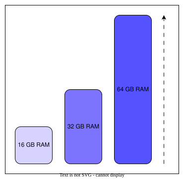

# Scalable_Systems_101

Source: https://www.educative.io/courses/grokking-the-system-design-interview/scalable-systems-101

---

[Home](https://www.educative.io/)

[Courses](https://www.educative.io/search?tab=courses)

[Grokking Modern System Design Interview](https://www.educative.io/courses/grokking-the-system-design-interview)

# Scalable Systems 101

Scalability in software systems is crucial for accommodating growth in users and data without sacrificing performance. It involves architectural decisions and adherence to system design principles, focusing on metrics like latency, bandwidth, and throughput. Two primary scaling mechanisms are vertical scaling, which enhances a single server's resources, and horizontal scaling, which adds more servers to distribute workloads. Effective autoscaling strategies and understanding dimensions of scalability, such as size and load scalability, are essential for maintaining system reliability. Additionally, identifying performance bottlenecks and implementing robust testing and disaster recovery practices ensure systems can handle increased demands efficiently.

We'll cover the following...

- [Scalability](https://www.educative.io/courses/grokking-the-system-design-interview/scalable-systems-101#Scalability)
  - [Latency, bandwidth, and throughput](https://www.educative.io/courses/grokking-the-system-design-interview/scalable-systems-101#Latency-bandwidth-and-throughput)
  - [When scalability is essential](https://www.educative.io/courses/grokking-the-system-design-interview/scalable-systems-101#When-scalability-is-essential)
- [Mechanisms to achieve scalability](https://www.educative.io/courses/grokking-the-system-design-interview/scalable-systems-101#Mechanisms-to-achieve-scalability)
  - [Vertical scaling (scale up)](https://www.educative.io/courses/grokking-the-system-design-interview/scalable-systems-101#Vertical-scaling-scale-up)
  - [Horizontal scaling (scale out)](https://www.educative.io/courses/grokking-the-system-design-interview/scalable-systems-101#Horizontal-scaling-scale-out)
- [Autoscaling best practices](https://www.educative.io/courses/grokking-the-system-design-interview/scalable-systems-101#Autoscaling-best-practices)
- [Dimensions of scalability](https://www.educative.io/courses/grokking-the-system-design-interview/scalable-systems-101#Dimensions-of-scalability)
- [Operating scalable systems with SLOs, SLIs, and tail latency](https://www.educative.io/courses/grokking-the-system-design-interview/scalable-systems-101#Operating-scalable-systems-with-SLOs-SLIs-and-tail-latency)
- [Identifying performance bottlenecks](https://www.educative.io/courses/grokking-the-system-design-interview/scalable-systems-101#Identifying-performance-bottlenecks)
  - [Monolithic databases](https://www.educative.io/courses/grokking-the-system-design-interview/scalable-systems-101#Monolithic-databases)
  - [Database selection](https://www.educative.io/courses/grokking-the-system-design-interview/scalable-systems-101#Database-selection)
  - [Consistency](https://www.educative.io/courses/grokking-the-system-design-interview/scalable-systems-101#Consistency)
  - [Architecture](https://www.educative.io/courses/grokking-the-system-design-interview/scalable-systems-101#Architecture)
  - [Caching](https://www.educative.io/courses/grokking-the-system-design-interview/scalable-systems-101#Caching)
  - [Traffic management](https://www.educative.io/courses/grokking-the-system-design-interview/scalable-systems-101#Traffic-management)
  - [Load distribution](https://www.educative.io/courses/grokking-the-system-design-interview/scalable-systems-101#Load-distribution)
  - [Code and algorithms](https://www.educative.io/courses/grokking-the-system-design-interview/scalable-systems-101#Code-and-algorithms)
- [Capacity planning and cost efficiency](https://www.educative.io/courses/grokking-the-system-design-interview/scalable-systems-101#Capacity-planning-and-cost-efficiency)
- [Testing performance and scalability](https://www.educative.io/courses/grokking-the-system-design-interview/scalable-systems-101#Testing-performance-and-scalability)
- [Resilience and disaster recovery](https://www.educative.io/courses/grokking-the-system-design-interview/scalable-systems-101#Resilience-and-disaster-recovery)
- [Conclusion](https://www.educative.io/courses/grokking-the-system-design-interview/scalable-systems-101#Conclusion)

As software systems grow in users and data, designing applications that can scale efficiently becomes a critical consideration.

Achieving scalability requires deliberate architectural choices and adherence to proven System Design principles, enabling applications to grow smoothly over time while maintaining performance, reliability, and operational manageability.

This lesson covers scalability principles, implementation patterns, evaluation metrics, and the operational practices required to maintain scalability in production. Understanding these concepts enables engineers to design systems that adapt to increasing workloads while minimizing latency and maintaining a seamless user experience.

## Scalability[#](https://www.educative.io/courses/grokking-the-system-design-interview/scalable-systems-101#Scalability)

Scalability refers to a system, network, or process's ability to accommodate increasing workloads, user requests, or data without a decline in performance or functionality. A system is scalable if it can sustain higher traffic or workload levels while maintaining expected performance and service behavior. Without proper scalability considerations, software systems can quickly become bottlenecked, resulting in slow response times, system outages, and a degraded user experience.

Before exploring the mechanisms for achieving scalability, it is important to understand the performance metrics that influence it. Latency, bandwidth, and throughput are three primary metrics that play a central role in evaluating system performance and scalability.

### Latency, bandwidth, and throughput[#](https://www.educative.io/courses/grokking-the-system-design-interview/scalable-systems-101#Latency-bandwidth-and-throughput)

**Latency** measures the time required for a system to respond to a request. It is influenced by multiple factors across both the network and application layers. Network latency is the time it takes a packet to move across the network. Application latency is the time the application takes to process the request. Reducing latency is essential for maintaining responsiveness, and it can be achieved through strategies such as utilizing content delivery networks (CDNs), which deploy servers closer to end-users at edge locations. Stress testing and load testing help identify application bottlenecks that increase latency.

While latency focuses on delay, **bandwidth** represents the maximum capacity of a network or computing system to transfer data over a specific period. A system with limited bandwidth may experience congestion when the volume of data exceeds its available capacity, resulting in slower data transmission and reduced performance.

Building on these two concepts, **throughput** measures how much data is successfully transmitted or processed by the system within a given time frame. Throughput depends on both latency and bandwidth, serving as a practical indicator of the system’s overall efficiency and ability to handle workload demands.

**Analogy:** A useful way to visualize the relationship among these metrics is to imagine data packets as vehicles traveling on a highway. In this analogy, latency is the time one vehicle takes to reach its destination, bandwidth is the number of lanes available, and throughput is the number of vehicles that successfully pass through the road over a given period. This analogy highlights how latency, bandwidth, and throughput interact to determine overall system performance.

### When scalability is essential[#](https://www.educative.io/courses/grokking-the-system-design-interview/scalable-systems-101#When-scalability-is-essential)

Not all systems require extensive scalability.

Applications with a small or predictable workload may operate effectively without special design considerations for growth. However, for enterprise systems, online services, or any application with rapidly expanding user bases, scalability is a critical requirement.

In these contexts, even slight increases in latency can result in significant losses in revenue or user satisfaction.

High scalability ensures that the system can support growth in traffic and data volume without a corresponding decline in performance, availability, or operational efficiency. Before designing a scalable system, engineers should evaluate projected growth in users and data.

They must consider whether the system will be able to accommodate anticipated increases over multiple years without significant redesign or resource over-provisioning.

Once the need for scalability is established, the next step is to explore the methods by which systems can accommodate increased load. Understanding the available mechanisms and their trade-offs enables engineers to design architectures that efficiently support growth while maintaining performance and reliability.

## Mechanisms to achieve scalability[#](https://www.educative.io/courses/grokking-the-system-design-interview/scalable-systems-101#Mechanisms-to-achieve-scalability)

There are two primary mechanisms to achieve scalability in software systems: vertical scaling and horizontal scaling. Each approach has distinct characteristics, advantages, and limitations that must be considered in System Design.

### Vertical scaling (scale up)[#](https://www.educative.io/courses/grokking-the-system-design-interview/scalable-systems-101#Vertical-scaling-scale-up)

Vertical scaling involves adding resources such as CPU, memory, or network bandwidth to an existing server or node to handle increased demand.

In practice, vertical scaling is straightforward and requires enhancing the capacity of a single machine rather than restructuring the entire system. This can help the system handle more load without major changes to the application or the operational overhead of coordinating multiple nodes.

While vertical scaling can be effective for moderate increases in load, it has inherent limitations.

Hardware upgrades are finite, expensive, and eventually impractical for very large workloads. For instance, a server with 16 GB of RAM may be upgraded to 32 GB to accommodate increased demand, but further upgrades may be physically or financially infeasible.

At that point, additional servers or nodes must be introduced to maintain performance.

Vertical scaling

The table below highlights the key benefits and constraints associated with vertical scaling.

|  |  |
| --- | --- |
| **Advantages** | **Limitations** |
| - Simple to implement administratively and in software - No complex middleware required - Existing application logic often remains unchanged | - Physical and technological constraints limit indefinite scaling - High cost for state-of-the-art hardware |

### Horizontal scaling (scale out)[#](https://www.educative.io/courses/grokking-the-system-design-interview/scalable-systems-101#Horizontal-scaling-scale-out)

Horizontal scaling involves increasing system capacity by adding more nodes of comparable hardware.

This approach distributes workloads across multiple servers or data centers, enhancing both performance and fault tolerance. Horizontal scaling offers several practical advantages, particularly in cloud computing environments.

It allows systems to scale dynamically in response to fluctuating workloads and reduces dependency on a single, high-capacity server. However, horizontal scaling introduces challenges such as maintaining fault tolerance and implementing middleware to coordinate nodes and distribute workloads efficiently.

The table below illustrates the benefits and potential challenges associated with scaling out systems horizontally.

|  |  |
| --- | --- |
| **Advantages** | **Limitations** |
| - Cost-effective and resilient - Supports dynamic scaling based on workload - Improves fault tolerance and availability | - Increased points of potential failure - Middleware complexity for coordination |

Horizontal scaling also enables dynamic scaling, which allows systems to automatically add or remove nodes in response to real-time demand.

This feature balances resource utilization against system performance without requiring significant manual intervention. To maximize these capabilities, organizations should implement effective autoscaling strategies that ensure resources are allocated efficiently and that system performance remains consistent under varying workloads.

The next section outlines key best practices for implementing autoscaling effectively.

## Autoscaling best practices[#](https://www.educative.io/courses/grokking-the-system-design-interview/scalable-systems-101#Autoscaling-best-practices)

Autoscaling enables systems to adjust capacity automatically based on real-time metrics such as CPU usage, request rates, or queue lengths. By defining appropriate scaling policies and thresholds, organizations can maintain optimal performance while avoiding unnecessary resource consumption.

Below is an overview of the primary methods for autoscaling:

- **Queue-depth-based scaling:** Adjusts worker nodes based on queue wait times to maintain service-level objectives.
- **Request-rate and latency-based scaling:** Modifies application server counts based on requests per second metrics and high-percentile latency (P95) to efficiently handle traffic spikes.
- **Scheduled scaling:** Provision resources in advance to anticipate predictable traffic surges, such as product launches or market openings. Pre-warmed pools or provisioned concurrency can reduce latency for critical operations.
- **Step scaling:** Increases resources incrementally rather than aggressively to avoid oscillation in performance and resource allocation.

It is essential to define minimum and maximum limits for replicas and to test autoscaling under failure scenarios, such as resource quota constraints or regional outages.

These measures help ensure system stability and reliability. Beyond automated scaling, evaluating a system across multiple dimensions provides a more complete understanding of its growth potential and operational efficiency under varying workloads.

## Dimensions of scalability[#](https://www.educative.io/courses/grokking-the-system-design-interview/scalable-systems-101#Dimensions-of-scalability)

Scalability can be evaluated across multiple dimensions, each representing a critical aspect of system growth and operational efficiency. Proper assessment of these dimensions allows engineers to understand the trade-offs and requirements for maintaining performance under increasing loads.

The dimensions include the following:

- **Size scalability:** Evaluates whether the system maintains or improves performance as additional resources are introduced. Adding nodes to a size-scalable system should not degrade performance.
- **Administrative scalability:** Measures the operational effort required to manage a growing system. Ideally, administrative overhead should increase minimally as new nodes are added.
- **Geographical scalability:** Considers the impact of physical distance between nodes on system performance, particularly communication latency in distributed operations.
- **Load scalability:** Assesses the system’s ability to handle variable workloads flexibly, including the addition, removal, or modification of components without performance degradation.
- **Functional scalability:** Evaluates whether new features or functionality can be integrated without disrupting existing operations or slowing performance.

Understanding the dimensions of scalability is essential, but ensuring that a system remains reliable under growing load requires clear performance targets. The next section discusses how SLOs, SLIs, and tail latency can be utilized to effectively operate scalable systems.

## Operating scalable systems with SLOs, SLIs, and tail latency[#](https://www.educative.io/courses/grokking-the-system-design-interview/scalable-systems-101#Operating-scalable-systems-with-SLOs-SLIs-and-tail-latency)

Scalability must be coupled with reliability to ensure a positive user experience.

To achieve this, systems should define service-level objectives (SLOs) that specify performance targets, such as maintaining 99.9% of requests under 300 ms and keeping error rates below 0.1%. To measure compliance with these SLOs, systems rely on service-level indicators (SLIs), including request latency, system availability, and resource saturation (CPU, memory, queue depth).

Monitoring tail latency, such as high-percentile response times like P95 or P99, is particularly important because outlier requests can disproportionately affect user experience.

Linking SLOs to error budgets helps teams decide whether to prioritize feature releases or invest in reliability improvements. Additionally, distributed tracing across services provides visibility into component interactions, which are often the points of failure in scalable systems.

While defining SLOs and monitoring SLIs ensures that a system meets its performance and reliability targets, it is equally important to detect and address the underlying issues that can prevent those targets from being achieved.

The next section examines common performance bottlenecks and strategies for mitigating them.

## Identifying performance bottlenecks[#](https://www.educative.io/courses/grokking-the-system-design-interview/scalable-systems-101#Identifying-performance-bottlenecks)

Even well-designed systems can encounter performance bottlenecks that compromise scalability. Identifying these issues early allows engineers to apply appropriate mitigation strategies and maintain system efficiency.

Bottlenecks may arise due to limitations in database architecture, System Design, caching strategies, or resource utilization. The following subsections explore common sources of bottlenecks and methods for addressing them.

### Monolithic databases[#](https://www.educative.io/courses/grokking-the-system-design-interview/scalable-systems-101#Monolithic-databases)

A frequent bottleneck occurs when a single database handles all data requests for a system.

Even when application nodes scale horizontally, a monolithic database may become the limiting factor because it can only handle a finite number of concurrent requests. To address this issue, engineers use database partitioning and sharding.

Partitioning divides a large database into smaller, more manageable segments, often based on attributes such as geographic region, company branch, or other logical criteria.

These segments, known as shards, each process requests independently, which reduces latency and improves throughput. For instance, a global employee database with 500,000 entries can be partitioned by continent to accelerate queries and reduce load on individual nodes.

### Database selection[#](https://www.educative.io/courses/grokking-the-system-design-interview/scalable-systems-101#Database-selection)

The type of database chosen also affects system performance. Relational databases provide strong consistency and transactional guarantees, but may limit horizontal scalability.

NoSQL databases offer flexible, distributed storage with eventual consistency, enhancing throughput under heavy loads. Evaluating trade-offs between database types early helps prevent performance degradation as demand grows.

### Consistency[#](https://www.educative.io/courses/grokking-the-system-design-interview/scalable-systems-101#Consistency)

In distributed systems, enforcing strong consistency across nodes can increase latency and reduce throughput under high load. Common challenges include:

- **Contention on hot partitions:** Multiple operations targeting the same data shard slow processing.
- **Dual-write coordination:** Writing to multiple systems simultaneously introduces delays.
- **Synchronous multi-service workflows:** Immediate consistency requirements increase response times.

Mitigation strategies include idempotent APIs, asynchronous messaging with outbox and inbox patterns, sagas for multi-service workflows, repartitioning or sharding to reduce hot partitions, and CQRS for read-heavy workloads. These approaches improve performance while maintaining acceptable consistency.

### Architecture[#](https://www.educative.io/courses/grokking-the-system-design-interview/scalable-systems-101#Architecture)

System Design can limit scalability when independent operations are executed sequentially, increasing response times and reducing concurrency.

Designing asynchronous workflows and parallelizing independent operations allows the system to handle multiple requests simultaneously, reducing latency and improving throughput. Architectural reviews, performance modeling, and stress testing help identify potential limitations before they affect users.

### Caching[#](https://www.educative.io/courses/grokking-the-system-design-interview/scalable-systems-101#Caching)

Ineffective caching can overload origin servers, slowing system performance.

Caches intercept frequent database requests, allowing servers to focus on other tasks. Edge caches, such as CDNs, keep static assets closer to end users, which reduces network round-trip latency. Strategic caching of high-demand content in memory or at the edge improves throughput and reduces latency under heavy load.

### Traffic management[#](https://www.educative.io/courses/grokking-the-system-design-interview/scalable-systems-101#Traffic-management)

Burst traffic patterns can create significant performance bottlenecks, overwhelming system resources and increasing latency. To prevent these bottlenecks and maintain responsiveness, engineers can apply workload shaping strategies:

- **Durable queues:** Buffer requests between producers and consumers to prevent sudden spikes from overloading services.
- **Backpressure:** Signals upstream services to reduce request rates when downstream resources are saturated, avoiding cascading slowdowns.
- **Rate limiting:** Controls the number of requests each client can make, ensuring fair resource allocation and preventing any single client from creating a bottleneck.
- **Bulkheads:** Isolate critical resources or services so that failures or high load in one area do not affect the entire system.
- **Circuit breakers:** Detect repeated failures and temporarily halt problematic operations, allowing the system to recover without widespread performance degradation.

### Load distribution[#](https://www.educative.io/courses/grokking-the-system-design-interview/scalable-systems-101#Load-distribution)

Uneven traffic can overload individual servers, leading to increased latency and reduced throughput. Load balancing helps prevent these performance issues by distributing incoming requests across multiple servers using algorithms such as:

- **Least response time:** Sends requests to the server with the shortest current response time to optimize processing.
- **Round robin:** Cycles sequentially through servers to spread load evenly.
- **IP hash:** Assigns requests to servers based on client IP addresses to maintain session consistency.

In addition to balancing traffic, load balancers enhance fault tolerance by rerouting requests when servers fail and can utilize predictive analytics to anticipate and mitigate potential performance slowdowns.

### Code and algorithms[#](https://www.educative.io/courses/grokking-the-system-design-interview/scalable-systems-101#Code-and-algorithms)

Poorly written or tightly coupled code can hinder scalability. Nested loops, complex logic, or dependencies between components increase processing time and complicate testing or refactoring. Designing loosely coupled components improves modularity, enables teams to work independently, and makes the system easier to scale.

Algorithmic efficiency, evaluated using Big O notation, ensures that both time and space complexity remain manageable as system workloads increase.

Understanding and addressing performance limitations across databases, architecture, caching, traffic, load distribution, and code is critical before planning for capacity. Once these factors are under control, engineers can make informed decisions about resource allocation and cost efficiency, ensuring the system scales effectively without overspending.

## Capacity planning and cost efficiency[#](https://www.educative.io/courses/grokking-the-system-design-interview/scalable-systems-101#Capacity-planning-and-cost-efficiency)

Effective capacity planning strikes a balance between performance, resource utilization, and operational costs. Key practices include:

- **Applying Little’s Law (L = λW):** Understanding the relationship between concurrency, arrival rate, and wait time helps estimate resource requirements.
- **Monitoring utilization:** Maintaining CPU, memory, and other resources at optimal levels (often 50–70%) preserves headroom for spikes.
- **Cost-to-serve analysis:** Ensuring systems scale costs sub-linearly with traffic using techniques such as rightsizing, autoscaling to zero, and leveraging spot or preemptible resources for non-critical workloads.
- **Tenant isolation:** In multi-tenant systems, applying per-tenant quotas and rate limits prevents noisy-neighbor issues.

With capacity and resource strategies in place, it is important to validate their effectiveness in real-world conditions. Practical testing provides insight into how the system behaves under varying loads, ensuring that planned optimizations support both performance and scalability goals.

## Testing performance and scalability[#](https://www.educative.io/courses/grokking-the-system-design-interview/scalable-systems-101#Testing-performance-and-scalability)

Testing is crucial to ensure that systems meet their performance and scalability requirements. Two complementary areas of testing exist: performance testing and scalability testing.

Performance testing evaluates how the application handles typical and peak loads, identifying areas for optimization. Key approaches include:

- **Profiling the application:** Dynamic code analysis detects memory leaks, concurrency errors, and inefficient algorithms. Tools for profiling include application-specific profilers and industry-standard performance analysis software.
- **Using CDNs:** Reduces latency by caching data closer to end users.
- **Data compression:** Decreases bandwidth usage and accelerates data transfer.

Scalability testing evaluates the system’s ability to handle growth in traffic, data, or workload.

Parameters to consider include CPU utilization, memory usage, network bandwidth, throughput, latency, and user experience under high load. Stress tests and load tests simulate heavy traffic to identify bottlenecks and validate that scaling strategies work effectively.

Beyond verifying performance and scalability, it is also critical to ensure that the system can withstand failures and recover gracefully. Validating resilience and disaster recovery capabilities ensures that growth and high performance do not come at the cost of reliability.

## Resilience and disaster recovery[#](https://www.educative.io/courses/grokking-the-system-design-interview/scalable-systems-101#Resilience-and-disaster-recovery)

A scalable system must also be resilient to failures.

Chaos testing involves intentionally introducing failures, such as terminating processes or severing network links, to validate system robustness. Disaster recovery rehearsals test the ability to restore services from backups or perform regional failover while monitoring recovery time objectives (RTO) and recovery point objectives (RPO) against defined SLOs.

Documentation, automated health checks, and dependency monitoring ensure regressions are identified and mitigated early. Regular testing and continuous improvement help systems maintain both scalability and reliability over time.

## Conclusion[#](https://www.educative.io/courses/grokking-the-system-design-interview/scalable-systems-101#Conclusion)

Scalability is a fundamental attribute of modern software systems.

It requires careful architectural planning, thoughtful choice of infrastructure and databases, efficient code design, and operational practices that maintain performance under growth. Engineers who understand vertical and horizontal scaling, autoscaling, bottlenecks, testing, and resilience can design systems that handle higher workloads without reducing reliability or degrading the user experience.

These principles form the foundation for designing systems that adapt and persist effectively as demands evolve.

Key Concepts to Prepare for the System Design Interview

Best Practices for Achieving Low Latency in System Design

Ask

[Scalability](https://www.educative.io/courses/grokking-the-system-design-interview/scalable-systems-101#Scalability)

[Latency, bandwidth, and throughput](https://www.educative.io/courses/grokking-the-system-design-interview/scalable-systems-101#Latency-bandwidth-and-throughput)

[When scalability is essential](https://www.educative.io/courses/grokking-the-system-design-interview/scalable-systems-101#When-scalability-is-essential)

[Mechanisms to achieve scalability](https://www.educative.io/courses/grokking-the-system-design-interview/scalable-systems-101#Mechanisms-to-achieve-scalability)

[Vertical scaling (scale up)](https://www.educative.io/courses/grokking-the-system-design-interview/scalable-systems-101#Vertical-scaling-scale-up)

[Horizontal scaling (scale out)](https://www.educative.io/courses/grokking-the-system-design-interview/scalable-systems-101#Horizontal-scaling-scale-out)

[Autoscaling best practices](https://www.educative.io/courses/grokking-the-system-design-interview/scalable-systems-101#Autoscaling-best-practices)

[Dimensions of scalability](https://www.educative.io/courses/grokking-the-system-design-interview/scalable-systems-101#Dimensions-of-scalability)

[Operating scalable systems with SLOs, SLIs, and tail latency](https://www.educative.io/courses/grokking-the-system-design-interview/scalable-systems-101#Operating-scalable-systems-with-SLOs-SLIs-and-tail-latency)

[Identifying performance bottlenecks](https://www.educative.io/courses/grokking-the-system-design-interview/scalable-systems-101#Identifying-performance-bottlenecks)

[Monolithic databases](https://www.educative.io/courses/grokking-the-system-design-interview/scalable-systems-101#Monolithic-databases)

[Database selection](https://www.educative.io/courses/grokking-the-system-design-interview/scalable-systems-101#Database-selection)

[Consistency](https://www.educative.io/courses/grokking-the-system-design-interview/scalable-systems-101#Consistency)

[Architecture](https://www.educative.io/courses/grokking-the-system-design-interview/scalable-systems-101#Architecture)

[Caching](https://www.educative.io/courses/grokking-the-system-design-interview/scalable-systems-101#Caching)

[Traffic management](https://www.educative.io/courses/grokking-the-system-design-interview/scalable-systems-101#Traffic-management)

[Load distribution](https://www.educative.io/courses/grokking-the-system-design-interview/scalable-systems-101#Load-distribution)

[Code and algorithms](https://www.educative.io/courses/grokking-the-system-design-interview/scalable-systems-101#Code-and-algorithms)

[Capacity planning and cost efficiency](https://www.educative.io/courses/grokking-the-system-design-interview/scalable-systems-101#Capacity-planning-and-cost-efficiency)

[Testing performance and scalability](https://www.educative.io/courses/grokking-the-system-design-interview/scalable-systems-101#Testing-performance-and-scalability)

[Resilience and disaster recovery](https://www.educative.io/courses/grokking-the-system-design-interview/scalable-systems-101#Resilience-and-disaster-recovery)

[Conclusion](https://www.educative.io/courses/grokking-the-system-design-interview/scalable-systems-101#Conclusion)