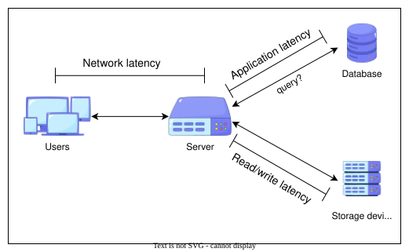

# Best_Practices_for_Achieving_Low_Latency_in_System_Design

Source: https://www.educative.io/courses/grokking-the-system-design-interview/best-practices-for-achieving-low-latency-in-system-design

---

[Home](https://www.educative.io/)

[Courses](https://www.educative.io/search?tab=courses)

[Grokking Modern System Design Interview](https://www.educative.io/courses/grokking-the-system-design-interview)

# Best Practices for Achieving Low Latency in System Design

Achieving low latency in system design is crucial for enhancing user experience, as even minor delays can significantly impact engagement and conversion rates. Key strategies include optimizing system architecture through microservices, efficient data management with appropriate database choices, minimizing network hops, and employing effective caching strategies. Additionally, code optimization, hardware selection, and real-time monitoring are essential for maintaining performance. By focusing on these principles, software engineers can create responsive applications that meet user expectations and reduce latency effectively.

We'll cover the following...

- [Understanding latency](https://www.educative.io/courses/grokking-the-system-design-interview/best-practices-for-achieving-low-latency-in-system-design#Understanding-latency)
  - [Does latency matter to users?](https://www.educative.io/courses/grokking-the-system-design-interview/best-practices-for-achieving-low-latency-in-system-design#Does-latency-matter-to-users)
  - [How to determine the threshold of latency?](https://www.educative.io/courses/grokking-the-system-design-interview/best-practices-for-achieving-low-latency-in-system-design#How-to-determine-the-threshold-of-latency)
- [Key principles of low-latency systems](https://www.educative.io/courses/grokking-the-system-design-interview/best-practices-for-achieving-low-latency-in-system-design#Key-principles-of-low-latency-systems)
- [7 best practices to achieve low latency](https://www.educative.io/courses/grokking-the-system-design-interview/best-practices-for-achieving-low-latency-in-system-design#7-best-practices-to-achieve-low-latency)
  - [1. System architecture](https://www.educative.io/courses/grokking-the-system-design-interview/best-practices-for-achieving-low-latency-in-system-design#1-System-architecture)
  - [2. Data management and optimization](https://www.educative.io/courses/grokking-the-system-design-interview/best-practices-for-achieving-low-latency-in-system-design#2-Data-management-and-optimization)
  - [3. Network design](https://www.educative.io/courses/grokking-the-system-design-interview/best-practices-for-achieving-low-latency-in-system-design#3-Network-design)
  - [4. Communication protocols](https://www.educative.io/courses/grokking-the-system-design-interview/best-practices-for-achieving-low-latency-in-system-design#4-Communication-protocols)
  - [5. Code optimization](https://www.educative.io/courses/grokking-the-system-design-interview/best-practices-for-achieving-low-latency-in-system-design#5-Code-optimization)
  - [6. Hardware and infrastructure](https://www.educative.io/courses/grokking-the-system-design-interview/best-practices-for-achieving-low-latency-in-system-design#6-Hardware-and-infrastructure)
  - [7. Effective caching strategies](https://www.educative.io/courses/grokking-the-system-design-interview/best-practices-for-achieving-low-latency-in-system-design#7-Effective-caching-strategies)
- [How Meta achieved low latency](https://www.educative.io/courses/grokking-the-system-design-interview/best-practices-for-achieving-low-latency-in-system-design#How-Meta-achieved-low-latency)
  - [How it works](https://www.educative.io/courses/grokking-the-system-design-interview/best-practices-for-achieving-low-latency-in-system-design#How-it-works)
    - [Outcome](https://www.educative.io/courses/grokking-the-system-design-interview/best-practices-for-achieving-low-latency-in-system-design#Outcome)
- [Designing for low latency](https://www.educative.io/courses/grokking-the-system-design-interview/best-practices-for-achieving-low-latency-in-system-design#Designing-for-low-latency)

In System Design, latency refers to the delay between a request and the system’s response.

As software engineers, we all know that latency can make or break user experience; every millisecond matters. It’s a rigorous struggle that requires constant innovation and optimization. A solid understanding of low-latency system design is also useful in system design interviews, including interviews at large engineering companies.

Let’s explore some of the best practices for achieving low latency in systems, drawing from both personal experiences and industry-proven techniques.

## Understanding latency[#](https://www.educative.io/courses/grokking-the-system-design-interview/best-practices-for-achieving-low-latency-in-system-design#Understanding-latency)

We usually measure it in units of time, such as milliseconds (ms), and have the following main types to consider:

- **Network latency:** The time a data packet takes to travel in a network from source to destination. It includes transmission, propagation, node processing, and queueing delays.
- **Application latency:** The delay at the application server, including processing time, querying the database, time to perform any other computational tasks, etc.
- **Read or write latency:** The delay in reading or writing data from or to storage devices such as disk or memory. It includes data seek time and transfer time.

The depiction of different types of latency

When we talk about latency, we’re focusing on these questions:

How quickly is the system acting on requests and sending responses back?  
The answer is as quickly as possible.

How does the increasing number of requests affect the latency of the system?

The answer is that it shouldn’t affect the latency at all.

We must ensure that the latency remains as minimal as possible to avoid high user bounce rates. First, let’s provide an overview from the users’ perspective: Does latency matter to users?

### Does latency matter to users?[#](https://www.educative.io/courses/grokking-the-system-design-interview/best-practices-for-achieving-low-latency-in-system-design#Does-latency-matter-to-users)

Google conducted an experiment that found a 200 ms delay in providing searched pages resulted in 0.22% fewer searches by users in the first three weeks and 0.36% fewer searches in the second three weeks.

For a 400 ms delay in search results, searches were reduced by 0.44% in the first three weeks and 0.76% during the second three weeks. A 500 ms delay resulted in a 20% drop in traffic. In similar experiments, Walmart’s conversion rate improved by 2% for every one-second improvement in the page load time. And it costs Amazon 1% of sales for every 100 milliseconds of delay in page load time.

Even after resolving the latency issues, winning back users’ trust and engagement takes time and effort. For this, we, as software engineers, should focus on designing low-latency systems during the initial phase, based on specific threshold values for various applications.

### How to determine the threshold of latency?[#](https://www.educative.io/courses/grokking-the-system-design-interview/best-practices-for-achieving-low-latency-in-system-design#How-to-determine-the-threshold-of-latency)

The faster a web page loads, the higher the chances of conversion. This means a user is highly likely to perform the intended operation if a targeted page loads quickly.

- A load time of 2.4 seconds yields a 1.9% conversion rate.
- A load time of 3.3 seconds yields a 1.5% conversion rate.
- A load time of 4.2 seconds yields a <1% conversion rate.
- A load time of 5.7+ seconds yields a <0.6% conversion rate.

According to studies, 47% of customers expect a page load time of less than 2 seconds. So, the conversion rate is the first threshold to consider.

The appropriate response time varies depending on the specific use case. Generally, a system is considered efficient if its average response time is between 0.1 and 1 seconds. Additionally, an average response time of 100 ms is effective for real-time applications, such as gaming, chatting, and live streaming.

Reduced website or application traffic due to high latency is a significant problem.

As software engineers, we know that latency doesn’t focus solely on speed; it’s about delivering a smooth, responsive experience. To reduce latency, apply practical engineering practices that improve response times and remove unnecessary bottlenecks.

Let’s dive into the key principles of low-latency systems to keep in mind when developing techniques to lower latency.

## Key principles of low-latency systems[#](https://www.educative.io/courses/grokking-the-system-design-interview/best-practices-for-achieving-low-latency-in-system-design#Key-principles-of-low-latency-systems)

The following principles summarize widely accepted best practices and methodologies for designing low-latency systems.

**1. Minimize data processing time:** Reducing data processing time involves optimizing how information flows through a system to enable faster computation and quicker responses. Common techniques include:

- Using efficient algorithms and data structures.
- Leveraging parallel or distributed processing.
- Optimizing data storage and retrieval paths to reduce overhead.

**2. Reduce network round-trip times:** Lowering network latency focuses on decreasing the time it takes for data to travel between components or services. Effective strategies include:

- Minimizing the number of network calls and hops.
- Using efficient, compact communication protocols.
- Employing event-driven architectures to eliminate unnecessary polling and improve responsiveness.

**3. Manage resources efficiently:**Efficient resource management ensures that CPU, memory, storage, and network bandwidth are allocated and used effectively. Techniques include:

- Applying load balancing to distribute system load.
- Partitioning data across nodes (sharding) to improve throughput.
- Implementing caching layers to reduce redundant computations and external calls.

By now, we’ve established that latency is a critical factor in system performance. As software engineers, we should intentionally design solutions that minimize latency. By understanding and applying these principles, we can build systems that are more responsive, scalable, and reliable.

Ready? Let’s dive into the strategies that will help us achieve lower latency and more responsive applications!

## 7 best practices to achieve low latency[#](https://www.educative.io/courses/grokking-the-system-design-interview/best-practices-for-achieving-low-latency-in-system-design#7-best-practices-to-achieve-low-latency)

### 1. System architecture[#](https://www.educative.io/courses/grokking-the-system-design-interview/best-practices-for-achieving-low-latency-in-system-design#1-System-architecture)

Achieving low latency in System Design requires careful consideration of the system architecture. Imagine you’re building a pizza shop in a city with two architectural choices.

The first one is like operating from a single, centralized location. It’s straightforward to manage, but as demand grows, you face delays in your operations while delivering pizzas to your customers; that’s the problem with monolithic architecture.

The second option is to set up distributed pizza shop branches across the city, delivering to the nearest locations and operating independently to manage the operations; that’s microservice architecture.

We need to make a critical decision between monolithic and microservice architecture. Monolithic applications tend to have higher latency due to the strong interdependencies of components. Microservices tend to have lower latency because they are designed with modular, independent components that can scale and respond more efficiently to requests.

In today’s software landscape, monolithic architecture is no longer suitable for complex applications and is rapidly fading away.

A depiction of monolithic and microservice architecture

Event-driven architecture is an approach that centers around events for data and applications.

It enables applications to act or react to those events. A client receives the data whenever an event is triggered in the application, without needing to request it from the server. This approach helps eliminate the problems of short and long polling and reduces the round-trip time, as data now only has to travel one way.

As you can see, the data must travel one way, and whenever an event occurs, this cuts the round-trip time in half, thereby lowering the latency.

Moreover, asynchronous communication is another factor that helps to reduce latency. It benefits applications that require real-time updates or processing, such as trading platforms, gaming servers, and real-time analytics systems.

A simple request-response and an event-driven architecture

### 2. Data management and optimization[#](https://www.educative.io/courses/grokking-the-system-design-interview/best-practices-for-achieving-low-latency-in-system-design#2-Data-management-and-optimization)

Efficient database management and data access are critical for low latency:

- We must select the appropriate database based on the nature of the data to be processed. SQL databases are excellent choices for storing structured data and handling complex queries, such as those involving customer information, orders, and product details. NoSQL databases are well-suited for achieving faster performance and flexible data models, particularly in applications such as social media posts, user comments, and real-time analytics.
- After choosing the right database, we should optimize data retrieval. First, we can index our data and optimize queries to reduce execution time. Second, we can shard and replicate the database, enabling the system to scale and retrieve data quickly.

  - **Sharding:** Splitting data across multiple databases or servers to distribute the load reduces latency by allowing parallel data access and processing.
  - **Replication:** Creating copies of data across multiple servers to ensure high availability and faster access, thereby reducing latency by serving queries from the closest or least loaded replica.

Database sharding and replication

- We can also utilize in-memory databases, such as Redis or Memcached, as a distributed cache to store frequently accessed data and reduce disk access times.

### 3. Network design[#](https://www.educative.io/courses/grokking-the-system-design-interview/best-practices-for-achieving-low-latency-in-system-design#3-Network-design)

Network design also plays a vital role in minimizing network latency:

- **Minimizing network hops:** The fewer stops (network hops) data has to make, the faster it reaches its destination. Think of it like a direct flight vs. a flight with multiple layovers. This is possible through peering agreements, optimizing routing protocols, establishing private network links, and other methods. For example, a trading company can establish a direct connection between its data centers in different cities, providing users with a competitive edge by reducing latency.
- **Content delivery network (CDN):** CDNs bring content closer to users, which speeds up data delivery. For example, a user in New York accessing a website hosted in California would experience lower latency if the content is served from a CDN node in New York.

  - **Geographical distribution:** Place CDN servers in different regions so that content is always served from a nearby location. For example, Netflix distributes videos to different geographical locations to minimize latency.
  - **Edge caching:** Store frequently accessed content at the edge of the network, where users are located.
  - **Dynamic content acceleration:** Use CDNs that speed up the delivery of dynamic (changing) content by optimizing how quickly data is fetched and delivered.
- **Load balancer:** A load balancer is a component that distributes the load evenly across available servers to prevent overloading a single server and ensure optimal performance. When the load is balanced, services are available to quickly handle new requests, reducing wait time to execute or process, and thereby lowering latency. We can opt for the following to balance the load:

  - **Round-robin load balancing:** It rotates requests among different servers in a balanced way. For example, if you have four servers, the first request is sent to server A, the second to server B, and so on, with the cycle continuing from A to D.
  - **Application load balancers:** These are advanced load balancers that can make intelligent decisions based on server load and send requests accordingly. For example, the AWS Elastic Load Balancer (ELB) can distribute incoming requests to the servers that are least busy.
  - **Geographic load balancing:** It directs users to the server closest to them, reducing data transmission time. For example, a user in Europe is directed to a European server instead of a server in the northern US.
  - **Least connections algorithm:** This algorithm balances the load by directing traffic to the server with fewer active connections or requests. Session persistence load balancing is also useful, which maintains a user’s session and sends requests to the same server.

A load balancer and a CDN in a system

### 4. Communication protocols[#](https://www.educative.io/courses/grokking-the-system-design-interview/best-practices-for-achieving-low-latency-in-system-design#4-Communication-protocols)

As we can see, everything happens through communication, and if the protocols we use for communication are inefficient, we won’t achieve lower latency. The following table shows some key protocols and how they are fit for different applications to reduce latency:

## Communication Protocols

|  |  |  |
| --- | --- | --- |
| **Protocols** | **Description** | **Example Use Case** |
| HTTP/2 | - Enable multiple requests - Multiplex responses from multiple resources | E-commerce websites, fetching images, product details, stylesheets, etc., simultaneously |
| User Datagram Protocol (UDP) | - Connectionless protocol - Faster data transmission | Multiplayer games like Fortnite uses UDP for real-time player interactions |
| Quick UDP Internet Connection (QUIC) | - Faster connection - Faster data transfer | Video streaming apps leverage QUICK to quickly establish a connection and start playing video |
| WebSockets | - Full-duplex communication protocol - Single, long-lived connection - Real-time data exchange | Applications like WhatsApp, Slack, etc. use WebSockets to enable instant messaging delivery |
| Message Queuing Telemetry Transport (MQTT) | - Lightweight messaging protocol - Optimized for low-bandwidth and high-latency networks | Automotive companies like Tesla use MQTT to collect and transmit data from vehicles in real-time. |
| gRPC Remote Procedure Call | - Remote procedure call t - Uses HTTP/2 for transport and Protocol Buffers for serialization | Companies like Netflix use gRPC to enable fast and efficient communication between microservices |

### 5. Code optimization[#](https://www.educative.io/courses/grokking-the-system-design-interview/best-practices-for-achieving-low-latency-in-system-design#5-Code-optimization)

The next best practice to lower latency is to optimize the code. We can opt for the following for code optimization:

- We must use efficient algorithms to minimize complexity and execution time. For example, choosing quicksort over bubble sort for sorting operations reduces the time complexity fromO(n 2)O (n\ ^2)O(n 2)toO(nlogn)O(n\text{log}n)O(nlogn).
- When discussing code optimization, we can’t escape choosing the right data structures. For example, choosing hash tables for fast lookup operations and balanced binary search trees for efficient insertion and deletion can help optimize latency.
- We must focus on reducing I/O operations, as they are slower than memory. We can batch multiple database queries into one or use in-memory databases, such as Redis. We can also opt for asynchronous processing for I/O tasks to unblock the main execution thread. For example, using `async/await` can significantly improve the responsiveness of the application.
- We should leverage parallel processing or multi-threading to distribute workloads across multiple CPU cores. In Python, libraries like `concurrent.futures` or `multiprocessing` can help run CPU-intensive tasks in parallel.
- We should remove unnecessary code, improve code that is a performance bottleneck, and optimize hot paths to improve execution time. We can reduce large files, such as JavaScript and CSS files. We can also opt for just-in-time (JIT) or ahead-of-time (AOT) compilation for the same to optimize runtime performance.
- Lastly, we can utilize profiling tools to pinpoint and address performance bottlenecks in our code. Tools like the GNU profiler, Linux performance profiler, and Visual Studio profiler can help you understand and analyze various performance metrics, including CPU time, memory usage, thread profiling, and database profiling, allowing you to optimize critical paths.

Code optimization strategies

### 6. Hardware and infrastructure[#](https://www.educative.io/courses/grokking-the-system-design-interview/best-practices-for-achieving-low-latency-in-system-design#6-Hardware-and-infrastructure)

Along with the other practices to lower latency, we should also focus on efficient hardware and infrastructure for our systems, as discussed as follows:

- Selecting hardware components that are optimized for speed can significantly reduce latency. For example, choosing a solid-state drive (SSD) over a hard disk drive (HDD).
- Utilizing already established cloud infrastructure, specialized for low latency, can be an optimal choice for systems. AWS, Google Cloud, and Azure offer services such as direct interconnects, edge computing, and regional data centers, designed to minimize latency. For example, the AWS Global Accelerator routes traffic to the optimal endpoint based on latency, ensuring faster responses.

> **Remember:** Implementing low-latency techniques is essential, but actively monitoring your system is even more crucial. By setting up real-time monitoring and alerting, and regularly testing load and performance, you can quickly identify and address issues, ensuring your system remains efficient and responsive.

### 7. Effective caching strategies[#](https://www.educative.io/courses/grokking-the-system-design-interview/best-practices-for-achieving-low-latency-in-system-design#7-Effective-caching-strategies)

Another important method for optimizing latency is to utilize caching at various layers. [Caching](https://www.educative.io/blog/system-design-caching) stores frequently accessed data in the cache memory, reducing the time it takes to access data compared to fetching it from the database.

The illustration below depicts how a simple cache operates:

Serving clients' requests from cached data

Serving data from the cache is not optimal when we don’t know when to remove or update the data.

We can do this with cache eviction policies, such as least recently used (LRU) and least frequently used (LFU). Another aspect that matters most when serving data through a cache is consistency. The data may have been updated in the backend, but we continue to serve clients with outdated data from the cache.

Synchronizing data is crucial, as updating the cache immediately helps prevent the provision of stale data.

## How Meta achieved low latency[#](https://www.educative.io/courses/grokking-the-system-design-interview/best-practices-for-achieving-low-latency-in-system-design#How-Meta-achieved-low-latency)

At Meta, a team was working on a distributed storage system with a strong emphasis on low latency.

**Challenge:** At the time, Meta (then Facebook) faced the significant challenge of efficiently storing and retrieving massive amounts of data. Traditional databases weren’t meeting their scale and latency requirements.

**Solution:** Engineers proposed a geographically distributed data store designed to provide efficient and timely access to the complex social graph for Facebook’s extensive user base.

### How it works[#](https://www.educative.io/courses/grokking-the-system-design-interview/best-practices-for-achieving-low-latency-in-system-design#How-it-works)

Facebook’s distributed storage system, including projects such as TAO (The Association Object) and Scuba (a scalable, consistent update-based architecture), is designed to efficiently handle massive amounts of data.

TAO provides a geographically distributed data store optimized for the social graph, ensuring low-latency reads and writes. Scuba, on the other hand, enables real-time ad-hoc analysis of large datasets for monitoring and troubleshooting.

These systems utilize replication, sharding, and caching to ensure data availability, consistency, and quick access, supporting Facebook’s large-scale and dynamic data needs.

The engineers used aggressive caching (distributed caching) strategies to reduce trips to the database and provide data from distributed locations closer to users.

The concept of objects (e.g., users, posts, pages) and associations, such as the “friends” relationships we all have on Facebook, helps to quickly respond to queries about user relationships. They used a specialized query engine optimized for both interactive and batch processing.

This enables analysts and engineers at Facebook to run queries that quickly retrieve insights from the stored data.

#### Outcome[#](https://www.educative.io/courses/grokking-the-system-design-interview/best-practices-for-achieving-low-latency-in-system-design#Outcome)

With distributed storage, Facebook can handle billions of read and write operations every second, ensuring users have a smooth, low-latency experience, even during peak times.

## Designing for low latency[#](https://www.educative.io/courses/grokking-the-system-design-interview/best-practices-for-achieving-low-latency-in-system-design#Designing-for-low-latency)

Lowering latency in a system is not just fixing one big thing; it’s about a combination of smart choices.

As software engineers, we should follow these three key principles during design and development to achieve lower latency from the start: minimizing data processing time, reducing network hops, and efficient resource management.

The techniques focusing on these three main principles can be leveraged to achieve the lower latency target or threshold we discussed earlier. Following these best practices will create faster, more responsive applications that keep your users happy and engaged.

**Pop quiz:** Imagine you’re designing a real-time online gaming platform where players worldwide compete in fast-paced games. Even a single millisecond of delay can make the difference between a player winning or losing the game.

Given the critical need for low latency, which five best practices would you prioritize to ensure a smooth and responsive gaming experience?

Scalable Systems 101

Distributed System Design Patterns

Ask

[Understanding latency](https://www.educative.io/courses/grokking-the-system-design-interview/best-practices-for-achieving-low-latency-in-system-design#Understanding-latency)

[Does latency matter to users?](https://www.educative.io/courses/grokking-the-system-design-interview/best-practices-for-achieving-low-latency-in-system-design#Does-latency-matter-to-users)

[How to determine the threshold of latency?](https://www.educative.io/courses/grokking-the-system-design-interview/best-practices-for-achieving-low-latency-in-system-design#How-to-determine-the-threshold-of-latency)

[Key principles of low-latency systems](https://www.educative.io/courses/grokking-the-system-design-interview/best-practices-for-achieving-low-latency-in-system-design#Key-principles-of-low-latency-systems)

[7 best practices to achieve low latency](https://www.educative.io/courses/grokking-the-system-design-interview/best-practices-for-achieving-low-latency-in-system-design#7-best-practices-to-achieve-low-latency)

[1. System architecture](https://www.educative.io/courses/grokking-the-system-design-interview/best-practices-for-achieving-low-latency-in-system-design#1-System-architecture)

[2. Data management and optimization](https://www.educative.io/courses/grokking-the-system-design-interview/best-practices-for-achieving-low-latency-in-system-design#2-Data-management-and-optimization)

[3. Network design](https://www.educative.io/courses/grokking-the-system-design-interview/best-practices-for-achieving-low-latency-in-system-design#3-Network-design)

[4. Communication protocols](https://www.educative.io/courses/grokking-the-system-design-interview/best-practices-for-achieving-low-latency-in-system-design#4-Communication-protocols)

[5. Code optimization](https://www.educative.io/courses/grokking-the-system-design-interview/best-practices-for-achieving-low-latency-in-system-design#5-Code-optimization)

[6. Hardware and infrastructure](https://www.educative.io/courses/grokking-the-system-design-interview/best-practices-for-achieving-low-latency-in-system-design#6-Hardware-and-infrastructure)

[7. Effective caching strategies](https://www.educative.io/courses/grokking-the-system-design-interview/best-practices-for-achieving-low-latency-in-system-design#7-Effective-caching-strategies)

[How Meta achieved low latency](https://www.educative.io/courses/grokking-the-system-design-interview/best-practices-for-achieving-low-latency-in-system-design#How-Meta-achieved-low-latency)

[How it works](https://www.educative.io/courses/grokking-the-system-design-interview/best-practices-for-achieving-low-latency-in-system-design#How-it-works)

[Outcome](https://www.educative.io/courses/grokking-the-system-design-interview/best-practices-for-achieving-low-latency-in-system-design#Outcome)

[Designing for low latency](https://www.educative.io/courses/grokking-the-system-design-interview/best-practices-for-achieving-low-latency-in-system-design#Designing-for-low-latency)