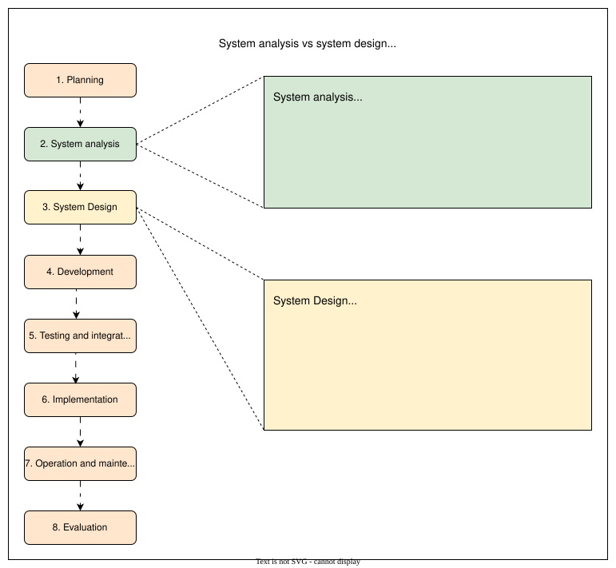

# System_Analysis_vs._System_Design

Source: https://www.educative.io/courses/grokking-the-system-design-interview/system-analysis-vs-system-design

---

[Home](https://www.educative.io/)

[Courses](https://www.educative.io/search?tab=courses)

[Grokking Modern System Design Interview](https://www.educative.io/courses/grokking-the-system-design-interview)

# System Analysis vs. System Design

System Design is a critical phase in software development, focusing on defining the architecture and specifications needed to meet business requirements. It follows system analysis, which identifies what those requirements are through feasibility studies and documentation. The two processes differ in their outputs: system analysis produces problem statements and requirements, while system design creates technical blueprints and implementation plans. Understanding these distinctions is essential for developing effective systems that align with organizational goals and user needs, utilizing structured approaches like the RESHADED framework to guide the design process.

We'll cover the following...

- [What is System Design?](https://www.educative.io/courses/grokking-the-system-design-interview/system-analysis-vs-system-design#What-is-System-Design)
- [System analysis vs. System Design](https://www.educative.io/courses/grokking-the-system-design-interview/system-analysis-vs-system-design#System-analysis-vs-System-Design)
  - [1. Deliverables at a glance (from discovery to blueprint)](https://www.educative.io/courses/grokking-the-system-design-interview/system-analysis-vs-system-design#1-Deliverables-at-a-glance-from-discovery-to-blueprint)
  - [2. Techniques and models (picking the right tool per phase)](https://www.educative.io/courses/grokking-the-system-design-interview/system-analysis-vs-system-design#2-Techniques-and-models-picking-the-right-tool-per-phase)
  - [3. System analysis precedes System Design](https://www.educative.io/courses/grokking-the-system-design-interview/system-analysis-vs-system-design#3-System-analysis-precedes-System-Design)
  - [4. Focusing on what vs how](https://www.educative.io/courses/grokking-the-system-design-interview/system-analysis-vs-system-design#4-Focusing-on-what-vs-how)
    - [System analysis: The what](https://www.educative.io/courses/grokking-the-system-design-interview/system-analysis-vs-system-design#System-analysis-The-what)
    - [System Design: The how](https://www.educative.io/courses/grokking-the-system-design-interview/system-analysis-vs-system-design#System-Design-The-how)
  - [5. Completing different tasks](https://www.educative.io/courses/grokking-the-system-design-interview/system-analysis-vs-system-design#5-Completing-different-tasks)
    - [Feasibility studies](https://www.educative.io/courses/grokking-the-system-design-interview/system-analysis-vs-system-design#Feasibility-studies)
    - [Requirements engineering](https://www.educative.io/courses/grokking-the-system-design-interview/system-analysis-vs-system-design#Requirements-engineering)
    - [The RESHADED approach to System Design](https://www.educative.io/courses/grokking-the-system-design-interview/system-analysis-vs-system-design#The-RESHADED-approach-to-System-Design)
- [Mini case study: Ticketing service in 8 decisions](https://www.educative.io/courses/grokking-the-system-design-interview/system-analysis-vs-system-design#Mini-case-study-Ticketing-service-in-8-decisions)
- [Conclusion](https://www.educative.io/courses/grokking-the-system-design-interview/system-analysis-vs-system-design#Conclusion)

System Design is a crucial component of the software development process. It enables engineers to step back and assess the broader impact of design decisions on the long-term efficiency, stability, and success of software and information systems.

Importantly, system design and the requirements it addresses do not exist in isolation.

As software engineers, we benefit from understanding why certain requirements are prioritized, how they align with our organization’s business goals, and how these choices influence the overall user experience. To understand the factors that shape a system’s design and how teams respond to implementation challenges, we also need to understand system analysis.

In this lesson, we explore system design and system analysis through a comparative lens, examining what each process entails, how they fit into the broader system development life cycle, and how to distinguish between them.

## What is System Design?[#](https://www.educative.io/courses/grokking-the-system-design-interview/system-analysis-vs-system-design#What-is-System-Design)

In software development, **System Design** is the process of defining the architecture, interfaces, and data model for a system to satisfy the requirements outlined in the SRSs.

At this stage, software engineers convert business requirements into technical specifications for building a new software system or updating an existing one. If the system is designed well, it will serve clients’ needs and, ultimately, fulfill business objectives.

As its name implies, System Design is a process that should happen systematically.

By thoroughly and systematically considering a system’s infrastructure, from hardware and software to data and its storage, we can help ensure that the final design possesses important characteristics such as reliability, effectiveness, and maintainability.

- Reliable systems are resilient against errors, failures, and faults.
- Effective systems satisfy users’ needs and requirements set by the business.
- Maintainable systems prove flexible and simple to scale up or down. It’s generally easier to add new features to maintainable systems, as well.

This introduction provides a high-level view of System Design. We’ll continue to unpack the design process in the next section, which will explore the differences between system analysis and System Design. However, a brief [primer](https://www.educative.io/blog/system-design-primer) or thorough guide could also be helpful.

System analysis and System Design are key phases of the SDLC

## System analysis vs. System Design[#](https://www.educative.io/courses/grokking-the-system-design-interview/system-analysis-vs-system-design#System-analysis-vs-System-Design)

As sequential phases of the SDLC, system analysis and System Design share a broader purpose: developing technological systems that serve the needs of both customers and businesses. From there, several differences emerge between the two processes. We’ll discuss three of these differences now.

### 1. Deliverables at a glance (from discovery to blueprint)[#](https://www.educative.io/courses/grokking-the-system-design-interview/system-analysis-vs-system-design#1-Deliverables-at-a-glance-from-discovery-to-blueprint)

A frequent source of confusion in system analysis versus System Design is “what do I actually produce in each?” Here’s a practical checklist of artifacts that hiring teams expect:

**System analysis (the what):**

- Problem statement and goals
- Feasibility report (technical, economic, operational)
- Stakeholder map and high-level business process flows
- Requirements backlog: functional and non-functional
- System Requirements Specification (SRS) serving as the single source of truth

**System Design (the how):**

- Architecture decision record (ADR) set
- High-level architecture diagram (services, data stores, integrations)
- Interface definitions and API contracts
- Data model: ERD, schema, and retention rules
- Capacity estimates and scalability plan (caching, partitions, queues)
- Security, privacy, and compliance controls mapped to requirements
- Deployment topology, CI/CD plan, and operational runbook

Treat the SRS as the contract that the design must satisfy; the design pack then becomes the contract that the implementation must satisfy.

### 2. Techniques and models (picking the right tool per phase)[#](https://www.educative.io/courses/grokking-the-system-design-interview/system-analysis-vs-system-design#2-Techniques-and-models-picking-the-right-tool-per-phase)

When comparing system analysis vs System Design, each phase benefits from different techniques:

**Analysis toolkit**

- **Elicitation:** stakeholder interviews, surveys, workshops
- **Modeling for understanding:** use-case diagrams, user stories, DFDs for data flow, context diagrams for system boundaries
- **Quality gates:** feasibility studies and early risk registers

**Design toolkit**

- **Structural modeling:** component and deployment diagrams, sequence diagrams for critical flows
- **Data design:** ERDs, normalization strategy, indexing plan
- **Integration:** API specs (request/response, error taxonomy), contract tests
- **Quality attributes:** threat modeling, performance budgets, caching, and shard strategies tied to non-functional requirements

Select the appropriate level of formality for the organization, ensuring traceability from requirements to design elements.

### 3. System analysis precedes System Design[#](https://www.educative.io/courses/grokking-the-system-design-interview/system-analysis-vs-system-design#3-System-analysis-precedes-System-Design)

Here’s where understanding the broader picture of the system development life cycle (SDLC) is beneficial.

The SDLC, also known as the Software Development Life Cycle (SDLC) or Application Development Life Cycle (ADLC), is a multi-phase process for creating an information system. It covers the life of the system, from planning through launch to assessment.

A key concept in information technology, the SDLC encompasses a mix of software and hardware configurations. These can include systems consisting of only software, only hardware, or a combination of both.

> The SDLC is not a methodology. It is a description of phases. There are, however, several methodologies or models that fit within the SDLC. Some well-known examples include Waterfall, Agile software development, and Rapid prototyping.

Depending on the source, there may be variations in the names and number of phases in the SDLC. However, developing a system generally involves the same major tasks, which can be organized into the following phases:

1. Planning and preliminary analysis
2. System analysis
3. System Design
4. Development
5. Testing and integration
6. Implementation
7. Operation and maintenance
8. Evaluation

The SDLC phases are generally meant to be implemented in sequence, with the completion of one preceding the initiation of the next.

This sequence helps teams focus on one phase at a time, which simplifies development. Depending on the organization and methodology, not every phase may be carried out at times. At other times, the phases may overlap.

Regardless, one thing usually stands true: system analysis and System Design are essential and sequential parts of the process.

Since the goal of the SDLC is to create high-quality information systems that support identified needs, it follows that system analysis comes before System Design. After all, for System Design to start fulfilling requirements, software engineers first need to know what those requirements are.

### 4. Focusing on what vs how[#](https://www.educative.io/courses/grokking-the-system-design-interview/system-analysis-vs-system-design#4-Focusing-on-what-vs-how)

System analysis and System Design divide their responsibilities in multiple ways. We’ve already discussed the importance of timing and how requirements gathering needs to precede the design of the technical solution. System analysts and software engineers also produce different deliverables: analysts define what the system must do, while engineers define how the system will be built.

#### System analysis: The what[#](https://www.educative.io/courses/grokking-the-system-design-interview/system-analysis-vs-system-design#System-analysis-The-what)

As discussed earlier, system analysis is an early and fundamental phase in the SDLC. In the context of software engineering, system analysts review a technological system for various purposes, ultimately proposing a solution to a problem using a computer system. In other words, they identify what is required to serve the client and customer needs. After conducting feasibility studies and requirements engineering, they document this information in a System Requirements Specification (SRS) document.

#### System Design: The how[#](https://www.educative.io/courses/grokking-the-system-design-interview/system-analysis-vs-system-design#System-Design-The-how)

With a completed SRS, the process advances to System Design, which involves determining how to satisfy the requirements.

To visualize the desired outcome, think of creating a unique combination of distinct components. To make this visualization more tangible, we’ll refer to these components as building blocks, representing similarities shared across System Design problems that have been extracted for easier reuse.

For our purposes, there are 16 building blocks of modern System Design that we can draw from.

It is helpful to think of these building blocks as bricks, a type of raw material that can be combined to form a structure. Once we understand their functions, we can use them to create reliable, effective, and maintainable systems for virtually any design problem.

The building blocks in higher layers are dependent upon those below.

### 5. Completing different tasks[#](https://www.educative.io/courses/grokking-the-system-design-interview/system-analysis-vs-system-design#5-Completing-different-tasks)

Another distinction to make between system analysis and System Design is in terms of the work process.

Two conventions are used in system analysis: feasibility studies and requirements engineering. Because system design is complex, no single method solves every problem, but engineers can apply consistent procedures to approach problems systematically.

We’ll discuss a reusable approach that can address multiple scenarios.

#### Feasibility studies[#](https://www.educative.io/courses/grokking-the-system-design-interview/system-analysis-vs-system-design#Feasibility-studies)

Recall that system analysis involves outlining a proposed solution to a defined problem. To gauge the suitability of potential solutions, system analysts turn to feasibility studies.

These studies typically involve the following steps:

1. Identifying deficiencies in the existing system. This process can begin by preparing a flowchart of the system, including its subsystems, and then examining it for vulnerabilities or potential points of failure.
2. Identifying the new system’s objectives, scope, and responsible users.
3. Preparing a flowchart of the proposed system.
4. Determining whether the proposal is a feasible solution for the new or upgraded system.

This final step is mostly concerned with weighing three types of feasibility:

- **Technical feasibility:** Noting the current hardware and software resources of the client or customer, and deciding whether the existing setup can meet the technical requirements of the proposed system.
- **Economic feasibility:** Conducting a cost-benefit analysis of the proposed system and comparing the results with the project budget.
- **Operational feasibility:** Determining whether the system will work in the way that its users expect, considering the availability of the people who will be needed to develop and implement the system.

Additional types of feasibility may include social feasibility, management feasibility, legal feasibility, and time feasibility.

However, no matter how system analysts slice up feasibility, the expected outcome remains the same: a determination of whether the proposed system for solving a defined problem can and should proceed. When this analysis yields a green light, system analysts can proceed with the requirements engineering process.

#### Requirements engineering[#](https://www.educative.io/courses/grokking-the-system-design-interview/system-analysis-vs-system-design#Requirements-engineering)

In requirements engineering, also known as requirements analysis, analysts will define, document, and maintain requirements pertaining to the proposed system. In general, this process includes examining data about the system’s goals and objectives, such as:

- How the proposed system would work at a high level
- What qualities or properties must the proposed system have to provide the expected results

Later, software engineers will look for specific coding solutions that align with these findings.

A major focus of requirements engineering is ensuring a thorough understanding of clients’ needs and expectations. Communication between the company producing the system and clients is key, and requirements engineering can include several activities to support alignment:

- **Solicitation:** Initially, collecting the requirements from the client
- **Analysis:** Assessing the clients’ requirements in more detail
- **Specification:** Producing a formal document, sometimes called a requirements specification
- **Validation or verification:** Ensuring that the documented requirements are consistent and meet the client’s needs
- **Management:** Matching proposed system processes to requirements

During feasibility studies and requirements engineering, systems analysts might use several kinds of tools.

These artifacts can include organizational flowcharts, existing or proposed system architecture diagrams, and UI mockups that show how users interact with the system. After determining the feasibility and fine-tuning requirements, system analysts produce the SRS. This document enables System Design engineers to begin designing the new or updated system.

Having understood the purpose and outputs of System Design, we can now explore a structured approach to breaking down complex design problems. The RESHADED framework provides a flexible guideline for translating requirements into robust system architectures.

#### The RESHADED approach to System Design[#](https://www.educative.io/courses/grokking-the-system-design-interview/system-analysis-vs-system-design#The-RESHADED-approach-to-System-Design)

Although no one-size-fits-all method exists for the design phase, the RESHADED approach provides engineers with a flexible way to break down complex problems into manageable components. This approach articulates the steps for designing almost any system from scratch, whether working on a client project or sitting for System Design interviews. We’ll quickly look at what the acronym stands for.

- **Requirements:** Gather all functional and non-functional requirements that reflect the client’s business or organizational needs.
- **Estimation:** Gauge the hardware and infrastructural resources needed to implement a system at scale.
- **Storage schema (optional):** Define a data model and, if relevant, include data flow diagrams. This involves specifying the structure of the data, the tables to use, the types of fields in each table, and the relationships between tables.
- **High-level design:** Select from the 16 building blocks we discussed earlier to fulfill certain functional requirements.
- **APIs:** Create interfaces that enable users to access and utilize various services within the system. Interfaces take the form of API calls and are typically a translation of functional requirements.
- **Detailed design:** Analyze and improve the high-level design, adding or replacing building blocks to meet non-functional requirements, then outlining these building blocks.
- **Evaluation:** Compare the detailed design against the requirements. Justify tradeoffs and weigh the pros and cons of alternative designs. Identify areas for improvement and consider solutions to any overlooked issues.
- **Distinctive component/feature:** Discuss a unique feature added to the design to satisfy requirements.

The utility of the RESHADED approach is most apparent in its flexibility as a general guideline to solving System Design problems. However, it’s not meant to solve every design problem, so don’t be afraid to be creative and resourceful when designing new solutions.

## Mini case study: Ticketing service in 8 decisions[#](https://www.educative.io/courses/grokking-the-system-design-interview/system-analysis-vs-system-design#Mini-case-study-Ticketing-service-in-8-decisions)

To ground the difference between system analysis and System Design, imagine a simple ticketing service:

**Analysis highlights (what):**

1. **Goal:** Users can purchase event tickets and receive confirmations in under 5 seconds.
2. **Actors and flows:** Guest user, registered user, admin; browse → select → pay → confirm.
3. **Constraints:** Peak 3,000 TPS during on-sale; PCI obligations; refunds within 24 hours.
4. **Non-functional:** 99.95% availability, P95 end-to-end latency < 1200 ms, eventual inventory consistency within 2 seconds.
5. **Outputs:** Feasibility green; SRS with prioritized requirements and risks (overselling, payment failures).

**Design highlights (how):**

6. **Architecture:** A stateless checkout service, inventory service with reserved-then-commit pattern, payment gateway adapter, notification service; API gateway front door; object storage for receipts; relational DB for orders; cache for event pages.
7. **Data design:** Orders table (with status states), Reservations table with TTL to prevent long holds, idempotency keys for payment retries, and an outbox table for reliable notifications.
8. **Quality attributes:** Queue to decouple payment and notification; circuit breakers around the gateway; optimistic locking on inventory with retries; rate limits on add-to-cart; observability budget aligned to SLOs.

Notice how the analysis artifacts define success, while the design artifacts embody trade-offs (e.g., optimistic locking vs. two-phase commit) that still satisfy the SRS.

## Conclusion[#](https://www.educative.io/courses/grokking-the-system-design-interview/system-analysis-vs-system-design#Conclusion)

System analysis defines what a system should achieve, while System Design determines how to implement it.

Together, they ensure software meets business goals and user needs. Structured approaches such as RESHADED help teams design scalable, reliable, and maintainable systems while balancing requirements and trade-offs.

Distributed System Design Patterns

API Design Interview vs. System Design Interview

Ask

[What is System Design?](https://www.educative.io/courses/grokking-the-system-design-interview/system-analysis-vs-system-design#What-is-System-Design)

[System analysis vs. System Design](https://www.educative.io/courses/grokking-the-system-design-interview/system-analysis-vs-system-design#System-analysis-vs-System-Design)

[1. Deliverables at a glance (from discovery to blueprint)](https://www.educative.io/courses/grokking-the-system-design-interview/system-analysis-vs-system-design#1-Deliverables-at-a-glance-from-discovery-to-blueprint)

[2. Techniques and models (picking the right tool per phase)](https://www.educative.io/courses/grokking-the-system-design-interview/system-analysis-vs-system-design#2-Techniques-and-models-picking-the-right-tool-per-phase)

[3. System analysis precedes System Design](https://www.educative.io/courses/grokking-the-system-design-interview/system-analysis-vs-system-design#3-System-analysis-precedes-System-Design)

[4. Focusing on what vs how](https://www.educative.io/courses/grokking-the-system-design-interview/system-analysis-vs-system-design#4-Focusing-on-what-vs-how)

[System analysis: The what](https://www.educative.io/courses/grokking-the-system-design-interview/system-analysis-vs-system-design#System-analysis-The-what)

[System Design: The how](https://www.educative.io/courses/grokking-the-system-design-interview/system-analysis-vs-system-design#System-Design-The-how)

[5. Completing different tasks](https://www.educative.io/courses/grokking-the-system-design-interview/system-analysis-vs-system-design#5-Completing-different-tasks)

[Feasibility studies](https://www.educative.io/courses/grokking-the-system-design-interview/system-analysis-vs-system-design#Feasibility-studies)

[Requirements engineering](https://www.educative.io/courses/grokking-the-system-design-interview/system-analysis-vs-system-design#Requirements-engineering)

[The RESHADED approach to System Design](https://www.educative.io/courses/grokking-the-system-design-interview/system-analysis-vs-system-design#The-RESHADED-approach-to-System-Design)

[Mini case study: Ticketing service in 8 decisions](https://www.educative.io/courses/grokking-the-system-design-interview/system-analysis-vs-system-design#Mini-case-study-Ticketing-service-in-8-decisions)

[Conclusion](https://www.educative.io/courses/grokking-the-system-design-interview/system-analysis-vs-system-design#Conclusion)