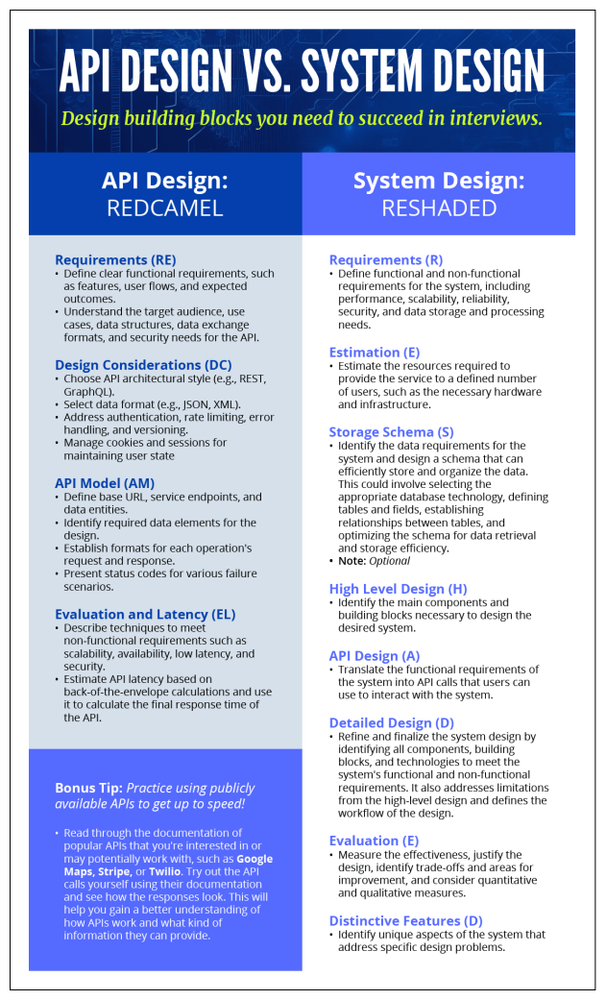

# API_Design_Interview_vs._System_Design_Interview

Source: https://www.educative.io/courses/grokking-the-system-design-interview/api-design-interview-vs-system-design-interview

---

[Home](https://www.educative.io/)

[Courses](https://www.educative.io/search?tab=courses)

[Grokking Modern System Design Interview](https://www.educative.io/courses/grokking-the-system-design-interview)

# API Design Interview vs. System Design Interview

API Design interviews assess a candidate's ability to create user-facing interfaces using existing software systems, focusing on communication, problem-solving, and design of functional components. In contrast, System Design interviews evaluate the ability to architect scalable and reliable software systems, emphasizing trade-offs and overall architecture. Mastery of both areas is crucial for career advancement, with System Design knowledge particularly enhancing prospects for senior roles and leadership positions in software engineering. Understanding these distinctions helps candidates align their preparation with their career goals and improve their competitiveness in the job market.

We'll cover the following...

- [API Design Interviews vs. System Design Interviews](https://www.educative.io/courses/grokking-the-system-design-interview/api-design-interview-vs-system-design-interview#API-Design-Interviews-vs-System-Design-Interviews)
  - [1) API Design: Leveraging the existing software system](https://www.educative.io/courses/grokking-the-system-design-interview/api-design-interview-vs-system-design-interview#1-API-Design-Leveraging-the-existing-software-system)
    - [Roles requiring System Design knowledge](https://www.educative.io/courses/grokking-the-system-design-interview/api-design-interview-vs-system-design-interview#Roles-requiring-System-Design-knowledge)
  - [2) System Design (building blocks of software systems)](https://www.educative.io/courses/grokking-the-system-design-interview/api-design-interview-vs-system-design-interview#2-System-Design-building-blocks-of-software-systems)
    - [Understanding the System Design Interview](https://www.educative.io/courses/grokking-the-system-design-interview/api-design-interview-vs-system-design-interview#Understanding-the-System-Design-Interview)
    - [Why we should level up our System Design knowledge](https://www.educative.io/courses/grokking-the-system-design-interview/api-design-interview-vs-system-design-interview#Why-we-should-level-up-our-System-Design-knowledge)
    - [System Design as an accelerator for career progression](https://www.educative.io/courses/grokking-the-system-design-interview/api-design-interview-vs-system-design-interview#System-Design-as-an-accelerator-for-career-progression)
      - [Without System Design experience:](https://www.educative.io/courses/grokking-the-system-design-interview/api-design-interview-vs-system-design-interview#Without-System-Design-experience)
      - [With System Design experience:](https://www.educative.io/courses/grokking-the-system-design-interview/api-design-interview-vs-system-design-interview#With-System-Design-experience)
- [Conclusion](https://www.educative.io/courses/grokking-the-system-design-interview/api-design-interview-vs-system-design-interview#Conclusion)

When preparing for technical interviews, developers often face a choice between two types of design interviews: System Design and API (or Product) Design. Understanding the difference helps us focus on our preparation and align it with our career goals.

A **System Design Interview** focuses on the functional building blocks of a software system, including how components interact, scale, and maintain reliability. A ["Product or API Design Interview"](https://www.educative.io/courses/grokking-the-product-architecture-interview) focuses on using those building blocks to create features, products, and interfaces that users interact with.

Which interview to prioritize depends on our goals. System Design interviews suit those interested in architecture and distributed systems. API Design interviews are more relevant for developers building applications and services on top of these systems.

Becoming familiar with both areas is important for developers who want to remain competitive. In this lesson, we will explore the differences between System Design and API Design interviews, and help us decide which to focus on based on our career path.

## API Design Interviews vs. System Design Interviews[#](https://www.educative.io/courses/grokking-the-system-design-interview/api-design-interview-vs-system-design-interview#API-Design-Interviews-vs-System-Design-Interviews)

Design interviews are important for interviewers because they assess a candidate’s problem-solving skills, technical knowledge, and ability to produce well-structured solutions to design challenges.

These interviews also serve as a key tool for determining a candidate’s starting level. A weaker system design interview can lead to a lower starting level, which may reduce initial compensation and affect future compensation growth. For instance, instead of being hired at Meta at E4 (Software Engineer III), a candidate might be offered E3 (Software Engineer II).

It can take one to three years to reach the next level, resulting in a significant loss of earning potential from a single 30 to 45-minute interview.

At most top companies, candidates may be offered a choice between the API Design Interview and the System Design Interview. Understanding which option aligns with skills and experience is essential. API design and system design both reflect real engineering work: defining interfaces, making trade-offs, and building systems that are maintainable and scalable.

The interviews evaluate aptitude in two key disciplines:

1. **API Design:** Leveraging the existing software system
2. **System Design:** Building blocks of software systems

### 1) API Design: Leveraging the existing software system[#](https://www.educative.io/courses/grokking-the-system-design-interview/api-design-interview-vs-system-design-interview#1-API-Design-Leveraging-the-existing-software-system)

The API Design Interview is a recent addition to the design interview family. Interviewers aim to evaluate how a candidate asks questions, communicates ideas, designs individual components, and explains the reasoning behind choices.

Effective API design requires knowledge of the existing software system. For example, if a distributed store cannot meet the required response time, the design may rely on a caching layer as an alternative. A strong candidate demonstrates the ability to navigate system constraints and produce APIs that are both fast and functional.

Several key factors must be defined when designing an API. Clarifying these criteria at the start of the interview is essential.

- **User:** Is this an internal tool or a product that other parties may need?
- **Problem:** What does the API aim to solve?
- **Response type:** Endpoints and successful or unsuccessful calls must be clearly defined.

  - Some standard failed HTTP request status codes to know are: 301, 403, 500
- **Use-case:** How will the API be implemented? This is essential for testing and debugging.

  - Common API architectures include: REST, GraphQL, and RPC
  - Common data formats are: JSON, XML, binary
- **Scalability:** Plan for an increase in demand. The API should be resilient and expandable.
- **Documentation:** What documentation is required for other developers to successfully integrate the API? This includes structure, behaviors, and parameters to be defined.

API Design interviews are becoming increasingly common in the software industry.

Many companies are shifting toward this narrower, API-focused approach for design interviews. Front-end developers, back-end developers, full-stack developers, and product managers benefit from familiarity with API design. In contrast, senior developers with limited exposure to API design may experience slower career growth.

Even without actively seeking a new position, knowledge of API design strengthens design skills, improves communication, and enhances overall product awareness within an organization.

At the same time, mastery of System Design remains critical for certain roles and career paths in software engineering, providing a distinct advantage.

#### Roles requiring System Design knowledge[#](https://www.educative.io/courses/grokking-the-system-design-interview/api-design-interview-vs-system-design-interview#Roles-requiring-System-Design-knowledge)

Certain software engineering roles demand a strong understanding of System Design principles:

- **Senior Software Engineers:** Work on complex systems, requiring System Design knowledge for efficiency and scalability.
- **Software Architects:** Create high-level design and architecture, needing a deep understanding of System Design for informed decision-making.
- **DevOps Engineers:** Streamline development, deployment, and operation of software systems, using System Design knowledge to optimize infrastructure and processes.
- **Site Reliability Engineers (SREs):** Focus on reliability, scalability, and performance, requiring in-depth System Design knowledge for effective strategies and monitoring.

These are just some of the roles where System Design expertise is highly sought after. For those looking to advance into these roles, it’s imperative to ramp up System Design interview skills as soon as possible.

### 2) System Design (building blocks of software systems)[#](https://www.educative.io/courses/grokking-the-system-design-interview/api-design-interview-vs-system-design-interview#2-System-Design-building-blocks-of-software-systems)

Software engineers at all experience levels should understand the fundamentals of system design.

That said, most engineers won’t actually be working on large distributed systems. Instead, they usually build applications that run on top of core infrastructure systems. However, there are certain careers and pathways in software engineering where mastery of System Design lends an undeniable edge.

Candidates with strong System Design knowledge and experience consistently perform better in technical interviews, making strategic preparation for System Design interviews essential.

#### Understanding the System Design Interview[#](https://www.educative.io/courses/grokking-the-system-design-interview/api-design-interview-vs-system-design-interview#Understanding-the-System-Design-Interview)

The System Design interview (SDI) evaluates a candidate’s ability to design and architect large-scale, complex software systems.

Here is how a typical SDI breaks down:

- **Design challenge:** Candidates have 30-45 minutes to tackle a high-level design task involving the creation, optimization, or scaling of a software system.
- **Clarification and analysis:** Next, candidates delve deeper into the problem’s requirements, constraints, and goals by asking relevant questions.
- **Solution presentation:** Candidates present their solution, considering scalability, performance, reliability, and security.
- **Discussion and review:** If there’s enough time, the interviewer may provide feedback, and the candidate can refine their design.

#### Why we should level up our System Design knowledge[#](https://www.educative.io/courses/grokking-the-system-design-interview/api-design-interview-vs-system-design-interview#Why-we-should-level-up-our-System-Design-knowledge)

A candidate without System Design knowledge may exhibit some of the following characteristics during an interview, which can make them appear less prepared or experienced:

- They have a limited understanding of trade-offs. Candidates without System Design knowledge tend to struggle to identify or discuss trade-offs, which often results in suboptimal solutions or flawed designs.
- They have tunnel vision when it comes to implementation details. Some candidates focus too heavily on low-level implementation details, such as algorithms or data structures, without considering the overall architecture.
- They struggle to address scalability and performance issues. Without a background in System Design, some candidates may not even bring up how their proposed solutions will scale.

Lastly, candidates without System Design knowledge often employ an unstructured approach to problem-solving. This is likely the most noticeable shortcoming I’ve encountered during interviews, even among experienced software engineers.

Luckily, it’s also one of the easiest to fix. System Design principles force us to think about solutions in a more organized and methodical manner, accounting for limitations and trade-offs.

#### System Design as an accelerator for career progression[#](https://www.educative.io/courses/grokking-the-system-design-interview/api-design-interview-vs-system-design-interview#System-Design-as-an-accelerator-for-career-progression)

A strong foundation in System Design can also accelerate our career growth. Engineers who excel in System Design are more likely to be promoted to senior or leadership positions within their organizations. Here’s a general idea of how the career might progress, illustrating the impact of System Design.

##### Without System Design experience:[#](https://www.educative.io/courses/grokking-the-system-design-interview/api-design-interview-vs-system-design-interview#Without-System-Design-experience)

- Entry-level software engineer (0-2 years)
- Mid-level software engineer (2-5 years)
- Senior software engineer (4-6 years)
- Technical lead or engineering Manager (8+ years)

It’s possible to become an EM without System Design experience, but it’s pretty much a certainty that it will be more challenging and take up more time to reach that position.

##### With System Design experience:[#](https://www.educative.io/courses/grokking-the-system-design-interview/api-design-interview-vs-system-design-interview#With-System-Design-experience)

- Entry-level software engineer (0-2 years)
- Mid-level software engineer (1-3 years)
- Senior software engineer (4-5 years)
- Technical lead or engineering manager (6+ years)
- Principal engineer or software architect (8+ years)

Individual skills and experiences vary, so these observations are not absolute. In the tech industry, strong System Design knowledge can accelerate contributions by enabling more effective and impactful work early in a project or role.

## Conclusion[#](https://www.educative.io/courses/grokking-the-system-design-interview/api-design-interview-vs-system-design-interview#Conclusion)

API design interviews focus on building clear, usable interfaces on top of existing systems, while system design interviews evaluate your ability to design scalable, reliable, and maintainable architectures. Mastery of both areas strengthens problem-solving, communication, and technical decision-making.

For career growth, System Design knowledge provides a clear advantage, enabling engineers to address trade-offs, plan for scalability, and accelerate progression into senior or leadership roles.

System Analysis vs. System Design

5 System Design Fundamentals for Technical Product Managers

Ask

[API Design Interviews vs. System Design Interviews](https://www.educative.io/courses/grokking-the-system-design-interview/api-design-interview-vs-system-design-interview#API-Design-Interviews-vs-System-Design-Interviews)

[1) API Design: Leveraging the existing software system](https://www.educative.io/courses/grokking-the-system-design-interview/api-design-interview-vs-system-design-interview#1-API-Design-Leveraging-the-existing-software-system)

[Roles requiring System Design knowledge](https://www.educative.io/courses/grokking-the-system-design-interview/api-design-interview-vs-system-design-interview#Roles-requiring-System-Design-knowledge)

[2) System Design (building blocks of software systems)](https://www.educative.io/courses/grokking-the-system-design-interview/api-design-interview-vs-system-design-interview#2-System-Design-building-blocks-of-software-systems)

[Understanding the System Design Interview](https://www.educative.io/courses/grokking-the-system-design-interview/api-design-interview-vs-system-design-interview#Understanding-the-System-Design-Interview)

[Why we should level up our System Design knowledge](https://www.educative.io/courses/grokking-the-system-design-interview/api-design-interview-vs-system-design-interview#Why-we-should-level-up-our-System-Design-knowledge)

[System Design as an accelerator for career progression](https://www.educative.io/courses/grokking-the-system-design-interview/api-design-interview-vs-system-design-interview#System-Design-as-an-accelerator-for-career-progression)

[Without System Design experience:](https://www.educative.io/courses/grokking-the-system-design-interview/api-design-interview-vs-system-design-interview#Without-System-Design-experience)

[With System Design experience:](https://www.educative.io/courses/grokking-the-system-design-interview/api-design-interview-vs-system-design-interview#With-System-Design-experience)

[Conclusion](https://www.educative.io/courses/grokking-the-system-design-interview/api-design-interview-vs-system-design-interview#Conclusion)