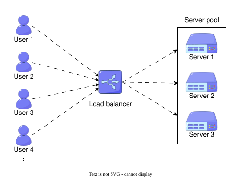

# 5_System_Design_Fundamentals_for_Technical_Product_Managers

Source: https://www.educative.io/courses/grokking-the-system-design-interview/5-system-design-fundamentals-for-technical-product-managers

---

[Home](https://www.educative.io/)

[Courses](https://www.educative.io/search?tab=courses)

[Grokking Modern System Design Interview](https://www.educative.io/courses/grokking-the-system-design-interview)

# 5 System Design Fundamentals for Technical Product Managers

Technical product managers (TPMs) in tech companies must now possess a solid understanding of System Design fundamentals, which were traditionally reserved for software engineers. Key concepts include load balancing for performance and reliability, key-value storage for scalability and speed, rate limiters to manage request loads, content delivery networks (CDNs) for efficient content distribution, and databases for data organization and integrity. Mastering these fundamentals enables TPMs to make informed decisions, optimize system performance, and effectively lead product teams to deliver successful, scalable, and reliable products.

We'll cover the following...

- [What is System Design, and why should you care as a TPM?](https://www.educative.io/courses/grokking-the-system-design-interview/5-system-design-fundamentals-for-technical-product-managers#What-is-System-Design-and-why-should-you-care-as-a-TPM)
  - [1. Load balancing](https://www.educative.io/courses/grokking-the-system-design-interview/5-system-design-fundamentals-for-technical-product-managers#1-Load-balancing)
    - [Advantages of load balancing](https://www.educative.io/courses/grokking-the-system-design-interview/5-system-design-fundamentals-for-technical-product-managers#Advantages-of-load-balancing)
    - [Why should a TPM know about load balancing?](https://www.educative.io/courses/grokking-the-system-design-interview/5-system-design-fundamentals-for-technical-product-managers#Why-should-a-TPM-know-about-load-balancing)
  - [2. Key-value storage](https://www.educative.io/courses/grokking-the-system-design-interview/5-system-design-fundamentals-for-technical-product-managers#2-Key-value-storage)
    - [Advantages of key-value storage](https://www.educative.io/courses/grokking-the-system-design-interview/5-system-design-fundamentals-for-technical-product-managers#Advantages-of-key-value-storage)
    - [Why should a TPM know about key-value storage?](https://www.educative.io/courses/grokking-the-system-design-interview/5-system-design-fundamentals-for-technical-product-managers#Why-should-a-TPM-know-about-key-value-storage)
  - [3. Rate limiters](https://www.educative.io/courses/grokking-the-system-design-interview/5-system-design-fundamentals-for-technical-product-managers#3-Rate-limiters)
    - [Advantages of rate limiters](https://www.educative.io/courses/grokking-the-system-design-interview/5-system-design-fundamentals-for-technical-product-managers#Advantages-of-rate-limiters)
    - [Why should a TPM know about rate limiters?](https://www.educative.io/courses/grokking-the-system-design-interview/5-system-design-fundamentals-for-technical-product-managers#Why-should-a-TPM-know-about-rate-limiters)
  - [4. Content delivery networks (CDNs)](https://www.educative.io/courses/grokking-the-system-design-interview/5-system-design-fundamentals-for-technical-product-managers#4-Content-delivery-networks-CDNs)
    - [Advantages of CDNs](https://www.educative.io/courses/grokking-the-system-design-interview/5-system-design-fundamentals-for-technical-product-managers#Advantages-of-CDNs)
    - [Why should a TPM know about CDNs?](https://www.educative.io/courses/grokking-the-system-design-interview/5-system-design-fundamentals-for-technical-product-managers#Why-should-a-TPM-know-about-CDNs)
  - [5. Databases](https://www.educative.io/courses/grokking-the-system-design-interview/5-system-design-fundamentals-for-technical-product-managers#5-Databases)
    - [Advantages of databases](https://www.educative.io/courses/grokking-the-system-design-interview/5-system-design-fundamentals-for-technical-product-managers#Advantages-of-databases)
    - [Why should a TPM know about databases?](https://www.educative.io/courses/grokking-the-system-design-interview/5-system-design-fundamentals-for-technical-product-managers#Why-should-a-TPM-know-about-databases)
- [Conclusion](https://www.educative.io/courses/grokking-the-system-design-interview/5-system-design-fundamentals-for-technical-product-managers#Conclusion)

Technical product managers (TPMs) at big tech companies (FAANG) and startups are required to have a fundamental knowledge of System Design.

System design fundamentals have traditionally been emphasized in software engineering interviews, while TPM interviews have placed less focus on them. However, the trend is now changing. As a TPM, you need to have a solid understanding of System Design in interviews and on the job as you lead a product team.

This lesson outlines five key System Design fundamentals that are critical for technical product managers to understand in order to lead teams effectively and deliver successful products.

## What is System Design, and why should you care as a TPM?[#](https://www.educative.io/courses/grokking-the-system-design-interview/5-system-design-fundamentals-for-technical-product-managers#What-is-System-Design-and-why-should-you-care-as-a-TPM)

System Design is the process of architecting a system so that all functional and non-functional requirements are met, including APIs, use cases, and integrations.

Even if you’re not directly responsible for the intricate details of this architecture as a TPM, you should understand the big picture and how different system components support organizational goals and meet the product requirements.

This foundational knowledge becomes especially important in interview settings, where [Product Manager System Design Interview Questions](https://www.educative.io/courses/product-manager-system-design-interview-questions) are increasingly common.

A TPM needs to understand System Design fundamentals to make informed design decisions for products. For example, a large-scale photo storage system needs a reliable way to assign unique IDs to uploaded images, such as a sequence generator, UUID, or distributed ID service.

Effective TPMs aim to guide the creation of systems that are agile, scalable, reliable, maintainable, and robust, ensuring they meet user and business requirements. The following section covers five fundamental System Design concepts essential for TPMs to succeed in their roles.

### 1. Load balancing[#](https://www.educative.io/courses/grokking-the-system-design-interview/5-system-design-fundamentals-for-technical-product-managers#1-Load-balancing)

**Load balancing** is an integral part of the System Design lifecycle and refers to redistributing tasks across different computing servers to enhance system performance and reliability. With millions of requests per second, load balancers evenly distribute tasks across available resources to ensure traffic flows smoothly.

Simplified working of a load balancer

#### Advantages of load balancing[#](https://www.educative.io/courses/grokking-the-system-design-interview/5-system-design-fundamentals-for-technical-product-managers#Advantages-of-load-balancing)

- **Improving efficiency:** Load balancers distribute traffic evenly among different servers, thereby improving efficiency and reducing costs simultaneously.
- **Availability of servers:** If one or more servers break down, load balancers will bypass them and ensure the system remains available by distributing traffic among properly functioning servers.
- **Scalability:** Adding more servers ensures that application capacity is increased concurrently via load balancing.

#### Why should a TPM know about load balancing?[#](https://www.educative.io/courses/grokking-the-system-design-interview/5-system-design-fundamentals-for-technical-product-managers#Why-should-a-TPM-know-about-load-balancing)

As a TPM, you will frequently encounter situations where your servers need to be scaled up to meet user demand or where there is a traffic surge and subsequent failure.

In this scenario, a load balancer will be particularly useful. Additionally, you must have the decision-making capacity to select a suitable load balancer algorithm for your development team, considering factors such as pricing, stakeholder commitment, and other relevant variables.

A load balancer helps the system improve scalability, performance, and availability, and reduces redundancy by ensuring server capacity can be adjusted simultaneously, failed servers are bypassed in favor of working ones, and server load is distributed evenly.

### 2. Key-value storage[#](https://www.educative.io/courses/grokking-the-system-design-interview/5-system-design-fundamentals-for-technical-product-managers#2-Key-value-storage)

A **key-value store** is a software storage system that builds on an associative array data model, such as a hash table or dictionary, to assign a unique value to every key within a collection.

Values can be anything, from unique IDs to blobs or server names. It can be challenging to scale with traditional storage systems in distributed environments while still maintaining strong and consistent availability. Several top tech companies, including Facebook, Netflix, and Amazon, rely more on primary-key access data stores than traditional online transaction processing (OLTP) databases.

By definition, OLTP is the rapid, real-time execution of huge database transactions over the internet.

Key-value store in action

#### Advantages of key-value storage[#](https://www.educative.io/courses/grokking-the-system-design-interview/5-system-design-fundamentals-for-technical-product-managers#Advantages-of-key-value-storage)

- **Scalability:** They can continuously process increasingly large amounts of data without a significant drop in performance.
- **Speed:** Simple retrieval and usage commands like `get`, `put`, and `delete` ensure efficiency.
- **Flexibility:** Scaling any large business model is easier due to the combined scalability and speed that key-value stores offer.

#### Why should a TPM know about key-value storage?[#](https://www.educative.io/courses/grokking-the-system-design-interview/5-system-design-fundamentals-for-technical-product-managers#Why-should-a-TPM-know-about-key-value-storage)

When designing a system, TPMs should evaluate when and where a key-value store is appropriate, considering its advantages in scalability, speed, and flexibility.

This model is particularly effective for storing customer personalization data. Key-value stores can enhance processing performance by distributing datasets across multiple machines with additional memory and improving fault tolerance.

Companies such as LinkedIn, Amazon, and MongoDB have leveraged key-value stores to achieve significant scaling over recent years.

### 3. Rate limiters[#](https://www.educative.io/courses/grokking-the-system-design-interview/5-system-design-fundamentals-for-technical-product-managers#3-Rate-limiters)

A **rate limiter** ensures that a service responds only to a set number of requests. Anything beyond the predefined limits is throttled. For example, if an API for a service has been configured to handle only 200 requests per minute, any requests over that will be blocked.

Throttling the number of requests to API servers via a rate limiter

#### Advantages of rate limiters[#](https://www.educative.io/courses/grokking-the-system-design-interview/5-system-design-fundamentals-for-technical-product-managers#Advantages-of-rate-limiters)

- **Cost efficiency:** They help control operational costs, for instance, by preventing operational experiments from exceeding the set quota of server requests.
- **Averting resource deprivation:** Several denial-of-service (DoS) attacks that occur due to software configuration errors are prevented with rate limiting.
- **Distributing data flow:** Like load balancers, rate limiters ensure that systems are not overburdened with a large amount of data and help evenly spread the load among different servers when required.

#### Why should a TPM know about rate limiters?[#](https://www.educative.io/courses/grokking-the-system-design-interview/5-system-design-fundamentals-for-technical-product-managers#Why-should-a-TPM-know-about-rate-limiters)

TPMs should ensure that servers operate efficiently and databases are protected from slow performance or overload. Implementing an appropriate rate-limiting algorithm helps achieve this.

Companies such as Lyft use rate limiters to maintain efficient and reliable system operations.

### 4. Content delivery networks (CDNs)[#](https://www.educative.io/courses/grokking-the-system-design-interview/5-system-design-fundamentals-for-technical-product-managers#4-Content-delivery-networks-CDNs)

Content delivery networks are geographically distributed servers that collaborate to ensure rapid and efficient content delivery over the internet.

CDNs use caching as a mechanism to speed up the delivery of content across the web. CDNs can serve static assets, web pages, images, videos, software downloads, and other web content. Several organizations use CDNs to accelerate the delivery of content via the internet.

A bank, for instance, might use a CDN to transfer sensitive data securely.

#### Advantages of CDNs[#](https://www.educative.io/courses/grokking-the-system-design-interview/5-system-design-fundamentals-for-technical-product-managers#Advantages-of-CDNs)

- **Improving efficiency:** CDNs enhance web page load times while reducing bounce rates. This keeps a user on the page and prevents them from abandoning it.
- **Enhancing security:** By mitigating distributed denial-of-service (DDoS) attacks, CDNs play a massive role in boosting security.
- **Cutting down on bandwidth costs:** Because CDNs primarily rely on caching and other optimizations, they can significantly reduce server bandwidth, keeping hosting costs down for website administrators and owners.

#### Why should a TPM know about CDNs?[#](https://www.educative.io/courses/grokking-the-system-design-interview/5-system-design-fundamentals-for-technical-product-managers#Why-should-a-TPM-know-about-CDNs)

For content-heavy organizations, TPMs may want to consider using a CDN to enhance system performance. CDNs can reduce data load times and latency, minimize redundancy, enhance security, and lower bandwidth costs, ultimately saving time and resources for the organization.

Content spread over a geographically distributed CDN

### 5. Databases[#](https://www.educative.io/courses/grokking-the-system-design-interview/5-system-design-fundamentals-for-technical-product-managers#5-Databases)

Traditional file systems come with many disadvantages, so databases are often preferred. A **database** is a collection of data organized in a way that is easily accessible, maintainable, manageable, and structured, allowing for efficient updates and processing.

Databases

Databases come in two main types:

- **Relational databases** are collections of datasets organized in multiple tables, columns, and records. Relational databases communicate with each other via database tables. Structured query language (SQL) is used to manipulate and retrieve information from these databases with commands like `insert`, `delete`, `update`, and `retrieve`.
- **Non-relational databases** (NoSQL) typically store unstructured data in a different format from relational databases. NoSQL databases have several types, including graph, key-value, document, and wide-column.

#### Advantages of databases[#](https://www.educative.io/courses/grokking-the-system-design-interview/5-system-design-fundamentals-for-technical-product-managers#Advantages-of-databases)

- **Data consistency:** Databases ensure that data redundancy is eliminated and changes are reflected in the database immediately, thereby preventing data inconsistency.
- **Data integrity:** By ensuring all users are presented with correct and accurate information, data integrity is maintained.
- **Data security:** Several security features, including password and user authentication, help maintain the security of data in databases.

#### Why should a TPM know about databases?[#](https://www.educative.io/courses/grokking-the-system-design-interview/5-system-design-fundamentals-for-technical-product-managers#Why-should-a-TPM-know-about-databases)

In today’s digital era, organizations rely on databases to scale operations and improve efficiency.

TPMs often take on responsibilities similar to a data product manager, overseeing how data is stored, distributed, and used across the organization. A strong understanding of databases and data science is crucial for making informed decisions in this area.

Different types of databases offer advantages such as data integrity, consistency, security, persistence, and ease of access.

## Conclusion[#](https://www.educative.io/courses/grokking-the-system-design-interview/5-system-design-fundamentals-for-technical-product-managers#Conclusion)

Mastering these five System Design fundamentals is essential for technical product managers.

Each concept equips us to make informed decisions, optimize system performance, and ensure reliability, scalability, and efficiency across products. When TPMs understand how system components interact and connect to business goals, they can guide engineering discussions, identify bottlenecks early, and help teams build systems that meet user and business requirements.

API Design Interview vs. System Design Interview

NeetCode Pro: Does It Hold Up for System Design Interviews?

Ask

[What is System Design, and why should you care as a TPM?](https://www.educative.io/courses/grokking-the-system-design-interview/5-system-design-fundamentals-for-technical-product-managers#What-is-System-Design-and-why-should-you-care-as-a-TPM)

[1. Load balancing](https://www.educative.io/courses/grokking-the-system-design-interview/5-system-design-fundamentals-for-technical-product-managers#1-Load-balancing)

[Advantages of load balancing](https://www.educative.io/courses/grokking-the-system-design-interview/5-system-design-fundamentals-for-technical-product-managers#Advantages-of-load-balancing)

[Why should a TPM know about load balancing?](https://www.educative.io/courses/grokking-the-system-design-interview/5-system-design-fundamentals-for-technical-product-managers#Why-should-a-TPM-know-about-load-balancing)

[2. Key-value storage](https://www.educative.io/courses/grokking-the-system-design-interview/5-system-design-fundamentals-for-technical-product-managers#2-Key-value-storage)

[Advantages of key-value storage](https://www.educative.io/courses/grokking-the-system-design-interview/5-system-design-fundamentals-for-technical-product-managers#Advantages-of-key-value-storage)

[Why should a TPM know about key-value storage?](https://www.educative.io/courses/grokking-the-system-design-interview/5-system-design-fundamentals-for-technical-product-managers#Why-should-a-TPM-know-about-key-value-storage)

[3. Rate limiters](https://www.educative.io/courses/grokking-the-system-design-interview/5-system-design-fundamentals-for-technical-product-managers#3-Rate-limiters)

[Advantages of rate limiters](https://www.educative.io/courses/grokking-the-system-design-interview/5-system-design-fundamentals-for-technical-product-managers#Advantages-of-rate-limiters)

[Why should a TPM know about rate limiters?](https://www.educative.io/courses/grokking-the-system-design-interview/5-system-design-fundamentals-for-technical-product-managers#Why-should-a-TPM-know-about-rate-limiters)

[4. Content delivery networks (CDNs)](https://www.educative.io/courses/grokking-the-system-design-interview/5-system-design-fundamentals-for-technical-product-managers#4-Content-delivery-networks-CDNs)

[Advantages of CDNs](https://www.educative.io/courses/grokking-the-system-design-interview/5-system-design-fundamentals-for-technical-product-managers#Advantages-of-CDNs)

[Why should a TPM know about CDNs?](https://www.educative.io/courses/grokking-the-system-design-interview/5-system-design-fundamentals-for-technical-product-managers#Why-should-a-TPM-know-about-CDNs)

[5. Databases](https://www.educative.io/courses/grokking-the-system-design-interview/5-system-design-fundamentals-for-technical-product-managers#5-Databases)

[Advantages of databases](https://www.educative.io/courses/grokking-the-system-design-interview/5-system-design-fundamentals-for-technical-product-managers#Advantages-of-databases)

[Why should a TPM know about databases?](https://www.educative.io/courses/grokking-the-system-design-interview/5-system-design-fundamentals-for-technical-product-managers#Why-should-a-TPM-know-about-databases)

[Conclusion](https://www.educative.io/courses/grokking-the-system-design-interview/5-system-design-fundamentals-for-technical-product-managers#Conclusion)