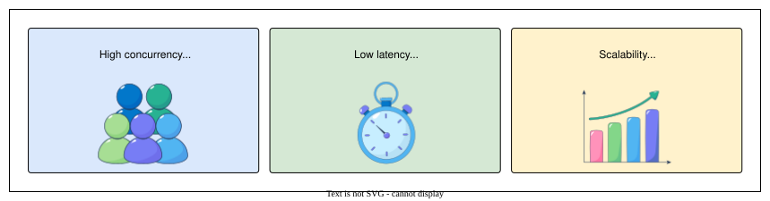

# Ticketmaster_System_Design

Source: https://www.educative.io/courses/grokking-the-system-design-interview/ticketmaster-system-design

---

[Home](https://www.educative.io/)

[Courses](https://www.educative.io/search?tab=courses)

[Grokking Modern System Design Interview](https://www.educative.io/courses/grokking-the-system-design-interview)

# Ticketmaster System Design

The design of a high-demand ticketing platform like Ticketmaster involves addressing complex challenges such as managing millions of concurrent users, ensuring system fairness, and maintaining low latency during peak traffic. Key functional requirements include event searches, ticket reservations, and secure payment processing, while non-functional requirements focus on scalability, availability, and security. The architecture incorporates load balancers, web servers, application servers, and databases, with strategies for concurrency handling, high availability, and robust security measures. Effective resource estimation and API design are crucial for delivering a seamless user experience during major events.

We'll cover the following...

- [Requirements for Ticketmaster](https://www.educative.io/courses/grokking-the-system-design-interview/ticketmaster-system-design#Requirements-for-Ticketmaster)
  - [Functional requirements](https://www.educative.io/courses/grokking-the-system-design-interview/ticketmaster-system-design#Functional-requirements)
  - [Nonfunctional requirements](https://www.educative.io/courses/grokking-the-system-design-interview/ticketmaster-system-design#Nonfunctional-requirements)
- [Estimating resources for Ticketmaster](https://www.educative.io/courses/grokking-the-system-design-interview/ticketmaster-system-design#Estimating-resources-for-Ticketmaster)
  - [Servers estimation for Ticketmaster](https://www.educative.io/courses/grokking-the-system-design-interview/ticketmaster-system-design#Servers-estimation-for-Ticketmaster)
  - [Storage estimation for Ticketmaster](https://www.educative.io/courses/grokking-the-system-design-interview/ticketmaster-system-design#Storage-estimation-for-Ticketmaster)
- [API design for Ticketmaster](https://www.educative.io/courses/grokking-the-system-design-interview/ticketmaster-system-design#API-design-for-Ticketmaster)
- [Building blocks](https://www.educative.io/courses/grokking-the-system-design-interview/ticketmaster-system-design#Building-blocks)
- [Design of Ticketmaster](https://www.educative.io/courses/grokking-the-system-design-interview/ticketmaster-system-design#Design-of-Ticketmaster)
  - [Detailed System Design of Ticketmaster](https://www.educative.io/courses/grokking-the-system-design-interview/ticketmaster-system-design#Detailed-System-Design-of-Ticketmaster)
- [Unique aspects of Ticketmaster’s design](https://www.educative.io/courses/grokking-the-system-design-interview/ticketmaster-system-design#Unique-aspects-of-Ticketmasters-design)
  - [Concurrency handling](https://www.educative.io/courses/grokking-the-system-design-interview/ticketmaster-system-design#Concurrency-handling)
  - [High availability](https://www.educative.io/courses/grokking-the-system-design-interview/ticketmaster-system-design#High-availability)
  - [Security](https://www.educative.io/courses/grokking-the-system-design-interview/ticketmaster-system-design#Security)
    - [Solutions](https://www.educative.io/courses/grokking-the-system-design-interview/ticketmaster-system-design#Solutions)
- [Conclusion](https://www.educative.io/courses/grokking-the-system-design-interview/ticketmaster-system-design#Conclusion)

Ticketing platforms for high-demand events, like major concerts, must manage millions of concurrent users trying to book the same seats.

These systems facilitate event searches, reservations, online payments, and digital ticket delivery, providing a streamlined user experience. Developing such platforms is a complex engineering challenge. Systems must manage extremely high traffic volumes while ensuring fairness, minimizing errors, and maintaining low latency.

Designing a scalable online ticketing system, like Ticketmaster, involves addressing multiple technical challenges. These systems must efficiently handle millions of concurrent requests, making the design both intricate and instructive.

Challenges in designing online ticket booking systems

Uncover the complete System Design of Ticketmaster, a deep dive that spans functional requirements, capacity estimations, API design, and the final architectural blueprint. We will begin by examining the core requirements for building a robust and scalable ticketing platform.

## Requirements for Ticketmaster[#](https://www.educative.io/courses/grokking-the-system-design-interview/ticketmaster-system-design#Requirements-for-Ticketmaster)

Defining a system’s requirements is the first step in structuring a well-defined architecture. Requirements establish the core functionalities and performance expectations that guide subsequent design decisions. These can be categorized into functional and non-functional requirements.

A clear understanding of both categories is essential for anticipating user needs and system resilience under high load, particularly in high-traffic scenarios like ticket sales.

### Functional requirements[#](https://www.educative.io/courses/grokking-the-system-design-interview/ticketmaster-system-design#Functional-requirements)

Key functionalities for a robust online ticketing system include:

- **List cities and venues:** Provide users with up-to-date catalogs of cities and venues, ensuring reliable and accessible data.
- **Search for events:** Enable efficient event search using filters such as date, location, or genre.
- **Reserve and purchase tickets:** Allow users to select seats and complete transactions seamlessly.
- **Manage bookings:** Enable users to view, modify, or cancel bookings efficiently.
- **Generate and validate tickets:** Issue digital tickets upon purchase and validate them securely at entry to prevent fraud.

### Nonfunctional requirements[#](https://www.educative.io/courses/grokking-the-system-design-interview/ticketmaster-system-design#Nonfunctional-requirements)

Critical non-functional requirements for a scalable ticketing system include:

- **Availability:** Ensure the system is highly available to meet user demand.
- **Scalability:** Handle millions of concurrent users, particularly during high-demand events.
- **Performance:** Provide low-latency responses, especially during seat selection.
- **Reliability:** Prevent double-booking or seat overselling.
- **Fault tolerance:** Maintain operation with minimal impact in case of server failures.
- **Security:** Protect user data, prevent fraud, and secure payment processing.

Effective scalability is essential; without it, the system may fail under heavy load during popular events. To maintain optimal performance and a superior user experience, it is vital to accurately project traffic demands and ensure that resources can adjust dynamically.

Balancing functional and nonfunctional requirements often involves trade-offs. Using structured trade-off matrices can help determine where compromises are acceptable without impacting user satisfaction or system stability.

Next, we will examine how to approach scalability considerations to ensure robust system performance.

## Estimating resources for Ticketmaster[#](https://www.educative.io/courses/grokking-the-system-design-interview/ticketmaster-system-design#Estimating-resources-for-Ticketmaster)

Once system requirements are established, the next step in System Design is to estimate the resources required to handle peak user demand efficiently.

This assessment determines the infrastructure necessary to maintain performance and scalability. Specifically, it involves calculating the number of application servers and evaluating how the system can sustain high traffic without degrading the user experience.

A key aspect of this process is estimating the number of application servers needed to maintain performance under peak load. By analyzing potential concurrent users and average request rates, it is possible to determine the server capacity required to ensure the system scales effectively.

### Servers estimation for Ticketmaster[#](https://www.educative.io/courses/grokking-the-system-design-interview/ticketmaster-system-design#Servers-estimation-for-Ticketmaster)

Assumptions:

- The system has 100 million daily active users (DAUs).
- Each user generates 100 requests per day during peak periods.
- Each server can handle approximately 64,000 requests per second (RPS).

Using these assumptions:

Reqs/day=DAUs×Req/user=100 M×100=10 Billion/day\text{Reqs}\_{\text{/day}} = \text{DAUs} \times \text{Req/user} = 100 \ \text{M} \times 100 = 10 \ \text{Billion}\_{\text{/day}}
Reqs/day​=DAUs×Req/user=100 M×100=10 Billion/day​

Reqs/sec=10 Billion86,400≈115 K/sec\text{Reqs}\_{\text{/sec}} = \frac{10 \ \text{Billion}}{86,400} \approx 115 \ \text{K}\_{\text{/sec}}
Reqs/sec​=86,40010 Billion​≈115 K/sec​

Servers=Req/secRPS of a server=115 K64,000≈2 Servers\text{Servers} = \frac{\text{Req}\_{\text{/sec}}}{\text{RPS of a server}} = \frac{115 \ \text{K}}{64,000} \approx 2 \ \text{Servers}
Servers=RPS of a serverReq/sec​​=64,000115 K​≈2 Servers

These calculations indicate the minimum number of servers required to support typical daily traffic.

However, during a traffic surge, when many users generate requests simultaneously, the peak request rate can approach the total number of DAUs:

Serverspeak=100 M64,000≈1562 Servers\text{Servers}\_{\text{peak}} = \frac{100 \ \text{M}}{64,000} \approx 1562\ \text{Servers}
Serverspeak​=64,000100 M​≈1562 Servers

These estimates are suitable for an interview context but can be refined further for production planning. For a detailed approach, refer to the [back-of-the-envelope calculations](https://www.educative.io/courses/grokking-the-system-design-interview/put-back-of-the-envelope-numbers-in-perspective).

### Storage estimation for Ticketmaster[#](https://www.educative.io/courses/grokking-the-system-design-interview/ticketmaster-system-design#Storage-estimation-for-Ticketmaster)

In this section, we estimate the storage requirements for a ticketing system.

Assumptions:

- The system serves 1,000 cities.
- Each city has 5 cinemas.
- Each cinema has approximately 1,000 seats.
- Each cinema hosts 2 shows per day on average.

A possible schema to store a booking is as follows:

Ace Editor

1

2

3

4

5

6

7

8

TABLE Booking(

ID int, # 4 bytes

Num\_Seats int, # 4 bytes

Show\_ID int, # 4 bytes

Movie\_ID int, # 4 bytes

Seat\_Numbers varchar(50), # 50 bytes

Booking\_Time timestamp, # 4 bytes

)

הההההההההההההההההההההההההההההההההההההההההההההההההההההההההההההההההההההההההההההההההההההההההההההההההההההההההההההההההההההההההההההההההההההההההההההההההההההההההההההההההההההההההההההההההההההההההההההההההההההההההההההההההההההההההההההההההההההההההההההההההההההההההההההההההההההההההההההההההההההההההההההההההההההההההההההההההההההההההההההההההההההההההההההההההההההההההההההההההההההההההההההההההההההההההההההההההההההההההההההההההההההההההההההההההההההההההההההההההההההההההההההההההההההההההההההההההההההההההההההההההההההההההההההההההההההההההההההההה

XXXXXXXXXXXXXXXXXXXXXXXXXXXXXXXXXXXXXXXXXXXXXXXXXXXXXXXXXXXXXXXXXXXXXXXXXXXXXXXXXXXXXXXXXXXXXXXXXXXXXXXXXXXXXXXXXXXXXXXXXXXXXXXXXXXXXXXXXXXXXXXXXXXXXXXXXXXXXXXXXXXXXXXXXXXXXXXXXXXXXXXXXXXXXXXXXXXXXXXXXXXXXXXXXXXXXXXXXXXXXXXXXXXXXXXXXXXXXXXXXXXXXXXXXXXXXXXXXXXXXXXXXXXXXXXXXXXXXXXXXXXXXXXXXXXXXXXXXXXXXXXXXXXXXXXXXXXXXXXXXXXXXXXXXXXXXXXXXXXXXXXXXXXXXXXXXXXXXXXXXXXXXXXXXXXXXXXXXXXXXXXXXXXXXXXXXXXXXXXXXXXXXXXXXXXXXXXXXXXXXXXXXXXXXXXXXXXXXXXXXXXXXXXXXXXXXXXXXXXXXXXXXXXXXXXXXXXXXXXXXXXXXXXXXXXXXXXXXXXXXXXXXXXXXXXX

This results in approximately 70 bytes per booking.

Storage/day=1,000 cities×5 cinemas×1,000 seats×2 shows×70 bytes=700 MB/day\text{Storage}\_{\text{/day}} = 1,000 \ \text{cities} \times 5 \ \text{cinemas} \times 1,000 \ \text{seats} \times 2 \ \text{shows} \times 70 \ \text{bytes} = 700 \ \text{MB/day}
Storage/day​=1,000 cities×5 cinemas×1,000 seats×2 shows×70 bytes=700 MB/day

Storage/month=700 MB×30≈21 GB\text{Storage}\_{\text{/month}} = 700 \ \text{MB} \times 30 \approx 21\ \text{GB}
Storage/month​=700 MB×30≈21 GB

Under this configuration, roughly 256 GB of storage would suffice for a year’s data, which is manageable for a large-scale service.

> **Note:** In a production system, multiple tables would exist for user accounts, transaction history, and inventory management. This calculation focuses on core booking storage requirements.

**Practical considerations:**

1. **Over-preparation:** Underestimating peak loads can create scalability issues. It is essential to consider unexpected surges, such as high-demand events, when planning infrastructure.
2. **Efficient data management:** Implement archiving strategies for outdated data and leverage cost-effective long-term storage to optimize resources.
3. **Real-world testing:** Conduct stress tests that simulate peak traffic to validate estimates and identify bottlenecks, enabling proactive tuning of the system.

Designing key API endpoints is the next step in ensuring the system operates efficiently and communicates effectively across components.

## API design for Ticketmaster[#](https://www.educative.io/courses/grokking-the-system-design-interview/ticketmaster-system-design#API-design-for-Ticketmaster)

A well-defined API enables efficient communication between clients and the Ticketmaster system. Key API functionalities include:

- **Search:** Returns available movies and showtimes for a specified location and time. Example request:

Ace Editor

1

2

-- Search

GET /search?city=Seattle&cinema=Regal&time=7pm

הההההההההההההההההההההההההההההההההההההההההההההההההההההההההההההההההההההההההההההההההההההההההההההההההההההההההההההההההההההההההההההההההההההההההההההההההההההההההההההההההההההההההההההההההההההההההההההההההההההההההההההההההההההההההההההההההההההההההההההההההההההההההההההההההההההההההההההההההההההההההההההההההההההההההההההההההההההההההההההההההההההההההההההההההההההההההההההההההההההההההההההההההההההההההההההההההההההההההההההההההההההההההההההההההההההההההההההההההההההההההההההההההההההההההההההההההההההההההההההההההההההההההההההההההההההההההההההההה

XXXXXXXXXXXXXXXXXXXXXXXXXXXXXXXXXXXXXXXXXXXXXXXXXXXXXXXXXXXXXXXXXXXXXXXXXXXXXXXXXXXXXXXXXXXXXXXXXXXXXXXXXXXXXXXXXXXXXXXXXXXXXXXXXXXXXXXXXXXXXXXXXXXXXXXXXXXXXXXXXXXXXXXXXXXXXXXXXXXXXXXXXXXXXXXXXXXXXXXXXXXXXXXXXXXXXXXXXXXXXXXXXXXXXXXXXXXXXXXXXXXXXXXXXXXXXXXXXXXXXXXXXXXXXXXXXXXXXXXXXXXXXXXXXXXXXXXXXXXXXXXXXXXXXXXXXXXXXXXXXXXXXXXXXXXXXXXXXXXXXXXXXXXXXXXXXXXXXXXXXXXXXXXXXXXXXXXXXXXXXXXXXXXXXXXXXXXXXXXXXXXXXXXXXXXXXXXXXXXXXXXXXXXXXXXXXXXXXXXXXXXXXXXXXXXXXXXXXXXXXXXXXXXXXXXXXXXXXXXXXXXXXXXXXXXXXXXXXXXXXXXXXXXXXXXX

- **Bookings and payments:** Temporarily reserves seats while the user completes payment. Example request:

Ace Editor

1

2

3

4

5

6

7

-- Reserve Seats

POST /create

Body: {

"showId": "s2411",

"userId": "u1412",

"seats": ["A1", "A2"]

}

הההההההההההההההההההההההההההההההההההההההההההההההההההההההההההההההההההההההההההההההההההההההההההההההההההההההההההההההההההההההההההההההההההההההההההההההההההההההההההההההההההההההההההההההההההההההההההההההההההההההההההההההההההההההההההההההההההההההההההההההההההההההההההההההההההההההההההההההההההההההההההההההההההההההההההההההההההההההההההההההההההההההההההההההההההההההההההההההההההההההההההההההההההההההההההההההההההההההההההההההההההההההההההההההההההההההההההההההההההההההההההההההההההההההההההההההההההההההההההההההההההההההההההההההההההההההההההההההה

XXXXXXXXXXXXXXXXXXXXXXXXXXXXXXXXXXXXXXXXXXXXXXXXXXXXXXXXXXXXXXXXXXXXXXXXXXXXXXXXXXXXXXXXXXXXXXXXXXXXXXXXXXXXXXXXXXXXXXXXXXXXXXXXXXXXXXXXXXXXXXXXXXXXXXXXXXXXXXXXXXXXXXXXXXXXXXXXXXXXXXXXXXXXXXXXXXXXXXXXXXXXXXXXXXXXXXXXXXXXXXXXXXXXXXXXXXXXXXXXXXXXXXXXXXXXXXXXXXXXXXXXXXXXXXXXXXXXXXXXXXXXXXXXXXXXXXXXXXXXXXXXXXXXXXXXXXXXXXXXXXXXXXXXXXXXXXXXXXXXXXXXXXXXXXXXXXXXXXXXXXXXXXXXXXXXXXXXXXXXXXXXXXXXXXXXXXXXXXXXXXXXXXXXXXXXXXXXXXXXXXXXXXXXXXXXXXXXXXXXXXXXXXXXXXXXXXXXXXXXXXXXXXXXXXXXXXXXXXXXXXXXXXXXXXXXXXXXXXXXXXXXXXXXXXXX

- **Booking confirmation:** Confirms the reservation after payment has been processed. Example request:

Ace Editor

1

2

3

4

5

6

-- Confirm Booking

POST /confirm

Body: {

"reservationId": "r2803",

"paymentInfo": {...}

}

הההההההההההההההההההההההההההההההההההההההההההההההההההההההההההההההההההההההההההההההההההההההההההההההההההההההההההההההההההההההההההההההההההההההההההההההההההההההההההההההההההההההההההההההההההההההההההההההההההההההההההההההההההההההההההההההההההההההההההההההההההההההההההההההההההההההההההההההההההההההההההההההההההההההההההההההההההההההההההההההההההההההההההההההההההההההההההההההההההההההההההההההההההההההההההההההההההההההההההההההההההההההההההההההההההההההההההההההההההההההההההההההההההההההההההההההההההההההההההההההההההההההההההההההההההההההההההההההה

XXXXXXXXXXXXXXXXXXXXXXXXXXXXXXXXXXXXXXXXXXXXXXXXXXXXXXXXXXXXXXXXXXXXXXXXXXXXXXXXXXXXXXXXXXXXXXXXXXXXXXXXXXXXXXXXXXXXXXXXXXXXXXXXXXXXXXXXXXXXXXXXXXXXXXXXXXXXXXXXXXXXXXXXXXXXXXXXXXXXXXXXXXXXXXXXXXXXXXXXXXXXXXXXXXXXXXXXXXXXXXXXXXXXXXXXXXXXXXXXXXXXXXXXXXXXXXXXXXXXXXXXXXXXXXXXXXXXXXXXXXXXXXXXXXXXXXXXXXXXXXXXXXXXXXXXXXXXXXXXXXXXXXXXXXXXXXXXXXXXXXXXXXXXXXXXXXXXXXXXXXXXXXXXXXXXXXXXXXXXXXXXXXXXXXXXXXXXXXXXXXXXXXXXXXXXXXXXXXXXXXXXXXXXXXXXXXXXXXXXXXXXXXXXXXXXXXXXXXXXXXXXXXXXXXXXXXXXXXXXXXXXXXXXXXXXXXXXXXXXXXXXXXXXXXXX

- **Retrieve booking:** Retrieves booking details for user reference or customer service. Example request:

Ace Editor

1

2

-- Get Booking

GET /booking?bookingId=b0102

הההההההההההההההההההההההההההההההההההההההההההההההההההההההההההההההההההההההההההההההההההההההההההההההההההההההההההההההההההההההההההההההההההההההההההההההההההההההההההההההההההההההההההההההההההההההההההההההההההההההההההההההההההההההההההההההההההההההההההההההההההההההההההההההההההההההההההההההההההההההההההההההההההההההההההההההההההההההההההההההההההההההההההההההההההההההההההההההההההההההההההההההההההההההההההההההההההההההההההההההההההההההההההההההההההההההההההההההההההההההההההההההההההההההההההההההההההההההההההההההההההההההההההההההההההההההההההההההה

XXXXXXXXXXXXXXXXXXXXXXXXXXXXXXXXXXXXXXXXXXXXXXXXXXXXXXXXXXXXXXXXXXXXXXXXXXXXXXXXXXXXXXXXXXXXXXXXXXXXXXXXXXXXXXXXXXXXXXXXXXXXXXXXXXXXXXXXXXXXXXXXXXXXXXXXXXXXXXXXXXXXXXXXXXXXXXXXXXXXXXXXXXXXXXXXXXXXXXXXXXXXXXXXXXXXXXXXXXXXXXXXXXXXXXXXXXXXXXXXXXXXXXXXXXXXXXXXXXXXXXXXXXXXXXXXXXXXXXXXXXXXXXXXXXXXXXXXXXXXXXXXXXXXXXXXXXXXXXXXXXXXXXXXXXXXXXXXXXXXXXXXXXXXXXXXXXXXXXXXXXXXXXXXXXXXXXXXXXXXXXXXXXXXXXXXXXXXXXXXXXXXXXXXXXXXXXXXXXXXXXXXXXXXXXXXXXXXXXXXXXXXXXXXXXXXXXXXXXXXXXXXXXXXXXXXXXXXXXXXXXXXXXXXXXXXXXXXXXXXXXXXXXXXXXXX

- **Booking cancellations:** Cancels an existing booking and releases the reserved seats. Example request:

Ace Editor

1

2

-- Cancel Booking

DELETE /booking?bookingId=b0102

הההההההההההההההההההההההההההההההההההההההההההההההההההההההההההההההההההההההההההההההההההההההההההההההההההההההההההההההההההההההההההההההההההההההההההההההההההההההההההההההההההההההההההההההההההההההההההההההההההההההההההההההההההההההההההההההההההההההההההההההההההההההההההההההההההההההההההההההההההההההההההההההההההההההההההההההההההההההההההההההההההההההההההההההההההההההההההההההההההההההההההההההההההההההההההההההההההההההההההההההההההההההההההההההההההההההההההההההההההההההההההההההההההההההההההההההההההההההההההההההההההההההההההההההההההההההההההההההה

XXXXXXXXXXXXXXXXXXXXXXXXXXXXXXXXXXXXXXXXXXXXXXXXXXXXXXXXXXXXXXXXXXXXXXXXXXXXXXXXXXXXXXXXXXXXXXXXXXXXXXXXXXXXXXXXXXXXXXXXXXXXXXXXXXXXXXXXXXXXXXXXXXXXXXXXXXXXXXXXXXXXXXXXXXXXXXXXXXXXXXXXXXXXXXXXXXXXXXXXXXXXXXXXXXXXXXXXXXXXXXXXXXXXXXXXXXXXXXXXXXXXXXXXXXXXXXXXXXXXXXXXXXXXXXXXXXXXXXXXXXXXXXXXXXXXXXXXXXXXXXXXXXXXXXXXXXXXXXXXXXXXXXXXXXXXXXXXXXXXXXXXXXXXXXXXXXXXXXXXXXXXXXXXXXXXXXXXXXXXXXXXXXXXXXXXXXXXXXXXXXXXXXXXXXXXXXXXXXXXXXXXXXXXXXXXXXXXXXXXXXXXXXXXXXXXXXXXXXXXXXXXXXXXXXXXXXXXXXXXXXXXXXXXXXXXXXXXXXXXXXXXXXXXXXXX

1.

What transport and communication protocols are suitable for Ticketmaster’s APIs, and why?

Show Answer

1 / 2

Defining these endpoints provides a clear foundation for System Design. The architecture will also require monitoring, load balancing, and other core components to ensure reliability and scalability.

## Building blocks[#](https://www.educative.io/courses/grokking-the-system-design-interview/ticketmaster-system-design#Building-blocks)

Designing a scalable Ticketmaster service requires several core components:

- **Load balancers:** Distribute incoming traffic across multiple servers to ensure system stability and prevent overload.
- **Databases:** Store information about cinemas, movies, cities, and users. SQL databases (e.g., MySQL, PostgreSQL) are preferred for their ACID compliance. Certain tasks may benefit from NoSQL databases to improve performance and scalability.
- **Web servers:** Serve static content, handle client requests, and forward dynamic requests to application servers.
- **Application servers:** Execute business logic, process API requests, and interact with databases.
- **Cache:** Improve response times by storing frequently accessed data.
- **Monitoring:** Track system health, detect anomalies, and log events for debugging and analysis.
- **Blob stores:** Store multimedia content such as movie posters or trailers.

The building blocks used in the System Design of Ticketmaster

**Practical insight:** Selecting the appropriate database technology is critical. SQL databases provide strong transactional support, while adding NoSQL databases for specific tasks can enhance scalability and performance. Match the database choice to the workload so the system can maintain performance and reliability as traffic grows.

## Design of Ticketmaster[#](https://www.educative.io/courses/grokking-the-system-design-interview/ticketmaster-system-design#Design-of-Ticketmaster)

With the core building blocks identified, we can proceed to the System Design of Ticketmaster. This section provides a high-level overview followed by considerations for detailed design.

High-level design of Ticketmaster

In this design, the load balancer distributes incoming requests to web servers, which serve the client-facing application. Requests requiring business logic are forwarded to application servers, which process the operations and interact with the databases to store or retrieve relevant information.

This architecture addresses the system's functional requirements. Achieving non-functional goals such as scalability, performance, and security requires careful attention to redundancy, fault tolerance, and efficient data management.

Integrating these considerations ensures a resilient ticketing platform that can support high volumes of concurrent users.

### Detailed System Design of Ticketmaster[#](https://www.educative.io/courses/grokking-the-system-design-interview/ticketmaster-system-design#Detailed-System-Design-of-Ticketmaster)

Expanding on the high-level design, we can identify services that fulfill both functional and nonfunctional requirements.

Detailed design of Ticketmaster

Users begin by requesting show searches, ticket bookings, and payments.

Load balancers efficiently manage these requests by distributing traffic across multiple web servers, preventing bottlenecks and enabling horizontal scaling by adding additional servers as required. All requests are routed through an API gateway, which provides a centralized entry point for client interactions.

Web servers serve static content securely, manage user sessions, and forward requests to application servers, which implement the business logic across several microservices:

- **Ticket service:** Handles reservations and ticket issuance.
- **Event service:** Manages large-scale event-related functionalities, including high-demand ticket releases, real-time seat availability updates, and event-based notifications.
- **User service:** Manages user authentication, profiles, and account settings.
- **Location service:** Stores and retrieves cinema-related data, including locations and available screens.
- **Search service:** Processes queries for movies, cinemas, and showtimes.

The application servers interact with the persistence layer to store, retrieve, and cache data efficiently.

A publish-subscribe system facilitates real-time event handling, such as notifications and updates for high-demand ticket releases. To ensure reliability and performance, a monitoring system continuously tracks system health, providing real-time analytics and alerts for proactive maintenance.

Ticketmaster is distinguished by its ability to handle high concurrency and real-time demands during major ticket releases.

Unlike typical System Designs, Ticketmaster's architecture must handle extreme traffic spikes while ensuring low latency and high availability for a seamless user experience. Let’s now examine what separates Ticketmaster from typical System Design problems.

## Unique aspects of Ticketmaster’s design[#](https://www.educative.io/courses/grokking-the-system-design-interview/ticketmaster-system-design#Unique-aspects-of-Ticketmasters-design)

Designing Ticketmaster introduces challenges that distinguish it from typical System Design problems, primarily due to requirements for extreme scalability and high concurrency. Key aspects of its architecture include:

- **Concurrency handling:** Efficiently managing simultaneous seat bookings to prevent overselling and conflicts.
- **High availability:** Maintaining system reliability and uptime, particularly during high-traffic events.
- **Security:** Protecting against unauthorized access, fraud, and cyber threats.

Each of these aspects is essential to providing a seamless and secure ticketing experience. The following sections will examine these considerations in detail.

### Concurrency handling[#](https://www.educative.io/courses/grokking-the-system-design-interview/ticketmaster-system-design#Concurrency-handling)

A significant challenge in Ticketmaster’s system is managing concurrent seat booking requests to avoid conflicts and prevent overselling. Common approaches to address these challenges include:

1. **Optimistic locking:** Suitable when conflicts are infrequent. The system monitors seat records using version numbers. If the version has changed during a booking attempt, the transaction is rolled back, indicating that another user has successfully booked the seat. This approach is less restrictive but may result in more transaction failures under high competition.
2. **Pessimistic locking:** The system locks the seat record when a booking begins, preventing other transactions from accessing it until the lock is released. This method ensures that no two users can book the same seat simultaneously, although it may reduce throughput under heavy load due to queuing.
3. **Distributed locking:** In a distributed environment, a centralized lock manager (e.g., Redis or Zookeeper) ensures consistent access to seat records across multiple servers. This prevents conflicts regardless of where requests originate. While essential for scalability, it introduces additional system complexity.

Distributed locking in action

**Practical insight:** Managing concurrency requires careful balance.

Optimistic locking can be efficient, but it is important to assess the likelihood of conflicts in the specific system context. Designing for worst-case scenarios and conducting pilot tests during live events can prevent unexpected failures and ensure reliable operation.

### High availability[#](https://www.educative.io/courses/grokking-the-system-design-interview/ticketmaster-system-design#High-availability)

The Ticketmaster system must maintain fault tolerance and high availability to ensure a seamless user experience, even in the event of server or network failures. Key strategies to achieve these goals include:

- **Redundancy:** Deploying multiple instances of each system component, such as web servers, application servers, and databases, ensuring traffic is distributed and that failures of individual servers do not disrupt service.
- **Replication:** Creating multiple copies of databases across different servers or data centers, allowing the system to continue operations seamlessly if a database fails.
- **Failover:** Implementing automatic failover mechanisms, redirecting traffic to standby servers in real time to minimize downtime and maintain user experience.

Integrating these strategies allows the system to handle unexpected failures robustly, maintaining high availability and reliability. These practices have proven effective in real-world applications, addressing availability challenges.

> **Note:** Numerous additional strategies exist for ensuring high availability, including autoscaling, graceful degradation, chaos engineering, and backup mechanisms. This section introduces the fundamental approaches.

### Security[#](https://www.educative.io/courses/grokking-the-system-design-interview/ticketmaster-system-design#Security)

Unauthorized access and data breaches pose significant risks to Ticketmaster, potentially compromising sensitive user data, including personal information, payment details, and booking history.

High-profile ticketing platforms are vulnerable to various threats, including credential stuffing, phishing attacks, payment fraud, automated bot-driven scalping, and denial-of-service (DoS) attacks. Implementing robust security measures is crucial for maintaining user trust, ensuring regulatory compliance, and preserving system integrity.

#### Solutions[#](https://www.educative.io/courses/grokking-the-system-design-interview/ticketmaster-system-design#Solutions)

- **Authentication and authorization:** Implementing role-based access control (RBAC) for users and administrators, ensuring that only authorized personnel can access specific functionalities or data and limiting exposure to sensitive information.
- **Data encryption:** Encrypting sensitive data, particularly payment-related information, protects it from unauthorized access both in transit and at rest.
- **Fraud prevention:** Deploying systems to detect and prevent suspicious activities and duplicate bookings, identifying patterns indicative of fraud using machine learning algorithms to maintain transaction integrity.

The illustration highlights key security techniques implemented in Ticketmaster.

It authenticates users to verify identities, authorizes actions to restrict administrative privileges, and prevents fraud to block unauthorized activities, such as ticket scalping or API misuse. Encryption ensures secure communication by encoding sensitive messages, collectively safeguarding the system from unauthorized access, fraudulent activities, and data breaches.

Multiple strategies exist for securing a system like Ticketmaster, including adherence to compliance standards, robust network security, proactive monitoring, and effective threat mitigation.

This section highlights key measures, including PCI-DSS compliance for secure payments, DDoS protection through firewalls and API security, and regular security audits to identify and prevent vulnerabilities. These measures collectively ensure data protection, system integrity, and resilience against evolving cyber threats.

**Practical insight:** Prioritizing security early in System Design is critical. Implementing thorough authentication protocols, robust encryption, access controls, and regular security audits has proven essential for preventing data breaches and maintaining user trust.

## Conclusion[#](https://www.educative.io/courses/grokking-the-system-design-interview/ticketmaster-system-design#Conclusion)

Designing a distributed system such as Ticketmaster requires a balance between scalability, reliability, security, and high performance.

This discussion examined essential design considerations, including API architecture, database management, security enforcement, and handling high concurrency. Together, these components determine the system’s ability to manage large-scale ticketing events efficiently.

Emerging approaches such as machine learning-based dynamic pricing, cryptographically verifiable fraud controls, and cloud-native service design can improve scalability, fault tolerance, and operational resilience. Advancements in predictive analytics and real-time event monitoring may improve operational efficiency while ensuring fair access to high-demand events.

Dropbox System Design

Ask

[Requirements for Ticketmaster](https://www.educative.io/courses/grokking-the-system-design-interview/ticketmaster-system-design#Requirements-for-Ticketmaster)

[Functional requirements](https://www.educative.io/courses/grokking-the-system-design-interview/ticketmaster-system-design#Functional-requirements)

[Nonfunctional requirements](https://www.educative.io/courses/grokking-the-system-design-interview/ticketmaster-system-design#Nonfunctional-requirements)

[Estimating resources for Ticketmaster](https://www.educative.io/courses/grokking-the-system-design-interview/ticketmaster-system-design#Estimating-resources-for-Ticketmaster)

[Servers estimation for Ticketmaster](https://www.educative.io/courses/grokking-the-system-design-interview/ticketmaster-system-design#Servers-estimation-for-Ticketmaster)

[Storage estimation for Ticketmaster](https://www.educative.io/courses/grokking-the-system-design-interview/ticketmaster-system-design#Storage-estimation-for-Ticketmaster)

[API design for Ticketmaster](https://www.educative.io/courses/grokking-the-system-design-interview/ticketmaster-system-design#API-design-for-Ticketmaster)

[Building blocks](https://www.educative.io/courses/grokking-the-system-design-interview/ticketmaster-system-design#Building-blocks)

[Design of Ticketmaster](https://www.educative.io/courses/grokking-the-system-design-interview/ticketmaster-system-design#Design-of-Ticketmaster)

[Detailed System Design of Ticketmaster](https://www.educative.io/courses/grokking-the-system-design-interview/ticketmaster-system-design#Detailed-System-Design-of-Ticketmaster)

[Unique aspects of Ticketmaster’s design](https://www.educative.io/courses/grokking-the-system-design-interview/ticketmaster-system-design#Unique-aspects-of-Ticketmasters-design)

[Concurrency handling](https://www.educative.io/courses/grokking-the-system-design-interview/ticketmaster-system-design#Concurrency-handling)

[High availability](https://www.educative.io/courses/grokking-the-system-design-interview/ticketmaster-system-design#High-availability)

[Security](https://www.educative.io/courses/grokking-the-system-design-interview/ticketmaster-system-design#Security)

[Solutions](https://www.educative.io/courses/grokking-the-system-design-interview/ticketmaster-system-design#Solutions)

[Conclusion](https://www.educative.io/courses/grokking-the-system-design-interview/ticketmaster-system-design#Conclusion)