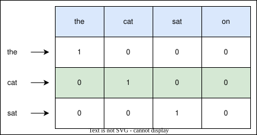

# Feature_Selection_and_Engineering_Techniques_for_ML_Systems

Source: https://www.educative.io/courses/machine-learning-system-design/feature-selection-and-feature-engineering

---

[Home](https://www.educative.io/)

[Courses](https://www.educative.io/search?tab=courses)

[Machine Learning System Design](https://www.educative.io/courses/machine-learning-system-design)

# Feature Selection and Feature Engineering

Explore different feature selection and engineering methods like one-hot encoding, feature hashing, crossed features, embeddings, and numeric scaling. Understand when and how to apply these techniques to improve model performance and scalability in real-world machine learning systems.

We'll cover the following...

- [1. One hot encoding for categorical features](https://www.educative.io/courses/machine-learning-system-design/feature-selection-and-feature-engineering#1-One-hot-encoding-for-categorical-features)
  - [When to use one-hot encoding](https://www.educative.io/courses/machine-learning-system-design/feature-selection-and-feature-engineering#When-to-use-one-hot-encoding)
  - [Common problems](https://www.educative.io/courses/machine-learning-system-design/feature-selection-and-feature-engineering#Common-problems)
  - [Best practices](https://www.educative.io/courses/machine-learning-system-design/feature-selection-and-feature-engineering#Best-practices)
  - [One hot encoding in tech companies](https://www.educative.io/courses/machine-learning-system-design/feature-selection-and-feature-engineering#One-hot-encoding-in-tech-companies)
- [2. Feature hashing](https://www.educative.io/courses/machine-learning-system-design/feature-selection-and-feature-engineering#2-Feature-hashing)
  - [Why feature hashing is useful](https://www.educative.io/courses/machine-learning-system-design/feature-selection-and-feature-engineering#Why-feature-hashing-is-useful)
    - [Feature hashing example](https://www.educative.io/courses/machine-learning-system-design/feature-selection-and-feature-engineering#Feature-hashing-example)
    - [Feature hashing in tech companies](https://www.educative.io/courses/machine-learning-system-design/feature-selection-and-feature-engineering#Feature-hashing-in-tech-companies)
- [3. Crossed feature](https://www.educative.io/courses/machine-learning-system-design/feature-selection-and-feature-engineering#3-Crossed-feature)
  - [Why crossed features matter](https://www.educative.io/courses/machine-learning-system-design/feature-selection-and-feature-engineering#Why-crossed-features-matter)
  - [Real-world example](https://www.educative.io/courses/machine-learning-system-design/feature-selection-and-feature-engineering#Real-world-example)
  - [Crossed feature in tech companies](https://www.educative.io/courses/machine-learning-system-design/feature-selection-and-feature-engineering#Crossed-feature-in-tech-companies)
- [4. Embedding](https://www.educative.io/courses/machine-learning-system-design/feature-selection-and-feature-engineering#4-Embedding)
  - [Why embeddings outperform one-hot and hashing](https://www.educative.io/courses/machine-learning-system-design/feature-selection-and-feature-engineering#Why-embeddings-outperform-one-hot-and-hashing)
  - [How to generate/learn embedding vector?](https://www.educative.io/courses/machine-learning-system-design/feature-selection-and-feature-engineering#How-to-generatelearn-embedding-vector)
  - [Embedding in tech companies](https://www.educative.io/courses/machine-learning-system-design/feature-selection-and-feature-engineering#Embedding-in-tech-companies)
- [5. Numeric features](https://www.educative.io/courses/machine-learning-system-design/feature-selection-and-feature-engineering#5-Numeric-features)
  - [Normalization](https://www.educative.io/courses/machine-learning-system-design/feature-selection-and-feature-engineering#Normalization)
  - [Standardization](https://www.educative.io/courses/machine-learning-system-design/feature-selection-and-feature-engineering#Standardization)

Feature engineering is the process of transforming raw data into meaningful, model-ready features. In real-world ML system design, good features often matter more than the choice of model.

This lesson introduces the most widely used feature engineering techniques in production systems and explains when, why, and how to use each one.

## 1. One hot encoding for categorical features[#](https://www.educative.io/courses/machine-learning-system-design/feature-selection-and-feature-engineering#1-One-hot-encoding-for-categorical-features)

One-hot encoding converts categorical variables into binary vectors where each category is represented by a 0 or 1.

### When to use one-hot encoding[#](https://www.educative.io/courses/machine-learning-system-design/feature-selection-and-feature-engineering#When-to-use-one-hot-encoding)

- Categorical features with low to medium cardinality
- Linear models and tree-based models
- Structured data (not text)



One hot encoding example

### Common problems[#](https://www.educative.io/courses/machine-learning-system-design/feature-selection-and-feature-engineering#Common-problems)

- Expansive computation and high memory consumption are major problems with one hot encoding. High numbers of values will create high-dimensional feature vectors. For example, if there are one million unique values in a column, it will produce feature vectors that have a dimensionality of one million.
- One hot encoding is not suitable for Natural Language Processing tasks. Microsoft Word’s dictionary is usually large, and we can’t use one hot encoding to represent each word as the vector is too big to store in memory.

### Best practices[#](https://www.educative.io/courses/machine-learning-system-design/feature-selection-and-feature-engineering#Best-practices)

- Depending on the application, some levels/categories that are not important, can be grouped together in the “Other” class.
- Make sure that the pipeline can handle unseen data in the test set.

> In Python, there are many ways to do one hot encoding, for example, `pandas.get_dummies` and sklearn `OneHotEncoder`. `pandas.get_dummies` does not “remember” the encoding during training, and if testing data has new values, it can lead to inconsistent mapping. `OneHotEncoder` is a Scikitlearn Transformer; therefore, you can use it consistently during training and predicting.

### One hot encoding in tech companies[#](https://www.educative.io/courses/machine-learning-system-design/feature-selection-and-feature-engineering#One-hot-encoding-in-tech-companies)

- It’s not practical to use one hot encoding to handle large cardinality features, i.e., features that have hundreds or thousands of unique values. Companies like [Instacart](https://www.instacart.com/) and [DoorDash](https://www.doordash.com/en-US) use more advanced techniques to handle large cardinality features.

## 2. Feature hashing[#](https://www.educative.io/courses/machine-learning-system-design/feature-selection-and-feature-engineering#2-Feature-hashing)

Feature hashing maps high-cardinality categorical features into a fixed-size vector using a hash function.

### Why feature hashing is useful[#](https://www.educative.io/courses/machine-learning-system-design/feature-selection-and-feature-engineering#Why-feature-hashing-is-useful)

- Handles thousands or millions of categories
- Fixed memory footprint
- No need to store a category dictionary

#### Feature hashing example[#](https://www.educative.io/courses/machine-learning-system-design/feature-selection-and-feature-engineering#Feature-hashing-example)

- First, you chose the dimensionality of your feature vectors. Then, using a hash function, you convert all values of your categorical attribute (or all tokens in your collection of
  documents) into a number. Then you convert this number into an index of your feature
  vector. The process is illustrated in the diagram below.


An illustration of the hashing trick for desired dimensionality of 5 for the originality of K of values of an attributes

- Let’s illustrate what it would look like to convert the text “The quick brown fox” into a feature vector. The values for each word in the phrase are:

  ```
  the = 5

  quick = 4

  brown = 4

  fox = 3
  ```
- Let define a hash function, hhh, that takes a string as input and outputs a non-negative integer. Let the desired dimensionality be 5. By applying the hash function to each word and applying the modulo of 5 to obtain the index of the word, we get:

  ```
  h(the) mod 5 = 0

  h(quick) mod 5 = 4

  h(brown) mod 5 = 4

  h(fox) mod 5 = 3
  ```
- In this example:

  - `h(the) mod 5 = 0` means that we have one word in dimension **0** of the feature vector.
  - `h(quick) mod 5 = 4` and `h(brown) mod 5 = 4` means that we have two words in dimension **4** of the feature vector.
  - `h(fox) mod 5 = 3` means that we have one word in dimension **3** of the feature vector.
  - As you can see, that there are no words in dimensions 1 or 2 of the vector, so we keep them as 0.
- Finally, we have the feature vector as: `[1, 0, 0, 1, 2]`.
- As you can see, there is a collision between words “quick” and “brown.” They are both represented by dimension 4. The lower the desired dimensionality, the higher the chances of collision. To reduce the probability of collision, we can increase the desired dimensions. This is the trade-off between speed and quality of learning.

> Commonly used hash functions are [MurmurHash3](https://en.wikipedia.org/wiki/MurmurHash), [Jenkins](https://en.wikipedia.org/wiki/Jenkins_hash_function), [CityHash](https://en.wikipedia.org/wiki/List_of_hash_functions), and [MD5](https://en.wikipedia.org/wiki/MD5).

#### Feature hashing in tech companies[#](https://www.educative.io/courses/machine-learning-system-design/feature-selection-and-feature-engineering#Feature-hashing-in-tech-companies)

- Feature hashing is popular in many tech companies like [Booking](https://www.booking.com/), [Facebook](https://www.facebook.com/), [Yahoo](https://www.yahoo.com/), [Yandex](https://yandex.com/), [Avazu](http://avazu.com/home/) and [Criteo](https://www.criteo.com/).
- One problem with hashing is collision. If the hash size is too small, more collisions will happen and negatively affect model performance. On the other hand, the larger the hash size, the more it will consume memory.
- Collisions also affect model performance. With high collisions, a model won’t be able to differentiate coefficients between feature values. For example, the coefficient for “User login/ User logout” might end up the same, which makes no sense.

> Depending on application, you can choose the number of bits for feature hashing that provide the correct balance between model accuracy and computing cost during model training. For example, by increasing hash size we can improve performance, but the training time will increase as well as memory consumption.

## 3. Crossed feature[#](https://www.educative.io/courses/machine-learning-system-design/feature-selection-and-feature-engineering#3-Crossed-feature)

Crossed features combine two or more categorical variables to capture interactions that individual features cannot represent.

### Why crossed features matter[#](https://www.educative.io/courses/machine-learning-system-design/feature-selection-and-feature-engineering#Why-crossed-features-matter)

- Using latitude alone or longitude alone gives weak signals.
- Crossing them defines a specific location, which is far more informative.

### Real-world example[#](https://www.educative.io/courses/machine-learning-system-design/feature-selection-and-feature-engineering#Real-world-example)

As an example, suppose we have Uber pick-up data with latitude and longitude stored in the database, and we want to predict demand at a certain location. If we just use the feature latitude for learning, the model might learn that a city block at a particular latitude is more likely to have a higher demand than others. This is similar for the feature longitude. However, a feature cross of longitude by latitude would represent a well-defined city block. Consequently, the model will learn more accurately.

Uber Pickups Map in 2015 (source Uber)

> Read more about different techniques in handling latitude/longitude here: [Haversine distance](https://en.wikipedia.org/wiki/Haversine_formula), [Manhattan distance](https://en.wiktionary.org/wiki/Manhattan_distance).

### Crossed feature in tech companies[#](https://www.educative.io/courses/machine-learning-system-design/feature-selection-and-feature-engineering#Crossed-feature-in-tech-companies)

This technique is commonly applied at many tech companies. [LinkedIn](https://www.linkedin.com/) uses crossed features between user location and user job title for their Job recommendation model. [Airbnb](https://www.airbnb.com/) also uses cross features for their Search Ranking model.

## 4. Embedding[#](https://www.educative.io/courses/machine-learning-system-design/feature-selection-and-feature-engineering#4-Embedding)

Feature embedding is an emerging technique that aims to transform features from the original space into a new space to support effective machine learning. The purpose of embedding is to capture semantic meaning of features; for example, similar features will be close to each other in the embedding vector space.

### Why embeddings outperform one-hot and hashing[#](https://www.educative.io/courses/machine-learning-system-design/feature-selection-and-feature-engineering#Why-embeddings-outperform-one-hot-and-hashing)

- Both one hot encoding and feature hashing can represent features in another dimension. However, these representations do not usually preserve the semantic meaning of each feature. For example, in the **Word2Vector** representation, embedding words into dense multidimensional representation helps to improve the prediction of the next words significantly.


A 4-dimensional embedding

- As an example, each word can be represented as a `d` dimension vector, and we can train our supervised model. We then use the output of one of the fully connected layers of the neural network model as embeddings on the input object. The embedding vector for a word would capture the semantic meaning of that word, with similar words having similar vector representations.

### How to generate/learn embedding vector?[#](https://www.educative.io/courses/machine-learning-system-design/feature-selection-and-feature-engineering#How-to-generatelearn-embedding-vector)

- For popular deep learning frameworks like TensorFlow, you need to define the dimension of embedding and network architecture. Once defined, the network can learn embedding automatically. For example:

  ```
  # Embed a 1,000 word vocabulary into 5

  dimensions.

  embedding_layer =

  tf.keras.layers.Embedding(1000, 5)
  ```

### Embedding in tech companies[#](https://www.educative.io/courses/machine-learning-system-design/feature-selection-and-feature-engineering#Embedding-in-tech-companies)

This technique is commonly applied at many tech companies.

- Twitter uses Embedding for UserIDs and cases like recommendations, nearest neighbor searches, and transfer learning.
- Doordash uses Store Embedding (store2vec) to personalize the store feed. Similar to word2vec, each store is one word and each sentence is one user session. Then, to generate vectors for a consumer, we sum the vectors for each store they ordered from in the past 6 months or a total of 100 orders. Then, the distance between a store and a consumer is determined by taking the cosine distance between the store’s vector and the consumer’s vector.
- Similarly, Instagram uses account embedding to recommend relevant content (photos, videos, and Stories) to users.

> The embedding dimensionality is usually determined experimentally or from experience. In TensorFlow documentation, they recommend: d=D4d = \sqrt[4]{D}d=4D​. Where DDD is the number of categories. Another way is to treat ddd as a hyperparameter, and we can tune on a downstream task.

> In large scale production, embedding features are usually pre-computed and stored in key/value storage to reduce inference latency.

## 5. Numeric features[#](https://www.educative.io/courses/machine-learning-system-design/feature-selection-and-feature-engineering#5-Numeric-features)

Numeric features are often overlooked, but in production ML systems, they can heavily influence model convergence, stability, and performance.

Real-world numeric features, such as price, age, distance, time spent, number of clicks, or delivery duration, usually come from different scales and distributions. If left untreated, features with larger magnitudes can dominate learning and skew model behavior.

Numeric feature transformation ensures that:

- Models learn fairly across features
- Training converges faster and more reliably
- Feature values remain stable during inference

Two of the most common numeric transformations are normalization and standardization, and choosing between them depends on data distribution and model type.

### Normalization[#](https://www.educative.io/courses/machine-learning-system-design/feature-selection-and-feature-engineering#Normalization)

- For numeric features, normalization can be done to make the mean equal 0, and the values be in the range [-1, 1]. There are some cases where we want to normalize data between the range [0, 1].

  v=v−min\_of\_vmax\_of\_v−min\_of\_vv = \frac{v - min\\_of\\_v}{max\\_of\\_v - min\\_of\\_v}v=max\_of\_v−min\_of\_vv−min\_of\_v​

  where,

  vvv is feature value,

  min\_of\_vmin\\_of\\_vmin\_of\_v is a minimum of feature value,

  max\_of\_vmax\\_of\\_vmax\_of\_v is a maximum of feature value

### Standardization[#](https://www.educative.io/courses/machine-learning-system-design/feature-selection-and-feature-engineering#Standardization)

- If features distribution resembles a normal distribution, then we can apply a standardized transformation.

  v=v−mean\_of\_vstd\_of\_vv = \frac{v - mean\\_of\\_v}{std\\_of\\_v}v=std\_of\_vv−mean\_of\_v​

  where,

  vvv is feature value,

  mean\_of\_vmean\\_of\\_vmean\_of\_v is a mean of feature value,

  std\_of\_vstd\\_of\\_vstd\_of\_v is the standard deviation of feature value
- If feature distribution resembles power laws, then we can transform it by using the formula:

  log(1+v1+median\_of\_v)log(\frac{1 + v}{1 + median\\_of\\_v})log(1+median\_of\_v1+v​)

> In practice, normalization can cause an issue as the values of `min` and `max` are usually outliers. One possible solution is “clipping”, where we choose a “reasonable” value for `min` and `max`. You can also learn more about how companies apply feature engineering [here](https://rebrand.ly/mleio).

Feature selection and Feature engineering quiz

1.

We have a table with columns UserID, CountryID, CityID, zip code, and age. Which of the following feature engineering is suitable to represent the data in a Machine Learning algorithm?

A.

Apply one hot encoding for all columns

B.

Apply Entity Embedding for CountryID and CityID; one hot Encoding of UserID and zipcode, and normalization of age.

C.

Apply Entity Embedding for CountryID, CityID, UserID, and zip code, and normalization of age.

---

1 / 5

Introduction

Training Pipeline

Ask

[1. One hot encoding for categorical features](https://www.educative.io/courses/machine-learning-system-design/feature-selection-and-feature-engineering#1-One-hot-encoding-for-categorical-features)

[When to use one-hot encoding](https://www.educative.io/courses/machine-learning-system-design/feature-selection-and-feature-engineering#When-to-use-one-hot-encoding)

[Common problems](https://www.educative.io/courses/machine-learning-system-design/feature-selection-and-feature-engineering#Common-problems)

[Best practices](https://www.educative.io/courses/machine-learning-system-design/feature-selection-and-feature-engineering#Best-practices)

[One hot encoding in tech companies](https://www.educative.io/courses/machine-learning-system-design/feature-selection-and-feature-engineering#One-hot-encoding-in-tech-companies)

[2. Feature hashing](https://www.educative.io/courses/machine-learning-system-design/feature-selection-and-feature-engineering#2-Feature-hashing)

[Why feature hashing is useful](https://www.educative.io/courses/machine-learning-system-design/feature-selection-and-feature-engineering#Why-feature-hashing-is-useful)

[Feature hashing example](https://www.educative.io/courses/machine-learning-system-design/feature-selection-and-feature-engineering#Feature-hashing-example)

[Feature hashing in tech companies](https://www.educative.io/courses/machine-learning-system-design/feature-selection-and-feature-engineering#Feature-hashing-in-tech-companies)

[3. Crossed feature](https://www.educative.io/courses/machine-learning-system-design/feature-selection-and-feature-engineering#3-Crossed-feature)

[Why crossed features matter](https://www.educative.io/courses/machine-learning-system-design/feature-selection-and-feature-engineering#Why-crossed-features-matter)

[Real-world example](https://www.educative.io/courses/machine-learning-system-design/feature-selection-and-feature-engineering#Real-world-example)

[Crossed feature in tech companies](https://www.educative.io/courses/machine-learning-system-design/feature-selection-and-feature-engineering#Crossed-feature-in-tech-companies)

[4. Embedding](https://www.educative.io/courses/machine-learning-system-design/feature-selection-and-feature-engineering#4-Embedding)

[Why embeddings outperform one-hot and hashing](https://www.educative.io/courses/machine-learning-system-design/feature-selection-and-feature-engineering#Why-embeddings-outperform-one-hot-and-hashing)

[How to generate/learn embedding vector?](https://www.educative.io/courses/machine-learning-system-design/feature-selection-and-feature-engineering#How-to-generatelearn-embedding-vector)

[Embedding in tech companies](https://www.educative.io/courses/machine-learning-system-design/feature-selection-and-feature-engineering#Embedding-in-tech-companies)

[5. Numeric features](https://www.educative.io/courses/machine-learning-system-design/feature-selection-and-feature-engineering#5-Numeric-features)

[Normalization](https://www.educative.io/courses/machine-learning-system-design/feature-selection-and-feature-engineering#Normalization)

[Standardization](https://www.educative.io/courses/machine-learning-system-design/feature-selection-and-feature-engineering#Standardization)