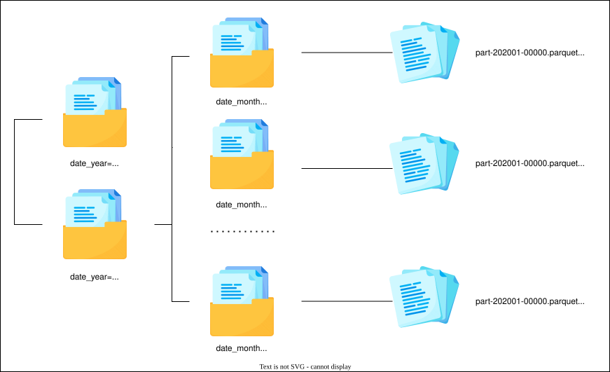
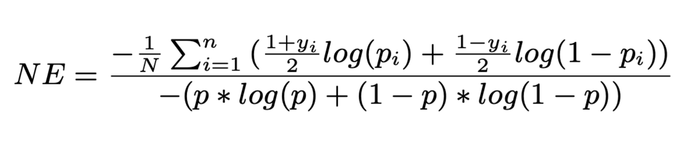

# Efficient_Machine_Learning_Training_Pipeline_Design

Source: https://www.educative.io/courses/machine-learning-system-design/training-pipeline

---

[Home](https://www.educative.io/)

[Courses](https://www.educative.io/search?tab=courses)

[Machine Learning System Design](https://www.educative.io/courses/machine-learning-system-design)

# Training Pipeline

Explore key components of a machine learning training pipeline including data storage formats like Parquet and TFRecord, strategies for addressing class imbalance, selection of loss functions for classification and regression, and the importance of retraining models regularly to maintain performance in dynamic environments.

We'll cover the following...

- [Training pipeline](https://www.educative.io/courses/machine-learning-system-design/training-pipeline#Training-pipeline)
  - [Data partitioning](https://www.educative.io/courses/machine-learning-system-design/training-pipeline#Data-partitioning)
  - [Handle imbalance class distribution](https://www.educative.io/courses/machine-learning-system-design/training-pipeline#Handle-imbalance-class-distribution)
  - [Choose the right loss function](https://www.educative.io/courses/machine-learning-system-design/training-pipeline#Choose-the-right-loss-function)
  - [Retraining requirements](https://www.educative.io/courses/machine-learning-system-design/training-pipeline#Retraining-requirements)

## Training pipeline[#](https://www.educative.io/courses/machine-learning-system-design/training-pipeline#Training-pipeline)

- A training pipeline needs to handle a large volume of data with low costs. One common solution is to store data in a column-oriented format like Parquet or ORC. These data formats enable high throughput for ML and analytics use cases. In other use cases, the tfrecord data format is widely used in the TensorFlow ecosystem.

### Data partitioning[#](https://www.educative.io/courses/machine-learning-system-design/training-pipeline#Data-partitioning)

- Parquet and ORC files usually get partitioned by time for efficiency as we can avoid scanning through the whole dataset. In this example, we partition data by year then by month. In practice, most common services on AWS, RedShift, and Athena support Parquet and ORC. In comparison to other formats like csv, Parquet can speed up the query times to be 30x faster, save 99% of the cost, and reduce the data that is scanned by 99%.



Partition training data in Parquet format

### Handle imbalance class distribution[#](https://www.educative.io/courses/machine-learning-system-design/training-pipeline#Handle-imbalance-class-distribution)

In ML use cases like Fraud Detection, Click Prediction, or Spam Detection, it’s common to have imbalance labels. There are few strategies to handle them, i.e, you can use any of these strategies depend on your use case.

- Use **class weights in loss function**: For example, in a spam detection problem where non-spam data has 95% data compare to other spam data which has only 5%. We want to penalize more in the spam class. In this case, we can modify the entropy loss function using weight.

  ```
  //w0 is weight for class 0 (non-spam), w1 is weight for class 1 (spam)

  loss_function = -w0 * ylog(p) - w1*(1-y)*log(1-p)
  ```
- Use **naive resampling**: Resample the non-spam class at a certain rate to reduce the imbalance in the training set. It’s important to have validation data and test data intact (no resampling).
- Use **synthetic resampling**: The Synthetic Minority Oversampling Technique (SMOTE)
  consists of synthesizing elements for the minority class, based on those that already exist. It works by randomly picking a point from the minority class and computing the k-nearest neighbors for that point. The synthetic points are added between the chosen point and its neighbors. For practical reasons, SMOTE is not as widely used as other methods.


### Choose the right loss function[#](https://www.educative.io/courses/machine-learning-system-design/training-pipeline#Choose-the-right-loss-function)

- It depends on the use case when deciding which loss function to use. For binary classification, the most popular is `cross-entropy`. In the Click Through Rate **(CTR)** prediction, Facebook uses Normalized Cross Entropy loss (a.k.a. `logloss`) to make the loss less sensitive to the background conversion rate.
  

> From an information theory perspective, the cross-entropy formula typically uses logarithm base-2 (reflecting bits of information). However, in most machine learning libraries and implementations such as TensorFlow, PyTorch, and scikit-learn, the natural logarithm (base-e) is used instead when computing cross-entropy loss.

- In a forecast problem, the most common metrics are the Mean Absolute Percentage Error (MAPE) and the Symmetric Absolute Percentage Error (SMAPE). For MAPE, you need to pay attention to whether or not your target value is skew, i.e., either too big or too small. On the other hand, SMAPE is not symmetric, as it treats under-forecast and over-forecast differently.

  **Mean Absolute Percentage Error**

  M=1n∑t=1n[At−FtAt]×100M = \frac{1}{n} \sum\_{t=1}^n [\frac{A\_{t}-F\_{t}}{A\_{t}}] \times 100M=n1​∑t=1n​[At​At​−Ft​​]×100

  **Symmetric Absolute Percentage Error**

  SMAPE=100n∑t=1n[Ft−At]([At]+[Ft])/2SMAPE = \frac{100}{n} \sum\_{t=1}^n \frac{[F\_{t}-A\_{t}]}{([A\_{t}] + [F\_{t}])/2}SMAPE=n100​∑t=1n​([At​]+[Ft​])/2[Ft​−At​]​

  MMM = mean absolute percentage error

  nnn = number of data

  AtA\_{t}At​ = actual value

  FtF\_{t}Ft​ = forecast value
- Other companies also use Machine Learning and Deep Learning for forecast problems. For example, Uber uses many different algorithms like Recurrent Neural Networks(RNNs), Gradient Boosting Trees, and Support Vector Regressors for various problems.

Some of the problems include Marketplace forecasting, Hardware capacity planning, and Marketing.

- For the regression problem, DoorDash used Quantile Loss to forecast Food Delivery demand.
- The Quantile Loss is given by:

L(y^,y)=max(α(y^−y),(1−α)(y−y^))L(\hat{y}, y) = max(\alpha(\hat{y}-y), (1-\alpha)(y-\hat{y}))L(y^​,y)=max(α(y^​−y),(1−α)(y−y^​))

### Retraining requirements[#](https://www.educative.io/courses/machine-learning-system-design/training-pipeline#Retraining-requirements)

- Retraining is a requirement in many tech companies. In practice, the data distribution is a non-stationary process, so the model does not perform well without retraining.
- In AdTech and recommendation/personalization use cases, it’s important to retrain models to capture changes in user’s behavior and trending topics. So, machine learning engineers need to make the training pipeline run fast and scale well with big data. When you design such a system, you need to balance between model complexity and training time.
- A common design pattern is to use a **scheduler** to retrain models on a regular basis, usually many times per day.

Quiz on Logloss

1.

Compute the average categorical cross-entropy (CCE)

|  | **Apple** | **Pear** | **Orange** |
| --- | --- | --- | --- |
| sample 1 | 1 | 0 | 0 |
| sample 2 | 1 | 0 | 0 |
| sample 3 | 1 | 0 | 0 |

|  | **pApple** | **pPear** | **pOrange** |
| --- | --- | --- | --- |
| sample 1 | 0.7 | 0.15 | 0.15 |
| sample 2 | 0.7 | 0.15 | 0.15 |
| sample 3 | 0.33 | 0.33 | 0.34 |

A.

0.607

B.

**2.1250**

C.

**-1.8220**

---

1 / 4

What scheduler softwares/tools can be used for retraining models?

Feature Selection and Feature Engineering

Inference

Ask

[Training pipeline](https://www.educative.io/courses/machine-learning-system-design/training-pipeline#Training-pipeline)

[Data partitioning](https://www.educative.io/courses/machine-learning-system-design/training-pipeline#Data-partitioning)

[Handle imbalance class distribution](https://www.educative.io/courses/machine-learning-system-design/training-pipeline#Handle-imbalance-class-distribution)

[Choose the right loss function](https://www.educative.io/courses/machine-learning-system-design/training-pipeline#Choose-the-right-loss-function)

[Retraining requirements](https://www.educative.io/courses/machine-learning-system-design/training-pipeline#Retraining-requirements)