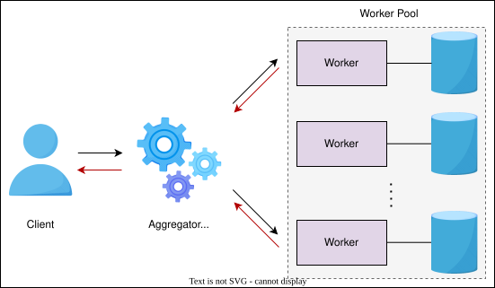
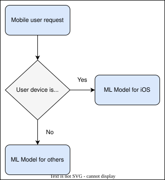

# Scalable_Inference_Techniques_for_Machine_Learning_Models

Source: https://www.educative.io/courses/machine-learning-system-design/inference

---

[Home](https://www.educative.io/)

[Courses](https://www.educative.io/search?tab=courses)

[Machine Learning System Design](https://www.educative.io/courses/machine-learning-system-design)

# Inference

Explore the process of inference in machine learning, focusing on scaling prediction workloads using aggregators and worker pools. Understand strategies for serving multiple models, managing data distribution shifts, and applying techniques like Thompson Sampling to balance exploration and exploitation in dynamic environments.

We'll cover the following...

- [Inference](https://www.educative.io/courses/machine-learning-system-design/inference#Inference)
  - [1. Imbalance workload](https://www.educative.io/courses/machine-learning-system-design/inference#1-Imbalance-workload)
    - [Serving logics and multiple models](https://www.educative.io/courses/machine-learning-system-design/inference#Serving-logics-and-multiple-models)
  - [2. Non-stationary problem](https://www.educative.io/courses/machine-learning-system-design/inference#2-Non-stationary-problem)
  - [3. Exploration vs. exploitation: Thompson Sampling](https://www.educative.io/courses/machine-learning-system-design/inference#3-Exploration-vs-exploitation-Thompson-Sampling)

## Inference[#](https://www.educative.io/courses/machine-learning-system-design/inference#Inference)

Inference is the process of using a trained machine learning model to make a prediction. Below are some of the techniques to scale inference in the production environment.

### 1. Imbalance workload[#](https://www.educative.io/courses/machine-learning-system-design/inference#1-Imbalance-workload)

- During inference, one common pattern is to split workloads onto multiple inference servers. We use similar architecture in Load Balancers. It is also sometimes called an Aggregator Service.

Dispatcher diagram

1. Clients (upstream process) send requests to the Aggregator Service. If the workload is too high, the Aggregator Service splits the workload and sends it to workers in the Worker pool. Aggregator Service can pick workers through one of the following ways:

   a) Work load

   b) Round Robin

   c) Request parameter
2. Wait for response from workers.
3. Forward response to client.

#### Serving logics and multiple models[#](https://www.educative.io/courses/machine-learning-system-design/inference#Serving-logics-and-multiple-models)

- For any business-driven system, it’s important to be able to change logic in serving models. For example, in an Ad Prediction system, depending on the type of ad candidates, we will route to a different model to get a score.

Combine multiple models in Inference

### 2. Non-stationary problem[#](https://www.educative.io/courses/machine-learning-system-design/inference#2-Non-stationary-problem)

- In an online setting, data is always changing. Therefore, the data distribution shift is common. So, keeping the models fresh is crucial to achieving sustained performance. Based on how frequently the model performance degrades, we can then decide how often models need to update/retrain. One common algorithm that can be used is the [Bayesian Logistic Regression](https://quinonero.net/Publications/AdPredictorICML2010-final.pdf).

### 3. Exploration vs. exploitation: Thompson Sampling[#](https://www.educative.io/courses/machine-learning-system-design/inference#3-Exploration-vs-exploitation-Thompson-Sampling)

- In an Ad Click prediction use case, it’s beneficial to allow some exploration when recommending new ads. However, if there are too few ad conversions, it can reduce company revenue. This is a well-known exploration-exploitation trade-off. One common technique is Thompson Sampling where at a time, ttt, we need to decide which action to take based on the reward.

Training Pipeline

Metrics Evaluation

Ask

[Inference](https://www.educative.io/courses/machine-learning-system-design/inference#Inference)

[1. Imbalance workload](https://www.educative.io/courses/machine-learning-system-design/inference#1-Imbalance-workload)

[Serving logics and multiple models](https://www.educative.io/courses/machine-learning-system-design/inference#Serving-logics-and-multiple-models)

[2. Non-stationary problem](https://www.educative.io/courses/machine-learning-system-design/inference#2-Non-stationary-problem)

[3. Exploration vs. exploitation: Thompson Sampling](https://www.educative.io/courses/machine-learning-system-design/inference#3-Exploration-vs-exploitation-Thompson-Sampling)