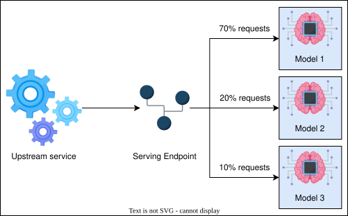

# Understanding_Metrics_Evaluation_for_Machine_Learning_Models

Source: https://www.educative.io/courses/machine-learning-system-design/metrics-evaluation

---

[Home](https://www.educative.io/)

[Courses](https://www.educative.io/search?tab=courses)

[Machine Learning System Design](https://www.educative.io/courses/machine-learning-system-design)

# Metrics Evaluation

Explore metrics evaluation in machine learning to understand how to measure model performance both offline and online. Learn to assess models using metrics like logloss, MAE, R2, and business impact metrics such as click-through rate and revenue lift. Gain insight into staging with real traffic and the role of A/B testing in validating production models.

We'll cover the following...

- [Metrics evaluation](https://www.educative.io/courses/machine-learning-system-design/metrics-evaluation#Metrics-evaluation)
  - [Offline metrics](https://www.educative.io/courses/machine-learning-system-design/metrics-evaluation#Offline-metrics)
  - [Online metrics](https://www.educative.io/courses/machine-learning-system-design/metrics-evaluation#Online-metrics)

## Metrics evaluation[#](https://www.educative.io/courses/machine-learning-system-design/metrics-evaluation#Metrics-evaluation)

In practice, it’s common that the model performs well during offline evaluation but does not perform well when in production. Therefore, it is important to measure model performance in both on and offline environments.

### Offline metrics[#](https://www.educative.io/courses/machine-learning-system-design/metrics-evaluation#Offline-metrics)

- During offline training and evaluating, we use metrics like logloss, MAE, and R2 to measure the goodness of fit. Once the model shows improvement, the next step would be to move to the staging/sandbox environment to test for a small percentage of real traffic.

### Online metrics[#](https://www.educative.io/courses/machine-learning-system-design/metrics-evaluation#Online-metrics)

- During the staging phase, we measure certain metrics, such as Lift in revenue or click through rate, to evaluate how well the model recommends relevant content to users. Consequently, we evaluate the impact on business metrics. If the observed revenue-related metrics show consistent improvement, then it is safe to gradually expose the model to a larger percentage of real traffic. Finally, when we have enough evidence that new models have improved revenue metrics, we can replace the current production models with new models. For further reading, explore how [Sage Maker enables A/B testing](https://aws.amazon.com/blogs/machine-learning/a-b-testing-ml-models-in-production-using-amazon-sagemaker/)
  or [LinkedIn A/B testing](https://engineering.linkedin.com/blog/2015/11/top-five-lessons-from-running-a-b-tests-on-the-world-s-largest-p).
- This diagram shows one way to allocate traffic to different models in production. In reality, there will be few a dozen models, each getting real traffic to serve online requests. This is one way to verify whether or not a model actually generates lift in the production environment.

Allocate traffic for multiple models in production

- AB testing is an extensive subject and is use case specific. Read more about [A/B testing](https://en.wikipedia.org/wiki/A/B_testing) here.

Inference

Problem Statement and Metrics

Ask

[Metrics evaluation](https://www.educative.io/courses/machine-learning-system-design/metrics-evaluation#Metrics-evaluation)

[Offline metrics](https://www.educative.io/courses/machine-learning-system-design/metrics-evaluation#Offline-metrics)

[Online metrics](https://www.educative.io/courses/machine-learning-system-design/metrics-evaluation#Online-metrics)