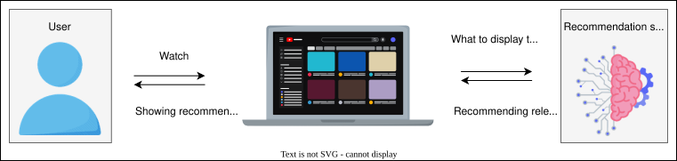

# Building_Video_Recommendation_Systems_with_Effective_Metrics

Source: https://www.educative.io/courses/machine-learning-system-design/problem-statement-and-metrics-g7p515EBD5r

---

[Home](https://www.educative.io/)

[Courses](https://www.educative.io/search?tab=courses)

[Machine Learning System Design](https://www.educative.io/courses/machine-learning-system-design)

# Problem Statement and Metrics

Explore how to establish clear problem statements and select appropriate offline and online metrics to design scalable video recommendation systems. Understand the balance between exploration and exploitation, and the technical requirements for retraining and low latency inference to maximize user engagement.

We'll cover the following...

- [Video recommendations](https://www.educative.io/courses/machine-learning-system-design/problem-statement-and-metrics-g7p515EBD5r#Video-recommendations)
  - [1. Problem statement](https://www.educative.io/courses/machine-learning-system-design/problem-statement-and-metrics-g7p515EBD5r#1-Problem-statement)
  - [2. Metrics design and requirements](https://www.educative.io/courses/machine-learning-system-design/problem-statement-and-metrics-g7p515EBD5r#2-Metrics-design-and-requirements)
    - [Metrics](https://www.educative.io/courses/machine-learning-system-design/problem-statement-and-metrics-g7p515EBD5r#Metrics)
      - [Offline metrics](https://www.educative.io/courses/machine-learning-system-design/problem-statement-and-metrics-g7p515EBD5r#Offline-metrics)
      - [Online metrics](https://www.educative.io/courses/machine-learning-system-design/problem-statement-and-metrics-g7p515EBD5r#Online-metrics)
    - [Requirements](https://www.educative.io/courses/machine-learning-system-design/problem-statement-and-metrics-g7p515EBD5r#Requirements)
    - [Training](https://www.educative.io/courses/machine-learning-system-design/problem-statement-and-metrics-g7p515EBD5r#Training)
    - [Inference](https://www.educative.io/courses/machine-learning-system-design/problem-statement-and-metrics-g7p515EBD5r#Inference)
    - [Exploration vs. Exploitation: Finding the Right Balance](https://www.educative.io/courses/machine-learning-system-design/problem-statement-and-metrics-g7p515EBD5r#Exploration-vs-Exploitation-Finding-the-Right-Balance)
  - [Summary](https://www.educative.io/courses/machine-learning-system-design/problem-statement-and-metrics-g7p515EBD5r#Summary)

## Video recommendations[#](https://www.educative.io/courses/machine-learning-system-design/problem-statement-and-metrics-g7p515EBD5r#Video-recommendations)

### 1. Problem statement[#](https://www.educative.io/courses/machine-learning-system-design/problem-statement-and-metrics-g7p515EBD5r#1-Problem-statement)

Build a video recommendation system that personalizes content for YouTube users. The main goal is to maximize user engagement by recommending videos they are likely to watch and enjoy. But it doesn’t stop there—we also want to introduce new and diverse content, not just more of what users already watch.

> Think of it like this: If someone watches cooking videos all day, the system shouldn’t just give them more of the same. It should also suggest travel vlogs, tech reviews, or short films they might find interesting.

**Goals:**

- Personalized recommendations based on user behavior
- Increase user engagement (watch time, click-throughs, conversions)
- Promote fresh content and not just historical favorites

Video recommendation system

### 2. Metrics design and requirements[#](https://www.educative.io/courses/machine-learning-system-design/problem-statement-and-metrics-g7p515EBD5r#2-Metrics-design-and-requirements)

#### Metrics[#](https://www.educative.io/courses/machine-learning-system-design/problem-statement-and-metrics-g7p515EBD5r#Metrics)

Choosing the right metrics is crucial. You can’t improve what you don’t measure. We split our metrics into offline and online evaluation methods:

##### Offline metrics[#](https://www.educative.io/courses/machine-learning-system-design/problem-statement-and-metrics-g7p515EBD5r#Offline-metrics)

Used during model training and validation.

- **Precision & recall:** How accurate and complete are our recommendations?
- **Ranking loss:** Measures how well the system ranks relevant videos higher.
- **Log loss:** Captures the model’s confidence in its predictions.

> Offline metrics are useful for rapid experimentation, but they don’t always reflect real user behavior.

##### Online metrics[#](https://www.educative.io/courses/machine-learning-system-design/problem-statement-and-metrics-g7p515EBD5r#Online-metrics)

These measure actual user behavior on the platform.

- **Click-through rate (CTR):** Do users click the videos we recommend?
- **Watch time:** How long do they stay engaged with the content?
- **Conversion rate:** Do they take desired actions like subscribing, liking, or sharing?

> A/B tests help validate whether your model performs well in the real world—not just in training.

#### Requirements[#](https://www.educative.io/courses/machine-learning-system-design/problem-statement-and-metrics-g7p515EBD5r#Requirements)

A robust video recommendation system must operate under demanding conditions. Here’s what’s expected:

#### Training[#](https://www.educative.io/courses/machine-learning-system-design/problem-statement-and-metrics-g7p515EBD5r#Training)

- **Challenge:** User interests shift rapidly. Videos can go viral in hours.
- **Solution:** The system should support frequent retraining (multiple times per day) to capture these trends.

#### Inference[#](https://www.educative.io/courses/machine-learning-system-design/problem-statement-and-metrics-g7p515EBD5r#Inference)

- **Challenge:** When a user opens the homepage, the system must instantly recommend ~100 videos.

- **Solution:** Response time (latency) should be under 200ms, ideally under 100ms.

> Fast recommendations are essential to keep users engaged. No one wants to wait for suggestions to load.

#### Exploration vs. Exploitation: Finding the Right Balance[#](https://www.educative.io/courses/machine-learning-system-design/problem-statement-and-metrics-g7p515EBD5r#Exploration-vs-Exploitation-Finding-the-Right-Balance)

A common challenge in recommendation systems is balancing:

- **Exploitation:** Recommending videos similar to what users already like
- **Exploration:** Suggesting new, unfamiliar content that might surprise or delight them

Too much exploitation = repetitive, boring feed
Too much exploration = irrelevant recommendations

> Great recommendation systems strike a balance—relevance plus discovery.

### Summary[#](https://www.educative.io/courses/machine-learning-system-design/problem-statement-and-metrics-g7p515EBD5r#Summary)

| **Type** | **Desired goals** |
| --- | --- |
| Metrics | Reasonable precision, high recall |
| Training | High throughput with the ability to retrain many times per day |
| Inference | Latency from 100ms to 200ms |
|  | Flexible to control exploration versus exploitation |

Metrics Evaluation

Candidate Generation and Ranking Model

Ask

[Video recommendations](https://www.educative.io/courses/machine-learning-system-design/problem-statement-and-metrics-g7p515EBD5r#Video-recommendations)

[1. Problem statement](https://www.educative.io/courses/machine-learning-system-design/problem-statement-and-metrics-g7p515EBD5r#1-Problem-statement)

[2. Metrics design and requirements](https://www.educative.io/courses/machine-learning-system-design/problem-statement-and-metrics-g7p515EBD5r#2-Metrics-design-and-requirements)

[Metrics](https://www.educative.io/courses/machine-learning-system-design/problem-statement-and-metrics-g7p515EBD5r#Metrics)

[Offline metrics](https://www.educative.io/courses/machine-learning-system-design/problem-statement-and-metrics-g7p515EBD5r#Offline-metrics)

[Online metrics](https://www.educative.io/courses/machine-learning-system-design/problem-statement-and-metrics-g7p515EBD5r#Online-metrics)

[Requirements](https://www.educative.io/courses/machine-learning-system-design/problem-statement-and-metrics-g7p515EBD5r#Requirements)

[Training](https://www.educative.io/courses/machine-learning-system-design/problem-statement-and-metrics-g7p515EBD5r#Training)

[Inference](https://www.educative.io/courses/machine-learning-system-design/problem-statement-and-metrics-g7p515EBD5r#Inference)

[Exploration vs. Exploitation: Finding the Right Balance](https://www.educative.io/courses/machine-learning-system-design/problem-statement-and-metrics-g7p515EBD5r#Exploration-vs-Exploitation-Finding-the-Right-Balance)

[Summary](https://www.educative.io/courses/machine-learning-system-design/problem-statement-and-metrics-g7p515EBD5r#Summary)