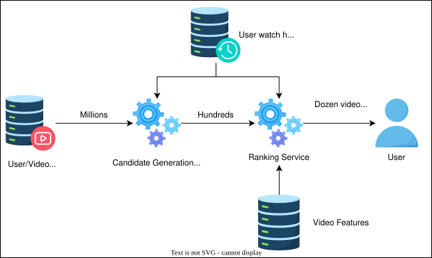

# Candidate_Generation_and_Ranking_Models_in_Video_Recommendation

Source: https://www.educative.io/courses/machine-learning-system-design/candidate-generation-and-ranking-model

---

[Home](https://www.educative.io/)

[Courses](https://www.educative.io/search?tab=courses)

[Machine Learning System Design](https://www.educative.io/courses/machine-learning-system-design)

# Candidate Generation and Ranking Model

Explore the two-stage process of candidate generation and ranking in video recommendation systems. Understand how feature engineering and models like matrix factorization and neural networks combine to deliver scalable and personalized video suggestions by estimating watch likelihood.

We'll cover the following...

- [3. Multi-stage models](https://www.educative.io/courses/machine-learning-system-design/candidate-generation-and-ranking-model#3-Multi-stage-models)
  - [Candidate generation model](https://www.educative.io/courses/machine-learning-system-design/candidate-generation-and-ranking-model#Candidate-generation-model)
    - [Feature engineering](https://www.educative.io/courses/machine-learning-system-design/candidate-generation-and-ranking-model#Feature-engineering)
    - [Training data](https://www.educative.io/courses/machine-learning-system-design/candidate-generation-and-ranking-model#Training-data)
    - [Model](https://www.educative.io/courses/machine-learning-system-design/candidate-generation-and-ranking-model#Model)
  - [Ranking model](https://www.educative.io/courses/machine-learning-system-design/candidate-generation-and-ranking-model#Ranking-model)
    - [Feature engineering](https://www.educative.io/courses/machine-learning-system-design/candidate-generation-and-ranking-model#Feature-engineering-1)
    - [Training data](https://www.educative.io/courses/machine-learning-system-design/candidate-generation-and-ranking-model#Training-data-1)
    - [Model](https://www.educative.io/courses/machine-learning-system-design/candidate-generation-and-ranking-model#Model-1)

## 3. Multi-stage models[#](https://www.educative.io/courses/machine-learning-system-design/candidate-generation-and-ranking-model#3-Multi-stage-models)

Architecture diagram for the video recommendation system

There are two stages, candidate generation, and ranking. The reason for two stages is to make the system scale.

> It’s a common pattern that you will see in many ML systems.

We will explore the two stages in the section below.

- The candidate model will find the relevant videos based on user watch history and the type of videos the user has watched.
- The ranking model will optimize for the view likelihood, i.e., videos that have high a watch possibility should be ranked high. It’s a natural fit for the logistic regression algorithm.

### Candidate generation model[#](https://www.educative.io/courses/machine-learning-system-design/candidate-generation-and-ranking-model#Candidate-generation-model)

#### Feature engineering[#](https://www.educative.io/courses/machine-learning-system-design/candidate-generation-and-ranking-model#Feature-engineering)

- Each user has a list of video watches (videos, minutes\_watched).

#### Training data[#](https://www.educative.io/courses/machine-learning-system-design/candidate-generation-and-ranking-model#Training-data)

- For generating training data, we can make a user-video watch space.
  We can start by selecting a period of data like last month, last 6 months, etc. This should find a balance between training time and model accuracy.

#### Model[#](https://www.educative.io/courses/machine-learning-system-design/candidate-generation-and-ranking-model#Model)

- The candidate generation can be done by [Matrix factorization](https://en.wikipedia.org/wiki/Matrix_factorization_(recommender_systems)#:~:text=Matrix%20factorization%20is%20a%20class,two%20lower%20dimensionality%20rectangular%20matrices.). The purpose of candidate generation is to generate “somewhat” relevant content to users based on their watched history. The candidate list needs to be big enough to capture potential matches for the model to perform well with desired latency.
- One solution is to use [collaborative algorithms](https://en.wikipedia.org/wiki/Collaborative_filtering) because the inference time is fast, and it can capture the similarity between user taste in the user-video space.

> In practice, for large scale system (Facebook, Google), we don’t use Collaborative Filtering and prefer low latency method to get candidate. One example is to leverage Inverted Index (commonly used in Lucene, Elastic Search). Another powerful technique can be found [FAISS](https://engineering.fb.com/2017/03/29/data-infrastructure/faiss-a-library-for-efficient-similarity-search/) or Google [ScaNN](https://ai.googleblog.com/2020/07/announcing-scann-efficient-vector.html).

### Ranking model[#](https://www.educative.io/courses/machine-learning-system-design/candidate-generation-and-ranking-model#Ranking-model)

During inference, the ranking model receives a list of video candidates given by the Candidate Generation model. For each candidate, the ranking model estimates the probability of that video being watched. It then sorts the video candidates based on that probability and returns the list to the upstream process.

#### Feature engineering[#](https://www.educative.io/courses/machine-learning-system-design/candidate-generation-and-ranking-model#Feature-engineering-1)

| **Features** | **Feature engineering** |
| --- | --- |
| Watched video IDs | Video embedding |
| Historical search query | Text embedding |
| Location | Geolocation embedding |
| User associated features: age, gender | Normalization or Standardization |
| Previous impression | Normalization or Standardization |
| Time related features | Month, week\_of\_year, holiday, day\_of\_week, hour\_of\_day. |

Read about [embedding](https://www.educative.io/courses/machine-learning-system-design/feature-selection-and-feature-engineering#4-embedding).

#### Training data[#](https://www.educative.io/courses/machine-learning-system-design/candidate-generation-and-ranking-model#Training-data-1)

- We can use User Watched History data. Normally, the ratio between watched vs. not-watched is 2/98. So, for the majority of the time, the user does not watch a video.

#### Model[#](https://www.educative.io/courses/machine-learning-system-design/candidate-generation-and-ranking-model#Model-1)

At the beginning, it’s important that we started with a simple model, as we can add complexity later.

- A fully connected neural network is simple yet powerful for representing non-linear relationships, and it can handle big data.
- We start with a fully connected neural network with **sigmoid** activation at the last layer. The reason for this is that the Sigmoid function returns value in the range [0, 1]; therefore it’s a natural fit for estimating probability.

> For deep learning architecture, we can use **relu**, (Rectified Linear Unit), as an activation function for hidden layers. It’s very effective in practice.

- The loss function can be cross-entropy loss.

Model prediction

Quiz on ranking model

1.

Why do we use Sigmoid activation at the last layer of our ranking model instead of relu?

A.

Because it’s faster to compute the Sigmoid function.

B.

Because the Sigmoid function outputs probability in the range [0, 1] that presents the watch probability to recommend videos.

---

1 / 2

Problem Statement and Metrics

Video Recommendation System Design

Ask

[3. Multi-stage models](https://www.educative.io/courses/machine-learning-system-design/candidate-generation-and-ranking-model#3-Multi-stage-models)

[Candidate generation model](https://www.educative.io/courses/machine-learning-system-design/candidate-generation-and-ranking-model#Candidate-generation-model)

[Feature engineering](https://www.educative.io/courses/machine-learning-system-design/candidate-generation-and-ranking-model#Feature-engineering)

[Training data](https://www.educative.io/courses/machine-learning-system-design/candidate-generation-and-ranking-model#Training-data)

[Model](https://www.educative.io/courses/machine-learning-system-design/candidate-generation-and-ranking-model#Model)

[Ranking model](https://www.educative.io/courses/machine-learning-system-design/candidate-generation-and-ranking-model#Ranking-model)

[Feature engineering](https://www.educative.io/courses/machine-learning-system-design/candidate-generation-and-ranking-model#Feature-engineering-1)

[Training data](https://www.educative.io/courses/machine-learning-system-design/candidate-generation-and-ranking-model#Training-data-1)

[Model](https://www.educative.io/courses/machine-learning-system-design/candidate-generation-and-ranking-model#Model-1)