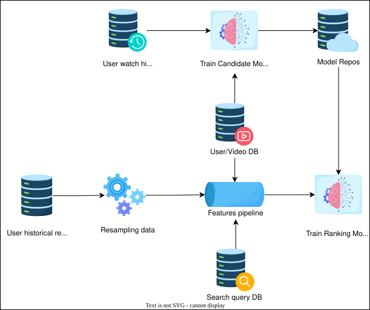
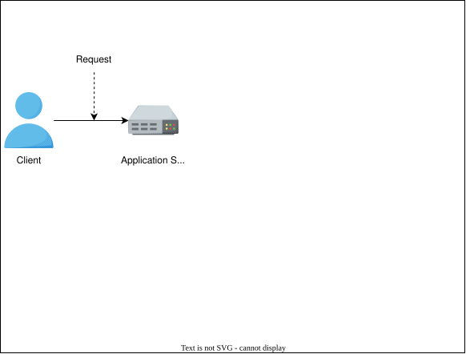
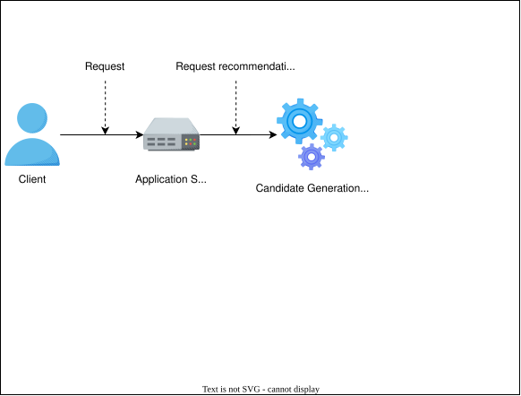
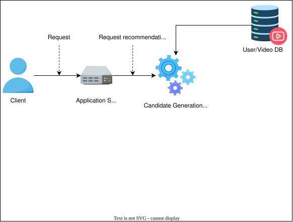
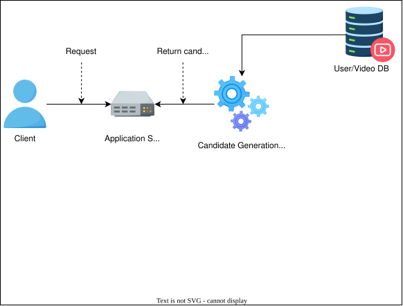
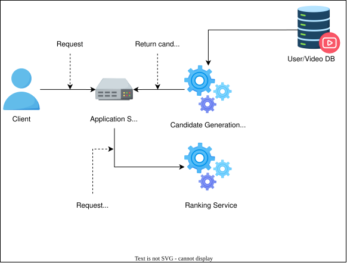

# Designing_Scalable_Video_Recommendation_Systems_for_Large_Users

Source: https://www.educative.io/courses/machine-learning-system-design/video-recommendation-system-design

---

[Home](https://www.educative.io/)

[Courses](https://www.educative.io/search?tab=courses)

[Machine Learning System Design](https://www.educative.io/courses/machine-learning-system-design)

# Video Recommendation System Design

Explore how to design and scale video recommendation systems for billions of users. Understand data assumptions, system components, and strategies for handling huge datasets and low-latency demands in production environments.

We'll cover the following...

- [4. Calculation & estimation](https://www.educative.io/courses/machine-learning-system-design/video-recommendation-system-design#4-Calculation--estimation)
  - [Assumptions](https://www.educative.io/courses/machine-learning-system-design/video-recommendation-system-design#Assumptions)
  - [Data size](https://www.educative.io/courses/machine-learning-system-design/video-recommendation-system-design#Data-size)
  - [Bandwidth](https://www.educative.io/courses/machine-learning-system-design/video-recommendation-system-design#Bandwidth)
  - [Scale](https://www.educative.io/courses/machine-learning-system-design/video-recommendation-system-design#Scale)
- [5. System design](https://www.educative.io/courses/machine-learning-system-design/video-recommendation-system-design#5-System-design)
  - [High-level system design](https://www.educative.io/courses/machine-learning-system-design/video-recommendation-system-design#High-level-system-design)
  - [Challenges](https://www.educative.io/courses/machine-learning-system-design/video-recommendation-system-design#Challenges)
    - [Huge data size](https://www.educative.io/courses/machine-learning-system-design/video-recommendation-system-design#Huge-data-size)
    - [Imbalance data](https://www.educative.io/courses/machine-learning-system-design/video-recommendation-system-design#Imbalance-data)
    - [High availability](https://www.educative.io/courses/machine-learning-system-design/video-recommendation-system-design#High-availability)
- [6. Scale the design](https://www.educative.io/courses/machine-learning-system-design/video-recommendation-system-design#6-Scale-the-design)
- [7. Follow up questions](https://www.educative.io/courses/machine-learning-system-design/video-recommendation-system-design#7-Follow-up-questions)
- [8. Summary](https://www.educative.io/courses/machine-learning-system-design/video-recommendation-system-design#8-Summary)

## 4. Calculation & estimation[#](https://www.educative.io/courses/machine-learning-system-design/video-recommendation-system-design#4-Calculation--estimation)

### Assumptions[#](https://www.educative.io/courses/machine-learning-system-design/video-recommendation-system-design#Assumptions)

For the sake of simplicity, we can make these assumptions:

- Video views per month are 150 billion.
- 10% of videos watched are from recommendations, a total of 15 billion videos.
- On the homepage, a user sees 100 video recommendations.
- On average, a user watches two videos out of 100 video recommendations.
- If users do not click or watch some video within a given time frame, i.e., 10 minutes, then it is a missed recommendation.
- The total number of users is 1.3 billion.

### Data size[#](https://www.educative.io/courses/machine-learning-system-design/video-recommendation-system-design#Data-size)

- For 1 month, we collected 15 billion positive labels and 750 billion negative labels.
- Generally, we can assume that for every data point we collect, we also collect hundreds of features. For simplicity, each row takes 500 bytes to store. In one month, we need 800 billion rows.
- Total size: 500 \* 800 \* 10910^9109 = 4 \* 101410^{14}1014 bytes = 0.4 Petabytes. To save costs, we can keep the last six months or one year of data in the data lake, and archive old data in cold storage.

### Bandwidth[#](https://www.educative.io/courses/machine-learning-system-design/video-recommendation-system-design#Bandwidth)

- Assume that every second we have to generate a recommendation request for 10 million users. Each request will generate ranks for 1k-10k videos.

### Scale[#](https://www.educative.io/courses/machine-learning-system-design/video-recommendation-system-design#Scale)

- Support 1.3 billion users

## 5. System design[#](https://www.educative.io/courses/machine-learning-system-design/video-recommendation-system-design#5-System-design)

### High-level system design[#](https://www.educative.io/courses/machine-learning-system-design/video-recommendation-system-design#High-level-system-design)

High level system design

- Database
  - User Watched history stores which videos are watched by a particular user overtime.
  - Search Query DB stores ahistorical queries that users have searched in the past. User/Video DB stores a list of Users and their profiles along with Video metadata.
  - User historical recommendations stores past recommendations for a particular user.

- Resampling data: It’s part of the pipeline to help scale the training process by down-sampling negative samples.
- Feature pipeline: A pipeline program to generate all required features for training a model. It’s important for feature pipelines to provide high throughput, as we require this to retrain models multiple times. We can use Spark or Elastic MapReduce or Google DataProc.
- Model Repos: Storage to store all models, using AWS S3 is a popular option.

> In practice, during inference, it’s desirable to be able to get the latest model near real-time. One common pattern for the inference component is to frequently pull the latest models from Model Repos based on timestamp.

### Challenges[#](https://www.educative.io/courses/machine-learning-system-design/video-recommendation-system-design#Challenges)

#### Huge data size[#](https://www.educative.io/courses/machine-learning-system-design/video-recommendation-system-design#Huge-data-size)

- Solution: Pick 1 month or 6 months of recent data.

#### Imbalance data[#](https://www.educative.io/courses/machine-learning-system-design/video-recommendation-system-design#Imbalance-data)

- Solution: Perform random negative down-sampling.

#### High availability[#](https://www.educative.io/courses/machine-learning-system-design/video-recommendation-system-design#High-availability)

- Solution 1: Use model-as-a-service, each model will run in Docker containers.
- Solution 2: We can use Kubernetes to auto-scale the number of pods.

Let’s examine the flow of the system:

1 / 8

User sends video recommendation request to the Application Server

1 / 8

Application Server sends recommendation request to Candidate Generation Service

1 / 8

Candidate Generation Service gets user metadata and videos from database

1 / 8

Candidate Generation Service returns list of video candidates to Application Server

1 / 8

Application service sends list of candidates to Ranking Service to score

When a user requests a video recommendation, the Application Server requests Video candidates from the Candidate Generation Model. Once it receives the candidates, it then passes the candidate list to the ranking model to get the sorting order. The ranking model estimates the watch probability and returns the sorted list to the Application Server. The Application Server then returns the top videos that the user should watch.

## 6. Scale the design[#](https://www.educative.io/courses/machine-learning-system-design/video-recommendation-system-design#6-Scale-the-design)

- Scale out (horizontal) multiple Application Servers and use Load Balancers to balance loads.
- Scale out (horizontal) multiple Candidate Generation Services and Ranking Services.

> It’s common to deploy these services in a Kubernetes Pod and take advantage of the Kubernetes Pod Autoscaler to scale out these services automatically.

> In practice, we can also use `Kube-proxy` so the Candidate Generation Service can call Ranking Service directly, reducing latency even further.

Design system at scale

## 7. Follow up questions[#](https://www.educative.io/courses/machine-learning-system-design/video-recommendation-system-design#7-Follow-up-questions)

| **Question** | **Answer** |
| --- | --- |
| How do we adapt to user behavior changing over time? | 1. Read more about Multi-arm bandit. 2. Use the Bayesian Logistic Regression Model so we can update prior data. 3. Use different loss functions to be less sensitive with click through rates, etc. |
|  |  |
| How do we handle the ranking model being under-explored? | We can introduce randomization in the Ranking Service. For example, 2% of requests will get random candidates, and 98% will get sorted candidates from the Ranking Service. |

Quiz on model and system design

1.

Which of the following are the benefits of splitting the Candidate Generation Service and the Ranking Service? Multi-select

A.

To build, deploy, and release each service independently.

B.

Reduce memory requirement in each service, so that each service can be deployed in individual Kubernetes pods.

C.

Scale Candidate Generation Services and Ranking Services independently.

D.

The Ranking Service can load ML models faster.

---

1 / 2

## 8. Summary[#](https://www.educative.io/courses/machine-learning-system-design/video-recommendation-system-design#8-Summary)

- We first learned to separate Recommendations into two services: Candidate Generation Service and Ranking Service.
- We also learned about using a Deep learning fully connected layers as a baseline model and how to handle feature engineering.
- To scale the system and reduce latency, we can use `kube-flow` so that the Candidate Generation Service can communicate with the Ranking Service directly.
- - You can also learn more about how companies scale there design [here](https://rebrand.ly/mleio).

Candidate Generation and Ranking Model

Problem Statement and Metrics

Ask

[4. Calculation & estimation](https://www.educative.io/courses/machine-learning-system-design/video-recommendation-system-design#4-Calculation--estimation)

[Assumptions](https://www.educative.io/courses/machine-learning-system-design/video-recommendation-system-design#Assumptions)

[Data size](https://www.educative.io/courses/machine-learning-system-design/video-recommendation-system-design#Data-size)

[Bandwidth](https://www.educative.io/courses/machine-learning-system-design/video-recommendation-system-design#Bandwidth)

[Scale](https://www.educative.io/courses/machine-learning-system-design/video-recommendation-system-design#Scale)

[5. System design](https://www.educative.io/courses/machine-learning-system-design/video-recommendation-system-design#5-System-design)

[High-level system design](https://www.educative.io/courses/machine-learning-system-design/video-recommendation-system-design#High-level-system-design)

[Challenges](https://www.educative.io/courses/machine-learning-system-design/video-recommendation-system-design#Challenges)

[Huge data size](https://www.educative.io/courses/machine-learning-system-design/video-recommendation-system-design#Huge-data-size)

[Imbalance data](https://www.educative.io/courses/machine-learning-system-design/video-recommendation-system-design#Imbalance-data)

[High availability](https://www.educative.io/courses/machine-learning-system-design/video-recommendation-system-design#High-availability)

[6. Scale the design](https://www.educative.io/courses/machine-learning-system-design/video-recommendation-system-design#6-Scale-the-design)

[7. Follow up questions](https://www.educative.io/courses/machine-learning-system-design/video-recommendation-system-design#7-Follow-up-questions)

[8. Summary](https://www.educative.io/courses/machine-learning-system-design/video-recommendation-system-design#8-Summary)