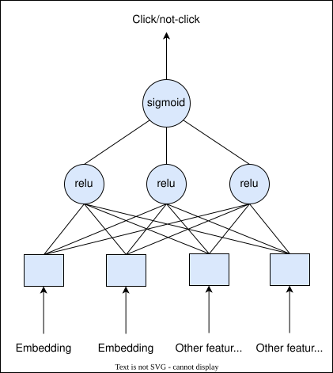

# Feed_Ranking_Model_Techniques_and_Training_Data_Strategies

Source: https://www.educative.io/courses/machine-learning-system-design/feed-ranking-model

---

[Home](https://www.educative.io/)

[Courses](https://www.educative.io/search?tab=courses)

[Machine Learning System Design](https://www.educative.io/courses/machine-learning-system-design)

# Feed Ranking Model

Explore how to engineer user and activity features, collect balanced training data, and select appropriate machine learning models for personalized feed ranking. Understand evaluation methods and practical considerations to optimize model performance and user engagement in feed ranking systems.

We'll cover the following...

- [3. Model](https://www.educative.io/courses/machine-learning-system-design/feed-ranking-model#3-Model)
  - [Feature engineering](https://www.educative.io/courses/machine-learning-system-design/feed-ranking-model#Feature-engineering)
  - [Training data](https://www.educative.io/courses/machine-learning-system-design/feed-ranking-model#Training-data)
  - [Model](https://www.educative.io/courses/machine-learning-system-design/feed-ranking-model#Model)
    - [Selection](https://www.educative.io/courses/machine-learning-system-design/feed-ranking-model#Selection)
    - [Evaluation](https://www.educative.io/courses/machine-learning-system-design/feed-ranking-model#Evaluation)

## 3. Model[#](https://www.educative.io/courses/machine-learning-system-design/feed-ranking-model#3-Model)

### Feature engineering[#](https://www.educative.io/courses/machine-learning-system-design/feed-ranking-model#Feature-engineering)

| **Features** | **Feature engineering** | **Description** |
| --- | --- | --- |
| User profile: job title, industry, demographic, etc. | For low cardinality: Use one hot encoding. Higher cardinality: use Embedding. |  |
| Connection strength between users |  | Represented by the similarity between users. We can also use Embedding for users and measure the distance vector. |
| Age of activity | Considered as a continuous feature or a binning value depending on the sensitivity of the Click target. |  |
| Activity features | Type of activity, hashtag, media, etc. Use Activity Embedding and measure the similarity between activity and user. |  |
| Cross features | Combine multiple features. | See the example in the Machine Learning System Design Primer. Read about [cross features](https://www.educative.io/courses/machine-learning-system-design/feature-selection-and-feature-engineering#3-conjunction) |

### Training data[#](https://www.educative.io/courses/machine-learning-system-design/feed-ranking-model#Training-data)

Before building any ML models we need to collect training data. The goal is to collect data across different types of posts, while simultaneously improving user experience. Below are some of the ways we can collect training data:

- Rank by chronicle order: This approach ranks each post in chronological order. Use this approach to collect click/not-click data. The trade-off here is serving bias because of the user’s attention on the first few posts. Also, there is a data sparsity problem because different activities, such as job changes, rarely happen compared to other activities on LinkedIn.
- Random serving: This approach ranks post by random order. This may lead to a bad user experience. It also does not help with sparsity, as there is a lack of training data about rare activities.
- Use a Feed Ranking algorithm: This would rank the top feeds. Within the top feeds, you would permute randomly. Then, use the clicks for data collection. This approach provides some randomness and is helpful for models to learn and explore more activities.

Based on this analysis, we will use an algorithm to generate training data so that we can later train a machine learning model.

We can start to use data for training by selecting a period of data: last month, last 6 months, etc. In practice, we want to find a balance between training time and model accuracy. We also downsample the negative data to handle the imbalanced data.

### Model[#](https://www.educative.io/courses/machine-learning-system-design/feed-ranking-model#Model)

#### Selection[#](https://www.educative.io/courses/machine-learning-system-design/feed-ranking-model#Selection)

- We can use a probabilistic sparse linear classifier (logistic regression). This is a popular method because of the computation efficiency that allows it to work well with sparse features.
- With the large volume of data, we need to use distributed training: Logistic Regression in Spark or Alternating Direction Method of Multipliers.
- We can also use deep learning in distributed settings. We can start with the fully connected layers with the Sigmoid activation function applied to the final layer. Because the CTR is usually very small (less than 1%), we would need to resample the training data set to make the data less imbalanced. It’s important to leave the validation set and test set intact to have accurate estimations about model performance.

Multilayer perceptron

#### Evaluation[#](https://www.educative.io/courses/machine-learning-system-design/feed-ranking-model#Evaluation)

- One approach is to split the data into training data and validation data. Another approach is to replay the evaluation to avoid biased offline evaluation. We use data until time ttt for training the model. We use test data from time t+1t+1t+1 and reorder their ranking based on our model during inference. If there is an accurate click prediction at the correct position, then we record a match. The total match will be considered as total clicks.
- During evaluation we will also evaluate how big our training data set should be, and how frequently we should retrain the model, among many other hyperparameters.

Problem Statement and Metrics

Feed Ranking System Design

Ask

[3. Model](https://www.educative.io/courses/machine-learning-system-design/feed-ranking-model#3-Model)

[Feature engineering](https://www.educative.io/courses/machine-learning-system-design/feed-ranking-model#Feature-engineering)

[Training data](https://www.educative.io/courses/machine-learning-system-design/feed-ranking-model#Training-data)

[Model](https://www.educative.io/courses/machine-learning-system-design/feed-ranking-model#Model)

[Selection](https://www.educative.io/courses/machine-learning-system-design/feed-ranking-model#Selection)

[Evaluation](https://www.educative.io/courses/machine-learning-system-design/feed-ranking-model#Evaluation)