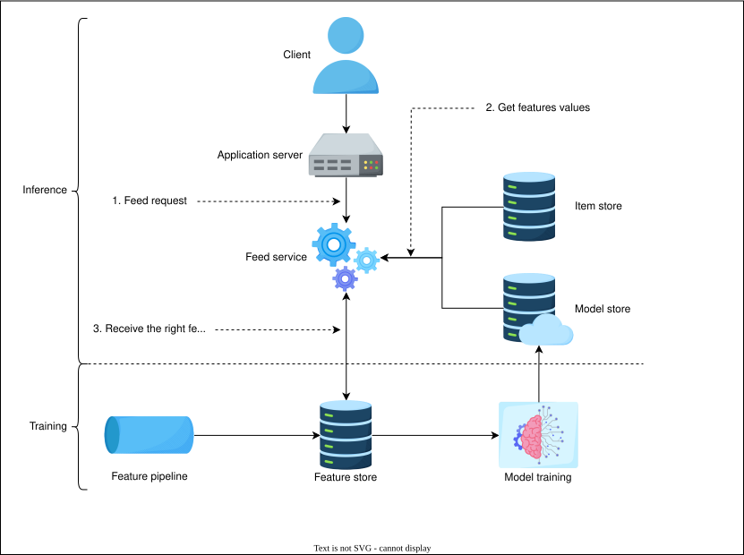
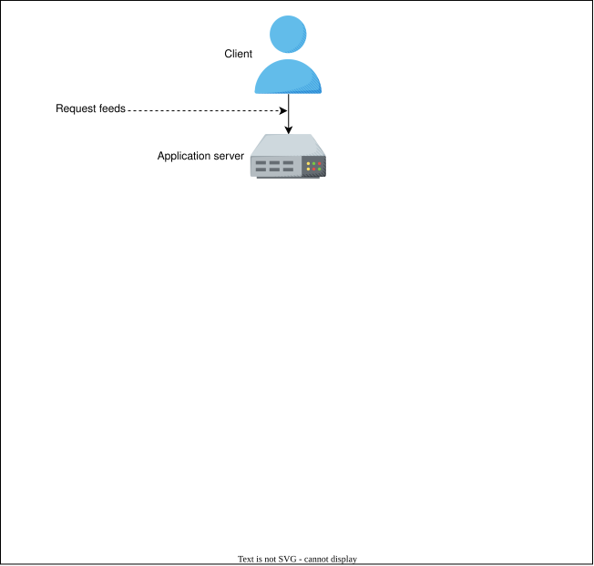
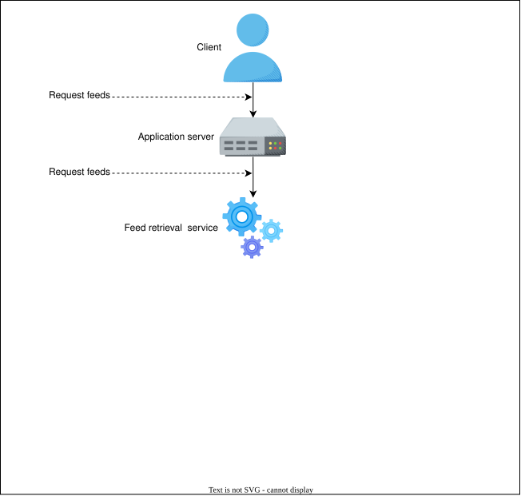
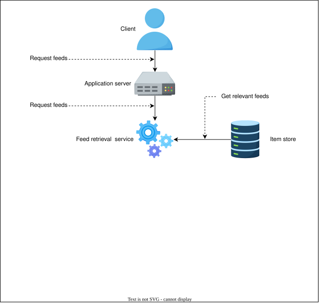
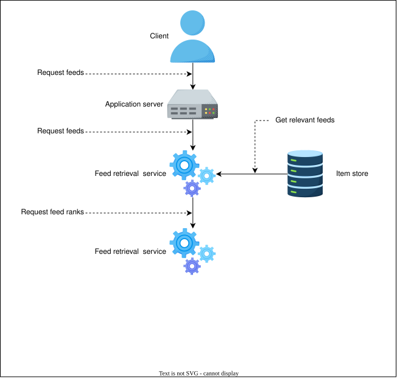
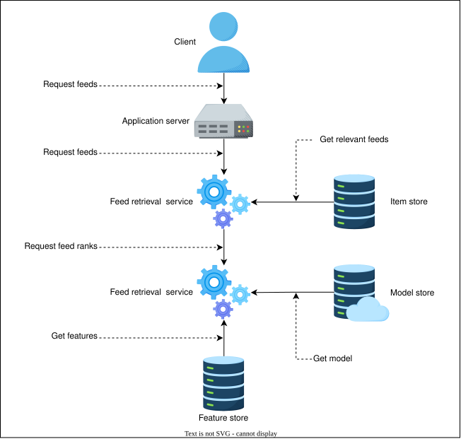

# Feed_Ranking_System_Design_for_Scalable_Machine_Learning

Source: https://www.educative.io/courses/machine-learning-system-design/feed-ranking-system-design

---

[Home](https://www.educative.io/)

[Courses](https://www.educative.io/search?tab=courses)

[Machine Learning System Design](https://www.educative.io/courses/machine-learning-system-design)

# Feed Ranking System Design

Explore how to design feed ranking systems that handle billions of samples and terabytes of data. Understand feature stores, model inference flows, and scaling strategies to build efficient personalized recommendation systems. This lesson guides you through practical considerations for system design in real-world ML applications.

We'll cover the following...

- [4. Calculation & estimation](https://www.educative.io/courses/machine-learning-system-design/feed-ranking-system-design#4-Calculation--estimation)
  - [Assumptions](https://www.educative.io/courses/machine-learning-system-design/feed-ranking-system-design#Assumptions)
  - [Data size](https://www.educative.io/courses/machine-learning-system-design/feed-ranking-system-design#Data-size)
  - [Scale](https://www.educative.io/courses/machine-learning-system-design/feed-ranking-system-design#Scale)
- [5. High-level design](https://www.educative.io/courses/machine-learning-system-design/feed-ranking-system-design#5-High-level-design)
- [6. Scale the design](https://www.educative.io/courses/machine-learning-system-design/feed-ranking-system-design#6-Scale-the-design)
- [7. Summary](https://www.educative.io/courses/machine-learning-system-design/feed-ranking-system-design#7-Summary)

## 4. Calculation & estimation[#](https://www.educative.io/courses/machine-learning-system-design/feed-ranking-system-design#4-Calculation--estimation)

### Assumptions[#](https://www.educative.io/courses/machine-learning-system-design/feed-ranking-system-design#Assumptions)

- 300 million monthly active users
- On average, a user sees 40 activities per visit. Each user visits 10 times per month.
- We have 12 \* 101010^{10}1010 or 120 billion observations/samples.

### Data size[#](https://www.educative.io/courses/machine-learning-system-design/feed-ranking-system-design#Data-size)

- Assume the click through rate is about 1% for 1 month. We collected 1 billion positive labels and about 110 billion negative labels. This is a huge dataset.
- Generally, we can assume that for every data point, we collect hundreds of features. For simplicity, each row takes 500 bytes to store.
- In one month, we need 120 billion rows. Total size: 500 \* 120 \* 10910^{9}109 = 60 \* 101210^{12}1012 bytes = 60 Terabytes. To save costs we can keep the last 6 months or 1 year of data in the data lake and archive old data in cold storage.

### Scale[#](https://www.educative.io/courses/machine-learning-system-design/feed-ranking-system-design#Scale)

- Supports 300 million users

## 5. High-level design[#](https://www.educative.io/courses/machine-learning-system-design/feed-ranking-system-design#5-High-level-design)

Feed Ranking High level design

- **Feature store** is feature values storage. During inference, we need low latency (<10ms) to access features before scoring. Examples of feature stores include MySQL Cluster, Redis, and DynamoDB.
- **Item store** stores all activities generated by users. It also stores models for the corresponding users. One goal is to maintain the consistent user experience, i.e., to use the same feed ranking method for any particular user. Item store provides the correct model for the corresponding users.

Let’s examine the flow of the system:

1 / 6

Client sends feed request to Application Server

1 / 6

Application Server sends feed request to Feed Retrieval Service

1 / 6

Feed Retrieval Service selects most relevant feeds from Item Store

1 / 6

Feed Retrieval Service sends feed ranks request to Feed Ranking Service

1 / 6

Feed Ranking Service gets the latest ML model, gets the right features from Feature Store

- A user visits the LinkedIn homepage and requests an Application Server for feeds. The Application Server sends feed requests to the Feed Service.
- Feed Service gets the latest model from Model Repos, gets the correct features from the Feature Store, and all the feeds from the ItemStore. Feed Service will provide features for the Model to get predictions.
- The Model returns recommended feeds sorted by click through rate likelihood.

## 6. Scale the design[#](https://www.educative.io/courses/machine-learning-system-design/feed-ranking-system-design#6-Scale-the-design)

- Scale out the Feed Service module as it represents both Retrieval Service and Ranking Service. This provides better visualization.
- Scale out the Application Server and put the Load Balancer in front of the Application Server to balance load.

Feed Ranking Service at scale

## 7. Summary[#](https://www.educative.io/courses/machine-learning-system-design/feed-ranking-system-design#7-Summary)

- We learned how to build Machine Learning models to rank feeds. The binary classification model with custom loss function helps the model be less sensitive to background click through rate.
- We learned how to create the process to generate training data for the Machine Learning Model.
- We learned how to scale training and inference by scaling out the Application Server and Feed Services.
- You can also learn more about how companies scale there design [here](https://rebrand.ly/mleio).

Feed Ranking Model

Problem Statement and Metrics

Ask

[4. Calculation & estimation](https://www.educative.io/courses/machine-learning-system-design/feed-ranking-system-design#4-Calculation--estimation)

[Assumptions](https://www.educative.io/courses/machine-learning-system-design/feed-ranking-system-design#Assumptions)

[Data size](https://www.educative.io/courses/machine-learning-system-design/feed-ranking-system-design#Data-size)

[Scale](https://www.educative.io/courses/machine-learning-system-design/feed-ranking-system-design#Scale)

[5. High-level design](https://www.educative.io/courses/machine-learning-system-design/feed-ranking-system-design#5-High-level-design)

[6. Scale the design](https://www.educative.io/courses/machine-learning-system-design/feed-ranking-system-design#6-Scale-the-design)

[7. Summary](https://www.educative.io/courses/machine-learning-system-design/feed-ranking-system-design#7-Summary)