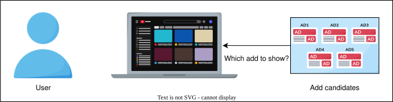

# Ad_Click_Prediction_Problem_Statement_and_Metrics_Explained

Source: https://www.educative.io/courses/machine-learning-system-design/problem-statement-and-metrics-N8K35PGw4nm

---

[Home](https://www.educative.io/)

[Courses](https://www.educative.io/search?tab=courses)

[Machine Learning System Design](https://www.educative.io/courses/machine-learning-system-design)

# Problem Statement and Metrics

Explore the problem statement and key metrics for ad click prediction models. Understand how to handle imbalanced data, design offline and online metrics, and meet inference latency and retraining requirements to optimize ad performance and revenue.

We'll cover the following...

- [What is Ad Click Prediction?](https://www.educative.io/courses/machine-learning-system-design/problem-statement-and-metrics-N8K35PGw4nm#What-is-Ad-Click-Prediction)
  - [1. Problem statement](https://www.educative.io/courses/machine-learning-system-design/problem-statement-and-metrics-N8K35PGw4nm#1-Problem-statement)
    - [Modeling assumption](https://www.educative.io/courses/machine-learning-system-design/problem-statement-and-metrics-N8K35PGw4nm#Modeling-assumption)
    - [Background: How ads are served](https://www.educative.io/courses/machine-learning-system-design/problem-statement-and-metrics-N8K35PGw4nm#Background-How-ads-are-served)
      - [The waterfall revenue model](https://www.educative.io/courses/machine-learning-system-design/problem-statement-and-metrics-N8K35PGw4nm#The-waterfall-revenue-model)
  - [2. Metrics design and requirements](https://www.educative.io/courses/machine-learning-system-design/problem-statement-and-metrics-N8K35PGw4nm#2-Metrics-design-and-requirements)
    - [Metrics](https://www.educative.io/courses/machine-learning-system-design/problem-statement-and-metrics-N8K35PGw4nm#Metrics)
      - [Offline metrics](https://www.educative.io/courses/machine-learning-system-design/problem-statement-and-metrics-N8K35PGw4nm#Offline-metrics)
      - [Online metrics](https://www.educative.io/courses/machine-learning-system-design/problem-statement-and-metrics-N8K35PGw4nm#Online-metrics)
    - [Requirements](https://www.educative.io/courses/machine-learning-system-design/problem-statement-and-metrics-N8K35PGw4nm#Requirements)
      - [Training](https://www.educative.io/courses/machine-learning-system-design/problem-statement-and-metrics-N8K35PGw4nm#Training)
      - [Inference](https://www.educative.io/courses/machine-learning-system-design/problem-statement-and-metrics-N8K35PGw4nm#Inference)
  - [Summary](https://www.educative.io/courses/machine-learning-system-design/problem-statement-and-metrics-N8K35PGw4nm#Summary)

## What is Ad Click Prediction?[#](https://www.educative.io/courses/machine-learning-system-design/problem-statement-and-metrics-N8K35PGw4nm#What-is-Ad-Click-Prediction)

Ad Click Prediction is the task of predicting whether a user will click on a displayed advertisement. It is one of the most critical problems in online advertising, directly impacting:

- Revenue generation
- User experience
- Advertiser return on investment (ROI)

At scale, even small improvements in prediction accuracy can translate into millions of dollars in additional revenue.

### 1. Problem statement[#](https://www.educative.io/courses/machine-learning-system-design/problem-statement-and-metrics-N8K35PGw4nm#1-Problem-statement)

Predicting whether a user will click on an ad is a critical problem in digital advertising. It impacts everything—from revenue to user experience. Build a machine learning model that predicts whether an ad will be clicked.

We’re focusing on a binary classification problem:

**Input:** Features describing:

- User (demographics, interests, historical behavior)
- Ad (creative type, category, campaign budget)
- Context (time, device, location, placement)

**Output:** A probability score indicating whether the user will click the ad

- 1 → Click
- 0 → No click

#### Modeling assumption[#](https://www.educative.io/courses/machine-learning-system-design/problem-statement-and-metrics-N8K35PGw4nm#Modeling-assumption)

To keep the system design focused and interview-friendly, we treat this as a standalone prediction problem, rather than modeling a full multi-stage ad ranking pipeline (e.g., cascaded classifiers or auctions).

This abstraction is common in machine learning system design interviews and early-stage modeling discussions.

Ads recommendation system

#### Background: How ads are served[#](https://www.educative.io/courses/machine-learning-system-design/problem-statement-and-metrics-N8K35PGw4nm#Background-How-ads-are-served)

Before jumping into metrics and modeling, let’s understand how ads are typically served. Most ad delivery systems follow a waterfall model.

##### The waterfall revenue model[#](https://www.educative.io/courses/machine-learning-system-design/problem-statement-and-metrics-N8K35PGw4nm#The-waterfall-revenue-model)

1. Publishers try to sell ad impressions via direct deals with the highest CPM (Cost Per Mille).
2. If the impression isn’t sold, it’s passed down the “waterfall” to other ad networks or exchanges.
3. This continues until the impression is finally sold.

The faster and more accurately you predict which ad will be clicked, the better your system performs—not just in clicks, but in revenue and user engagement.

Waterfall Revenue Model

### 2. Metrics design and requirements[#](https://www.educative.io/courses/machine-learning-system-design/problem-statement-and-metrics-N8K35PGw4nm#2-Metrics-design-and-requirements)

Metrics differ depending on whether the system is in training or production.

#### Metrics[#](https://www.educative.io/courses/machine-learning-system-design/problem-statement-and-metrics-N8K35PGw4nm#Metrics)

During the training phase, we can focus on machine learning metrics instead of revenue metrics or CTR metrics. Below are the two metrics:

##### Offline metrics[#](https://www.educative.io/courses/machine-learning-system-design/problem-statement-and-metrics-N8K35PGw4nm#Offline-metrics)

- Normalized Cross-Entropy (NCE): NCE is the predictive `logloss` divided by the `cross-entropy` of the background CTR. This way NCE is insensitive to background CTR. This is the NCE formula:

NCE=−1N∑i=1n(1+yi2log(pi))+1−yi2log(1−pi))−(p∗log(p)+(1−p)∗log(1−p))NCE = \frac{-\frac{1}{N} \sum\_{i=1}^n (\frac{1+y\_i}{2} log(p\_i)) + \frac{1-y\_i}{2}log(1-p\_i))} {-(p\*log(p) +(1-p)\*log(1-p))}NCE=−(p∗log(p)+(1−p)∗log(1−p))−N1​∑i=1n​(21+yi​​log(pi​))+21−yi​​log(1−pi​))​

Where:

- 𝑦𝑖𝑦\_𝑖yi​: Actual label (0 or 1)
- 𝑝𝑖𝑝\_𝑖pi​: Predicted probability
- 𝑝𝑝p: Global average click rate

This metric penalizes confident but wrong predictions—perfect for probabilistic classifiers.

##### Online metrics[#](https://www.educative.io/courses/machine-learning-system-design/problem-statement-and-metrics-N8K35PGw4nm#Online-metrics)

- Revenue Lift: Percentage of revenue changes over a period of time. Upon deployment, a new model is deployed on a small percentage of traffic. The key decision is to balance between percentage traffic and the duration of the A/B testing phase.

#### Requirements[#](https://www.educative.io/courses/machine-learning-system-design/problem-statement-and-metrics-N8K35PGw4nm#Requirements)

##### Training[#](https://www.educative.io/courses/machine-learning-system-design/problem-statement-and-metrics-N8K35PGw4nm#Training)

- Imbalance data: The Click Through Rate (CTR) is very small in practice (1%-2%), which makes supervised training difficult. We need a way to train the model that can handle highly imbalanced data.
- Retraining frequency: The ability to retrain models many times within one day to capture the data distribution shift in the production environment.
- Train/validation data split: To simulate a production system, the training data and validation data is partitioned by time.

##### Inference[#](https://www.educative.io/courses/machine-learning-system-design/problem-statement-and-metrics-N8K35PGw4nm#Inference)

- Serving: Low latency (50ms - 100ms) for ad prediction.
- Latency: Ad requests go through a waterfall model, therefore, recommendation latency for ML model needs to be fast.
- Overspent: If the ad serving model repeatedly serves the same ads, it might end up over-spending the campaign budget and publishers lose money.

### Summary[#](https://www.educative.io/courses/machine-learning-system-design/problem-statement-and-metrics-N8K35PGw4nm#Summary)

| **Type** | **Desired goals** |
| --- | --- |
| Metrics | Reasonable normalized cross-entropy and click through rate |
| Training | Ability to handle imbalance data |
|  | High throughput with the ability to retrain many times per day |
| Inference | Latency from 50 to 100ms |
|  | Ability to control or avoid overspent campaign budget while serving ads |

Quiz on loss function

1.

For the loss function, why can’t we use the logloss function?

A.

It’s difficult to interpret when compared with accuracy, precision, and recall metrics.

B.

Logloss is only applicable for binary classification and can be sensitive to background CTR.

---

1 / 5

Feed Ranking System Design

Ad Click Prediction Model

Ask

[What is Ad Click Prediction?](https://www.educative.io/courses/machine-learning-system-design/problem-statement-and-metrics-N8K35PGw4nm#What-is-Ad-Click-Prediction)

[1. Problem statement](https://www.educative.io/courses/machine-learning-system-design/problem-statement-and-metrics-N8K35PGw4nm#1-Problem-statement)

[Modeling assumption](https://www.educative.io/courses/machine-learning-system-design/problem-statement-and-metrics-N8K35PGw4nm#Modeling-assumption)

[Background: How ads are served](https://www.educative.io/courses/machine-learning-system-design/problem-statement-and-metrics-N8K35PGw4nm#Background-How-ads-are-served)

[The waterfall revenue model](https://www.educative.io/courses/machine-learning-system-design/problem-statement-and-metrics-N8K35PGw4nm#The-waterfall-revenue-model)

[2. Metrics design and requirements](https://www.educative.io/courses/machine-learning-system-design/problem-statement-and-metrics-N8K35PGw4nm#2-Metrics-design-and-requirements)

[Metrics](https://www.educative.io/courses/machine-learning-system-design/problem-statement-and-metrics-N8K35PGw4nm#Metrics)

[Offline metrics](https://www.educative.io/courses/machine-learning-system-design/problem-statement-and-metrics-N8K35PGw4nm#Offline-metrics)

[Online metrics](https://www.educative.io/courses/machine-learning-system-design/problem-statement-and-metrics-N8K35PGw4nm#Online-metrics)

[Requirements](https://www.educative.io/courses/machine-learning-system-design/problem-statement-and-metrics-N8K35PGw4nm#Requirements)

[Training](https://www.educative.io/courses/machine-learning-system-design/problem-statement-and-metrics-N8K35PGw4nm#Training)

[Inference](https://www.educative.io/courses/machine-learning-system-design/problem-statement-and-metrics-N8K35PGw4nm#Inference)

[Summary](https://www.educative.io/courses/machine-learning-system-design/problem-statement-and-metrics-N8K35PGw4nm#Summary)