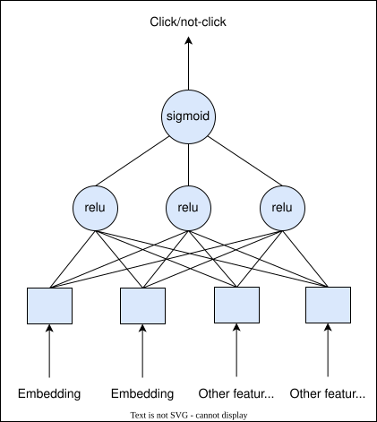

# Designing_Effective_Ad_Click_Prediction_Models_with_Feature_Engineering

Source: https://www.educative.io/courses/machine-learning-system-design/ad-click-prediction-model

---

[Home](https://www.educative.io/)

[Courses](https://www.educative.io/search?tab=courses)

[Machine Learning System Design](https://www.educative.io/courses/machine-learning-system-design)

# Ad Click Prediction Model

Explore how to design ad click prediction models with effective feature engineering, training data strategies, and model evaluation methods. Understand how to handle imbalanced data, select features like advertiser IDs and user behavior, and enhance model accuracy using deep learning techniques. By the end, you will grasp how to balance training time with performance and apply evaluation strategies to improve prediction quality.

We'll cover the following...

- [3. Model](https://www.educative.io/courses/machine-learning-system-design/ad-click-prediction-model#3-Model)
  - [Feature engineering](https://www.educative.io/courses/machine-learning-system-design/ad-click-prediction-model#Feature-engineering)
  - [Training data](https://www.educative.io/courses/machine-learning-system-design/ad-click-prediction-model#Training-data)
  - [Model](https://www.educative.io/courses/machine-learning-system-design/ad-click-prediction-model#Model)
    - [Selection](https://www.educative.io/courses/machine-learning-system-design/ad-click-prediction-model#Selection)
    - [Evaluation](https://www.educative.io/courses/machine-learning-system-design/ad-click-prediction-model#Evaluation)

## 3. Model[#](https://www.educative.io/courses/machine-learning-system-design/ad-click-prediction-model#3-Model)

### Feature engineering[#](https://www.educative.io/courses/machine-learning-system-design/ad-click-prediction-model#Feature-engineering)

| **Features** | **Feature engineering** | **Description** |
| --- | --- | --- |
| AdvertiserID | Use Embedding or feature hashing | It’s easy to have millions of advertisers |
| User’s historical behavior, i.e., numbers of clicks on ads over a period of time. | Feature scaling, i.e., normalization |  |
| Temporal: time\_of\_day, day\_of\_week etc | One hot encoding |  |
| Cross features | Combine multiple features | See example in the Machine Learning System Design Primer |

### Training data[#](https://www.educative.io/courses/machine-learning-system-design/ad-click-prediction-model#Training-data)

Before building any ML models we need to collect training data. The goal here is to collect data across different types of posts while simultaneously improving the user experience. As you recall from the previous lesson about the waterfall model, we can collect a lot of data about ad clicks. We can use this data for training the Ad Click model.

We can start to use data for training by selecting a period of data: last month, last six months, etc. In practice, we want to find a balance between training time and model accuracy. We also downsample the negative data to handle the imbalanced data.

### Model[#](https://www.educative.io/courses/machine-learning-system-design/ad-click-prediction-model#Model)

#### Selection[#](https://www.educative.io/courses/machine-learning-system-design/ad-click-prediction-model#Selection)

- We can use deep learning in distributed settings. We can start with fully connected layers with the Sigmoid activation function applied to the final layer. Because the CTR is usually very small (less than 1%), we would need to resample the training data set to make the data less imbalanced. It’s important to leave the validation and test sets intact to have accurate estimations about model performance.

DL fully connected model

#### Evaluation[#](https://www.educative.io/courses/machine-learning-system-design/ad-click-prediction-model#Evaluation)

- One approach is to split the data into training data and validation data. Another approach is to replay evaluation to avoid biased offline evaluation. Assume the training data we have up until time ttt. We use test data from time t+1t+1t+1 and reorder their ranking based on our model during inference. If there is an accurate click prediction, we record a match. The total match will be considered as total clicks.
- During evaluation we will also evaluate how big our training data set should be and how frequently we need to retrain the model among many other hyperparameters.

Problem Statement and Metrics

Ads Recommendation System Design

Ask

[3. Model](https://www.educative.io/courses/machine-learning-system-design/ad-click-prediction-model#3-Model)

[Feature engineering](https://www.educative.io/courses/machine-learning-system-design/ad-click-prediction-model#Feature-engineering)

[Training data](https://www.educative.io/courses/machine-learning-system-design/ad-click-prediction-model#Training-data)

[Model](https://www.educative.io/courses/machine-learning-system-design/ad-click-prediction-model#Model)

[Selection](https://www.educative.io/courses/machine-learning-system-design/ad-click-prediction-model#Selection)

[Evaluation](https://www.educative.io/courses/machine-learning-system-design/ad-click-prediction-model#Evaluation)