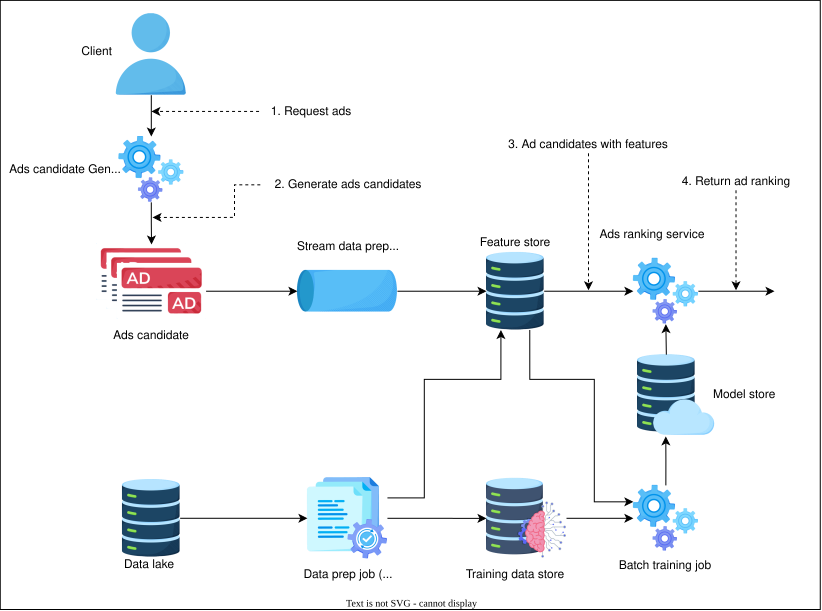
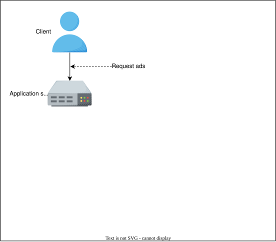
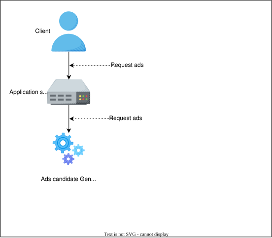
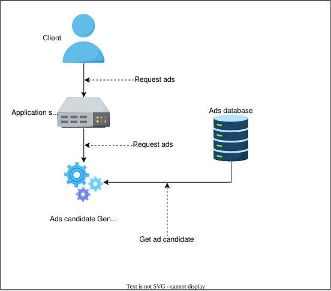
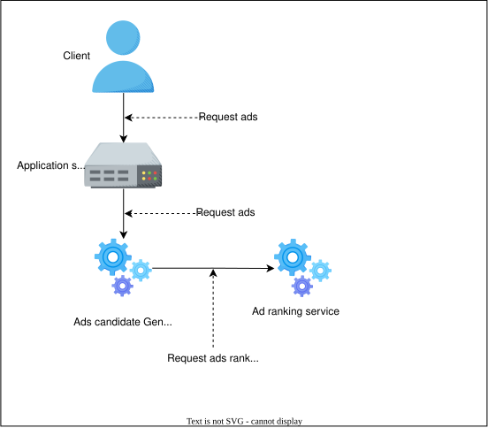
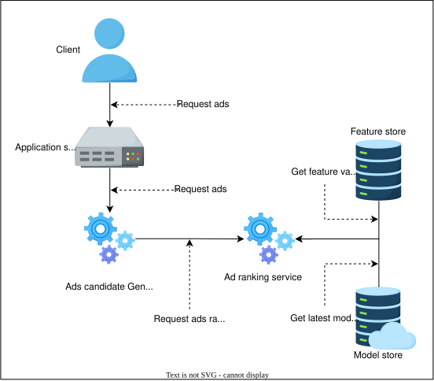

# Designing_Scalable_Ads_Recommendation_Systems_for_Click_Prediction

Source: https://www.educative.io/courses/machine-learning-system-design/ads-recommendation-system-design

---

[Home](https://www.educative.io/)

[Courses](https://www.educative.io/search?tab=courses)

[Machine Learning System Design](https://www.educative.io/courses/machine-learning-system-design)

# Ads Recommendation System Design

Explore the design and scaling of ads recommendation systems focused on ad click prediction. Understand data estimation, system components like data lakes and feature stores, and methods to maintain low latency with high traffic. Learn strategies for model retraining and load balancing to optimize ad ranking performance in production.

We'll cover the following...

- [4. Calculation and estimation](https://www.educative.io/courses/machine-learning-system-design/ads-recommendation-system-design#4-Calculation-and-estimation)
  - [Assumptions](https://www.educative.io/courses/machine-learning-system-design/ads-recommendation-system-design#Assumptions)
  - [Data size](https://www.educative.io/courses/machine-learning-system-design/ads-recommendation-system-design#Data-size)
  - [Scale](https://www.educative.io/courses/machine-learning-system-design/ads-recommendation-system-design#Scale)
- [5. High level design](https://www.educative.io/courses/machine-learning-system-design/ads-recommendation-system-design#5-High-level-design)
- [6. Scale the design](https://www.educative.io/courses/machine-learning-system-design/ads-recommendation-system-design#6-Scale-the-design)
- [7. Follow up questions](https://www.educative.io/courses/machine-learning-system-design/ads-recommendation-system-design#7-Follow-up-questions)
- [8. Summary](https://www.educative.io/courses/machine-learning-system-design/ads-recommendation-system-design#8-Summary)

## 4. Calculation and estimation[#](https://www.educative.io/courses/machine-learning-system-design/ads-recommendation-system-design#4-Calculation-and-estimation)

### Assumptions[#](https://www.educative.io/courses/machine-learning-system-design/ads-recommendation-system-design#Assumptions)

- 40K ad requests per second or 100 billion ad requests per month
- Each observation (record) has hundreds of features, and it takes 500 bytes to store.

### Data size[#](https://www.educative.io/courses/machine-learning-system-design/ads-recommendation-system-design#Data-size)

- Data: historical ad click data includes [user, ads, click\_or\_not]. With an estimated 1% CTR, it has 1 billion clicked ads. We can start with 1 month of data for training and validation. Within a month we have, 100 \* 101210^{12}1012 \* 500 = 5 \* 101610^{16}1016 bytes or 50 PB. One way to make it more manageable is to downsample the data, i.e., keep only 1%-10% or use 1 week of data for training data and use the next day for validation data.

### Scale[#](https://www.educative.io/courses/machine-learning-system-design/ads-recommendation-system-design#Scale)

- Supports 100 million users

## 5. High level design[#](https://www.educative.io/courses/machine-learning-system-design/ads-recommendation-system-design#5-High-level-design)

AdClick Prediction high level design

- Data lake: Store data that is collected from multiple sources, i.e., logs data or event-driven data (Kafka)
- Batch data prep: Collections of ETL (Extract, Transform, and Load) jobs that store data in Training data Store.
- Batch training jobs organize scheduled jobs as well as on-demand jobs to retrain new models based on training data storage.
- Model Store: Distributed storage like S3 to store models.
- Ad Candidates: Set of Ad candidates provided by upstream services (refer back to waterfall model).
- Stream data prep pipeline: Processes online features and stores features in key-value storage for low latency down-stream processing.
- Model Serving: Standalone service that loads different models and provides Ad Click probability.

Let’s examine the flow of the system:

1 / 6

Client sends an ad request to Application Server

1 / 6

Application Server sends ad request to Ads Candidate Generation service

1 / 6

Ads Candidate Generation Service generates ad candidates from database

1 / 6

Ads Candidate Generation Service sends ad ranking request to Ads Ranking service

1 / 6

Ads Ranking service gets feature values from Feature Store, gets latest model

- User visits the homepage and sends an Ad request to the Candidate Generation Service. Candidate Generation Service generates a list of Ads Candidates and sends them to the Aggregator Service.
- The Aggregator Service splits the list of candidates and sends it to the Ad Ranking workers to score.
- Ad Ranking Service gets the latest model from Model Repos, gets the correct features from the Feature Store, produces ad scores, then returns the list of ads with scores to the Aggregator Service.
- The Aggregator Service selects top K ads
  (For example, k = 10, 100, etc.) and returns to upstream services.

## 6. Scale the design[#](https://www.educative.io/courses/machine-learning-system-design/ads-recommendation-system-design#6-Scale-the-design)

High-level design of ads recommendation system

- Given a latency requirement of 50ms-100ms for a large volume of Ad Candidates (50k-100k), if we partition one serving instance per request we might not achieve Service Level Agreement (SLA). For this, we scale out Model Serving and put Aggregator Service to spread the load for Model Serving components.

> One common pattern is to have the Aggregator Service. It distributes the candidate list to multiple serving instances and collects results. Read more about it [here](https://www.educative.io/courses/machine-learning-system-design/inference#1-imbalance-workload).

## 7. Follow up questions[#](https://www.educative.io/courses/machine-learning-system-design/ads-recommendation-system-design#7-Follow-up-questions)

| **Question** | **Answer** |
| --- | --- |
| How do we adapt to user behavior changing over time? | Retrain the model as frequently as possible. One example is to retrain the model every few hours with new data (collected from user clicked data). |
|  |  |
| How do we handle the Ad Ranking Model being under-explored? | We can introduce randomization in Ranking Service. For example, 2% of requests will get random candidates, and 98% will get sorted candidates from Ad Ranking Service. |

## 8. Summary[#](https://www.educative.io/courses/machine-learning-system-design/ads-recommendation-system-design#8-Summary)

- We first learned to choose Normalize Entropy as the metric for the Ad Click Prediction Model.
- We learn how to apply the Aggregator Service to achieve low latency and overcome imbalance workloads.
- To scale the system and reduce latency, we can use `kube-flow` so that Ad Generation services can directly communicate with Ad Ranking services.
- We can also learn more about how companies scale there design [here](https://rebrand.ly/mleio).

Ad Click Prediction Model

Ad Recommender System Design

Ask

[4. Calculation and estimation](https://www.educative.io/courses/machine-learning-system-design/ads-recommendation-system-design#4-Calculation-and-estimation)

[Assumptions](https://www.educative.io/courses/machine-learning-system-design/ads-recommendation-system-design#Assumptions)

[Data size](https://www.educative.io/courses/machine-learning-system-design/ads-recommendation-system-design#Data-size)

[Scale](https://www.educative.io/courses/machine-learning-system-design/ads-recommendation-system-design#Scale)

[5. High level design](https://www.educative.io/courses/machine-learning-system-design/ads-recommendation-system-design#5-High-level-design)

[6. Scale the design](https://www.educative.io/courses/machine-learning-system-design/ads-recommendation-system-design#6-Scale-the-design)

[7. Follow up questions](https://www.educative.io/courses/machine-learning-system-design/ads-recommendation-system-design#7-Follow-up-questions)

[8. Summary](https://www.educative.io/courses/machine-learning-system-design/ads-recommendation-system-design#8-Summary)