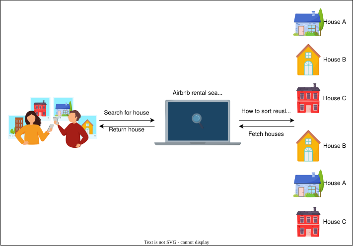

# Problem_Statement_and_Metrics_in_Rental_Search_Ranking

Source: https://www.educative.io/courses/machine-learning-system-design/problem-statement-and-metrics-7DooyyP35Ej

---

[Home](https://www.educative.io/)

[Courses](https://www.educative.io/search?tab=courses)

[Machine Learning System Design](https://www.educative.io/courses/machine-learning-system-design)

# Problem Statement and Metrics

Explore how to frame the problem of rental search ranking by predicting bookings using a classification model. Understand the importance of choosing appropriate offline metrics such as normalized discounted cumulative gain (nDCG) and online metrics like conversion rate. Learn techniques to handle imbalanced data and design training, validation, and inference strategies for a practical ranking system.

We'll cover the following...

- [Airbnb rental search ranking](https://www.educative.io/courses/machine-learning-system-design/problem-statement-and-metrics-7DooyyP35Ej#Airbnb-rental-search-ranking)
  - [1. Problem statement](https://www.educative.io/courses/machine-learning-system-design/problem-statement-and-metrics-7DooyyP35Ej#1-Problem-statement)
  - [2. Metrics design and requirements](https://www.educative.io/courses/machine-learning-system-design/problem-statement-and-metrics-7DooyyP35Ej#2-Metrics-design-and-requirements)
    - [Metrics](https://www.educative.io/courses/machine-learning-system-design/problem-statement-and-metrics-7DooyyP35Ej#Metrics)
      - [Offline metrics](https://www.educative.io/courses/machine-learning-system-design/problem-statement-and-metrics-7DooyyP35Ej#Offline-metrics)
      - [Online metrics](https://www.educative.io/courses/machine-learning-system-design/problem-statement-and-metrics-7DooyyP35Ej#Online-metrics)
    - [Requirements](https://www.educative.io/courses/machine-learning-system-design/problem-statement-and-metrics-7DooyyP35Ej#Requirements)
      - [Training on imbalanced data](https://www.educative.io/courses/machine-learning-system-design/problem-statement-and-metrics-7DooyyP35Ej#Training-on-imbalanced-data)
      - [Time-based train/validation split](https://www.educative.io/courses/machine-learning-system-design/problem-statement-and-metrics-7DooyyP35Ej#Time-based-trainvalidation-split)
    - [Inference and serving considerations](https://www.educative.io/courses/machine-learning-system-design/problem-statement-and-metrics-7DooyyP35Ej#Inference-and-serving-considerations)
  - [Summary](https://www.educative.io/courses/machine-learning-system-design/problem-statement-and-metrics-7DooyyP35Ej#Summary)

## Airbnb rental search ranking[#](https://www.educative.io/courses/machine-learning-system-design/problem-statement-and-metrics-7DooyyP35Ej#Airbnb-rental-search-ranking)

### 1. Problem statement[#](https://www.educative.io/courses/machine-learning-system-design/problem-statement-and-metrics-7DooyyP35Ej#1-Problem-statement)

Airbnb users often search for homes in a specific location. The platform must return relevant stays—but more than that, it must return homes users are likely to book. So the goal of the ranking system is simple:

> Rank the homes such that those most likely to be booked appear higher in the search results.

A naive method might use keyword matching or hand-crafted scoring—like sorting based on similarity between the query and listing descriptions. But this fails in practice. Text similarity might show results that “sound good,” but don’t necessarily lead to bookings.

Instead, we want a data-driven approach. If we could estimate the likelihood of a user booking a given listing, we could rank by that likelihood. That brings us to the core idea:

Train a supervised machine learning model that learns from historical user sessions and predicts whether a listing will be booked.
This becomes a binary classification task: booked vs. not booked.

> Why binary classification?
>
> - Our outcome is binary (booked or not).
> - It allows flexibility in evaluating ranking, user behavior, and optimizing for downstream metrics like revenue.
> - Alternative methods like regression (predicting booking probability directly) could work, but classification gives more control when balancing false positives vs. negatives—important in high-stakes ranking.

Search ranking system for Airbnb

### 2. Metrics design and requirements[#](https://www.educative.io/courses/machine-learning-system-design/problem-statement-and-metrics-7DooyyP35Ej#2-Metrics-design-and-requirements)

#### Metrics[#](https://www.educative.io/courses/machine-learning-system-design/problem-statement-and-metrics-7DooyyP35Ej#Metrics)

Designing the right metrics is just as important as choosing the algorithm. The wrong metric can optimize the wrong behavior.

We break down metrics into two buckets: offline metrics (evaluated during training) and online metrics (measured in production).

##### Offline metrics[#](https://www.educative.io/courses/machine-learning-system-design/problem-statement-and-metrics-7DooyyP35Ej#Offline-metrics)

- **Normalized discounted Cumulative Gain:** nDCG is a standard metric in ranking problems where position matters. It gives higher weight to correct predictions near the top of the list—exactly what we want in search ranking.

> Why nDCG?
>
> - Users rarely scroll through all results. A relevant result at position 2 is more valuable than at position 10.
>   \*It accounts for both relevance and position, unlike basic accuracy or AUC.
>   \*It reflects user satisfaction better than simple classification metrics like precision or recall.

DCGp=∑i=1prelilog2(i+1)DCG\_{p} = \sum\_{i=1}^p {rel\_{i} \over log\_{2}(i+1)}
DCGp​=i=1∑p​log2​(i+1)reli​​

nDCGp=DCGpIDCGpnDCG\_{p} = {DCG\_{p} \over IDCG\_{p}}
nDCGp​=IDCGp​DCGp​​

Where:

- relᵢ = relevance score of the result at position i
- IDCG = ideal DCG, if all relevant results were perfectly ordered

This allows us to optimize how well the most relevant (bookable) listings are surfaced at the top.

##### Online metrics[#](https://www.educative.io/courses/machine-learning-system-design/problem-statement-and-metrics-7DooyyP35Ej#Online-metrics)

- Conversion rate and revenue lift: This measures the number of bookings per number of search results in a user session.

  conversion\_rate=number\_of\_bookingsnumber\_of\_search\_resultsconversion\\_rate = \frac{number\\_of\\_bookings}{ number\\_of\\_search\\_results}conversion\_rate=number\_of\_search\_resultsnumber\_of\_bookings​

#### Requirements[#](https://www.educative.io/courses/machine-learning-system-design/problem-statement-and-metrics-7DooyyP35Ej#Requirements)

##### Training on imbalanced data[#](https://www.educative.io/courses/machine-learning-system-design/problem-statement-and-metrics-7DooyyP35Ej#Training-on-imbalanced-data)

The dataset is heavily imbalanced: most listings don’t get booked. The model must be robust to this skew.

- Use stratified sampling, class weighting, or focal loss to avoid biasing toward the majority class.
- Consider downsampling non-bookings or using techniques like SMOTE to handle the imbalance.

##### Time-based train/validation split[#](https://www.educative.io/courses/machine-learning-system-design/problem-statement-and-metrics-7DooyyP35Ej#Time-based-trainvalidation-split)

To mimic production behavior:

- Choose a cutoff date.
- Use sessions before that date for training.
- Use sessions after that date for validation.

#### Inference and serving considerations[#](https://www.educative.io/courses/machine-learning-system-design/problem-statement-and-metrics-7DooyyP35Ej#Inference-and-serving-considerations)

- **Latency target:** 50–100ms. Search ranking needs to be fast to avoid degrading user experience.
- **Cold-start challenge:** New listings have no data. Use hybrid models or backfill with rule-based heuristics (e.g., prioritize listings with high-quality photos or competitive pricing).

### Summary[#](https://www.educative.io/courses/machine-learning-system-design/problem-statement-and-metrics-7DooyyP35Ej#Summary)

| **Type** | **Desired goals** |
| --- | --- |
| Metrics | Achieve high normalized discounted Cumulative Gain metric |
| Training | Ability to handle imbalance data |
|  | Split training data and validation data by time |
| Inference | Latency from 50ms to 100ms |
|  | Ability to avoid under-predicting for new listings |

Ad Recommender System Design

Booking Model

Ask

[Airbnb rental search ranking](https://www.educative.io/courses/machine-learning-system-design/problem-statement-and-metrics-7DooyyP35Ej#Airbnb-rental-search-ranking)

[1. Problem statement](https://www.educative.io/courses/machine-learning-system-design/problem-statement-and-metrics-7DooyyP35Ej#1-Problem-statement)

[2. Metrics design and requirements](https://www.educative.io/courses/machine-learning-system-design/problem-statement-and-metrics-7DooyyP35Ej#2-Metrics-design-and-requirements)

[Metrics](https://www.educative.io/courses/machine-learning-system-design/problem-statement-and-metrics-7DooyyP35Ej#Metrics)

[Offline metrics](https://www.educative.io/courses/machine-learning-system-design/problem-statement-and-metrics-7DooyyP35Ej#Offline-metrics)

[Online metrics](https://www.educative.io/courses/machine-learning-system-design/problem-statement-and-metrics-7DooyyP35Ej#Online-metrics)

[Requirements](https://www.educative.io/courses/machine-learning-system-design/problem-statement-and-metrics-7DooyyP35Ej#Requirements)

[Training on imbalanced data](https://www.educative.io/courses/machine-learning-system-design/problem-statement-and-metrics-7DooyyP35Ej#Training-on-imbalanced-data)

[Time-based train/validation split](https://www.educative.io/courses/machine-learning-system-design/problem-statement-and-metrics-7DooyyP35Ej#Time-based-trainvalidation-split)

[Inference and serving considerations](https://www.educative.io/courses/machine-learning-system-design/problem-statement-and-metrics-7DooyyP35Ej#Inference-and-serving-considerations)

[Summary](https://www.educative.io/courses/machine-learning-system-design/problem-statement-and-metrics-7DooyyP35Ej#Summary)