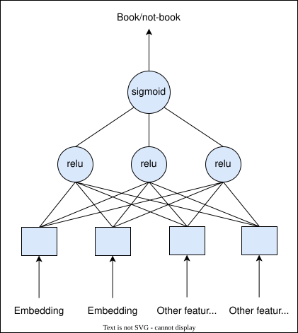

# Booking_Model_Design_and_Feature_Engineering_for_Rental_Ranking

Source: https://www.educative.io/courses/machine-learning-system-design/booking-model

---

[Home](https://www.educative.io/)

[Courses](https://www.educative.io/search?tab=courses)

[Machine Learning System Design](https://www.educative.io/courses/machine-learning-system-design)

# Booking Model

Explore how to design a booking prediction model for rental search ranking, focusing on feature engineering techniques such as geolocation transformations, embeddings, and normalization. Learn to select training data effectively and implement deep learning architectures to predict booking likelihood accurately.

We'll cover the following...

- [3. Model](https://www.educative.io/courses/machine-learning-system-design/booking-model#3-Model)
  - [Feature engineering](https://www.educative.io/courses/machine-learning-system-design/booking-model#Feature-engineering)
  - [Training data](https://www.educative.io/courses/machine-learning-system-design/booking-model#Training-data)
  - [Model architecture](https://www.educative.io/courses/machine-learning-system-design/booking-model#Model-architecture)

## 3. Model[#](https://www.educative.io/courses/machine-learning-system-design/booking-model#3-Model)

### Feature engineering[#](https://www.educative.io/courses/machine-learning-system-design/booking-model#Feature-engineering)

- Geolocation of listing (latitude/longitude): Taking raw latitude and raw longitude features is very tough to model as feature distribution is not smooth. One way around this is to take a log of distance from the center of the map for latitude and longitude separately.
- Favourite place: store user’s favorite neighborhood place in 2 dimensions grid. For example, users add Pier 39 as their favorite place, we encode this place into a specific cell, then use embedding before training/serving.

| **Features** | **Feature engineering** | **Description** |
| --- | --- | --- |
| Listing ID | Listing ID embedding | See Embedding in Machine Learning Primer: Feature Selection and Feature engineering. |
| Listing feature | Number of bedrooms, list of amenities, listing city |  |
| Location | Measure lat/long from the center of the user map, then normalize |  |
| Historical search query | Text embedding |  |
| User associated features: age, gender | Normalization or Standardization |  |
| Number of previous bookings | Normalization or Standardization |  |
| Previous length of stays | Normalization or Standardization |  |
| Time related features | Month, weekofyear, holiday, dayofweek, hourofday |  |

### Training data[#](https://www.educative.io/courses/machine-learning-system-design/booking-model#Training-data)

- User search history, view history, and bookings. We can start by selecting a period of data: last month, last 6 months, etc., to find the balance between training time and model accuracy.

> In practice, we decide the length of training data by running multiple experiments. Each experiment will pick a certain time period to train data. We then compare model accuracy and training time across different experimentations.

### Model architecture[#](https://www.educative.io/courses/machine-learning-system-design/booking-model#Model-architecture)

DL fully connected model

- Input: User data, search query, and Listing data.
- Output: This is a binary classification model, i.e., user books a rental or not.
- We can start with the deep learning with fully connected layers as a baseline. Model outputs a number within [0, 1] and presents the likelihood of booking.
- To further improve the model, we can also use other more modern network architecture, i.e., Variational AutoEncoder or Denoising AutoEncoder. Read more about [Variational Autoencoder](https://en.wikipedia.org/wiki/Autoencoder#Variational_autoencoder_(VAE)).

Problem Statement and Metrics

Rental Search Ranking System Design

Ask

[3. Model](https://www.educative.io/courses/machine-learning-system-design/booking-model#3-Model)

[Feature engineering](https://www.educative.io/courses/machine-learning-system-design/booking-model#Feature-engineering)

[Training data](https://www.educative.io/courses/machine-learning-system-design/booking-model#Training-data)

[Model architecture](https://www.educative.io/courses/machine-learning-system-design/booking-model#Model-architecture)